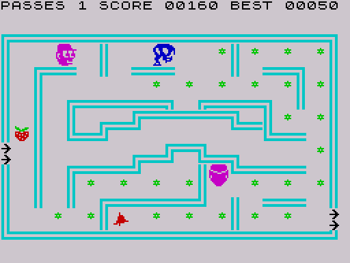
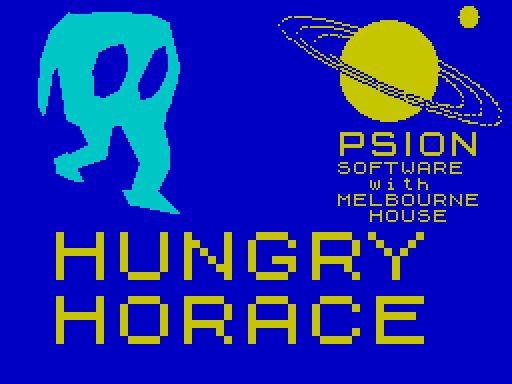

# 1. Overview: the game, the hardware, the memory map, the loader

Hungry Horace is a maze game for the ZX Spectrum, published in 1982 by Psion
with Melbourne House (the program itself says "Copyright © 1982 Beam
Software"). This file describes what the player sees, which parts of the
Spectrum the program uses, where everything lives in memory and how the tape
gets the program into memory and running.

## The game



Horace (blue) walks through a maze of cyan walls and eats green flowers for 10
points each. Guards (magenta heads) chase him; touching one costs a "pass"
(a life). A red bell lies somewhere in each maze; when Horace takes it the
guards turn into scared faces for a while and can be eaten for 100 points.
Guards occasionally leave a fruit behind (one graphic looks like a cherry, the other like a strawberry; 50 points).
The black arrows on the left edge mark where Horace enters, the arrows on the
right edge are the exit: walking through them starts the next of four mazes.
Some mazes have invisible pads at the top and bottom that carry Horace (and
the guards) to the opposite edge. After every fourth maze the game gets
faster. The top row is the status line: `PASSES`, `SCORE`, `BEST`.

Controls: Q or 4 up, Z or 3 down, I or 1 left, P or 2 right, T toggles the
sound ([ReadKeys](../src/movement.asm#L135), [CheckSoundKey](../src/events.asm#L658)). There is no joystick support.

Nothing in the program counts the flowers: eating all of them does not end a
maze; the only way forward is the exit (read from the code: no routine reads
or counts flower cells apart from scoring them in [EatObject](../src/sprites.asm#L133)).

## Hardware used

| Part | How the game uses it | Where |
| --- | --- | --- |
| Z80 CPU | Runs with interrupts disabled (`DI` at [Start](../src/main.asm#L52)); all timing is done with busy-wait loops | [Delay](../src/library.asm#L10), [PaceAndChime](../src/events.asm#L693) |
| Screen bitmap $4000-$57FF | Written directly: maze tiles, sprites, ROM-font text, block letters | [DrawMaze](../src/library.asm#L155), [DrawSprite](../src/library.asm#L247), [PrintChar](../src/library.asm#L105), [DrawBlocks](../src/library.asm#L706) |
| Attributes $5800-$5AFF | Colours, and also the collision map: every object is recognised by its attribute byte | [GetBlockObject](../src/library.asm#L359), [ProbeMove](../src/library.asm#L556) |
| ULA port $FE, input | Keyboard half-rows; the title and demo read all eight rows at once (port $00FE) | [ReadControls](../src/movement.asm#L52), [TitleLoop](../src/main.asm#L130), [CheckSoundKey](../src/events.asm#L658) |
| ULA port $FE, output | Beeper (bit 4) and border (always white, 7) | [PlayRisingTone](../src/guards.asm#L94), [ShowScore](../src/sprites.asm#L169), [HoraceDies](../src/events.asm#L175) and others |
| ROM $0000-$1FFF | Read as a table of random bytes | [GetRandom](../src/library.asm#L28), [ChooseGuardMove](../src/movement.asm#L389) |
| ROM font $3D00 | Characters of the status line and the title texts | [PrintChar](../src/library.asm#L105) |
| ROM BEEPER $03B5 | The bell chime | [PaceAndChime](../src/events.asm#L693) |
| System variable FRAMES $5C78 | Seeds the random pointer; afterwards used by the guard AI as its own random pointer | [Start](../src/main.asm#L52), [ChooseGuardMove](../src/movement.asm#L389) |

No interrupt mode 2, no 128K hardware, no AY sound chip, no Kempston or
Sinclair joystick port. Everything the program touches lies below $8000.

## Memory map

The game is a single code block of 8267 ($204B) bytes loaded at $5FB5 and
ending at $7FFF. The source is split into 13 modules, one per address range
([`re/modules.txt`](../re/modules.txt)); [`src/game.asm`](../src/game.asm)
includes them in address order.

| Range | Module | Contents |
| --- | --- | --- |
| $4000-$57FF | (screen) | bitmap |
| $5800-$5AFF | (screen) | attributes |
| $5C00-$5CB5 | (ROM) | system variables; only FRAMES is used after the start |
| below $5FB5 | (BASIC) | BASIC program and the machine stack; `CLEAR 24500` puts RAMTOP at $5FB4, the stack pointer is $5F9D in the main loop (measured, see [GameOver](../src/events.asm#L299)) |
| $5FB5-$5FFF | [main.asm](../src/main.asm) | 75 unused zero bytes ([L5FB5](../src/main.asm#L6)) |
| $6000-$624E | [main.asm](../src/main.asm) | entry point, title screen, demo start, maze set-up, main loop ([Start](../src/main.asm#L52)) |
| $624F-$651D | [movement.asm](../src/movement.asm) | controls, demo autopilot, move planning, guard AI |
| $651E-$66A3 | [sprites.asm](../src/sprites.asm) | erasing and drawing guards, eating and score display |
| $66A4-$6A21 | [events.asm](../src/events.asm) | guard contact, death, game over, Horace, bell, fruit, timers, sound key, pacing |
| $6A22-$6AA6 | [guards.asm](../src/guards.asm) | guard timers and records, rising tone, maze descriptor copy |
| $6AA7-$6B0B | [texts.asm](../src/texts.asm) | title and demo texts, three title-loop variables |
| $6B0C-$6DA5 | [library.asm](../src/library.asm) | delay, random numbers, printing, cell and sprite drawing, collision probes |
| $6DA6-$6E8E | [state.asm](../src/state.asm) | guard release timers, AI scratch, working guard record, four guard records |
| $6E8F-$6FCE | [title_gfx.asm](../src/title_gfx.asm) | block bitmaps of the words HUNGRY and HORACE |
| $6FCF-$7BF6 | [mazes.asm](../src/mazes.asm) | current maze descriptor, four descriptors, four maps of 768 bytes |
| $7BF7-$7C46 | [tiles.asm](../src/tiles.asm) | ten 8x8 maze tiles |
| $7C47-$7CC6 | [variables.asm](../src/variables.asm) | status line text, game variables, two fruit graphics |
| $7CC7-$7FA6 | [sprite_gfx.asm](../src/sprite_gfx.asm) | Horace, guard, scared guard and bell sprites, blank sprite |
| $7FA7-$7FFF | [sprite_gfx.asm](../src/sprite_gfx.asm) | 89 unused zero bytes ([L7FA7](../src/sprite_gfx.asm#L172)) |

Code and data are interleaved: variables sit next to the code that owns them
($6B08-$6B0B in the text module, $6DA6-$6DE2 between the library and the
graphics). The detailed field layouts are in [Data structures](02-data.md).

Since nothing is used above $7FFF and the stack sits below the code, the
program fits in the memory of a 16K Spectrum (inferred from the memory map;
not tested on a 16K machine).

## How it loads

The tape ([`tape/tape.txt`](../tape/tape.txt)) has four files, each a header
and a data block:

| # | Header | Type | Length | Load address | Contents | Source |
| --- | --- | --- | --- | --- | --- | --- |
| 1 | `horace` | BASIC, autostart line 2 | 38 | | first loader | [`src/loader03.bas`](../src/loader03.bas) |
| 2 | `HORACE` | BASIC, autostart line 2 | 275 | | second loader | [`src/loader05.bas`](../src/loader05.bas) |
| 3 | `T` | CODE | 6912 | 16384 ($4000) | loading screen | [`data/screen07.scr`](../data/screen07.scr) |
| 4 | `C` | CODE | 8267 | 24501 ($5FB5) | the game | [`src/game.asm`](../src/game.asm) |

The first program is two lines long. It is saved with `SAVE "horace" LINE 2`,
so after `LOAD ""` it starts at line 2, which is `LOAD "HORACE"`: its only job
is to load the second BASIC program.

The second program starts with `0 REM © Beam Software 1982`, and its line 2
does the rest:

```basic
2 POKE PEEK 23635+256*PEEK 23636,255: BORDER 1: PAPER 1: INK 1: CLEAR 24500:
  POKE 23659,0: PRINT AT 22,0;: LOAD "" CODE :
  POKE 23659,0: PRINT AT 22,0;: LOAD "" CODE : BORDER 7: PRINT USR 24576
```

- `POKE PEEK 23635+256*PEEK 23636,255` writes 255 into the first byte of the
  BASIC program (23635 is the system variable PROG), which is the high byte of
  the first line number. The REM line then has a line number of 65280 or more,
  which the ROM does not list or edit normally: a protection against `LIST`
  (inferred; standard idiom of the time).
- `BORDER 1: PAPER 1: INK 1` makes everything blue on blue, so the ROM's
  "Bytes:" messages are invisible on the blue loading screen (inferred).
- `CLEAR 24500` sets RAMTOP to $5FB4, just below the code block, and moves the
  machine stack there.
- `POKE 23659,0` sets DF SZ (the number of lines of the lower screen) to 0
  before each `LOAD "" CODE`, so that the ROM can print into rows 22-23 without
  scrolling the loading screen (inferred; another common idiom).
- The first `LOAD "" CODE` loads the loading screen ([image](img/loading.png))
  straight into the display file, the second loads the game to $5FB5.
- `BORDER 7: PRINT USR 24576` sets a white border and calls $6000, the entry
  point [Start](../src/main.asm#L52). The game never returns to BASIC.

[Start](../src/main.asm#L52) disables interrupts, seeds the random pointer from FRAMES, switches
the sound on and falls into the title screen ([Title and demo](03-title-and-menu.md)).


