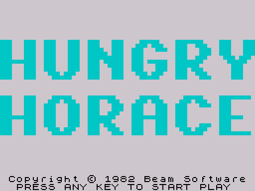
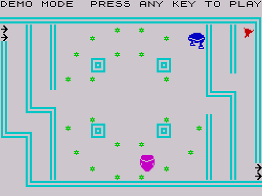

# 3. Title screen, demo mode, start of a game

The title screen shows the two words in big block letters, cycles their
colour and plays a rising tone on every pass. Any key starts a game; after
140 passes (about 12 seconds) the same code starts a demo instead, in which
an autopilot steers Horace. The only difference between demo and game is one
flag, [GameActive](../src/texts.asm#L72), which selects the input source and switches the text
output off.

## Drawing the title

[ShowTitle](../src/main.asm#L74) is the entry for the title screen at start-up and after every
game or demo. It:

1. fills the attributes with $3F (white on white), clears the bitmap, then
   sets all attributes to $38 (black ink on white paper);
2. sets [GameActive](../src/texts.asm#L72) to 0 and [TitleCountdown](../src/texts.asm#L39) to 140 (`TITLE_PASSES`);
3. draws HUNGRY at character rows 5-9 ($40A0) and HORACE at rows 12-16
   ($4880) with [DrawBlocks](../src/library.asm#L706) ([DrawTitle](../src/main.asm#L97)); the block format is in
   [Data structures](02-data.md#title-block-bitmaps);
4. prints the copyright line and the prompt at row 22 ([PrintTitleText](../src/main.asm#L109)).

[PrintChar](../src/library.asm#L105) only draws while bit 0 of [GameActive](../src/texts.asm#L72) is set, so the title
code saves the flag, sets it to 1 for the printing and restores it (0)
afterwards. The same trick is used for the demo banner below.

## The title loop

[TitleLoop](../src/main.asm#L130) does one pass per rising tone:

- it takes the attribute of the first cell of rows 5-9, increments the ink
  (`INC A; AND $3F; OR $38`, so ink 0-7 on white paper) and copies it over
  all 160 cells with `LDIR`; the same for rows 12-16. The block letters change
  colour together, the background is the same white paper;
- it calls [PlayRisingTone](../src/guards.asm#L94), a 16-step square-wave sweep of about 0.08 s,
  which is also the delay of the loop;
- it decrements [TitleCountdown](../src/texts.asm#L39); at 0 it jumps to [StartGame](../src/main.asm#L169) with
  [GameActive](../src/texts.asm#L72) still 0, which starts the demo;
- it reads the keyboard with port high byte $00, which selects all eight
  half-rows at once. If any of the five key bits is 0, it sets [GameActive](../src/texts.asm#L72)
  to 1 and starts a real game.

Measured in the simulator: with no key pressed the demo starts 606 frames
(about 12 s) after the program starts, so a title pass takes about 4.3 frames.

## Starting a game or the demo

[StartGame](../src/main.asm#L169) sets the state of a new game:

| Variable | Value | Note |
| --- | --- | --- |
| [MazeNumber](../src/variables.asm#L46) | $FF | the next maze is number 0 |
| [GuardInterval](../src/variables.asm#L34) | 8 | slowest pace |
| [Passes](../src/variables.asm#L204) | 3 | the first score display adds a free pass, so the screen shows 4 |
| [Score](../src/variables.asm#L174) | 0 | |
| [GuardsReleased](../src/texts.asm#L55), [ExtraPassMark](../src/variables.asm#L194) | 0 | |
| [GuardTimers](../src/state.asm#L20) | 0, 2048, 4096, 8192 | via [ResetGuardTimers](../src/guards.asm#L15) |

It then falls into [NextMaze](../src/main.asm#L186), the per-maze set-up described in
[The main loop](04-game-loop.md#outer-control-flow). [BestScore](../src/variables.asm#L183) is not
touched: it survives from game to game until the machine is reset.

## Demo mode

The demo runs the normal game code. [GameActive](../src/texts.asm#L72) = 0 changes four things:

| Where | Game (1) | Demo (0) |
| --- | --- | --- |
| [ShowTopRow](../src/main.asm#L239) | prints [StatusText](../src/variables.asm#L10) | prints [DemoText](../src/texts.asm#L26) with printing briefly enabled, then sets FLASH on its first nine attribute cells ("DEMO MODE") |
| [PrintChar](../src/library.asm#L105) (and through it [PrintNumber](../src/library.asm#L54)) | draws | returns at once: no score, passes or best score are shown |
| [ReadControls](../src/movement.asm#L52) | reads the keys | runs the [Autopilot](../src/movement.asm#L69); any key leaves the demo |
| [HoraceDies](../src/events.asm#L175) | restarts the same maze | goes on to the next maze (and the pace advances after every fourth) |
| [GameOver](../src/events.asm#L299) | may update [BestScore](../src/variables.asm#L183) | does not |

The sounds are not muted in the demo.

### The autopilot

[Autopilot](../src/movement.asm#L69) chooses Horace's direction on every pass of the main loop. For
each direction 3, 2, 1, 0 it probes the 2x2 block one cell ahead with
[ProbeMove](../src/library.asm#L556) and assigns a weight:

| Probe result | Weight |
| --- | --- |
| wall, exit arrows, mixed pads and arrows | 0 |
| free or wrap pad, current direction | 25 + random 0-31 + 40 = 65-96 |
| free or wrap pad, opposite direction | 25 + random 0-31 - 10 = 15-46 |
| free or wrap pad, sideways | 25 + random 0-31 = 25-56 |

The random numbers come from [GetRandom](../src/library.asm#L28) (one per open direction). The
weights are stored in [GuardDirScores](../src/state.asm#L82), the table the guard AI uses, and the
highest one becomes [HoraceDir](../src/variables.asm#L146) directly; [RequestedDir](../src/variables.asm#L137) is not used. The
scan goes from direction 3 down to 0 and only a strictly greater weight
replaces the best, so ties go to the higher code. Going straight on always
wins while it is open; at a wall the demo picks one of the open turns at
random, a reversal being slightly less likely. Flowers, guards and the bell
are ignored, and the exit arrows weigh 0, so the demo never leaves a maze
through the exit: it moves to the next maze only when Horace dies.

### Leaving the demo

In the demo, [ReadControls](../src/movement.asm#L52) reads all half-rows at once on every pass. On a
key press it pops its own return address and jumps to [GameOver](../src/events.asm#L299), which
flashes the screen and returns to the title. This path leaves the stack
pointer two bytes higher each time (see
[Tricks and bugs](06-tricks.md#the-demo-abort-leaks-stack)). [GameOver](../src/events.asm#L299) jumps to
[ShowTitle](../src/main.asm#L74), so the key that ends the demo does not start a game by itself;
a game starts when a key is down at the end of a title pass, which includes a
key still held after the 1.6 s of the game-over flashes (read from the code).

The demo also ends by itself when its passes run out (each death in the demo
costs a pass like in a game).
