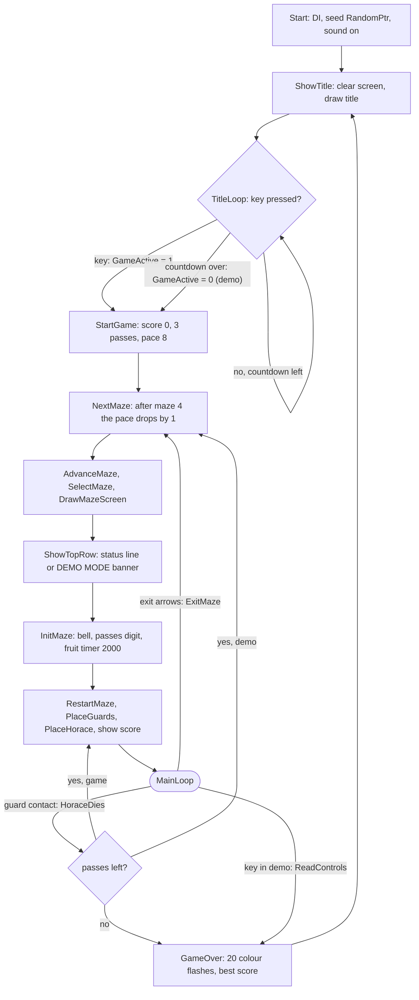
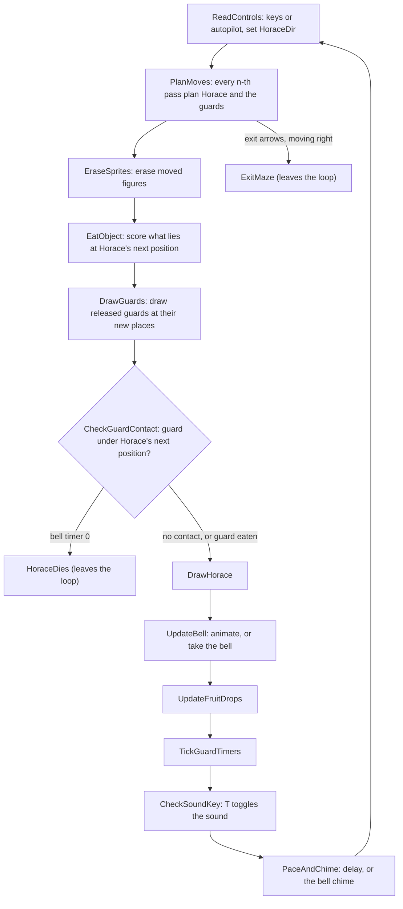

# 4. The main loop

All of the game runs in one routine, [Start](../src/main.asm#L52), which never returns. After the
title it sets up a maze, places the figures and enters a loop of twelve
calls. There is no frame synchronisation: interrupts are off, and the speed
of the game is the time one pass takes, padded by a busy-wait delay at the
end. The loop is left only by jumps that drop a return address from the
stack.

## Outer control flow

The labels are entry points inside [Start](../src/main.asm#L52): [ShowTitle](../src/main.asm#L74), [TitleLoop](../src/main.asm#L130),
[StartGame](../src/main.asm#L169), [NextMaze](../src/main.asm#L186), [AdvanceMaze](../src/main.asm#L198), [SelectMaze](../src/main.asm#L205),
[DrawMazeScreen](../src/main.asm#L233), [ShowTopRow](../src/main.asm#L239), [InitMaze](../src/main.asm#L283), [RestartMaze](../src/main.asm#L297),
[PlaceGuards](../src/main.asm#L309), [PlaceHorace](../src/main.asm#L350), [MainLoop](../src/main.asm#L375). The three exits are
[ExitMaze](../src/events.asm#L765), [HoraceDies](../src/events.asm#L175) and the demo abort in [ReadControls](../src/movement.asm#L52); all of
them leave the loop with `POP HL` (drop the return address of the current
call) followed by a `JP`.

### Per-maze set-up ([NextMaze](../src/main.asm#L186) to [InitMaze](../src/main.asm#L283))

1. If [MazeNumber](../src/variables.asm#L46) was 3 (the fourth maze was just finished),
   [GuardInterval](../src/variables.asm#L34) drops by one, but not below 1. The test is
   `INC A; AND $FC`: it is non-zero only for 3 + 1 = 4 (and not for $FF + 1).
2. [MazeNumber](../src/variables.asm#L46) = (number + 1) AND 3; [LoadMazeDescriptor](../src/guards.asm#L133) copies the
   descriptor and [DrawMaze](../src/library.asm#L155) draws the 768-cell map over the whole screen.
3. Row 0 gets the status line ([StatusText](../src/variables.asm#L10)) or the demo banner.
4. [BellPos](../src/variables.asm#L283) = the bell position of the descriptor, the passes digit is
   printed at column 7, [FruitTimer](../src/variables.asm#L69) = 2000.

The guard release timers are not reset here: when Horace leaves through the
exit, the timers keep running in the next maze ([ResetGuardTimers](../src/guards.asm#L15) is
called only by [StartGame](../src/main.asm#L169) and [HoraceDies](../src/events.asm#L175)).

### Per-life set-up ([RestartMaze](../src/main.asm#L297) to [PlaceHorace](../src/main.asm#L350))

Also the target of [HoraceDies](../src/events.asm#L175) after a lost pass in a game; the maze stays
on the screen with the flowers eaten so far.

1. If the bell is still in the maze, it is put back at its start position; a
   bell already taken stays gone.
2. For each guard: position = [MazeGuardStart](../src/mazes.asm#L24) if its release timer is 0,
   else [MazeHoraceStart](../src/mazes.asm#L26); the new position is the same; the saved
   background is set to four blank floor cells (attribute $3E, empty bitmap).
   Every released guard therefore starts on the same cell.
3. Horace is placed at [MazeHoraceStart](../src/mazes.asm#L26) facing right; [StepCountdown](../src/variables.asm#L21) is
   loaded with the pace.
4. [ShowScore](../src/sprites.asm#L169) prints the score (and gives the free pass on the first call
   of a game, see [scoring](05-bell-fruit-score.md#score-display-and-extra-passes)),
   [PrintNumber](../src/library.asm#L54) prints the best score.
5. [BellTimer](../src/state.asm#L61) = 0, [HoraceAttr](../src/variables.asm#L155) = $39.

## One pass of the main loop

| # | Routine | Does | Details |
| --- | --- | --- | --- |
| 1 | [ReadControls](../src/movement.asm#L52) | Sets [HoraceDir](../src/variables.asm#L146) from the keys (game) or the autopilot (demo); nothing while Horace is in a wrap pause | [Horace](05-horace.md#controls) |
| 2 | [PlanMoves](../src/movement.asm#L237) | Counts [StepCountdown](../src/variables.asm#L21) down; on 0 plans Horace's next cell into [HoraceNextPos](../src/variables.asm#L126) and each released guard's next cell with [ChooseGuardMove](../src/movement.asm#L389) | [Horace](05-horace.md#movement), [Guards](05-guards.md#the-guard-ai) |
| 3 | [EraseSprites](../src/sprites.asm#L13) | Erases Horace if he moves (blank sprite), restores the background of each moving guard and saves the background at its new cell ([EraseGuard](../src/sprites.asm#L66)) | [Drawing](05-drawing.md#sprites-and-backgrounds) |
| 4 | [EatObject](../src/sprites.asm#L133) | Looks at the attributes of the block at [HoraceNextPos](../src/variables.asm#L126): flower +10, bell or fruit +50; then [ShowScore](../src/sprites.asm#L169) | [Scoring](05-bell-fruit-score.md#scoring) |
| 5 | [DrawGuards](../src/sprites.asm#L235) | Draws each released guard at its new position ([DrawGuard](../src/sprites.asm#L273)); counts down the bell timer | [Guards](05-guards.md#drawing-a-guard) |
| 6 | [CheckGuardContact](../src/events.asm#L27) | Guard attribute in Horace's next block: death, or (bell timer running) guard eaten and all guards sent home | [Death](05-death.md) |
| 7 | [DrawHorace](../src/events.asm#L342) | Draws Horace at [HoraceNextPos](../src/variables.asm#L126) and makes it [HoracePos](../src/variables.asm#L113); during a wrap pause only copies the position | [Horace](05-horace.md#drawing-horace) |
| 8 | [UpdateBell](../src/events.asm#L419) | Bell pick-up test, otherwise redraws the swinging bell | [Bell](05-bell-fruit-score.md#the-bell) |
| 9 | [UpdateFruitDrops](../src/events.asm#L512) | For each released guard, [MaybeDropFruit](../src/events.asm#L558) counts the fruit timer and may plant a fruit | [Fruit](05-bell-fruit-score.md#fruit) |
| 10 | [TickGuardTimers](../src/events.asm#L621) | Decrements every non-zero release timer | [Guards](05-guards.md#release-timers) |
| 11 | [CheckSoundKey](../src/events.asm#L658) | T key edge toggles [SoundMask](../src/variables.asm#L89) | [Sound](05-sound.md) |
| 12 | [PaceAndChime](../src/events.asm#L693) | Busy-wait delay, or the two-tone bell chime instead of it | below |

Ordering matters in two places. Guards are drawn before the contact test, so
[CheckGuardContact](../src/events.asm#L27) sees them at their new cells; Horace is drawn after it,
so his own attribute does not hide a guard. The bell is drawn after Horace,
on top of him, so a bell cell overlapping Horace keeps the bell attribute (see
[Tricks and bugs](06-tricks.md#the-bell-pays-50-points-per-pass)).

## Timing and speed

There is no `HALT` and no interrupt handler; the game runs as fast as the
code allows, and three things set the speed:

1. **Step interval.** [PlanMoves](../src/movement.asm#L237) moves Horace and the guards one cell only
   every [GuardInterval](../src/variables.asm#L34) passes (8 at the start, down to 1). This is the
   main speed control.
2. **Delay.** [PaceAndChime](../src/events.asm#L693) ends every pass with [Delay](../src/library.asm#L10) of
   `$015E + $1E * n` loop passes (n = [GuardInterval](../src/variables.asm#L34)), 26 T-states each:
   590 passes, about 15,300 T-states, at n = 8; 380 passes, about 9,900
   T-states, at n = 1. A third term, based on [GuardsReleased](../src/texts.asm#L55), subtracts up
   to 446 passes; it is non-zero only in rare windows and then can make the
   delay wrap round (see [Tricks and bugs](06-tricks.md#tickguardtimers-counts-the-wrong-thing)).
3. **Drawing and sound.** Everything else in the pass: sprite drawing for
   each guard out, the score chirp of [ShowScore](../src/sprites.asm#L169) on every score change, and
   the chime, which replaces the delay on two out of every 64 passes while the
   bell is in the maze (two ROM BEEPER tones of about 22 ms each).

Measured in the simulator (play script, maze 1, pace 8, one guard released,
bell present; the simulator does not model memory contention): 263 passes in 200 frames of 69,888 T-states, about 1.3 passes
per 50 Hz frame, so a figure moves about 8 cells per second. The pass time
grows with the number of guards out.

What the pace n controls:

| Quantity | Formula | n = 8 | n = 1 |
| --- | --- | --- | --- |
| passes per movement step | n | 8 | 1 |
| delay loop at the end of a pass | $015E + $1E·n passes | 590 | 380 |
| release timer of guard 2 / 3 / 4 | n·256 / n·512 / n·1024 passes | 2048 / 4096 / 8192 | 256 / 512 / 1024 |
| bell timer (decremented once per drawn guard per pass) | 128·n | 1024 | 128 |

The pace starts at 8 and goes down by one each time the four mazes have been
played, so it reaches 1 at the 29th maze and stays there.

Pauses that stop the whole game:

| Event | Length | Routine |
| --- | --- | --- |
| Horace goes through a wrap pad | about 0.07 s | [PlanMoves](../src/movement.asm#L237) |
| any score change | about 8 ms | [ShowScore](../src/sprites.asm#L169) |
| a guard is eaten | about 0.25 s | [CheckGuardContact](../src/events.asm#L27) |
| Horace dies | about 1 s | [HoraceDies](../src/events.asm#L175) |
| game over | 20 rising tones, about 1.6 s | [GameOver](../src/events.asm#L299) |

The lengths are those given in the routine headers, computed from the loop
counts; the game-over figure is 20 times the 0.08 s of [PlayRisingTone](../src/guards.asm#L94).
