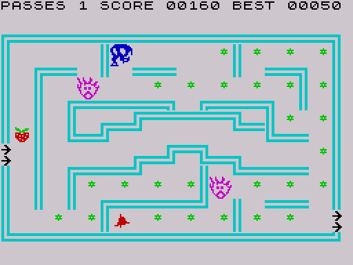

# 5b. Guards: records, release timers and AI

There are four guards. Each has a 43-byte record that holds its position,
direction, animation counter, a wait counter and a copy of the screen under
its sprite; all guard code works on one record at a time in a shared buffer.
Guards enter the maze one after another, controlled by four release timers.
At every step a guard scores the four directions (straight on, chasing
Horace, random sideways moves) and takes the best; while the bell timer runs
the chase term is subtracted, so the guards flee.

## Records and the working buffer

The record layout is in [Data structures](02-data.md#guard-record). Every
per-guard operation follows the same pattern, here from [DrawGuards](../src/sprites.asm#L235):

```asm
  LD HL,GuardTimers
  LD B,GUARD_COUNT        ; 4 = first record ... 1 = last
DrawGuards_Loop:
  PUSH BC
  LD A,(HL)
  INC HL
  OR (HL)                 ; release timer of this guard
  INC HL
  PUSH HL
  JR NZ,DrawGuards_0      ; timer running: not in the maze yet
  CALL LoadGuardRecord    ; record B -> buffer at $6DB8
  CALL DrawGuard          ; work on the buffer
  CALL SaveGuardRecord    ; buffer -> record
DrawGuards_0:
  POP HL
  POP BC
  DJNZ DrawGuards_Loop
```

[LoadGuardRecord](../src/guards.asm#L41) selects the record from B with a chain of compares
(4 → $6DE3, 3 → $6E0E, 2 → $6E39, anything else → $6E64), stores the
address in [GuardRecordPtr](../src/state.asm#L94) and copies 43 bytes to [GuardRecord](../src/state.asm#L122);
[SaveGuardRecord](../src/guards.asm#L74) copies them back. The same loop appears in
[PlanMoves](../src/movement.asm#L237), [DrawGuards](../src/sprites.asm#L235), [UpdateFruitDrops](../src/events.asm#L512) (guards 1 to 4) and in
[EraseSprites](../src/sprites.asm#L13) and [HoraceDies](../src/events.asm#L175) (guards 4 to 1, walking the timers
backwards). A change made to the buffer outside such a load/save pair is
lost at the next load; [TakeBell](../src/events.asm#L473) has one of those (see
[Tricks and bugs](06-tricks.md#bugs)).

## Release timers

[GuardTimers](../src/state.asm#L20) holds one word per guard. A guard whose timer is 0 is "in the
maze": it is planned, erased, drawn, tested for fruit and for contact. Guards
with a running timer are skipped by every loop and are not on the screen.

[ResetGuardTimers](../src/guards.asm#L15), called at the start of a game and after every lost
pass, sets the timers to

| Guard | Timer | At pace 8 |
| --- | --- | --- |
| 1 | 0 | released at once |
| 2 | n·256 | 2048 passes |
| 3 | n·512 | 4096 passes |
| 4 | n·1024 | 8192 passes |

where n is [GuardInterval](../src/variables.asm#L34). [TickGuardTimers](../src/events.asm#L621) decrements every non-zero
timer once per pass. At the measured 1.3 passes per frame the second guard
appears about 30 seconds after the start at pace 8, the fourth after almost
two minutes (estimate; the pass time varies). The timers are not reset when
Horace leaves through the exit, so a guard that has been released stays
released in the following mazes.

Where a guard appears ([PlaceGuards](../src/main.asm#L309)): when a maze starts or a life is
lost, a guard with timer 0 is put at [MazeGuardStart](../src/mazes.asm#L24); a guard with a
running timer is put at [MazeHoraceStart](../src/mazes.asm#L26), next to the entrance arrows,
and appears there when its timer runs out. All released guards share the
same start cell; the random sideways scores of the AI separate them.

## The guard AI

[ChooseGuardMove](../src/movement.asm#L389) runs for each released guard on every movement step
(called by [PlanMoves](../src/movement.asm#L237) when [StepCountdown](../src/variables.asm#L21) reaches 0). It returns at once
while the guard's wait counter [GuardWait](../src/state.asm#L130) is non-zero.

It first converts Horace's and the guard's screen offsets into row and column
([HoraceCell](../src/variables.asm#L225), [GuardCell](../src/state.asm#L71)): three `RR H` drop the pixel-row bits, five
`RR H / RR L` pairs shift the rest right by five.

Then it scores the directions 3, 2, 1, 0 into [GuardDirScores](../src/state.asm#L82):

| Probe result for that direction | Base score |
| --- | --- |
| wall, arrows, anything ≥ 2 | 0 (never chosen while another direction scores) |
| open, the guard's current direction | 25 + 40 = 65 |
| open, the opposite direction | 25 - 10 = 15 |
| open, sideways | 25 + random 0-31 |

Every open direction that leads towards Horace then gets a chase bonus of
`10 + distance`, where the distance is measured along that direction's axis
in cells:

| Direction | Gets the bonus when | Distance |
| --- | --- | --- |
| up | Horace's row ≤ guard's row | guard row - Horace row |
| down | Horace's row ≥ guard's row | Horace row - guard row |
| left | Horace's column ≤ guard's column | guard column - Horace column |
| right | Horace's column ≥ guard's column | Horace column - guard column |

When Horace is level with the guard, both directions of that axis get the
bonus of 10. A far-away Horace gives a bigger bonus, so the guard first
closes the longer of the two gaps. While [BellTimer](../src/state.asm#L61) is non-zero the bonus
is negated (`NEG`) before it is added, so directions towards Horace lose
points and the guard tends to run away. The addition is 8-bit without a
floor; a score that goes below 0 wraps to a large value and wins (see
[Tricks and bugs](06-tricks.md#bugs): scared guards can turn towards Horace).

The best score wins ([ChooseGuardMove_Pick](../src/movement.asm#L567)). The scan runs from direction
3 down to 0 and replaces the best only on a strictly greater score, so ties go
to left, then down, right, up; if every score is 0 the result is up (0). The
new direction is stored in [GuardDir](../src/state.asm#L124), and [ChooseGuardMove_Move](../src/movement.asm#L585) probes it
once more: free → [GuardNewPos](../src/state.asm#L128) is one cell on; wrap pad → position ± the
maze's wrap delta, as for Horace; anything else → the guard stays.

Examples, at pace 8, guard moving right along a corridor with Horace 5 rows
above and 3 columns to the right, at a junction where up and right are open:

| Direction | Open | Base | Chase | Total (normal) | Total (scared) |
| --- | --- | --- | --- | --- | --- |
| up | yes | 25 + random r | 10 + 5 | 40 + r | 10 + r |
| right | yes | 65 | 10 + 3 | 78 | 52 |
| down | no | 0 | | 0 | 0 |
| left | yes | 15 | | 15 | 15 |

With r ≤ 31 the guard always keeps going right in this example (normal: 78
against at most 71). In general a guard turns into a side corridor only when
the random sideways score plus a chase bonus beats going straight on, or
when it cannot go straight on.

**Random numbers.** The sideways term does not use [GetRandom](../src/library.asm#L28). The AI
increments the low word of the ROM system variable FRAMES ($5C78) itself
(interrupts are off, so nothing else changes it) and reads the ROM byte at
that address with the high byte masked to $0F, i.e. somewhere in
$0000-$0FFF. Only open sideways directions draw a number. See
[Tricks and bugs](06-tricks.md#random-numbers-from-the-rom).

The AI also maintains a counter [UnusedAiCounter](../src/variables.asm#L58) that nothing reads (dead
code, [Tricks and bugs](06-tricks.md#dead-code-and-unused-bytes)).

## Drawing a guard

Guards are erased and redrawn using the background saved in their record, so
they can pass over flowers, fruit and the bell without destroying them:

1. [EraseSprites](../src/sprites.asm#L13) calls [EraseGuard](../src/sprites.asm#L66) for each released guard. If
   [GuardNewPos](../src/state.asm#L128) equals the position, nothing happens. Otherwise the four
   saved cells are drawn back at the old position ([EraseGuard_Always](../src/sprites.asm#L77)),
   and [SaveBackground](../src/library.asm#L444) copies the four cells at the new position into the
   record. [SaveBackgroundCell](../src/library.asm#L492) stores any guard-coloured cell as blank
   floor, so a guard never saves another guard as background.
2. [DrawGuards](../src/sprites.asm#L235) calls [DrawGuard](../src/sprites.asm#L273), which makes the new position current
   and draws the sprite with attribute $3B.

[DrawGuard](../src/sprites.asm#L273) picks the graphic:

- [BellTimer](../src/state.asm#L61) running: the timer is decremented (once per guard drawn, so
  with four guards out it runs four times as fast) and the sprite is one of
  the two frames of [ScaredGuardSprites](../src/sprite_gfx.asm#L122), chosen by bit 3 of the animation
  counter;
- otherwise one of four directional sprites from [GuardSprites](../src/sprite_gfx.asm#L72) (bit 5 of
  the counter set) or [GuardSprites2](../src/sprite_gfx.asm#L96) (clear).

The animation counter is incremented on every draw, i.e. every pass.



## Eaten guards

When Horace touches a guard while [BellTimer](../src/state.asm#L61) runs, [CheckGuardContact](../src/events.asm#L27)
adds 100 points, clears the bell timer (all guards are dangerous again at
once), plays a falling buzz and then sends **every** released guard home, not
only the one that was touched: each is wiped from the screen with
[EraseGuard_Always](../src/sprites.asm#L77), moved to [MazeHoraceStart](../src/mazes.asm#L26) facing right, has its
background saved there, and gets [GuardWait](../src/state.asm#L130) = 90 (`GUARD_WAIT`).

While [GuardWait](../src/state.asm#L130) is non-zero the guard is not planned ([ChooseGuardMove](../src/movement.asm#L389)
returns), drops no fruit, and is not drawn: [DrawGuard](../src/sprites.asm#L273) decrements the
counter and returns, and draws the guard again on the pass the counter
reaches 0. The selection of "released" guards in this loop is faulty (it
steps through the timers one byte at a time), see
[Tricks and bugs](06-tricks.md#bugs).
