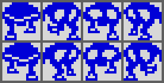
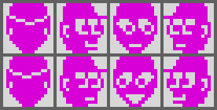
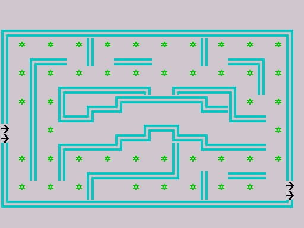
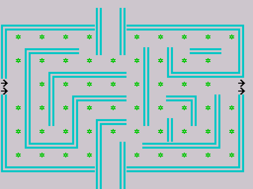
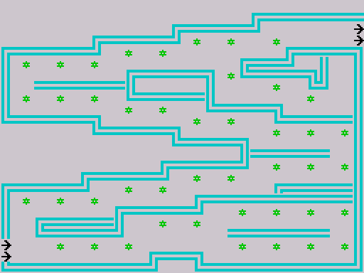
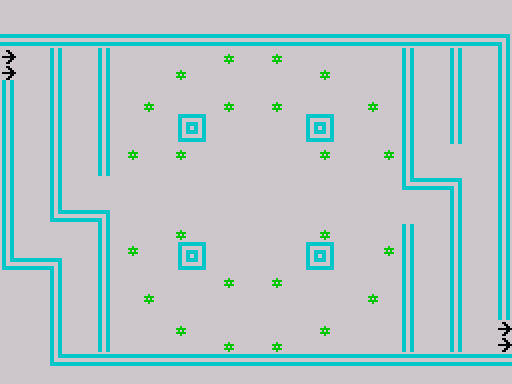

# 7. Graphics gallery

Every picture below is produced from the game's own bytes: sprite and tile
sheets with `tools/zxgfx.py`, the title words and the mazes by calling the
game's drawing routines ([DrawBlocks](../src/library.asm#L706), [DrawMaze](../src/library.asm#L155)) in the simulator, and
the screens by running the game. The commands are in
[`docs/img/Makefile`](img/Makefile) (`make -f docs/img/Makefile` from the
project root). Sprite sheets are drawn at 4x, tiles at 6x, screens at 2x.

## Loading screen

[`img/loading.png`](img/loading.png): the 6912-byte screen block `T` of the
tape ([`data/screen07.scr`](../data/screen07.scr)), loaded straight into
$4000 by the BASIC loader. Standard Spectrum screen format (bitmap, then
attributes). It credits Psion Software with Melbourne House.

## Title screen

[`img/title-screen.png`](img/title-screen.png): the running game at frame
299, during the title loop. The two words are in cyan at this moment; the
title loop changes their ink on every pass.

[`img/title.png`](img/title.png): [TitleHungry](../src/title_gfx.asm#L14) ($6E8F) and
[TitleHorace](../src/title_gfx.asm#L39) ($6F2F), 160 bytes each, drawn by calling [DrawBlocks](../src/library.asm#L706)
($6D4E) twice with the screen addresses the title uses ($40A0 and $4880) and
cropped to rows 5-16. Format: one byte per 8x8 cell, bits 4/5/0/1 = the four
4x4 blocks ([Data structures](02-data.md#title-block-bitmaps)). The cyan ink
comes from the $3D attribute the picture was rendered with; the game cycles
the ink.

## Horace

[`img/horace.png`](img/horace.png): [HoraceSprites](../src/sprite_gfx.asm#L15) ($7CC7, top row) and
[HoraceSprites2](../src/sprite_gfx.asm#L40) ($7D47, bottom row), four sprites each in direction order
up, right, down, left. 16x16 pixels, 32 bytes per sprite in the cell order
top-left, top-right, bottom-left, bottom-right. Drawn with Horace's attribute
$39 (blue ink). The two rows are the two walking frames, selected by bit 4
of [HoraceAnim](../src/variables.asm#L164).

## Guards

[`img/guard.png`](img/guard.png): [GuardSprites](../src/sprite_gfx.asm#L72) ($7DC7, top) and
[GuardSprites2](../src/sprite_gfx.asm#L96) ($7E47, bottom), four directions each (up shows the back of
the head), attribute $3B (magenta). Same 32-byte format. Bit 5 of the guard's
animation counter selects the row.

[`img/guard-scared.png`](img/guard-scared.png): [ScaredGuardSprites](../src/sprite_gfx.asm#L122)
($7EC7), the two frames used for every direction while the bell timer runs,
alternating on bit 3 of the animation counter.

## Bell

[`img/bell.png`](img/bell.png): [BellSprites](../src/sprite_gfx.asm#L139) ($7F07), four frames of the
swinging bell, attribute $3A (red). [UpdateBell](../src/events.asm#L419) plays them as 0, 1, 2, 3,
3, 2, 1, 0, one step every 8 passes.

The blank sprite [BlankSprite](../src/sprite_gfx.asm#L162) ($7F87, 32 zero bytes) is not shown.

## Fruit

[`img/fruit.png`](img/fruit.png): [FruitCellsA](../src/variables.asm#L241) ($7C7C) and
[FruitCellsB](../src/variables.asm#L264) ($7CA0). These are not sprites but four saved cells of 9
bytes each (attribute, then 8 pixel rows), in the format of a guard's saved
background, rendered with their own attributes: green ($3C) stalk cells on
top, red ($3A) body cells below. The first looks like a cherry, the second
like a strawberry.

## Maze tiles

[`img/tiles.png`](img/tiles.png): [TileGraphics](../src/tiles.asm#L10) ($7BF7), tiles 0-9, 8
bytes each, with the attribute [DrawMaze](../src/library.asm#L155) gives each code: 0 floor
(blank), 1 horizontal wall, 2 flower, 3 arrow, 4 vertical wall, 5-8 the four
corners, 9 wrap pad (blank, white on white).

## Mazes

Each maze is drawn by calling [DrawMaze](../src/library.asm#L155) ($6B75) with its map, the screen
start $4000 and $300 cells, exactly as [NextMaze](../src/main.asm#L186) does. Row 0 is empty (it
holds the status line in the game). The wrap pads are invisible by design;
their positions are listed with each maze.

[`img/maze1.png`](img/maze1.png): maze 1, map [Maze1Map](../src/mazes.asm#L216) ($72F7),
descriptor [Maze1Desc](../src/mazes.asm#L50). Entrance arrows at the left (rows 13-14), exit at
the right (rows 19-20). Wrap pads at row 14, columns 16-17, in a notch
of the central wall; they send Horace 8 rows up. 44 flowers.

[`img/maze2.png`](img/maze2.png): maze 2, map [Maze2Map](../src/mazes.asm#L164) ($6FF7, first in
memory), descriptor [Maze2Desc](../src/mazes.asm#L77). Entrance and exit both at rows 10-11. The
central vertical corridor runs off the top and bottom edges, where the pads
(rows 1 and 23) connect the two ends. 55 flowers.

[`img/maze3.png`](img/maze3.png): maze 3, map [Maze3Map](../src/mazes.asm#L267) ($75F7),
descriptor [Maze3Desc](../src/mazes.asm#L104). Entrance at the bottom left (rows 21-22), exit at
the top right (rows 2-3). No wrap pads. 44 flowers.

[`img/maze4.png`](img/maze4.png): maze 4, map [Maze4Map](../src/mazes.asm#L319) ($78F7),
descriptor [Maze4Desc](../src/mazes.asm#L132). Entrance at the top left (rows 3-4), exit at the
bottom right (rows 20-21). Pads at both ends of the two long vertical
corridors near the left and right edges (rows 3 and 21, columns 4-5 and
26-27). 24 flowers.

## Screens in play

[`img/demo.png`](img/demo.png): frame 1999 with no input: the demo, already
in maze 4 because every death in the demo moves on to the next maze. The
banner replaces the status line; `DEMO MODE` flashes.

[`img/game.png`](img/game.png): frame 2750 of the play script
([`tests/inputs/play.txt`](../tests/inputs/play.txt)): the second game, maze
1, with two guards out, the bell at the bottom and a strawberry left by a
guard near the entrance. The status line shows one pass left, score 160 and
the best score 50 from the first game.

[`img/scared.png`](img/scared.png): the same moment continued for 60 frames
with [BellTimer](../src/state.asm#L61) ($6DAE) poked to $0400, as if Horace had taken the bell:
both guards use the scared sprite. The poke is only a way to get this
picture; the play script never takes the bell (the bell timer stays 0 in a
memory watch over its 4000 frames).
