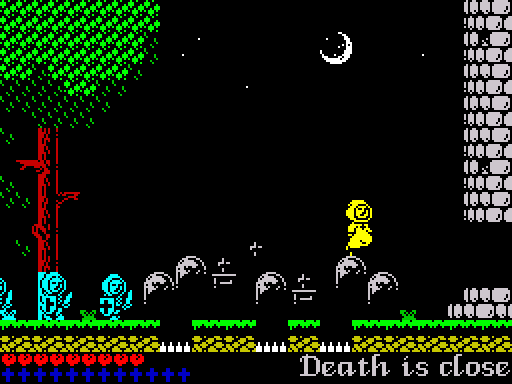
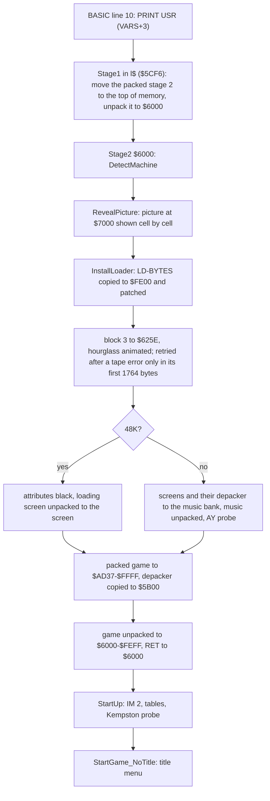
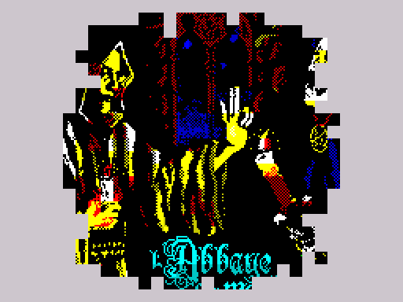
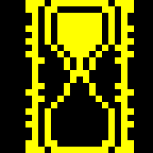

# 1. Overview

l'Abbaye des Morts is a flip-screen platform game: the room fills the top 22
character rows of the screen, and walking off an edge replaces it with the
neighbouring room. This section describes what the player sees, the parts of
the Spectrum the program uses, where everything lies in memory, and how the
tape gets the game running: a BASIC line, a machine code string variable, two
MegaLZ-packed stages, a picture revealed cell by cell and a patched copy of
the ROM tape loader that animates an hourglass.

## The game



- **Story.** The intro text (room 0) says: "13th Century. The Cathars were
  being expelled by the Catholic Church out of the Lanquedoc. The Cathar Jean
  Raymond runs to escape the crusaders..." (the spelling is the game's, F129).
- **Rooms.** 25 rooms (0-24) on a 5 x 5 grid: right and left are room +1 and
  -1, down and up +5 and -5 ([RoomNumber](../src/variables.asm#L80), F41, F76). Room 0 holds the
  intro text, room 4 is only used by the ending, and room 1 is only seen
  through a window of room 2 (F124). A 26th room, 25, exists only for the
  ending. Play starts in room 5, "Escape !!!", with crusaders running in from
  the left edge (F108, F118).
- **Lives.** 9 at the start, shown as hearts in the status bar. A heart in a
  room adds one, up to 9 (F122). Harmful tiles (the spikes in the pits, the
  blood) and the creatures kill at a touch; falls do not (F72, F73). After a death Jean
  restarts at the last checkpoint touched, or in room 5 (F33).
- **Crosses.** Twelve crosses lie in the rooms; the status bar counts them.
  Eight can be taken while the wheel of faith in room 17 is at rest and four
  only while it is turned (F31). With twelve crosses a ring of crosses
  appears in Satan's room (24) and leads up to the chalice; taking it turns
  Satan to smoke and brings the red scroll that starts the ending (F29, F53,
  F125). See [Items and the ending](05-items-ending.md).
- **Other items.** Eight checkpoints (a cross in a ring) and a trigger in the
  Abandoned church, six parchments with hints, three levers that open doors,
  a bell that opens the floor of The Altar (room 8) down to the Catacombs
  (room 13), two arches that join rooms 10 and 19 (F58, F69, F142, F145).
- **No score, no levels, no demo, no high score, no pause, no sound toggle**
  (Q3, Q8). The intro (room 0) runs until a key is pressed.
- **Controls.** P right, O left, A crouch, Q jump by default; the four can be
  redefined and a Kempston joystick can be switched on or off in the controls
  menu. R and Y held together end the game; T is the debug room warp, active
  only after the RAGE cheat ([Title and menus](03-title-and-menu.md), F23,
  F26, F27).

The bottom two character rows are the status bar: row 22 holds nine hearts
at the left, red for each life left and blue for the others, row 23 twelve
crosses, bright white for those collected and blue for the others (F43), and
the right part shows the room name in the game's proportional font.

## Hardware used

| Part | Use |
| --- | --- |
| Z80 at 3.5 MHz, IM 2 | [StartUp](../src/startup.asm#L39) sets I = $84 and IM 2; every vector of the 257-byte table [Im2Table](../src/im2table.asm#L11) is $8585, the handler [InterruptHandler](../src/interrupt.asm#L35). The game logic runs inside the interrupt, once per 50 Hz frame ([Game loop](04-game-loop.md), F103) |
| Screen bitmap $4000-$57FF, attributes $5800-$5AFF | written directly: changed cells by [DrawRedrawList](../src/redraw.asm#L32), text and frames by the script interpreter [RunScript](../src/script.asm#L99), the status bar by [DrawLivesBar](../src/sprites.asm#L1337) and [DrawCrossesHud](../src/hud.asm#L17) |
| RAM $5B00-$60FF | tile map, object list and tile flag map of the room, over the printer buffer and the system variables (the game never returns to BASIC) |
| Port $FE out | border (black from the start-up on) and the speaker, bit 4 ([PlaySoundStep](../src/mainloop.asm#L291), F105) |
| Port $FE in | keyboard: eight half-rows read with `INI` into [KeyRows](../src/controls.asm#L190) every frame ([ScanKeyboard](../src/helpers.asm#L221)) |
| Port $1F in | Kempston joystick: probed 65536 times at start-up, then read every frame while it is switched on ([ReadKempston](../src/controls.asm#L59), F35) |
| Port $7FFD out | 128K paging, written on every machine at start-up ([PageInBank0](../src/interrupt.asm#L108)); used for the music bank on a 128K only |
| AY ports $FFFD / $BFFD | the loader's AY probe ([WriteAY](../src/stage2.asm#L161)); in the game only through code in the 128K music bank (not disassembled) |
| R register | the only random source: Death's throw side, the church door flicker, the unused noise effect (Q12) |
| ROM | the loader copies and patches LD-BYTES and reads ROM bytes as click data; the game calls no ROM routine (Q14) |

The border stays black: the start-up writes 0 to port $FE and every beeper
write keeps the border bits 0.

## Memory map

On a 48K the game occupies $5B00-&#36;FFFF after loading; the screen is the
only other memory it uses. Addresses below are those of the original; `$85BC-$BFFF`
can be moved as a block (`make shift-test`), the rest stays where it is
(see [`re/layout.mk`](../re/layout.mk)).

| Range | Size | Contents | Source |
| --- | --- | --- | --- |
| $5B00-$5DBF | 704 | room tile map: 22 rows x 32 tile numbers | [TILE_MAP](../src/game.asm#L7) |
| $5DC0-$5DFF | 64 | object list: requests to create objects (template, y, x) | [OBJECT_LIST](../src/game.asm#L8), [ObjectListPtr](../src/buffers.asm#L17) |
| $5E00-$60BF | 704 | tile flag map: class and redraw marks of every cell (F68) | [FLAG_MAP](../src/game.asm#L11), [FlagMapTail](../src/startup.asm#L150) |
| $6000-$6072 | 115 | start-up code, run once, then overwritten by the flag map | [StartUp](../src/startup.asm#L39) |
| $60C0-$60FF | 64 | main stack (SP = $6100) | [MainStack](../src/startup.asm#L158) |
| $6100-$612F | 48 | address of each flag map row (24 words, built at start-up) | [FlagRowTable](../src/startup.asm#L174) |
| $6130-$66DB | 1452 | proportional font: index of 96 words, glyphs 16 rows high | [FontIndex](../src/font.asm#L11), [FontGlyphs](../src/font.asm#L50) |
| $66DC-$68CB | 496 | item sprites: the arch (16 x 24) and 14 of 16 x 16 | [SpriteArch](../src/graphics.asm#L44) |
| $68CC-$717E | 2227 | 20 packed sprite sets | [PackedSetArcher](../src/graphics.asm#L333) |
| $717F-$7235 | 183 | parchment frame tiles and layout | [ParchmentFrameTiles](../src/graphics.asm#L702), [ParchmentLayout](../src/graphics.asm#L730) |
| $7236-$83A7 | 4466 | room script table (26 words) and the scripts | [RoomScriptTable](../src/roomscripts.asm#L8) |
| $83A8-$83FF | 88 | ending actor lists, the debug room warp, music track of each room | [CutsceneList1](../src/cutscenelists.asm#L14), [DebugWarpRoom](../src/cutscenelists.asm#L39), [RoomMusicTable](../src/cutscenelists.asm#L63) |
| $8400-$8500 | 257 | IM 2 vector table, all $85 | [Im2Table](../src/im2table.asm#L11) |
| $8501-$855E | 94 | game variables | [CutsceneDone](../src/variables.asm#L7) to [RedrawListPtr](../src/variables.asm#L584) |
| $855F-$8584 | 38 | interrupt stack | [InterruptStack](../src/variables.asm#L595) |
| $8585-$8A8E | 1290 | interrupt handler, 128K hooks, new game, main loop, room entry, beeper effects, intro, ending, spawning | [InterruptHandler](../src/interrupt.asm#L35), [StartGame](../src/mainloop.asm#L70) |
| $8A8F-$9047 | 1465 | item types and frame lists, room objects (77 x 11 bytes), room items (45 x 8 bytes) | [ItemTypeTable](../src/objects.asm#L17), [RoomObjects](../src/objects.asm#L276), [RoomItems](../src/objects.asm#L616) |
| $9048-$93D2 | 907 | 53 length-prefixed strings | [RoomNames](../src/text.asm#L19) |
| $93D3-$95FE | 556 | behaviour blocks of the creatures, projectile sprite blocks | [BehaviourJean](../src/behaviours.asm#L45) |
| $95FF-&#36;A595 | 3991 | redraw, sprite drawing, status bar, parchments, script interpreter, keys, menus, cheat | [DrawRedrawList](../src/redraw.asm#L32) to [ScriptGameOver](../src/controls.asm#L756) |
| $A596-&#36;BC91 | 5884 | game frame, items, hit tests, Jean, room exits, tile effects, sprite unpacking, creatures | [GameFrame](../src/gameframe.asm#L22), [PlayerState](../src/player.asm#L33), [EntityHandlers](../src/entities.asm#L30) |
| $BC92-&#36;BE55 | 452 | templates of spawned objects, frame list runner, checkpoints | [ArrowLeftTemplate](../src/templates.asm#L49), [Checkpoints](../src/templates.asm#L259) |
| $BE56-&#36;BEFB | 166 | two list pointers and the frame call list | [ObjectListPtr](../src/buffers.asm#L17), [FrameList](../src/buffers.asm#L50) |
| $BEFC-&#36;BFFF | 260 | unused (&#36;FF) | [SpareFill1](../src/buffers.asm#L58) |
| $C000-&#36;C0FF | 256 | sprite draw queue: 16 jobs of 16 bytes | [DrawQueue](../src/buffers.asm#L75) |
| $C100-&#36;C1F3 | 244 | 11 object slots of 22 bytes and their end mark | [ObjectSlots](../src/buffers.asm#L125) |
| $C1F4-&#36;C1FF | 12 | unused (&#36;FF) | [SpareFill2](../src/buffers.asm#L132) |
| $C200-&#36;CCFF | 2816 | redraw buffers: run list, lengths, attributes, 8 pixel-row pages | [RedrawRuns](../src/buffers.asm#L150) to [RedrawPixels](../src/buffers.asm#L182) |
| $CD00-&#36;D6FF | 2560 | tile flags, tile attributes, tile bitmaps (256 tiles) | [TileFlags](../src/tiles.asm#L37), [TileAttrs](../src/tiles.asm#L64), [TileGfx](../src/tiles.asm#L93) |
| $D700-&#36;FEFF | 10240 | sprite sheet: 40 pages, one per pixel row; columns $63-&#36;FF filled per room | [SpriteSheet](../src/spritesheet.asm#L25), [SpriteSheetLower](../src/spritesheet.asm#L281) |
| $FF00-&#36;FFFF | 256 | outline mask table, built at start-up | [OutlineMasks](../src/game.asm#L13) |

Unused bytes inside the variable block: $8508 and $8520 ($8550 is used only by the 128K music bank). The details
of every structure are in [Data structures](02-data.md).

## How it loads

The tape (`ABBAYE.TZX`) has three standard-speed blocks and no protection
(F132):

| Block | Contents | Source |
| --- | --- | --- |
| 1 | header: program "l'Abbaye", 5689 bytes, autostart line 10, program part 40 bytes | [`tape/tape.txt`](../tape/tape.txt) |
| 2 | BASIC line 10 and the variables area: one string variable, l&#36;, of 5646 bytes | [`src/loader.bas`](../src/loader.bas), [`src/stage1.asm`](../src/stage1.asm) |
| 3 | headerless, flag $FF, 29796 bytes, loaded at $625E by the loader's copy of LD-BYTES | [`scripts/block3.py`](../scripts/block3.py) |

At the standard ROM speed the three blocks take about 5, 34 and 176 seconds
(computed from the block contents and the ROM's pulse lengths), about three
and a half minutes in all.



### BASIC and the string variable

The program part of block 2 is one line
([`src/loader.bas`](../src/loader.bas)):

```basic
10 PRINT USR ( PEEK VAL "23627"+ VAL "256"* PEEK VAL "23628"+ VAL "3")
```

23627/23628 is the system variable VARS, the start of the BASIC variables.
The variables area that follows the line on the tape holds one string, l$
([LoaderString](../src/stage1.asm#L11)): a letter byte $4C, a length word, and 5646
bytes of contents, so VARS+3 is the first byte of the string. The string
holds the first stage of the loader as machine code, followed by the packed
second stage. Its last byte is $80, which is also the end marker of the
variables area. With PROG at $5CCB and a 40-byte program, VARS is $5CF3 and
the code starts at $5CF6.

### Stage 1

[Stage1](../src/stage1.asm#L16) (132 bytes of code at $5CF6) disables interrupts, puts
the stack just below itself (USR leaves its own address in BC) and moves the
packed second stage (5513 bytes) with `LDDR` to the top of memory, ending at
$FFFF: unpacked, stage 2 covers $6000-$8AFF, which overlaps the place the
string was loaded to. It then pushes $6000 as the return address and runs the
MegaLZ depacker ([MEGALZ_DEPACK](../src/megalz.asm#L9), a macro the loader
uses twice), which ends with `RET C` into stage 2.

### MegaLZ

All five packed streams of the tape (stage 2, the loading screen, the info
screen, the 128K music and the game) use MegaLZ. The depacker reads a bit
stream most significant bit first, taking bytes from the packed data as the
bit buffer runs out, interleaved with the literal bytes; the first output
byte is stored as it is ([`scripts/megalz.py`](../scripts/megalz.py)):

| Code | Meaning |
| --- | --- |
| `1` + byte | literal byte |
| `000` + 3 bits x | copy 1 byte from distance 8 - x |
| `001` + byte n | copy 2 bytes from distance 256 - n |
| `010` + offset | copy 3 bytes |
| `011` + gamma + offset | copy 4 or more bytes; eight zero bits and a one end the stream |
| offset | `0` + byte n: distance 256 - n (1-256); `1` + 4 bits d + byte n: distance (17 - d) x 256 - n (257-4352) |

The gamma code is k zero bits, a one and k + 1 bits v: length 2 + 2^(k+1) +
v. The project's [`scripts/megalz.py`](../scripts/megalz.py) holds a decoder
and an optimal packer whose ties fall the way the original packer's did, so
`make` rebuilds every stream byte for byte.

The two screens are packed in "RCS" order: within each third of the bitmap
the cells are taken column by column, the eight pixel rows of a cell
together, and the 768 attributes follow as they are. Neighbouring bytes are
then more alike, which packs better. [DepackScreen](../src/stage2.asm#L290) is a copy of
the depacker that converts every address it writes or copies from into the
screen layout on the fly.

### Stage 2

[Stage2](../src/stage2.asm#L52) runs at $6000 with its stack below it:

1. **Machine check** ([DetectMachine](../src/stage2.asm#L171)). It writes $10 to
   port $7FFD and $10 to $FFFF, then $11 and $11, then pages $10 back in and
   reads $FFFF. On a 48K the second write landed on the same byte, and the
   machine type becomes 1. On a 128K [MeasureBanks](../src/stage2.asm#L201) counts how
   many times `INC DE / JR $-1` runs in one frame in banks 1, 3, 4 and 6,
   with a temporary IM 2 handler of `POP HL / RET` that returns from the
   `CALL` of the counting loop, and keeps the fastest bank. Banks 1 and 3 are
   contended on the original 128K and banks 4 and 6 on the +2A/+3, so the
   fastest of the four is an uncontended one on either (inferred). The machine
   type is then the port $7FFD value of that bank ($11, $13, $14 or $16).
2. **Picture** ([RevealPicture](../src/stage2.asm#L433)). The picture stored at $7000
   (RCS order, attributes at $8800) is copied to the screen one cell at a
   time, in the order of the 768 cell numbers at [RevealOrder](../src/stage2.asm#L497),
   from the middle of the screen outwards. Before each cell it sends bit 4 of
   a ROM byte (the cell number used as a ROM address) to the speaker, after
   it bit 3 of the R register (the MIC output), and waits 26 `DJNZ` loops;
   both writes keep the border colour read from BORDCR, so the border does
   not change. The routine sets SP to the
   order table and `POP`s the cell numbers. In the simulator the whole picture
   is on the screen 9 frames after stage 2 starts (observed).

   

3. **Tape loader** ([InstallLoader](../src/stage2.asm#L679)). LD-BYTES is copied from
   the ROM ($0556-$05E2) to $FE00 and patched: the border colour operand
   becomes 0, the `PUSH HL` of the SA/LD-RET return address becomes a `NOP`
   (the copy returns straight to its caller; with a non-standard ROM the same
   store writes $70, `LD (HL),B`, a case the source leaves unexplained), the
   closing `JP NC,LD-8-BITS`
   is pointed at the copy, and, when the ROM's LD-EDGE-1 is the standard one
   (no $C3 at $05E9), the `CALL LD-EDGE-2` inside LD-8-BITS is pointed at new
   edge routines copied to $FE8D ([LdEdge2](../src/stage2.asm#L570), [LdEdge1](../src/stage2.asm#L573)).
   In place of the ROM's delay loop these draw one cell (8 bytes) of the
   middle column of the current hourglass frame before each edge sample,
   the cells in the order top, middle, bottom, middle; they keep the border
   black (`AND 7` became `AND 0`) and do not test BREAK. The pilot tone and
   the sync pulses are still timed by the ROM's own edge routines, which the
   copy calls at their ROM addresses.
4. **Hourglass.** [DrawHourglass](../src/stage2.asm#L705) draws a 3 x 3 cell
   hourglass in bright yellow at the bottom right corner (cells 29-31 of rows
   21-23) and copies two sets of ten frames of its middle column to $FC00 and
   $FD00. [BuildFrameTable](../src/stage2.asm#L651) fills the page at $FB00 so that the
   high byte of the count of bytes still to load selects a frame: the frame
   steps on once per tenth of the block. Bit 0 of the low byte selects the
   frame set ([HourglassFramesEven](../src/stage2.asm#L775) for an even
   count, [HourglassFramesOdd](../src/stage2.asm#L806) for an odd one): the
   two sets are two phases of the falling grains, so the middle of the
   hourglass changes with every byte loaded. Frame 9 has all the sand above,
   frame 0, the end of the load, all of it below (observed, F158).

   

5. **Block 3** is loaded at $625E, over the code that has finished its work
   (from [RevealExit](../src/stage2.asm#L424) on). A tape error loads it
   again, but only in its first 1764 bytes: further on block 3 has overwritten
   [BuildFrameTable](../src/stage2.asm#L651) and
   [DrawHourglass](../src/stage2.asm#L705), and the retry runs block-3 data
   as code (observed with a simulated error, F157). The block holds four
   MegaLZ streams ([`scripts/block3.py`](../scripts/block3.py)):

   | Address | Packed | Unpacked | Contents |
   | --- | --- | --- | --- |
   | $625E | 2541 | 6912 | loading screen (the title), RCS order ([`data/loading.scr`](../data/loading.scr)) |
   | $6C4B | 1251 | 6912 | info screen, RCS order ([`data/info.scr`](../data/info.scr)) |
   | $712E | 4811 | 11631 | 128K music: a Vortex Tracker II player and modules, not disassembled ([`data/music128.bin`](../data/music128.bin)) |
   | $83F9 | 21193 | 40704 | the game, $6000-&#36;FEFF |

6. **48K tail.** All attributes are set to 0, then
   [DepackScreen](../src/stage2.asm#L290) unpacks the loading screen. The pixels arrive
   under black attributes and the picture appears when the attributes, the
   last part of the stream, are written: in the simulator the first
   attribute is written 26 frames after the load and the screen is complete
   at frame 29 (observed).
7. **The game.** [StartGame](../src/stage2.asm#L95) copies the depacker to the printer
   buffer at $5B00, moves the packed game to $AD37-&#36;FFFF with `LDDR` (one
   byte too many is moved, to $0000, where the ROM ignores it), and jumps to
   the copy with $6000 pushed as the return address. The game is unpacked
   upwards from $6000 while the packed data is read from above, over the
   loader and the info screen. In the simulator this takes 78 frames; memory
   $6000-&#36;FEFF and the screen then equal `re/orig.z80`, the snapshot the
   project starts from (observed).

On a 48K the info screen is never unpacked: the game overwrites it.

### The 128K tail

[Start128](../src/stage2.asm#L114) runs instead of step 6: it
pages in the bank chosen by the machine check, copies
[DepackScreen](../src/stage2.asm#L290) to $C000 and the two packed screens after it
(the loading screen at $C09D, the info screen at $CA8A), unpacks the music
to $CF6D, silences the AY and probes it (register 8 written with $0F and 7
and read back), pages bank 0 with ROM 1 back in ($10) and goes on with the
game as on the 48K. The loading screen is not shown by the loader on a 128K.
The word left on the stack for the game holds the machine type in the high
byte and 1 in the low byte if the AY answered (F66). None of this runs in the
project's simulator, which is a 48K.

## Start-up

The game's entry is [StartUp](../src/startup.asm#L39) at $6000, reached by the depacker's `RET`
with the machine word on the stack (F132). It runs once; its bytes lie in the
tile flag map and are overwritten when the first room is entered. It:

1. pops the word, keeps the machine type in [MachineType](../src/variables.asm#L44) and, on a 128K,
   calls [Patch128KHooks](../src/startup.asm#L122) (below);
2. pages bank 0 in ([PageInBank0](../src/interrupt.asm#L108), harmless on a 48K), sets the border
   black and the speaker off;
3. sets I = $84 and IM 2, and puts the address of a `RET`
   ([NoFrameRoutine](../src/mainloop.asm#L245)) in [InterruptRoutine](../src/variables.asm#L34), the word the interrupt
   handler calls through. Interrupts stay disabled until the title menu
   ([TitleWaitKey](../src/controls.asm#L303) executes the first `EI`);
4. builds [FlagRowTable](../src/startup.asm#L174), the address of each row of the flag map;
5. builds the outline masks at $FF00: byte n is NOT(n OR n<<1 OR n>>1), the
   pixels of n and their neighbours cleared, which gives sprites a one-pixel
   black outline without stored masks (F37, see [Screen drawing](05-drawing.md));
6. reads port $1F 65536 times and ORs the readings. If bits 0-4 were never
   set, a Kempston interface is assumed and the byte [KempstonSwitch](../src/controls.asm#L45) at the
   end of the key reader is a `NOP`; otherwise (floating bus, no interface)
   it becomes a `RET`. A joystick moved during the probe also switches it off
   (F35). The start-up lasts 43 frames in the simulator (observed), nearly
   all of it this loop: 65536 passes of 46 T-states;
7. jumps to [StartGame_NoTitle](../src/mainloop.asm#L75), past the drawing of the title script: the
   loading screen is the title the first time
   ([Title and menus](03-title-and-menu.md)).

## 48K and 128K

The game is one program for both machines. On a 128K, [Patch128KHooks](../src/startup.asm#L122)
turns three instructions of the 48K code into calls and, when the loader
found an AY, a fourth into a jump; on a 48K they stay inert
(the `LD HL,nn` of a stub only loads a register, F111). The table lists what
differs; the 128K column is read from the code, and for the bank's side from
its bytes in [`data/music128.bin`](../data/music128.bin) and from runs of
single bank routines; the game's 128K paths were not run.

| | 48K | 128K |
| --- | --- | --- |
| [MachineType](../src/variables.asm#L44) | 1 | port $7FFD value of the music bank, $11, $13, $14 or $16 |
| [StartGame_Music](../src/mainloop.asm#L79) (start of every game) | `LD HL,BankShowTitle` | `CALL` [BankShowTitle](../src/interrupt.asm#L218): bank routine $F9D7 with HL = $C09D |
| [ShowInfoScreen](../src/controls.asm#L242) (SPACE on the title) | `RET`: SPACE does nothing | `CALL` [BankShowInfo](../src/interrupt.asm#L215): bank routine $F9D7 with HL = $CA8A, then [BankShowTitle](../src/interrupt.asm#L218) when SPACE is released |
| [RunEnding_Music](../src/sequences.asm#L148) (end of the ending) | `LD HL,BankEndingDoor` | `CALL` [BankEndingDoor](../src/interrupt.asm#L212): bank routine $FC4B |
| [PlaySoundStep](../src/mainloop.asm#L291) (every frame) | beeper effects | with an AY: `JP` [PlayEffectOnAY](../src/interrupt.asm#L163), bank routine $CF7D |
| title after Game Over or the ending | [ScriptTitle](../src/controls.asm#L736) is drawn | not drawn (F111) |
| loading and info screens | loading screen unpacked by the loader; info screen lost | both kept packed in the music bank |

The bank routine at $F9D7 is, by its bytes, `LD B,3 / LD DE,$5800 / XOR A`,
a loop that clears the 768 attributes, and `JP $C000`, the copy of
[DepackScreen](../src/stage2.asm#L290); $C09D and $CA8A are where [Start128](../src/stage2.asm#L114)
put the packed loading and info screens. So on a 128K these two entries
unpack a screen: the title at the start of every game (which is why the
title script is not needed) and the info screen while SPACE is held (hence
the names [BankShowTitle](../src/interrupt.asm#L218) and
[BankShowInfo](../src/interrupt.asm#L215)). Run on its own in the simulator,
the routine gives exactly [`data/loading.scr`](../data/loading.scr) from
$C09D and [`data/info.scr`](../data/info.scr) from $CA8A. The routine at
$FC4B, run on its own, is a scene of the ending that only the 128K shows, a
door that opens, 210 frames long; it calls
[BuildMirrorTable](../src/templates.asm#L286) at $BE48 and sets
[MusicTrack](../src/variables.asm#L529) ($8551) to 2 (hence
[BankEndingDoor](../src/interrupt.asm#L212)). What $CF7D does was not worked
out; it reads two bytes of [KeyRows](../src/controls.asm#L190), $A2D4 and
$A2D9, at fixed addresses (by its bytes).
