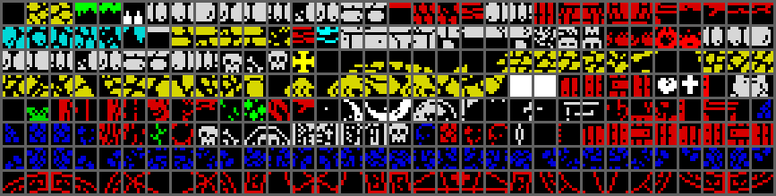

# 2. Data structures

The game state is a block of byte variables at $8501-$855E, Jean's own
variables at $A894, and eleven 22-byte object slots at $C100 that hold every
creature, item and projectile of the room. Rooms are bytecode scripts that
fill a 32 x 22 tile map and a flag map of the same shape; creatures and items
come from two record tables keyed by room. This section gives the layout of
each structure; the code that uses them is described in the sections that
follow.

## Positions

| Unit | Meaning | Range |
| --- | --- | --- |
| cell | a character cell of the room: row 0-21, column 0-31. Tile map, flag map, items and checkpoints use cells | |
| 2-pixel unit | the high byte of a position word; 4 units to a cell. x / 4 is the byte column of a sprite and x AND 3 its shift phase (0, 2, 4 or 6 pixels) | x 0-$7F, y 0-$57 |
| position word | 8.8 fixed point: the low byte is a fraction of a unit. Jean, the creatures and the projectiles keep x and y as words; speeds are 8.8 words in units per frame | |

The room area is 256 x 176 pixels (128 x 88 units). A coordinate just left
of or above the room wraps to $FC-&#36;FF or $FA-&#36;FF ([CheckRoomExit](../src/player.asm#L1015), F76).

## Game variables

All at $8501-$855E ([`src/variables.asm`](../src/variables.asm)). A new game
clears $8512-$854D and then sets the lives to 9 (F123).

| Address | Name | Meaning |
| --- | --- | --- |
| $8501 | [CutsceneDone](../src/variables.asm#L7) | set by an actor when a cutscene of the ending is over |
| $8502 | [PressedKeyMask](../src/variables.asm#L21), [PressedKeyRow](../src/variables.asm#L23) | bit mask and half-row of the key held, written every frame by the menu routine [MenuFrame](../src/controls.asm#L548) for the key redefinition |
| $8504 | [InterruptRoutine](../src/variables.asm#L34) | word: the routine the interrupt handler calls ([Game loop](04-game-loop.md)) |
| $8506 | [MachineType](../src/variables.asm#L44) | 1 on a 48K; on a 128K the port $7FFD value of the music bank |
| $8507 | [PagingState](../src/variables.asm#L53) | last value written to port $7FFD |
| $8508 | [UnusedByte](../src/variables.asm#L61) | unused |
| $8509 | [RoomNumber](../src/variables.asm#L77) | current room, 0-25 |
| $850A | [RoomTableEnd](../src/variables.asm#L87) | constant $1A, read together with the room as a word: the end mark of the room tables |
| $850B | [ExitDirection](../src/variables.asm#L98) | side of the last room exit: 0 right, 1 left, 2 down, 3 up; the next room is swept in from it (F41) |
| $850C | [RoomState](../src/variables.asm#L116) | what the main loop does next; bit 7 lets the frame routine run the game logic ([Game loop](04-game-loop.md)) |
| $850D | [RoomNameString](../src/variables.asm#L125) | string number of the room name in the status bar |
| $850E | [ParchmentLine1](../src/variables.asm#L137), [ParchmentLine2](../src/variables.asm#L139) | string numbers of the two lines of the parchment being read |
| $8510 | [BloodAnimTimer](../src/variables.asm#L150) | countdown of the bubbling blood (rooms 21-23) |
| $8511 | [CrossFlashTimer](../src/variables.asm#L159) | countdown of the colour step of the ring of crosses |
| $8512 | [RespawnX](../src/variables.asm#L177), [RespawnY](../src/variables.asm#L181) | two words: where Jean appears when a room is entered in state 2 or 4 |
| $8516 | [PlayerBoxXMax](../src/variables.asm#L198) | 4 bytes: Jean's hit box, right, left, bottom and top edge, rebuilt every frame |
| $851A | [ChurchDoorShut](../src/variables.asm#L216) | $FF once Jean has entered the Abandoned church (room 7) |
| $851B | [BellRung](../src/variables.asm#L242) | the bell of room 2: 0 or 1 |
| $851C | [LeverRoom9](../src/variables.asm#L244), [LeverRoom10](../src/variables.asm#L246) | the levers of rooms 9 and 10: 0 or 1 |
| $851E | [WheelState](../src/variables.asm#L248) | the wheel of faith of room 17: 0 at rest, 6 turned, bit 7 = still touched (F31) |
| $851F | [LeverRoom20](../src/variables.asm#L250) | the lever of room 20 |
| $8520 | | unused |
| $8521 | [ChaliceTaken](../src/variables.asm#L266) | $FF once the chalice is taken |
| $8522 | [SatanSmoked](../src/variables.asm#L277) | $FF once Satan has turned to smoke |
| $8523 | [DoorwayRoom10](../src/variables.asm#L292), [DoorwayRoom19](../src/variables.asm#L294) | the two arches; bit 7 = Jean has just arrived through it (F32) |
| $8525-$8540 | [HeartRoom2](../src/variables.asm#L321) to [WheelCrossRoom22](../src/variables.asm#L375) | one flag per pick-up item, $FF = taken: 9 hearts, 6 parchments, the red scroll ([RedScrollTaken](../src/variables.asm#L351)), 12 crosses |
| $8541 | [CrossRingCount](../src/variables.asm#L391) | crosses of the ring drawn so far in room 24, 0-12 |
| $8542 | [CrossRingDone](../src/variables.asm#L393) | set to 12 with the twelfth cross, cleared by Satan's smoke; nothing reads it |
| $8543-$854B | [CheckpointFlag0](../src/variables.asm#L408) to [CheckpointFlag8](../src/variables.asm#L424) | the active checkpoint: all 0, or one nonzero (F33) |
| $854C | [Lives](../src/variables.asm#L435) | 9 at the start, at most 9 from hearts (F122) |
| $854D | [Crosses](../src/variables.asm#L444) | crosses collected, 0-12 |
| $854E | [SoundPlaying](../src/variables.asm#L452) | beeper effect playing (0 none) |
| $854F | [SoundRequest](../src/variables.asm#L470) | effect requested by the game; replaces the one playing (F104, F107) |
| $8550 | [UnusedByte2](../src/variables.asm#L476) | unused |
| $8551 | [MusicTrack](../src/variables.asm#L488) | track for the 128K music player; not read on a 48K |
| $8552 | [SpawnQueueCount](../src/variables.asm#L501) | requests waiting in the object list |
| $8553 | [CrossColours](../src/variables.asm#L510) | 6 attributes the ring of crosses cycles through |
| $8559 | [ProbeRight](../src/variables.asm#L524) | 4 bytes: tile flags around the chasing face of room 11 |
| $855D | [RedrawListPtr](../src/variables.asm#L540) | word: write pointer of the redraw run list |
| $855F-$8584 | [InterruptStack](../src/variables.asm#L550) | the interrupt handler's stack |

Jean's variables are in the player module (&#36;A894-&#36;A8A4), next to his code:

| Address | Name | Meaning |
| --- | --- | --- |
| $A894 | [PlayerState](../src/player.asm#L30) | 0 none (intro, ending), 1 dying, 2 jumping, 3 crouching, 4 standing or walking, 5 falling, $FF debug room warp |
| $A895 | [PlayerAnimTimer](../src/player.asm#L33) | frames to the next animation frame |
| $A896 | [PlayerFrame](../src/player.asm#L35) | animation frame |
| $A897 | [PlayerFacing](../src/player.asm#L37) | 0 right, 1 left |
| $A898 | [PlayerSpeedY](../src/player.asm#L39) | word: vertical speed, 8.8 units per frame; $01FE at the start of a jump (F71) |
| $A89A | [PlayerSpare](../src/player.asm#L41) | word, unused |
| $A89C | [PlayerTileHead](../src/player.asm#L43) | 4 bytes: tile flags found at the head, right side, feet and left side this frame |
| $A8A0 | [PlayerHit](../src/player.asm#L51) | 0, or 4 (harmful tile), $FF (creature), 2 (the pyre of the ending): Jean dies (F73) |
| $A8A1 | [PlayerX](../src/player.asm#L53), [PlayerY](../src/player.asm#L55) | position words; a new game starts at X $2400, Y $4400 |

The control variables (key table, control bits, key rows) are at
$A2B7-&#36;A2DA and are described in [Title and menus](03-title-and-menu.md).
Several more flags are single instructions that the code rewrites (a `RET`
or a `NOP` as the first byte of a routine); they are listed in
[Game loop](04-game-loop.md).

## Room scripts

Each room is drawn by a script: [RoomScriptTable](../src/roomscripts.asm#L8) holds 26 words, the
script of room n at $7236 + 2n, and [EnterRoom](../src/mainloop.asm#L188) runs it with the
interpreter [RunScript](../src/script.asm#L84) (F13). The same bytecode draws the title, the
menus, the parchments, the Game Over screen and the ending texts. A byte
below $80 is a character, printed in the proportional font at the text
cursor; a byte of $80 or more is a command, whose handler is the word at
[ScriptOpTable](../src/hud.asm#L323) + 2 (code - $80). Commands $83, $95 and $9C run a
subscript, which ends with its own $80. Tile commands write the tile number
into the tile map and the tile's flags into the flag map ([PlaceTile](../src/script.asm#L489)); the
screen is redrawn from the two maps afterwards.

Operands are bytes unless marked: y and x a cell row and column (pixel row
and column where noted), w and h a width and height in cells, t a tile
number, a an attribute, n and k counts, `word` an address; `(y x)*k` is a
list of k positions. The short names are those of the comments in
[`src/roomscripts.asm`](../src/roomscripts.asm).

| Code | Name | Operands | Effect | Handler |
| --- | --- | --- | --- | --- |
| $80 | END | | end of the script or subscript | [OpEnd](../src/script.asm#L116) |
| $81 | FILLPIX | y x w h b | fill w bytes x h pixel rows of the bitmap with b; y is a pixel row | [OpFillPixels](../src/script.asm#L131) |
| $82 | ALIGN | mode y | alignment of the next numbered string (1 left, 2 centred, other right) and its pixel row | [OpSetTextAlign](../src/script.asm#L170) |
| $83 | CALL | word | run the subscript | [OpCallScript](../src/script.asm#L185) |
| $84 | PRINTVAR | word | print the string whose number is in the byte at the address | [OpPrintStringVar](../src/script.asm#L224) |
| $85 | PRINT | n | print string n | [OpPrintString](../src/script.asm#L206) |
| $86 | FILLTILE | y x w h t | fill a rectangle with tile t | [OpFillTiles](../src/script.asm#L264) |
| $87 | ROOMNAME | n | room name = string n ([RoomNameString](../src/variables.asm#L125)) | [OpSetRoomName](../src/script.asm#L305) |
| $88 | BLOCK | w h, w x h tiles | define the block pattern | [OpDefineBlock](../src/script.asm#L1355) |
| $89 | TILEBLOCK | y x w h | fill a rectangle with the block pattern, repeated | [OpFillWithBlock](../src/script.asm#L1275) |
| $8A | EDGES | mask | flag bit 1 on the border cells: bit 0 left column, 1 right column, 2 top row (bit 3 would write below the map, F6) | [OpFlagEdges](../src/script.asm#L1174) |
| $8B | STAMPS | n, t1..tn, k, (y x)*k | a row of n listed tiles at k positions | [OpStampRun](../src/script.asm#L333) |
| $8C | TILE1 | y x t | one tile | [OpPlaceTile](../src/script.asm#L377) |
| $8D | RUNS | y x t c, c counts | tile t along the rows from (y, x): the counts alternate between cells drawn and cells skipped | [OpTileStripes](../src/script.asm#L430) |
| $8E | CURSOR | y x | text cursor at pixel row y, pixel column x | [OpSetTextCursor](../src/script.asm#L748) |
| $8F | FILLATTR | y x w h a | fill attribute cells with a | [OpFillAttrs](../src/script.asm#L151) |
| $90 | REDRAWMARK | f | 1: mark every cell for redraw; 0: clear the marks | [OpMarkRedraw](../src/script.asm#L959) |
| $91 | PICTURES | t w h k, (y x)*k | a block of w x h tiles numbered t, t+1, ... at k positions | [OpStampTileBlock](../src/script.asm#L992) |
| $92 | STAMP1 | t k, (y x)*k | tile t at k positions | [OpStampOne](../src/script.asm#L318) |
| $93 | ROW | y x n, t1..tn | a row of n listed tiles | [OpTileRow](../src/script.asm#L398) |
| $94 | BITMAP | y x t c, c bytes | tile t where a two-level bit mask has bits set (F3) | [OpDrawTileMask](../src/script.asm#L1048) |
| $95 | IFZERO | word word | run the subscript at the first word if the byte at the second is 0 | [OpRunIfZero](../src/script.asm#L1128) |
| $96 | FLAGS | y x w h f | set the flag map bytes of a rectangle to f | [OpSetFlagRect](../src/script.asm#L1418) |
| $97 | SPRITESET | n | unpack sprite set n into the sprite sheet | [OpUnpackSprites](../src/script.asm#L1472) |
| $98 | RECTS | t k, (y x w h)*k | fill k rectangles with tile t | [OpFillTilesList](../src/script.asm#L242) |
| $99 | TILEBLOCKS | k, (y x w h)*k | fill k rectangles with the block pattern | [OpFillBlockList](../src/script.asm#L1255) |
| $9A | RUN1 | t y x n | a vertical line of n tiles t; no script uses it (F130) | [OpTileVLine](../src/script.asm#L1508) |
| $9B | RUNS_V | t k, (y x n)*k | k vertical lines of tile t | [OpTileVLines](../src/script.asm#L1488) |
| $9C | IFNZ | word word | run the subscript if the byte is not 0 | [OpRunIfNonZero](../src/script.asm#L1146) |
| $9D | WATER | y x a n | water strip of n cells with its reflection; the cells get the harmful flag 4 (F8, F115) | [OpSetupWater](../src/script.asm#L1555) |
| $9E | BLOOD | | start the bubbling blood of the bottom row (F116) | [OpAnimateBlood](../src/script.asm#L1617) |
| $9F | CROSSES | | start the ring of twelve crosses (F117) | [OpTwelveCrosses](../src/script.asm#L1630) |

The operand lengths decode every script of $726A-$83A7 to its end without
a gap (F1), and they reproduce all 522 command starts the interpreter
executed when every room was entered in the simulator (F13). The first lines
of [RoomScript05](../src/roomscripts.asm#L304), "Escape !!!", where a game starts:

```
  DEFB $97,$01            ; SPRITESET 1
  DEFB $87,$05            ; ROOMNAME 5 "Escape !!!"
  DEFB $83                ; CALL ScriptRoomPanel
  DEFW ScriptRoomPanel
  DEFB $83                ; CALL BlockGrassEarth
  DEFW BlockGrassEarth
  DEFB $99,$03,$14,$00,$20,$02,$13,$14 ; TILEBLOCKS 3 rectangles
  DEFB $06,$02,$12,$16,$04,$02
```

How the interpreter runs and what each room's script draws is in
[Rooms](05-rooms.md).

## Room objects

The creatures and moving things of every room are 77 records of 11 bytes in
[RoomObjects](../src/objects.asm#L259), ended by the room byte $1A. [SpawnRoomObjects](../src/sequences.asm#L419) scans the
whole table on room entry and makes a slot for every record of the current
room ([SpawnRoomObject](../src/sequences.asm#L451), F96, F102).

| Offset | Size | Meaning | Slot |
| --- | --- | --- | --- |
| +0 | 1 | room | |
| +1 | 1 | kind: index of the handler in [EntityHandlers](../src/entities.asm#L29) | +0 (handler word) |
| +2 | 1 | speed; times 4 it is an 8.8 word in units per frame | +2 (word) |
| +3 | 1 | animation delay or timer; for kind 1 the delay before the first crusader | +$12, +$13 |
| +4 | 1 | x, 2-pixel units | +7 |
| +5 | 1 | y, 2-pixel units | +9 |
| +6 | 1 | initial timer or animation state | +&#36;A, +&#36;B |
| +7 | 1 | lower patrol limit; countdown of the timer kinds; template low byte for kind 1 | +4 |
| +8 | 1 | upper patrol limit; its reload; template high byte for kind 1; end x of a kind 0 runner | +5 |
| +9 | 2 | behaviour block: how the kind looks and its hit box | +&#36;C-+&#36;F from the block, +$10 pointer |

| Kind | Handler | What (rooms) |
| --- | --- | --- |
| 0 | [UpdateIntroRunner](../src/entities.asm#L1116) | Jean and three crusaders crossing the intro screen (0) |
| 1 | [UpdateCrusaderSpawner](../src/entities.asm#L136) | makes a running crusader every 40 frames from a template (5, 6, 25) |
| 2, 3 | [UpdateWalkLeft](../src/entities.asm#L775), [UpdateWalkRight](../src/entities.asm#L1045) | horizontal patrols starting left or right: rats, bats, worms, skeletons, soldiers, ghosts, flyers, devils |
| 4, 5 | [UpdateWalkDown](../src/entities.asm#L998), [UpdateWalkUp](../src/entities.asm#L710) | vertical patrols starting down or up: spiders, fireballs, flies |
| 6, 7 | [UpdateHangedDown](../src/entities.asm#L916), [UpdateHangedUp](../src/entities.asm#L636) | the hanged men of room 9 on their ropes (no record starts as kind 7) |
| 8 | [UpdateChaser](../src/entities.asm#L1397) | the grinning face of room 11 that follows Jean |
| 9 | [UpdateDropHanging](../src/entities.asm#L1579) | water drops (15, 19) |
| 10 | [UpdateArcher](../src/entities.asm#L1846) | skeleton archers (17, 21) |
| 11 | [UpdateStoneHead](../src/entities.asm#L1800) | stone heads in the wall that shoot arrows (20, 22) |
| 12 | [UpdatePlant](../src/entities.asm#L1997) | plants that spit seeds (14) |
| 13 | [UpdateFishWaiting](../src/entities.asm#L2431) | fish that jump out of the water (16, 19) |
| 14, 15 | [UpdateBeastHead](../src/entities.asm#L2619), [UpdateBeastFire](../src/entities.asm#L2705) | the Pestilent Beast and its fire breath (10) |
| 16 | [UpdateDeathLeft](../src/entities.asm#L3099) | Death (18) |
| 17 | [UpdateSatan](../src/entities.asm#L3519) | Satan (24) |

A patrol is one creature with two handlers that swap themselves in the
slot's first word at the limits (F86, F97). The creatures are described in
[Creatures](05-creatures.md).

## Room items

The things Jean can touch are 45 records of 8 bytes in [RoomItems](../src/objects.asm#L580), ended
by the room byte $1A. On room entry [SpawnRoomItems](../src/sequences.asm#L291) makes a slot for every
record of the room whose flag byte is not $FF ([SpawnItem](../src/sequences.asm#L314),
[MakeItemSlot](../src/sequences.asm#L355), F98).

| Offset | Size | Meaning |
| --- | --- | --- |
| +0 | 1 | room |
| +1 | 2 | address of the item's flag byte in the variables ($851B-$854B) |
| +3 | 1 | type, the index in [ObjectTypeTable](../src/objects.asm#L14) |
| +4 | 1 | row of the top left cell of the 16 x 16 sprite |
| +5 | 1 | column |
| +6 | 2 | action routine, entered with carry set when Jean touches the item; for a parchment the two string numbers of its lines |

| Type | Item | Records | Action | Flag |
| --- | --- | --- | --- | --- |
| 0 | heart | 9 | [ActionHeart](../src/gameframe.asm#L415) | $FF when taken |
| 1 | cross, takeable with the wheel at rest | 8 | [ActionCrossWheelRest](../src/gameframe.asm#L569) | $FF when taken |
| 2 | cross, takeable with the wheel turned | 4 | [ActionCrossWheelTurned](../src/gameframe.asm#L553) | $FF when taken |
| 3 | checkpoint | 8 | [ActionCheckpoint](../src/gameframe.asm#L273) | 2 when active |
| 4 | bell (room 2) | 1 | [ActionBellOrLever](../src/gameframe.asm#L496) | 1 when rung |
| 5 | parchment | 6 | [ParchmentHandler](../src/gameframe.asm#L757), [ActionParchment](../src/gameframe.asm#L785) | $FF when read |
| 6 | red scroll (room 24) | 1 | [ActionFinalScroll](../src/gameframe.asm#L236) | $FF when touched |
| 7 | church door trigger (room 7), no sprite | 1 | [ActionChurchDoor](../src/gameframe.asm#L173) | checkpoint flag 0 |
| 8 | arch (rooms 10, 19) | 2 | [ActionArchToRiver](../src/gameframe.asm#L365), [ActionArchToBeast](../src/gameframe.asm#L339) | bit 7 latch |
| 9 | lever (rooms 9, 10, 20) | 3 | [ActionBellOrLever](../src/gameframe.asm#L496), [ActionGateLever](../src/gameframe.asm#L524) | 1 when pulled |
| 10 | wheel of faith (room 17) | 1 | [ActionWheel](../src/gameframe.asm#L304) | 0 or 6 |
| 11 | chalice (room 24) | 1 | [ActionChalice](../src/gameframe.asm#L469) | $FF when taken |

Every record touched in the simulator did what its type says (F69). The
type records ([ObjectTypeRecords](../src/objects.asm#L51), 8 bytes each) give what goes into the
slot: +0 frames between animation steps, +1 number of frames, +2 the slot
handler ([RoomItemHandler](../src/gameframe.asm#L129), or [ParchmentHandler](../src/gameframe.asm#L757) for type 5), +4 the
frame list, +6 sprite width in bytes (2), +7 height in units (8). Only the
heart (2 frames every 20), the crosses (6 every 5) and the arch (9 every 3)
animate by themselves; the other actions pick their frame from the flag. A
frame list ([FramesHeart](../src/objects.asm#L120) and on, 34 frames in all) has 4 bytes per frame:
the address of a 16 x 16 sprite in [SpriteArch](../src/graphics.asm#L24) and on (2 bytes per pixel
row, no mask), the attribute and a 0. The cross list has 12 frames: six
colours of the solid cross, then six of the thin one drawn while the cross
cannot be taken (F31). What each action does is in
[Items and the ending](05-items-ending.md).

## Behaviour blocks

A room object record points to a behaviour block in $93D3-$95FE
([BehaviourJean](../src/behaviours.asm#L41) and on). [SpawnRoomObject](../src/sequences.asm#L451) copies its first four bytes
to slot +&#36;C-+&#36;F and keeps the address of byte 5 in slot +$10, through which
the handler reads the rest. The walking and flying kinds (0, 2-6, 8) share
one layout:

| Offset | Size | Meaning |
| --- | --- | --- |
| +0 | 4 | hit box: top, left, bottom and right edge relative to the position, in units (F100) |
| +4 | 1 | number of animation frames, copied to slot +$15 (1 for the hanged men and the Beast's head, 2 for the others; the block's comment calls the byte unknown, [SpawnRoomObject](../src/sequences.asm#L451) and [StepAnimation](../src/gameframe.asm#L897) use it as the frame count; inferred) |
| +5 | 1 | attribute |
| +6 | 2 | table of (first column, width) pairs, one per x AND 3, into the pre-shifted copies of the sprite sheet ([ShiftPairs](../src/player.asm#L907)) |
| +8 | 1 | height in units |
| +9 | 2 | list of sprite sheet addresses for the first direction (left or up), one per frame |
| +&#36;B | 2 | the same for the second direction (right or down) |

The other kinds keep the hit box and byte 4 and differ after it (attribute,
height and width, then the sprite addresses): the drops, the archers, the
stone heads, the plants, the fish, the Beast, Death (with its own shift table
for a sprite 19 columns wide per frame) and Satan (two sprite halves). The
same area holds the sprite blocks of the projectiles and the ending's actors
(attribute, shift table, height, sprites), which the templates point to, for
example [SpriteBlockFireball](../src/behaviours.asm#L322) and [SpriteBlockScythe](../src/behaviours.asm#L555).

## Object slots

Eleven slots of 22 bytes at [ObjectSlots](../src/buffers.asm#L119) (&#36;C100-&#36;C1F1) hold everything
that moves or can be touched in the room, followed by the end mark at $C1F2,
a handler word that points to [EndOfSlots](../src/gameframe.asm#L112). Word 0 of a slot is its
handler, 0 for a free slot. [RunObjectSlots](../src/gameframe.asm#L92) sets SP to each slot in turn
and executes `RET`, which enters the handler with SP pointing at the slot's
next word: the handler `POP`s its own state and ends with a jump to the next
slot (F34; [Creatures](05-creatures.md)). The layout after word 0 belongs to
the handler; three layouts are made by the three spawners (F80):

| Offset | Room item ([MakeItemSlot](../src/sequences.asm#L355)) | Room object ([SpawnRoomObject](../src/sequences.asm#L451)) | From a template ([SpawnQueuedObjects](../src/sequences.asm#L221)) |
| --- | --- | --- | --- |
| +0 | handler [RoomItemHandler](../src/gameframe.asm#L129) | handler of the kind | handler |
| +2 | row, column (bytes) | speed (word) | x speed (word) |
| +4 | action routine (word) | lower, upper limit | y speed (word) |
| +6 | flag address (word) | x (word) | x (word) |
| +8 | frame countdown, reload | y (word) | y (word) |
| +&#36;A | frame, number of frames | timer, reload | hit box near corner (y, x) |
| +&#36;C | frame list (word) | hit box near corner (y, x) | hit box far corner (y, x) |
| +&#36;E | width, height | hit box far corner (y, x) | sprite block pointer |
| +$10 | | sprite block pointer (byte 5 of the behaviour block) | animation counter, reload |
| +$12 | | animation counter, reload | frame, number of frames |
| +$14 | | frame, number of frames | not set by the spawner |

The hit box words hold edges, not sizes: [HitTest](../src/gameframe.asm#L821) adds both to the
position to get the near and the far corner (F100). With 11 slots for at most
10 items and objects in one room (room 15) the room spawners never run out;
spawns during play are dropped when every slot is busy (F110, F126).

## Templates and the object list

Objects made during play (arrows, seeds, fireballs, scythes, flames, splashes,
the smoke, the ending's actors) are copied from templates in $BC92-&#36;BDD9
([ArrowLeftTemplate](../src/templates.asm#L26) and on). A creature that shoots writes a 4-byte
request (template address, y, x) to the object list at $5DC0 through
[ObjectListPtr](../src/buffers.asm#L15) and counts it in [SpawnQueueCount](../src/variables.asm#L501); at the end of the
frame [SpawnQueuedObjects](../src/sequences.asm#L221) turns every request into a slot (F55):

| Template bytes | Slot |
| --- | --- |
| 0-5: handler, x speed, y speed | +0 to +5 |
| 6: x offset (signed, units) | +6 = 0, +7 = x + offset |
| 7: y offset | +8 = 0, +9 = y + offset |
| 8-17: hit box, sprite block, animation | +&#36;A to +$13 |

A template of 16 bytes is followed directly by the next one, so the copy
takes that template's first two bytes into slot +$12/+$13; the projectile
handlers do not read them (F55). The crusaders
of the chase rooms are copied whole (22 bytes) by their spawner
([CrusaderTemplateRoom5](../src/entities.asm#L79), F118), and Satan's smoke ([SmokeTemplate](../src/templates.asm#L172)) is
copied over Satan's own slot (F53). The ending's two actor lists
([CutsceneList1](../src/cutscenelists.asm#L14)) are a count followed by requests in the same 4-byte form.

## Checkpoints

[Checkpoints](../src/templates.asm#L364) holds ten records of 3 bytes: room, row, column. Records 1-9
belong to the nine flags [CheckpointFlag0](../src/variables.asm#L408)-[CheckpointFlag8](../src/variables.asm#L424); the tenth is
the start of a game. [SelectCheckpoint](../src/templates.asm#L315) takes the record of the first
nonzero flag, or the tenth when all are 0, and sets the respawn position to
column x 4, row x 4 (F33).

| Record | Room | Row, column | Flag set by |
| --- | --- | --- | --- |
| 1 | 7 Abandoned church | 16, 2 | the church door trigger (1) |
| 2 | 8 The Altar | 17, 7 | checkpoint item (2) |
| 3 | 11 Cave of illusions | 17, 14 | checkpoint item |
| 4 | 12 Plagued ruins | 7, 8 | checkpoint item |
| 5 | 14 Hidden garden | 17, 8 | checkpoint item |
| 6 | 15 Gloomy tunels | 7, 21 | checkpoint item |
| 7 | 19 Underground river | 11, 8 | checkpoint item |
| 8 | 21 Evil church | 5, 19 | checkpoint item |
| 9 | 23 Ashes to ashes | 17, 17 | checkpoint item |
| 10 | 5 Escape !!! | 17, 9 | none: the start |

## Tiles, the tile map and the flag map

A room is 22 rows of 32 cells. The tile map at $5B00 holds a tile number per
cell; the flag map three pages higher, at $5E00, holds a flag byte per cell
(F68). Three tables of 256 entries describe the tiles:

| Table | Address | Contents |
| --- | --- | --- |
| [TileFlags](../src/tiles.asm#L36) | $CD00 | the flag byte a cell gets when the tile is placed |
| [TileAttrs](../src/tiles.asm#L61) | $CE00 | the attribute of the tile |
| [TileGfx](../src/tiles.asm#L90) | $CF00 | 8 bytes of bitmap, tile n at $CF00 + 8n |

A flag map byte:

| Bits | Meaning |
| --- | --- |
| 7 | redraw this cell in the next drawing pass |
| 6 | a sprite was drawn on this cell; the next pass turns it into bit 7, which erases the sprite (F40) |
| 0-2 | class of the tile |

| Class | Byte | Tiles | Meaning |
| --- | --- | --- | --- |
| 0 | $80 | $25, $75-$76, $7B-$7C, $7E-$86, $88-&#36;B7, $C0-&#36;FF | background |
| 1 | $81 | $10, $26, $87 | platform solid from above only (F74) |
| 3 | $83 | the walls and floors: $00-$04, $06-$0F, $11-$24, $27-$3A, $3D-$4D, $77-$7A, $7D, $B8-&#36;BF | bit 1 blocks walking and the head, bit 0 can be stood on (F7, F74) |
| 4 | $84 | $05, $3B-$3C, $4E-$74 | harmful: kills Jean, removes a scythe (F56) |

Class 2 (bit 1 alone) is used by no tile; script command $8A sets bit 1 on
the border cells of a room, which makes an edge a wall. Every tile flag has bit 7 set, so a room that has
just been built is drawn in full. [TileMapAddress](../src/helpers.asm#L141) and [FlagMapAddress](../src/helpers.asm#L166)
give the address of a cell; [FlagRowTable](../src/startup.asm#L171) holds the address of each flag
map row for the creature code.



## Font

The text of the game is drawn in a proportional font 16 pixel rows high
([DrawGlyph](../src/script.asm#L531)). [FontIndex](../src/font.asm#L11) has a word for each character $20-$7F: bits
0-11 are the offset of the glyph from the address of the word's high byte,
bits 12-15 the width in pixels minus 2 (2-17 pixels; the width is also the
advance). A glyph in [FontGlyphs](../src/font.asm#L50) is a 16-bit mask, bit 15 for pixel row 0,
followed by one pattern for each set bit; a clear bit repeats the row above.
A pattern is one byte for glyphs up to 8 pixels wide and two bytes, right
byte first, for wider ones (F22, read from the code; a W drawn by the routine
in the simulator is 13 pixels wide).

## Texts

[RoomNames](../src/text.asm#L18) starts a table of 53 strings, each a length byte and that many
ASCII characters; [FindString](../src/script.asm#L791) finds string n by stepping over n strings.

| Strings | Contents |
| --- | --- |
| 0-24 | room names; 0 and 4 are the placeholders ":)" and ":&#36;", never shown (F129) |
| 25-36 | the six parchments, two lines each ([ParchmentTexts](../src/text.asm#L54)) |
| 37 | "G a m e  O v e r" ([GameOverText](../src/text.asm#L72)) |
| 38-42 | the intro text ([IntroText](../src/text.asm#L81)) |
| 43-45 | Satan's words ([SatanText](../src/text.asm#L93)) |
| 46-48 | "Heresy!!! ..." ([HeresyText](../src/text.asm#L103)) |
| 49-52 | the last words of the ending ([EndingText](../src/text.asm#L112)) |

The menus, the controls screen and the title script print their texts as
characters inside scripts, not as numbered strings
([ScriptControlsScreen](../src/controls.asm#L641), [ScriptTitle](../src/controls.asm#L741)).

## Sprite sheet and packed sprite sets

The creatures and Jean are drawn from the sprite sheet at $D700-&#36;FEFF: 40
pages of 256 bytes, page $D7 + r holding pixel row r, so the byte of row r
and column c is at $D700 + 256r + c and a sprite is a run of columns read
down the pages ([SpriteSheet](../src/spritesheet.asm#L25), [SpriteSheetLower](../src/spritesheet.asm#L278)). A sprite address has
the first pixel row in the high byte and the first column in the low byte.

| Columns | Rows | Contents |
| --- | --- | --- |
| $00-$62 | 0-23 | Jean: 9 frames of 11 columns, each frame as four copies shifted by 0, 2, 4 and 6 pixels (2, 3, 3 and 3 columns); frames 6-8 are the flames of his death |
| $00-$2F | 24-39 | Jean crouching: 4 frames of 12 columns |
| $30-$62 | 24-39 | small sprites: projectiles, drops, flames, stone heads, plants, fish |
| $63-&#36;FF | 0-39 | the room's sprites, unpacked from the packed sets on room entry |

The 20 packed sets ([PackedSet0](../src/graphics.asm#L308)-[PackedSet19](../src/graphics.asm#L635), $68CC-$717E) are
unpacked by script command $97 through [UnpackSpriteSet](../src/unpack.asm#L86), with the record
of the set in [UnpackRecords](../src/unpack.asm#L24) (6 bytes each):

| Offset | Size | Meaning |
| --- | --- | --- |
| +0 | 2 | destination in the sheet (page = first pixel row, low byte = first column) |
| +2 | 2 | address of the packed set |
| +4 | 1 | flags: bit 7 adds after each frame three copies shifted right by 2, 4 and 6 pixels (N + 1 columns each); bit 6 adds after all frames a mirrored copy of every frame |
| +5 | 1 | frame width N in columns |

A packed set starts with two bytes, the number of columns and the height in
character rows. Then, for each column and each character row, a flag byte is
followed by the literal pixel bytes it asks for: a set bit (most significant
first) takes the next byte of the stream, a clear bit repeats the previous
pixel byte of the column, which is 0 at the top of a column and carries over
from one character row to the next (F113). A model of this format and of the
shifted and mirrored copies reproduces every byte the game writes for all 20
records (F114). The mirror uses a table of bit-reversed bytes that
[BuildMirrorTable](../src/templates.asm#L388) builds at $C500 on every room entry. Drawing from the
sheet is described in [Screen drawing](05-drawing.md).

## Drawing lists

Three lists pass the sprites of a frame from the game logic to the screen;
[Game loop](04-game-loop.md) describes when each is built and run, and
[Screen drawing](05-drawing.md) how.

| List | Address | Entry |
| --- | --- | --- |
| frame call list | [FrameList](../src/buffers.asm#L44) $BE5A, pointer [FrameListPtr](../src/buffers.asm#L26) | 10 bytes: routine ([QueueSprite](../src/sprites.asm#L38) or [QueueBlockSprite](../src/redraw.asm#L635)), position (y, x/4), sprite address, width in bytes, height in units, an unused byte, attribute ([SpriteCmd](../src/player.asm#L952)); closed by the word [LeaveFrameList](../src/templates.asm#L291); room for 16 (F38, F44) |
| draw queue | [DrawQueue](../src/buffers.asm#L69) $C000 | 16 jobs of 16 bytes: routine, graphics, rows, position, offset, height, width, attribute ([SpriteJob](../src/sprites.asm#L185), F39) |
| redraw run list | [RedrawRuns](../src/buffers.asm#L144) $C200 | per row: row, number of runs, then (first column, cell index) per run; $FF ends it. The cells' lengths, attributes and 8 pixel rows are at $C300, $C400 and the pages $C500-&#36;CC00 (F99) |
