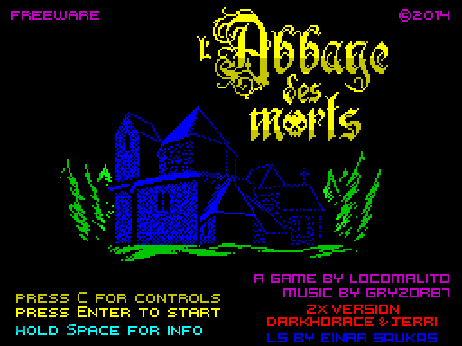
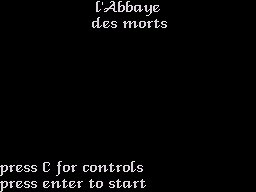
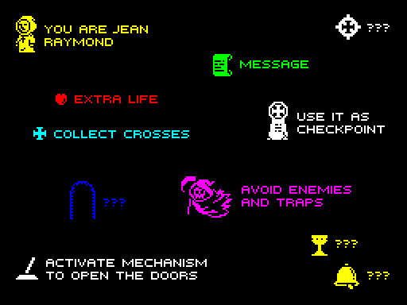
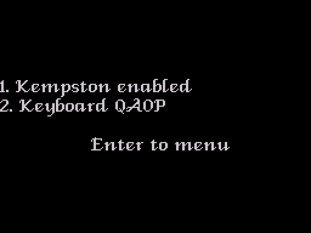
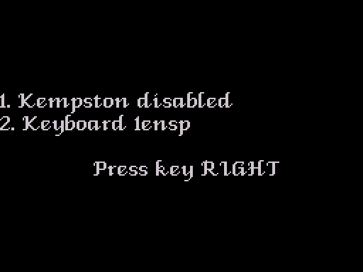
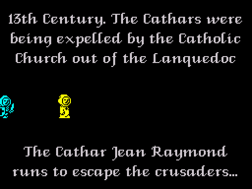
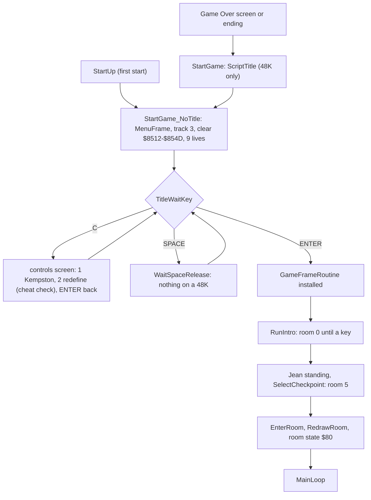
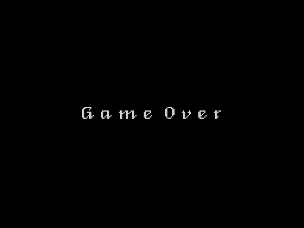

# 3. Title, menus and the start of a game

There is no title code on the first start: the loading screen is the title,
and the game only waits for a key. The menus are drawn by the same script
interpreter as the rooms and read the keyboard through a frame routine that
runs in the interrupt. This section covers the title, the controls menu with
the key redefinition and the Kempston switch, the RAGE cheat hidden in the
redefinition, the intro in room 0 and what a new game resets.

## The title



[StartUp](../src/startup.asm#L39) ends with a jump to [StartGame_NoTitle](../src/mainloop.asm#L70), past the call that
draws [ScriptTitle](../src/controls.asm#L741), so the loading screen that the loader unpacked stays
up as the title. Its three prompts, "press C for controls", "press Enter to
start" and "hold Space for info", are part of the picture
([`data/loading.scr`](../data/loading.scr)).

When a game ends, by Game Over or after the ending, the main loop jumps to
[StartGame](../src/mainloop.asm#L65), which on a 48K draws [ScriptTitle](../src/controls.asm#L741): the title in the
proportional font and the first two prompts, white on black. On a 128K the
`DEC A / CALL Z` skips the script (F111); there the stub at
[StartGame_Music](../src/mainloop.asm#L74) unpacks the loading screen again from the music bank
([Overview](01-overview.md#48k-and-128k), inferred).



From [StartGame_NoTitle](../src/mainloop.asm#L70) on, both cases are the same:

1. [MenuFrame](../src/controls.asm#L548) becomes the interrupt's frame routine ([InterruptRoutine](../src/variables.asm#L34)).
   Every frame it plays a step of the beeper effect, reads the keyboard into
   [KeyRows](../src/controls.asm#L191) ([ScanKeyboard](../src/helpers.asm#L221)), stores the first key held as (half-row,
   mask) in [PressedKeyMask](../src/variables.asm#L21) ([FindPressedKey](../src/controls.asm#L83)) and its code in
   [KeyCode](../src/controls.asm#L180) ([GetKeyCode](../src/controls.asm#L212)).
2. [MusicTrack](../src/variables.asm#L486) is set to 3 (read by the 128K player only).
3. The 60 bytes $8512-$854D are cleared and [Lives](../src/variables.asm#L433) is set to 9, the
   status bar redraws are armed and Jean's animation timer is set to 8 (see
   [A new game](#a-new-game)).
4. [TitleWaitKey](../src/controls.asm#L305) enables interrupts (the first `EI` after the loader, on
   the first start), waits with `HALT` until no key is held, then waits for
   ENTER, SPACE or C. Other keys are ignored.

| Key | Effect |
| --- | --- |
| ENTER | return to [StartGame](../src/mainloop.asm#L65), which starts the intro and the game |
| SPACE | calls [WaitSpaceRelease](../src/controls.asm#L245). On a 48K its first byte is `RET`: nothing happens (observed: `tests/inputs/info.txt` holds SPACE for 250 frames and the title stays). On a 128K the `RET` becomes a `CALL` that shows the info screen from the music bank while SPACE is held (inferred, [Overview](01-overview.md#48k-and-128k)) |
| C | the controls screen |



The info screen of the image above is the second stream of tape block 3
([`data/info.scr`](../data/info.scr)). On a 48K the loader leaves it packed
at $6C4B and the game, unpacked over it, destroys it, so the "hold Space for
info" prompt of the 48K title does nothing.

## The controls screen



C calls [SaveMenuArea](../src/controls.asm#L566), which copies the bitmap of the middle third of the
screen ($4800-$4FFF) to $C500 and the whole attribute file to $5B00, two
buffers of the game that are idle while the menus are up. The script
[ScriptControlsScreen](../src/controls.asm#L641) then makes every attribute black, clears the middle
third and prints "Enter to menu"; [ScriptKeyboardLine](../src/controls.asm#L678) prints
"2. Keyboard" with the key names, and [DrawKempstonLine](../src/controls.asm#L620) prints
"1. Kempston enabled" or "disabled". The top and bottom thirds keep their
pixels under black attributes, so only the middle third needs saving.
[RestoreMenuArea](../src/controls.asm#L579) copies both parts back with the same code: it patches an
`EX DE,HL` over the two `NOP`s in front of the `LDIR`s of [CopyMenuArea](../src/controls.asm#L592),
which reverses the copies.

The menu loop ([ControlsMenuLoop](../src/controls.asm#L341)) waits for a key with `HALT`:

| Key | Effect |
| --- | --- |
| 1 | [ToggleKempston](../src/controls.asm#L263): flips [KempstonSwitch](../src/controls.asm#L46) between `RET` and `NOP` and redraws the line |
| 2 | [RedefineKeys](../src/controls.asm#L355) |
| ENTER | back to the title ([TitleMenu](../src/controls.asm#L297): [RestoreMenuArea](../src/controls.asm#L579), then the title loop) |

## Keys and control bits

[ControlKeys](../src/controls.asm#L131) holds eight (half-row index, bit mask) pairs, one per
control bit. Every frame [ReadKeyControls](../src/controls.asm#L21) tests each pair against
[KeyRows](../src/controls.asm#L191) and builds the byte [ControlsRead](../src/controls.asm#L155); [GameFrame](../src/gameframe.asm#L20) derives
[ControlsHeld](../src/controls.asm#L164) and the bits newly pressed this frame, [ControlsPressed](../src/controls.asm#L172)
(F27).

| Bit | Control | Default key | Kempston |
| --- | --- | --- | --- |
| 0 | right | P | right |
| 1 | left | O | left |
| 2 | crouch | A | down |
| 3 | jump | Q | |
| 4 | jump (copy of bit 3's key) | Q | fire |
| 5 | debug room warp (with the cheat on) | T, fixed | |
| 6 | abort, with bit 7 | R, fixed | |
| 7 | abort, with bit 6 | Y, fixed | |

The keyboard sets both jump bits, the Kempston fire only bit 4; joystick up
is ignored (mask $17). R and Y held together during play set the room state
to 5, Game Over (F26). The half-rows are indexed in the order of the port
high bytes $FE, $FD, $FB, $F7, $EF, $DF, $BF, $7F; [KeyCodeTable](../src/controls.asm#L200) gives the
character of each key for the menus. There is no pause key and no sound
toggle (Q3).

### Redefining the keys



[RedefineKeys](../src/controls.asm#L355) blanks the 8-character name buffer [KeyNames](../src/controls.asm#L689) and calls
[RedefineOneKey](../src/controls.asm#L410) for JUMP, CROUCH, LEFT and RIGHT in that order (the
records at [PromptJump](../src/controls.asm#L384)). Each call prints "Press key" and the control's
name, waits until no key is held and then for a key, appends the key's name
to the buffer ([AddKeyName](../src/controls.asm#L463): one character, or "en", "sp", "cs", "ss" for
ENTER, SPACE and the shifts), requests sound effect 5 and stores the key's
(half-row, mask) in the control's pair. Any key is accepted, including keys
already used. Afterwards the JUMP pair is copied into the fifth pair,
[CheckCheatKeys](../src/controls.asm#L516) runs and the controls screen is drawn again.

The pair comes from [FindPressedKey](../src/controls.asm#L83), which scans each half-row from bit 4
down to bit 0, and the name from [GetKeyCode](../src/controls.asm#L212), which scans from bit 0 up.
With two keys of one half-row held at once the screen names one key and the
game uses the other (observed with P and I held for JUMP: the screen reads
P and the stored pair is that of I, F127).

### The Kempston joystick

[StartUp](../src/startup.asm#L39) reads port $1F 65536 times; when no reading ever has a bit of
0-4 set, it assumes an interface and writes `NOP` at [KempstonSwitch](../src/controls.asm#L46),
otherwise `RET` (F35). [KempstonSwitch](../src/controls.asm#L46) is the last byte of
[ReadKeyControls](../src/controls.asm#L21): as a `NOP` it lets the code fall into [ReadKempston](../src/controls.asm#L61),
which ORs the joystick bits into the control byte. The menu entry 1 flips the
byte. A joystick held during the start-up probe leaves it switched off; the
simulator answers 0 on port $1F, so the controls screen there reads
"Kempston enabled".

## The RAGE cheat

[CheckCheatKeys](../src/controls.asm#L516) runs after every redefinition. It XORs together the
eight bytes of the first four pairs of [ControlKeys](../src/controls.asm#L131) and the eight bytes of
[CheatKeyPairs](../src/controls.asm#L114) (E, G, A and R for right, left, crouch and jump), and when
the result is 0 it flips the opcode at [SmcWarpCheat](../src/player.asm#L568) between `JR` ($18)
and `JR Z` ($28):

```
CheckCheatKeys:
  LD HL,ControlKeys
  LD DE,CheatKeyPairs
  LD BC,CHEAT_BYTES*$0100 ; 8 bytes, running XOR in C
CheckCheatKeys_Loop:
  LD A,(DE)
  XOR (HL)
  XOR C                   ; accumulate
  LD C,A
  INC HL
  INC DE
  DJNZ CheckCheatKeys_Loop
  RET NZ                  ; not the cheat keys
  LD A,(SmcWarpCheat)     ; the opcode of the JR at SmcWarpCheat
  XOR CHEAT_OPCODE_FLIP   ; $18 <-> $28
  LD (SmcWarpCheat),A
  RET
```

Typed in the order of the prompts (JUMP, CROUCH, LEFT, RIGHT) the keys
spell R, A, G, E. Because only the XOR of all the bytes is tested, any four
keys whose bytes XOR to the same value work as well: Z, X, C and 5 do, and
59392 of the 2560000 possible key choices toggle the cheat (F24). Entering
such keys a second time turns the cheat off again; a new game does not reset
it (F123).

In [UpdatePlayer](../src/player.asm#L554) the flipped instruction follows a `BIT 5` test of the
newly pressed controls. As `JR` it always skips [EnterRoomWarp](../src/player.asm#L581); as
`JR Z` it skips it only while T is not pressed. T then sets
[PlayerState](../src/player.asm#L30) to $FF, and in that state [UpdatePlayer](../src/player.asm#L554) runs
[DebugWarpRoom](../src/cutscenelists.asm#L39) instead of Jean: Jean is not drawn and does not move, the
direction controls move to the room to the right, left, below or above
(through the normal room exits, so the room number wraps modulo 25 with the
byte quirk of F77), and T returns to normal play (F23, F119). With the RAGE
layout the warp keys are E, G, A and R.

## The intro: room 0



ENTER on the title returns to [StartGame](../src/mainloop.asm#L65), which makes
[GameFrameRoutine](../src/interrupt.asm#L175) the frame routine, clears [ExitDirection](../src/variables.asm#L98) and
[RoomState](../src/variables.asm#L116) and calls [RunIntro](../src/sequences.asm#L21). That routine sets [PlayerState](../src/player.asm#L30) to 0
(no player), enters room 0 and draws it: [RoomScript00](../src/roomscripts.asm#L97) clears the screen,
prints strings 38-42 centred and clears every redraw mark, so the room
drawing that follows ([RedrawRoom](../src/sprites.asm#L1147) draws only marked cells) leaves the
text alone. The runners pass between the two blocks of text. The room objects of room 0 are four runners of kind 0
([UpdateIntroRunner](../src/entities.asm#L1116)): Jean at x $F7 and three crusaders at $E3, $D7 and
$CB, all left of the room, running right until x reaches $80, where each
frees its slot. Jean runs at 1 pixel per frame and the crusaders at 0.75, so
he pulls ahead; they have no hit test (F92). Once they have gone the text
stays alone on the screen.

The loop of [RunIntro](../src/sequences.asm#L21) is the main loop's drawing half without its gates:
wait for a complete frame list ([WaitFrameList](../src/sequences.asm#L58)), run it, build and draw
the changed cells, read [KeyCode](../src/controls.asm#L180). It returns when any key is held, when a
control bit 0-4 is set (which includes the joystick), or when the room state
is 5. There is no demo: the intro waits for a key as long as it takes (F108).
R and Y held during the intro do not end the game there, because the start
of the game sets the room state again; still held, they end it on its first
frame of play (F128).

## A new game

After [RunIntro](../src/sequences.asm#L21) returns, [StartGame](../src/mainloop.asm#L65) sets [PlayerState](../src/player.asm#L30) to 4
(standing) and falls into the main loop's death branch: [SelectCheckpoint](../src/templates.asm#L315)
finds no checkpoint flag set and takes the tenth record of [Checkpoints](../src/templates.asm#L364),
room 5 at row 17, column 9, so Jean starts at X $2400, Y $4400 (F108). The
respawn position is copied to Jean, [EnterRoom](../src/mainloop.asm#L188) builds room 5 and
[RedrawRoom](../src/sprites.asm#L1147) sweeps it in, and the room state becomes $80: the game runs
([Game loop](04-game-loop.md)).



What a new game resets was checked by playing a game with the flags, the
crosses, the lives, the cheat and the cross ring changed, ending it with R
and Y, starting a second one and comparing its memory with a fresh start
(F123). The block $8512-$854D is cleared: the respawn position, the church
door, the bell, the levers, the wheel, the chalice and Satan flags, the
arches, every item flag, the cross ring, the checkpoints and the crosses;
the lives become 9 and the two status bar redraws are armed. Not reset: the
cheat byte at [SmcWarpCheat](../src/player.asm#L568), the redefined keys and the Kempston switch,
the two tile animation timers ($8510, $8511), the colour step of the ring of
crosses and the attribute of its tile $4C. None of these shows in play.

## Game Over

Room state 5 makes the main loop run [ScriptGameOver](../src/controls.asm#L761) (string 37,
"G a m e  O v e r", centred, white on black), set [MusicTrack](../src/variables.asm#L486) to 7, wait
for a key and its release ([WaitKeyPress](../src/helpers.asm#L9), [WaitKeyRelease](../src/helpers.asm#L27)) and jump to
[StartGame](../src/mainloop.asm#L65): the title script, then the title menu as above. There is no
high score. The state is set when the last life is lost (F73) or by R and Y
(F26).


