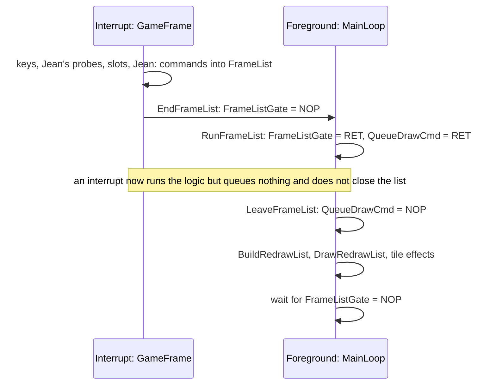
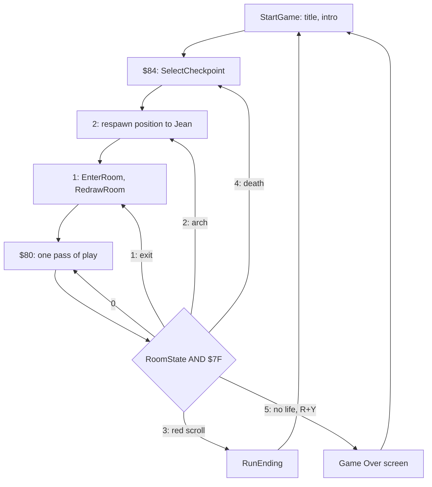

# 4. The game loop

The game runs in two halves that meet at one byte. The game logic runs in
the 50 Hz interrupt: every frame the IM 2 handler plays a step of the beeper
effect, reads the keys, moves Jean and every object, and leaves the sprites
of the frame as a list of draw commands. The foreground loop only draws: it
waits until a list is complete, runs it, and copies the changed cells to the
screen. When the drawing falls behind, frames of logic still run but their
pictures are not drawn, so the game keeps its speed in a busy room and shows
fewer pictures instead (F103).

## The interrupt handler

[StartUp](../src/startup.asm#L39) sets I = $84; the 257 bytes of [Im2Table](../src/im2table.asm#L11) are all $85, so the
vector is $8585 whatever the data bus holds. [InterruptHandler](../src/interrupt.asm#L30) at $8585
works on its own stack and leaves nothing on the interrupted one:

```
InterruptHandler:
  EX (SP),HL              ; HL = interrupted PC; the old HL is now on the stack
  LD (SmcInterruptReturn+$0001),HL ; return address: operand of the JP at $85B9
  POP HL                  ; HL as it was
  LD (SmcInterruptSP+$0001),SP ; interrupted SP: operand of the LD SP at $85B6
  PUSH BC                 ; no effect: writes BC below the interrupted SP,
  DI
  LD SP,InterruptHandler  ; interrupt stack, InterruptStack-$8584
  PUSH IX
  ...                     ; HL, AF, BC, DE, IY and the alternate set
  LD HL,(InterruptRoutine) ; frame routine address
  CALL JumpToHL           ; JP (HL): call the frame routine
  ...                     ; pop everything
  EI                      ; the only EI of the frame; takes effect after the LD
SmcInterruptSP:
  LD SP,SmcInterruptSP    ; SMC: the operand is the interrupted SP
SmcInterruptReturn:
  JP SmcInterruptReturn   ; SMC: the operand is the interrupted PC
```

The return address and the interrupted SP are stored in the operands of the
last two instructions, the registers go on [InterruptStack](../src/variables.asm#L548) ($855F-$8584),
and the handler leaves with `LD SP,nn` and `JP nn` instead of `RET`. The
reason is the foreground: while it runs a frame list, SP walks up through the
list at $BE5A as a data pointer ([below](#the-frame-call-list)), and just
under the start of the list lie the list pointers, the checkpoint table and
the code of [BuildMirrorTable](../src/templates.asm#L388). A handler that pushed its registers on the
interrupted stack would write over them (inferred). Here only the CPU's own
two-byte push and the stray `PUSH BC` land there, at worst on
[FrameListPtr](../src/buffers.asm#L26), which every game frame sets again. Interrupts stay disabled
for the whole handler, so a frame routine is never interrupted. The `EI`
before `LD SP` leaves a window of one instruction: an interrupt accepted
there would store $85B9 as the return address and hang on `JP $85B9`; it
would need a handler that ends exactly as the next interrupt arrives
(inferred, F112).

The word [InterruptRoutine](../src/variables.asm#L34) selects what a frame does:

| Routine | Installed by | Does |
| --- | --- | --- |
| [NoFrameRoutine](../src/mainloop.asm#L241) | [StartUp](../src/startup.asm#L39) | a `RET`; replaced by [MenuFrame](../src/controls.asm#L548) before interrupts are first enabled, so never called |
| [MenuFrame](../src/controls.asm#L548) | [StartGame_NoTitle](../src/mainloop.asm#L70) | beeper step, key scan for the menus ([Title and menus](03-title-and-menu.md)) |
| [GameFrameRoutine](../src/interrupt.asm#L175) | [StartGame](../src/mainloop.asm#L65) after ENTER on the title | beeper step ([PlaySoundStep](../src/mainloop.asm#L287)), then [GameFrame](../src/gameframe.asm#L20) |

[GameFrameRoutine](../src/interrupt.asm#L175) stays installed for the intro, the game, the parchments,
the ending and the Game Over screen; the room state decides how much of
[GameFrame](../src/gameframe.asm#L20) runs.

## One game frame

[GameFrame](../src/gameframe.asm#L20) runs once per interrupt (F103):

| # | Code | Does |
| --- | --- | --- |
| 1 | [ScanKeyboard](../src/helpers.asm#L221) | eight half-rows of port $FE into [KeyRows](../src/controls.asm#L191) |
| 2 | [ReadKeyControls](../src/controls.asm#L21) | the eight control bits into [ControlsRead](../src/controls.asm#L155); with the joystick on, [ReadKempston](../src/controls.asm#L61) adds port $1F |
| | | if bit 7 of [RoomState](../src/variables.asm#L116) is clear, stop here: no game logic while a room is built, a text window is up or the Game Over screen waits |
| 3 | | [ControlsPressed](../src/controls.asm#L172) = bits set now and not in the last frame; [ControlsHeld](../src/controls.asm#L164) = bits now. R and Y together: room state 5 (F26) |
| 4 | | [FrameListPtr](../src/buffers.asm#L26) = $BE5A: the frame call list starts empty |
| 5 | [ProbePlayer](../src/player.asm#L78) | Jean's hit box and the tile flags at his head, sides and feet; 4 in [PlayerHit](../src/player.asm#L51) on a harmful tile ([Jean](05-player.md)) |
| 6 | [RunObjectSlots](../src/gameframe.asm#L92) | every busy slot: items test Jean's box and act, creatures move, test their hit box and queue their sprites ([Creatures](05-creatures.md), [Items](05-items-ending.md)) |
| 7 | [UpdatePlayer](../src/player.asm#L554) | Jean's state machine: death on a hit, walking, jumping, falling, crouching; queues his sprite |
| 8 | [EndFrameList](../src/gameframe.asm#L59) | closes the list and opens the gate for the foreground, unless the foreground is running the previous list |
| 9 | [SpawnQueuedObjects](../src/sequences.asm#L221) | turns the requests of shooting creatures into slots, when [SpawnQueueCount](../src/variables.asm#L499) is not 0 |
| 10 | [CheckRoomExit](../src/player.asm#L1015) | Jean beyond an edge: next room, room state 1 |

The order has consequences that the later sections rely on:

- The items and creatures (6) test their boxes against the box
  [ProbePlayer](../src/player.asm#L78) built from Jean's position before he moves (5), and
  [UpdatePlayer](../src/player.asm#L554) (7) reads [PlayerHit](../src/player.asm#L51) in the same frame, so a touch
  kills in the frame it happens.
- Objects requested in a frame are created after all slots have run (9), so
  a new arrow or seed first moves in the next frame. When no slot is free
  the rest of the requests are dropped (F126).
- The room exit (10) comes last: a frame in which Jean leaves still runs
  every creature of the old room.

The frame logic takes from about 5,500 T-states (the intro) to about
16,000 (rooms 10 and 15) of the 69,888 of a frame, plus 7,000-9,000 for a
beeper effect, which plays before [GameFrame](../src/gameframe.asm#L20) (F105; measurements in
[Timing and speed](#timing-and-speed)).

## The frame call list

The creatures and Jean do not draw. Each copies a 10-byte draw command into
the frame call list at [FrameList](../src/buffers.asm#L44) (&#36;BE5A, pointer [FrameListPtr](../src/buffers.asm#L26)): the
address of a routine and the 8 bytes that routine pops ([SpriteCmd](../src/player.asm#L952),
[Data structures](02-data.md#drawing-lists)). [EndFrameList](../src/gameframe.asm#L59) appends the
address of [LeaveFrameList](../src/templates.asm#L291) and writes `NOP` over the `RET` at
[FrameListGate](../src/templates.asm#L252). The list is run without a `CALL`: [RunFrameList](../src/templates.asm#L272) sets
SP to the start of the list and returns into it, every command routine pops
its parameters and returns into the next command, and [LeaveFrameList](../src/templates.asm#L291)
puts SP back:

```
FrameListGate:
  RET                     ; RET until the list is complete; 0 (NOP) when it is
RunFrameList:
  LD A,OP_RET             ; RET
  LD (QueueDrawCmd),A     ; the code at $AA1F that queues a command now returns
  LD (FrameListGate),A    ; the list is taken
  LD (LeaveFrameList+$0001),SP ; saved SP: operand of the LD SP,nn
  LD SP,FrameList         ; start of the frame call list
  RET                     ; run the first command
LeaveFrameList:
  LD SP,LeaveFrameList    ; the operand is stored by RunFrameList
  XOR A
  LD (QueueDrawCmd),A     ; frame code may queue commands again
  RET                     ; return to the caller of FrameListGate
```

Two bytes of code are the whole handshake (F54):

- [FrameListGate](../src/templates.asm#L252) is a flag and an entry point at once. The foreground
  reads it with `LD A,(nn)`: 0 means a complete list is waiting, and a
  `CALL` to it then falls through into [RunFrameList](../src/templates.asm#L272). [RunFrameList](../src/templates.asm#L272)
  writes `RET` there first, so a list is taken once; [EnterRoom](../src/mainloop.asm#L188) also
  writes `RET`, so the first list of a room comes from a complete frame of
  that room.
- The first byte of [QueueDrawCmd](../src/player.asm#L445) is `RET` while the list runs. The
  queueing routines read it as a flag and do not touch the list then, and
  [GameFrame](../src/gameframe.asm#L20) skips [EndFrameList](../src/gameframe.asm#L59): an interrupt that arrives while the
  foreground is in the middle of the list runs the frame's logic but leaves
  the list alone, and that frame is never drawn.

When the foreground is late the other way, still drawing when the next frame
closes a new list, the new list simply replaces the waiting one: every frame
starts the list again at $BE5A. The foreground always draws the newest
complete frame.



## The main loop

The foreground is [StartGame](../src/mainloop.asm#L65) and [MainLoop](../src/mainloop.asm#L118): it starts a game and never
returns ([Title and menus](03-title-and-menu.md)). Each pass reads the low
7 bits of [RoomState](../src/variables.asm#L116); bit 7 only tells [GameFrame](../src/gameframe.asm#L20) to run the logic
(F25):

| State | Set by | The main loop |
| --- | --- | --- |
| $80 | the main loop, once a room is drawn | one pass of play: see below |
| 1 | [CheckRoomExit](../src/player.asm#L1015) when Jean crosses an edge (also the debug warp) | [EnterRoom](../src/mainloop.asm#L188), [RedrawRoom](../src/sprites.asm#L1147), state $80 |
| 2 | the arches between rooms 10 and 19 ([ActionArchToRiver](../src/gameframe.asm#L365), [ActionArchToBeast](../src/gameframe.asm#L339)) | Jean to the respawn position ([RespawnX](../src/variables.asm#L175)), then as 1 |
| 3 | the red scroll of room 24 ([ActionFinalScroll](../src/gameframe.asm#L236)) | [RunEnding](../src/sequences.asm#L113), then a new game at [StartGame](../src/mainloop.asm#L65) |
| $84 | the end of the dying animation with lives left ([UpdateDying_End](../src/player.asm#L525)) | [SelectCheckpoint](../src/templates.asm#L315): room and position of the active checkpoint, then as 2 |
| $85, 5 | the end of the dying animation with no life left; R and Y in [GameFrame](../src/gameframe.asm#L20) | Game Over screen, then [StartGame](../src/mainloop.asm#L65) |
| 0 | [EnterRoom](../src/mainloop.asm#L188) while it builds a room, [SelectCheckpoint](../src/templates.asm#L315), a text window ([ShowTextWindow](../src/hud.asm#L116) saves and restores the state), the end of a cutscene | not seen by the main loop: the code that sets it sets another state before the loop looks |



[EnterRoom](../src/mainloop.asm#L188) builds a room without drawing it: it builds the bit-reversed
byte table at $C500 ([BuildMirrorTable](../src/templates.asm#L388)), writes `RET` over the five
one-shot routines of the previous room, clears the draw queue, frees the 11
object slots, sets the room state to 0, runs the room's script, spawns the
room's items and objects, sets the music track and closes
[FrameListGate](../src/templates.asm#L252). [RedrawRoom](../src/sprites.asm#L1147) then draws every marked cell in a sweep
from the side Jean entered by, which takes 8-9 frames (F42). Meanwhile the
interrupt only reads the keys, because the room state is 0. How a room is
built is described in [Rooms](05-rooms.md).

### One pass of play

[MainLoop_Play](../src/mainloop.asm#L131) runs these in order:

| Code | Does |
| --- | --- |
| [RunEventScript](../src/hud.asm#L279) | one-shot: runs a script queued by an item or by Satan (the church door, the gate of room 20, the ring of crosses erased when Satan turns to smoke) |
| [ParchmentGate](../src/hud.asm#L88) | one-shot: shows the parchment just picked up ([ShowParchment](../src/hud.asm#L103)); the room state is 0 until a key is pressed |
| [DrawLivesBar](../src/sprites.asm#L1321) | one-shot: hearts in row 22 |
| [DrawCrossesHud](../src/hud.asm#L17) | one-shot: crosses in row 23 |
| | while [FrameListGate](../src/templates.asm#L252) is not 0, back to the first line |
| [FrameListGate](../src/templates.asm#L252) | = [RunFrameList](../src/templates.asm#L272): each command clips its sprite, marks the cells it covers for redraw and adds a job to the draw queue |
| [BuildRedrawList](../src/redraw.asm#L556) | collects the marked cells into runs, copies their tiles into the redraw buffers and draws the queued sprites into them |
| [DrawRedrawList](../src/redraw.asm#L32) | copies the buffered cells to the screen |
| [DrawWaterReflection](../src/effects.asm#L29) | rooms 16 and 19 only: the reflection in the water |
| [AnimateBloodTiles](../src/effects.asm#L187) | rooms 21-23 only: the bubbling blood |
| [ShowCrossRing](../src/effects.asm#L240) | room 24 only: the ring of crosses |

The four one-shot routines are called again and again while the loop waits
for the gate, so a parchment opens without waiting for a frame list. The
drawing itself is described in [Screen drawing](05-drawing.md), the three
tile effects in [Rooms](05-rooms.md).

The intro ([RunIntro](../src/sequences.asm#L21)) and the cutscenes of the ending ([RunCutscene](../src/sequences.asm#L167))
have their own copies of the drawing half, without the one-shot routines:
wait for the gate ([WaitFrameList](../src/sequences.asm#L58)), run the list, build and draw the
cells.

### Code that switches itself

Many flags of the loop are the first byte of a routine: `RET` (&#36;C9) for off,
`NOP` (0) for on. The caller always calls; the routine either returns at once
or runs, and a one-shot routine writes `RET` back over itself as it starts.

| Byte | Routine | Armed (NOP) by | Disarmed (RET) by |
| --- | --- | --- | --- |
| $BDDA | [FrameListGate](../src/templates.asm#L252) | [EndFrameList](../src/gameframe.asm#L59) | [RunFrameList](../src/templates.asm#L272), [EnterRoom](../src/mainloop.asm#L188) |
| $AA1F | [QueueDrawCmd](../src/player.asm#L445) (on while `NOP`) | [LeaveFrameList](../src/templates.asm#L291) | [RunFrameList](../src/templates.asm#L272) |
| $9CE7 | [RunEventScript](../src/hud.asm#L279) | [ActionChurchDoor](../src/gameframe.asm#L173), [ActionGateLever](../src/gameframe.asm#L524), [UpdateSatan](../src/entities.asm#L3519) | itself, [EnterRoom](../src/mainloop.asm#L188) |
| $9C51 | [ParchmentGate](../src/hud.asm#L88) | [ActionParchment](../src/gameframe.asm#L785) | [ShowTextWindow](../src/hud.asm#L116), [EnterRoom](../src/mainloop.asm#L188) |
| $9BF3 | [DrawLivesBar](../src/sprites.asm#L1321) | [StartGame](../src/mainloop.asm#L65), [ActionHeart](../src/gameframe.asm#L415), [UpdateDying_End](../src/player.asm#L525), [ShowTextWindow](../src/hud.asm#L116) | itself |
| $9C1B | [DrawCrossesHud](../src/hud.asm#L17) | [StartGame](../src/mainloop.asm#L65), [TakeCross](../src/gameframe.asm#L581), [ShowTextWindow](../src/hud.asm#L116) | itself |
| $AD88 | [DrawWaterReflection](../src/effects.asm#L29) | script command $9D | [EnterRoom](../src/mainloop.asm#L188) |
| $AE20 | [AnimateBloodTiles](../src/effects.asm#L187) | script command $9E | [EnterRoom](../src/mainloop.asm#L188) |
| $AE4B | [ShowCrossRing](../src/effects.asm#L240) | script command $9F | [EnterRoom](../src/mainloop.asm#L188) |

The same device switches the joystick ([KempstonSwitch](../src/controls.asm#L46)), the 128K hooks
and the cheat ([Title and menus](03-title-and-menu.md)); the full list of
self-modified code is in [Tricks](06-tricks.md).

## Timing and speed

A 48K frame is 69,888 T-states. The interrupt is accepted at T 19-34 of
the frame; [GameFrame](../src/gameframe.asm#L20) starts at about T 370, or at about T 8,000 when a
beeper effect is playing (F105). How long the rest takes depends on the
room. The table was measured in the simulator, entering each room directly
with Jean standing still and hits switched off: the T-states from the start
of [GameFrame](../src/gameframe.asm#L20) to [EndFrameList](../src/gameframe.asm#L59) and the length of one foreground pass,
from [RunFrameList](../src/templates.asm#L272) back to [MainLoop](../src/mainloop.asm#L118) with the interrupts that fall into
it (frames 40-300), and the number of lists drawn in 1000 frames:

| Room | Logic, T | Foreground pass, T | Lists drawn per 1000 frames | Pictures per second |
| --- | --- | --- | --- | --- |
| 2 Tower of the Bell | 9,900-10,000 | 80,000-102,000 | 753 | 38 |
| 5 Escape !!! | 6,800-12,300 | 47,000-140,000 | 476 | 24 |
| 10 Pestilent Beast | 11,200-15,800 | 103,000-182,000 | 423 | 21 |
| 15 Gloomy tunels | 11,700-15,800 | 115,000-188,000 | 429 | 21 |
| 18 Banquet of Death | 6,800-11,300 | 44,000-126,000 | 493 | 25 |
| 24 Satan !!! | 8,100-13,700 | 89,000-161,000 | 528 | 26 |

The logic takes a tenth to a quarter of a frame; a foreground pass takes
between two thirds of a frame and nearly three frames, so the screen shows
every second or third frame of the logic. In the intro, with four runners on
an empty screen, the list is closed at T 5,700-7,300 (F103). Over frames
700-1500 of `tests/inputs/play.txt` the counts are 800 frames of logic, 708
lists closed and 586 drawn (F103). A list is not closed when the interrupt
arrives while the previous one is being run, and a closed list is not drawn
when the next frame replaces it first.

The counts come from `tools/zxrun.py build/docs/play400.z80 --poke
0x8509,ROOM --poke 0x850C,0x81 --poke 0xA87A,0x18 --frames 1000 --take
ADDR:FILE` with ADDR = $A596 ([GameFrame](../src/gameframe.asm#L20)), $A5DB ([EndFrameList](../src/gameframe.asm#L59)) and
$BDDB ([RunFrameList](../src/templates.asm#L272)), counting the lines of each file; the T-states from
a run of the same snapshot in the project's Python simulator that logged the
T-state at those addresses and at [MainLoop](../src/mainloop.asm#L118).

What follows from this design:

- **Constant speed.** Jean walks 1 pixel and falls up to about 4 pixels per
  logic frame (F70, F72), 50 frames a second, whatever the room holds; the
  screen shows every second or third position. Nothing waits for the
  drawing, so a busy room does not slow the game down.
- **Pauses of the logic.** The logic stops (room state without bit 7)
  while a room is swept in (8-9 frames, F42), while a parchment or a text
  window waits for a key, and on the Game Over screen; beeper effects only
  delay it within the frame.
- **No double buffering.** The cells are written to the screen whenever the
  foreground gets to them, with no regard to the beam; only changed cells
  are written, so a frame touches a small part of the screen.
