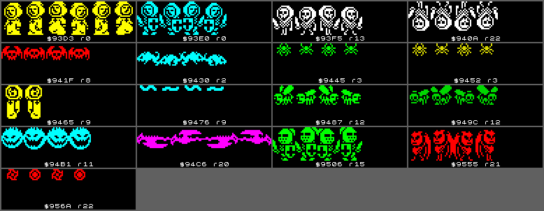
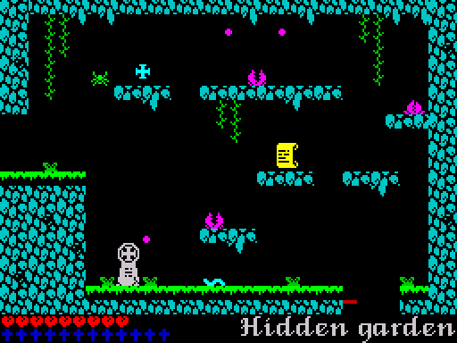
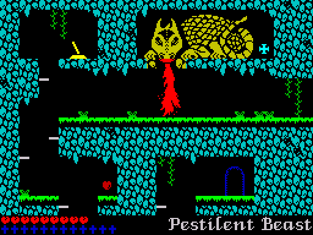
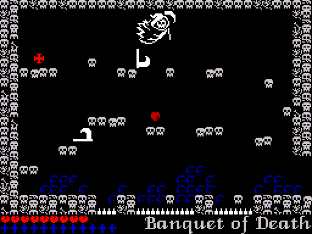
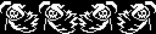
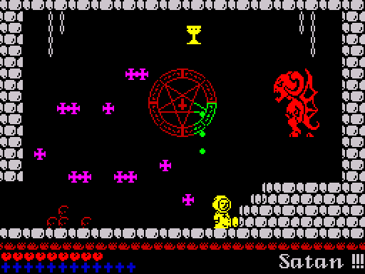
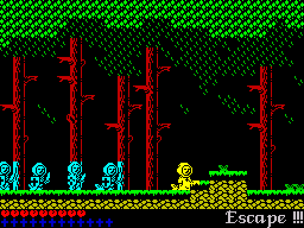

# 5.3 Creatures

Everything that moves except Jean, and every item, lives in one of 11 object
slots of 22 bytes. A slot is a stack frame: the slot runner points the stack
pointer at it and RETs into its first word, and the handler POPs its own
fields. The creatures follow fixed patterns. Only the face of room 11 moves
toward Jean, the archers turn to face him, and the only random choice is the
side Death throws a scythe to (F49).



## Slots and the RET dispatch

The slots are at [ObjectSlots](../src/buffers.asm#L119) (&#36;C100-&#36;C1F1), followed by an end mark at
$C1F2 whose handler is [EndOfSlots](../src/gameframe.asm#L112). Word 0 of a slot is its handler; 0
means the slot is free. Once per game frame [GameFrame](../src/gameframe.asm#L20) calls
[RunObjectSlots](../src/gameframe.asm#L92):

```asm
RunObjectSlots:
  LD (EndOfSlots+$0001),SP ; operand of the LD SP at EndOfSlots
  LD HL,ObjectSlots       ; first slot
RunObjectSlot:
  LD SP,HL                ; SP into the slot
  LD A,(HL)               ; handler address (low)
  INC L
  OR (HL)                 ; zero = free slot
  RET NZ                  ; RET pops the handler address and enters it
  LD HL,SLOT_SIZE         ; free slot: skip it
  ADD HL,SP
  JP RunObjectSlot
```

A handler is entered with SP at slot + 2. It POPs the words it needs, PUSHes
back the ones it changed, and ends by jumping to [RunObjectSlot](../src/gameframe.asm#L97) with HL at
the next slot ([NextSlotAfterAnim](../src/entities.asm#L1296) and similar tails compute it from SP).
The end mark's handler reloads the saved SP and returns to [GameFrame](../src/gameframe.asm#L20). This
works because the game frame runs inside the interrupt handler, with
interrupts disabled. Here is the patroller that walks left, up to the point
where it hands over to the hit test:

```asm
UpdateWalkLeft:
  POP BC                  ; speed
  POP DE                  ; D right turning point, E left turning point
  POP HL                  ; x (8.8)
  OR A
  SBC HL,BC               ; x goes left
  PUSH HL                 ; store x
  POP HL                  ; SP is back at slot+8
  LD A,H                  ; x in 2-pixel units
  CP E                    ; at the left turning point?
  JR NZ,UpdateWalkLeft_0  ; no: go on
  LD HL,$FFFA             ; -6: back to slot+2
  ADD HL,SP
  LD SP,HL
  LD HL,UpdateWalkRight   ; from the next frame the creature goes right
  PUSH HL                 ; written over the handler word at slot+0
```

Turning round is a new handler word: a patroller has no direction variable.
The same pattern turns a falling drop back into a hanging one, a waiting fish
into a jumping one, a scythe from falling to sliding, and a crusader into one
of its jumps. A handler frees its slot by writing 0 over word 0
([FreeEntitySlot](../src/entities.asm#L1312), [FreeEntitySlotAtEntry](../src/entities.asm#L107)).

Most handlers end in the same tail: [HitTest](../src/gameframe.asm#L821) against Jean, then
[StepAnimation](../src/gameframe.asm#L897) for the frame counter, then [SelectFrameLeft](../src/entities.asm#L1204) or
[SelectFrameRight](../src/entities.asm#L1198), which put the frame's sprite sheet address into the
draw command [SpriteCmd](../src/player.asm#L952) and append its 10 bytes to the frame call list
([Drawing](05-drawing.md)). The continuation addresses are passed in IX, IY
or as the operand of a self-modified JP, so the slot fields can stay on the
stack throughout.

## Where slots come from

| Source | When | Routine | What |
| --- | --- | --- | --- |
| [RoomItems](../src/objects.asm#L580), 45 records of 8 bytes | room entry | [SpawnRoomItems](../src/sequences.asm#L291) | items ([Items](05-items-ending.md)) |
| [RoomObjects](../src/objects.asm#L259), 77 records of 11 bytes | room entry | [SpawnRoomObjects](../src/sequences.asm#L419) | the creatures of the room |
| the object list at $5DC0 | end of the game frame | [SpawnQueuedObjects](../src/sequences.asm#L221) | projectiles, flames, smoke, the actors of the ending |
| a crusader template | every 40 frames in rooms 5, 6, 25 | [SpawnCrusader](../src/entities.asm#L169) | a crusader |

[SpawnRoomObject](../src/sequences.asm#L451) turns a room object record into a slot (F96): word 0 is
word `kind` of [EntityHandlers](../src/entities.asm#L29), the speed byte times 4 becomes the 8.8
speed word, x and y become the high bytes of the position words, two bytes
become the turning points of a patrol (or a timer), and the record's pointer
to a behaviour block gives the hit box, the frame count and the sprite
description (record layout in [Data structures](02-data.md)). A room never has
more than 10 item and object records together (room 15), so the 11 slots,
all free at entry, are enough; neither spawner checks for a full table
(F110).

During play a creature that shoots builds a 4-byte record (template address,
y, x) at [SPAWN_TEMPLATE](../src/game.asm#L9) and [SPAWN_POSITION](../src/game.asm#L10), appends it to the object
list at [OBJECT_LIST](../src/game.asm#L8) ($5DC0) and increments [SpawnQueueCount](../src/variables.asm#L499). At the end
of the game frame [SpawnQueuedObjects](../src/sequences.asm#L221) copies each template of
`src/templates.asm` into a free slot: bytes 0-5, then x and y plus the
template's two signed offsets, then bytes 8-17 (F55). The templates of the
arrows, seeds, fireballs and the splash are only 16 bytes long, so the copy
takes two bytes of the next template into slot +$12/+$13, which their
handlers do not read (F55). When no slot is free the
rest of the queue is dropped: in room 14 this happens at every volley of the
plants, so some seeds are never spat (F126).

## The creatures by room

| Room | Creatures (kind) |
| --- | --- |
| 0 | the intro: Jean and three crusaders running right (0) |
| 2 | two rats (2, 3) |
| 3 | two green and two yellow spiders (4, 5) |
| 5, 6, 25 | the crusader spawner (1) |
| 8 | two bats (2, 3) |
| 9 | four hanged men (6), two worms (2) |
| 10 | the Pestilent Beast: head (14) and fire (15) |
| 11 | the grinning face (8) |
| 12 | five flies (5) |
| 13 | two skeletons (2) |
| 14 | a spider (4), a worm (2), three plants (12) |
| 15 | five water drops (9), two green soldiers (2) |
| 16 | a spider (4), three fish (13) |
| 17 | three skeleton archers (10) |
| 18 | Death (16) |
| 19 | a spider (4), two water drops (9), two fish (13) |
| 20 | a magenta bird, a green soldier (2), a stone head (11) |
| 21 | an archer (10), three red demons (2, 3) |
| 22 | a skeleton, a white ghost, a red demon (2), three fire wheels (4), a stone head (11) |
| 23 | a white ghost, two magenta birds (2), three fire wheels (4) |
| 24 | Satan (17) |

Rooms 1, 4 and 7 have no creatures. A creature's look comes only from its
behaviour block in `src/behaviours.asm`: a rat and a skeleton run the same
handler. A block holds the hit box edges (+0 top, +1 left, +2 bottom, +3
right, relative to the position; F100), the number of animation frames (+4;
the block header in the source calls this byte Unknown, but
[SpawnRoomObject](../src/sequences.asm#L451) copies it to slot +$15 and [StepAnimation](../src/gameframe.asm#L897) wraps the
frame number there), then the sprite description: attribute, shift table,
height, and the frame tables for moving left or up and for moving right or
down (F93, F101).

## Hit tests

[HitTest](../src/gameframe.asm#L821) pops two words from the slot, the offset and the far corner of
the hit box (y in the low byte, x in the high byte), adds both to the
position, and falls into [OverlapTest](../src/gameframe.asm#L844), which compares the box with Jean's
([PlayerBoxXMax](../src/variables.asm#L196)). Both corners are measured from the position, so the
second word is a size only when the offset is 0 (F100). The test is

- creature right edge >= Jean's left edge and creature left edge < Jean's
  right edge, and the same in y,

so a box touching Jean's from the left or from above counts, from the right
or below it does not. On an overlap [HitTestDone](../src/gameframe.asm#L874) sets [PlayerHit](../src/player.asm#L51) to
$FF, and Jean dies in this frame ([Jean](05-player.md)). Then it jumps to the
caller's continuation, which [HitTest](../src/gameframe.asm#L821) stored as the operand of the JP at
[SmcHitContinue](../src/gameframe.asm#L879). The rat of room 2 was measured: its box bytes 03 01 06 06
are edges, x+1..x+6 by y+3..y+6, and Jean's feet touching its top does not
kill (F100).

Every creature kills on touch except the intro runners, the invisible
crusader spawner, the head of the Beast (only the jet of fire kills, and only
while it shows), a drop while it hangs, a fish while it is under the water,
the splashes and Satan's smoke, which skip the test. The plants call
[OverlapTest](../src/gameframe.asm#L844) themselves ([UpdatePlant](../src/entities.asm#L1997)). There is no energy: one touch
is one life.

## Patrollers (kinds 2-5)

[UpdateWalkLeft](../src/entities.asm#L775) and [UpdateWalkRight](../src/entities.asm#L1045) move x, [UpdateWalkUp](../src/entities.asm#L710) and
[UpdateWalkDown](../src/entities.asm#L998) move y, by the slot's speed every frame. At the turning
point (slot +4 for the low end, +5 for the high one) the handler writes the
opposite handler over word 0 (F86, F97). A kind 2 record starts moving left,
3 right, 4 down and 5 up. Moving left or up the creature is drawn from the
first frame table, right or down from the second (F93).

| Creature | Block | Rooms | Moves | Speed, pixels per frame |
| --- | --- | --- | --- | --- |
| rat | [BehaviourRat](../src/behaviours.asm#L133) | 2 | x | 1 |
| bat | [BehaviourBat](../src/behaviours.asm#L116) | 8 | x | 1, 0.5 |
| worm | [BehaviourWorm](../src/behaviours.asm#L206) | 9, 14 | x | 0.5 |
| skeleton | [BehaviourSkeleton](../src/behaviours.asm#L78) | 13, 22 | x | 1 |
| white ghost | [BehaviourWhiteFlyer](../src/behaviours.asm#L97) | 22, 23 | x | 1 |
| magenta bird | [BehaviourBird](../src/behaviours.asm#L280) | 20, 23 | x | 1, 1.5 |
| green soldier | [BehaviourSoldier](../src/behaviours.asm#L348) | 15, 20 | x | 0.5 |
| red demon | [BehaviourDemon](../src/behaviours.asm#L427) | 21, 22 | x | 1 |
| green spider | [BehaviourSpider](../src/behaviours.asm#L153) | 3, 14, 16, 19 | y | 0.75-1.3 |
| yellow spider | [BehaviourSpiderYellow](../src/behaviours.asm#L169) | 3 | y | 0.5, 1.25 |
| fly (two kinds) | [BehaviourFlyA](../src/behaviours.asm#L223), [BehaviourFlyB](../src/behaviours.asm#L241) | 12 | y | 0.75-2 |
| fire wheel | [BehaviourFireWheel](../src/behaviours.asm#L448) | 22, 23 | y | 2, 3 |

The horizontal handlers test the turning point for equality (CP / JR NZ),
the vertical ones with >= and <. A horizontal creature placed outside its
limits, or with a speed that steps over the limit value, would therefore run
until x wraps round 256; no record in the table does this, and a bat poked
outside its limits in the simulator took 500 frames to come back (F94). None
of these creatures look at the flag map: the limits in the records keep them
on their ledges.

## Hanged men (kinds 6 and 7, room 9)

The four bodies of the Hangman tree are vertical patrollers
([UpdateHangedDown](../src/entities.asm#L916), [UpdateHangedUp](../src/entities.asm#L636)) that also draw their rope into the
tile map: every frame the cell at row y / 4, column x / 4 + 1 gets tile $B7, a
dotted red line, and the cell below it the blank tile $80. The rope grows
behind a falling body and shortens behind a rising one (F88). The tile map
writes mark the cells for redraw like any other tile. No record has kind 7;
the slots get [UpdateHangedUp](../src/entities.asm#L636) at the first turn.

## The grinning face (kind 8, room 11)

[UpdateChaser](../src/entities.asm#L1397) is the only creature that follows Jean. After a 30-frame
delay it moves 0.5 pixel per frame on each axis toward Jean's x and y. Before
moving it reads the flag map around its sprite, 2 cells wide and 3 high from
(x / 4, y / 4): the two cells of its top row (for up), the two under its
bottom row (down), and the cells beside its second and third rows (left and
right). An axis whose cells on the side it wants to go to are not class 0
does not move, so the face slides along walls; on an axis where it is level
with Jean it does not move either (F89). It always
faces Jean. The probes treat the flag map as one array of 32-byte rows, so at
the screen edges they read cells of the neighbouring rows; in room 11 those
are walls too and the face stays in the room (F95).

## Water drops (kind 9, rooms 15 and 19)

A drop cycles between [UpdateDropHanging](../src/entities.asm#L1579) and [UpdateDropFalling](../src/entities.asm#L1621)
([AnimateDrop](../src/entities.asm#L1707) counts the cycle). It hangs at the tip of a stalactite,
swells (frame 1) for the last 30 of 70 frames, then falls one unit (2 pixels)
per frame to the end point of its record, 16 units in room 15, and starts
again at the tip (F90). A start delay of 11 to 61 frames from the record keeps
the drops of a room out of step. While it falls, two sprites are queued, the
new drop at the tip and the falling one, and only the falling one is hit
tested.

## Archers and stone heads (kinds 10 and 11)

[UpdateArcher](../src/entities.asm#L1846) (rooms 17 and 21) and [UpdateStoneHead](../src/entities.asm#L1800) (rooms 20 and 22)
stand still and share [UpdateShooter_Common](../src/entities.asm#L1883) and [UpdateShooter_Tail](../src/entities.asm#L1927). A
countdown in the slot runs from 80 (archers) or 70 (stone heads); for its
last 30 frames the shooter shows its aiming frame, and at 0 it queues an
arrow and requests sound effect 7 (F81, F91). An archer faces Jean, comparing
his x with its own, and takes [ArrowLeftTemplate](../src/templates.asm#L26) or
[ArrowRightTemplate](../src/templates.asm#L41); a stone head always shoots left
([WallShotTemplate](../src/templates.asm#L51)). The three archers of room 17 start with the same
countdown and shoot together.

## Plants and seeds (kind 12, room 14)

The three plants of the Hidden garden ([UpdatePlant](../src/entities.asm#L1997)) count down from 148,
176 and 120 and reload 120; at 50 the plant opens and spits two seeds
([SeedLeftTemplate](../src/templates.asm#L61), [SeedRightTemplate](../src/templates.asm#L75)), one up to each side (F82).
[UpdateSeed](../src/entities.asm#L2286) adds $14 to the vertical speed every frame, so a seed flies in
an arc; it is removed when the cell at its position is not class 0 or it
leaves the room. Touching a plant kills.



## Fish and splashes (kind 13, rooms 16 and 19)

A fish waits under the water for 30 frames ([UpdateFishWaiting](../src/entities.asm#L2431), not drawn,
not tested), then jumps for 54 frames ([UpdateFishJumping](../src/entities.asm#L2508)): it starts at
y $4C7C (8.8) with the speed $FDAE (2.3 units up per frame) and $16 is added
each frame, so it rises out of the water and falls back. A splash
([SplashTemplate](../src/templates.asm#L107), [UpdateSplash](../src/entities.asm#L2346), three frames of two frames each) is
made at the water surface (y $50) when it leaves and when it returns (F83).
The fish of a room start with different countdowns, so they do not jump
together.

## The Pestilent Beast (kinds 14 and 15, room 10)

The dragon's body is part of the room's tiles. Two objects animate it on a
cycle of 110 frames. [UpdateBeastHead](../src/entities.asm#L2619) lowers the head by 2 units for the
last 40 frames of the cycle and is never hit tested. [UpdateBeastFire](../src/entities.asm#L2705)
draws the jet, two sprites below the mouth, only in the last 38 frames of the
cycle (the first time 72 frames after the room is entered), with a hit box 7
units wide and $17 high from the mouth (14 by 46 pixels), and requests sound effect 7 every second frame. At
the end of the cycle it queues two flames ([FlameLeftTemplate](../src/templates.asm#L120),
[FlameRightTemplate](../src/templates.asm#L139)) on the ledge below, which [UpdateMovingSprite](../src/entities.asm#L2942)
moves left and right at 0.5 pixel per frame until x reaches $18 or $70 (F84).



## Death (kind 16, room 18)

Death patrols x between $08 and $68 at one pixel per frame, swapping
[UpdateDeathRight](../src/entities.asm#L3062) and [UpdateDeathLeft](../src/entities.asm#L3099) at the ends. A timer reloads
every 50 frames; when it reaches 20, [ThrowDeathScythe](../src/entities.asm#L3234) requests sound
effect 7 and queues [ScytheLeftTemplate](../src/templates.asm#L147) or [ScytheRightTemplate](../src/templates.asm#L165),
chosen by bit 0 of the R register (F49). The R register is the game's only
source of chance (Q12).

A scythe falls straight down at 1.5 pixels per frame ([UpdateScytheFalling](../src/entities.asm#L3305)).
When the cells under it are solid it lands, its y rounded down to a cell row,
and [UpdateScytheSliding](../src/entities.asm#L3409) moves it sideways one pixel per frame; when the
floor ends it falls again. The two handlers alternate, so a scythe creeps
along a ledge, drops off its end and goes on until it leaves the room at
x >= $71 or x < 8, or meets a harmful cell (F50, F56). One path of the sliding
handler, taken only when a solid cell is level with the scythe, draws it at
y = x; it is never reached in play (F51, [Tricks](06-tricks.md)).





## Satan (kind 17, room 24)

[UpdateSatan](../src/entities.asm#L3519) moves Satan up and down between y $05 and $28 at one pixel per
frame, the speed negated at each end. He is two sprites, an upper half 4
bytes wide and a lower half 3 bytes wide, one byte further right and 12 units
lower ([QueueTwoPartSprite](../src/entities.asm#L3687)). His hit box reaches $0F units right and $17
down from his position, 30 by 46 pixels. His timer starts at 150 and then reloads every 50 frames; at 0 he
requests sound effect 7 and queues three fireballs from one unit left of and
9 units below his position: [FireballUpTemplate](../src/templates.asm#L79) (up and left),
[FireballLeftTemplate](../src/templates.asm#L91) (left) and [FireballDownTemplate](../src/templates.asm#L98) (down and left)
(F52). [UpdateFireball](../src/entities.asm#L2132) is [UpdateArrow](../src/entities.asm#L2157) with one more test: it frees the
slot once [SatanSmoked](../src/variables.asm#L275) is set.



When the chalice has been taken ([ChaliceTaken](../src/variables.asm#L264) is not 0), the next run of
[UpdateSatan](../src/entities.asm#L3519), in the same game frame, sets [SatanSmoked](../src/variables.asm#L275), sets music track 7, starts
[ScriptEraseCrosses](../src/roomscripts.asm#L1475) through [RunEventScript](../src/hud.asm#L279), clears [CrossRingDone](../src/variables.asm#L391)
and copies [SmokeTemplate](../src/templates.asm#L172) over its own slot: a white cloud
([UpdateSatanSmoke](../src/entities.asm#L3726)) that lasts 150 frames and has no hit box (F53). On a
later visit [UpdateSatan](../src/entities.asm#L3519) finds [SatanSmoked](../src/variables.asm#L275) set and frees its slot at
once.

## Crusaders (kind 1, rooms 5, 6 and 25)

The crusaders are the chase of the first rooms and of the ending. A record of
kind 1 is an invisible spawner ([UpdateCrusaderSpawner](../src/entities.asm#L136)): 90 frames after
the room is entered, and then every 40 frames, it copies a 22-byte template
([CrusaderTemplateRoom5](../src/entities.asm#L79), [CrusaderTemplateRoom6](../src/entities.asm#L83),
[CrusaderTemplateRoom25](../src/entities.asm#L87)) into a free slot (F118). The crusader starts off
the left edge (x $F7) on the floor (y $44).

[UpdateCrusader](../src/entities.asm#L491) adds $0060 to x every frame, 0.75 pixel, slower than Jean's
one pixel. It never reads the flag map; it follows a path script, pairs of
(x, command). When the high byte of x equals the next target, the command's
routine from [PathCommands](../src/entities.asm#L564) is written over the handler word:

| Command | Routine | Effect |
| --- | --- | --- |
| 0 | [UpdateCrusader](../src/entities.asm#L491) | keep running |
| 1 | [UpdateCrusaderStepUp](../src/entities.asm#L340) | six frames along [JumpCurveStepUp](../src/entities.asm#L217): up 8 pixels, x speed $00A0 |
| 2 | [UpdateCrusaderHop](../src/entities.asm#L248) | six frames along [JumpCurveHop](../src/entities.asm#L221): a hop over a pit, back to the same height, x speed $0150 |
| 3 | [UpdateCrusaderFall](../src/entities.asm#L296) | six frames along [JumpCurveFall](../src/entities.asm#L219): down 16 pixels |
| 4 | [FreeEntitySlotAtEntry](../src/entities.asm#L107) | remove the crusader |
| 5 | [UpdateCrusaderSignal](../src/entities.asm#L454) | set [CutsceneDone](../src/variables.asm#L7), keep running |

| Room | Path script | Commands at x |
| --- | --- | --- |
| 5 | [PathScriptRoom5](../src/entities.asm#L589) | step up at $48 and $50, fall at $64, removed at $7F |
| 6 | [PathScriptRoom6](../src/entities.asm#L594) | hops at $24, $3C, $4C, steps up at $68 and $6C, removed at $7F |
| 25 | [PathScriptRoom25](../src/entities.asm#L601) | steps up at $48, $4C, $50, $54, end of the cutscene at $64 |

The curves are six signed speeds that sum to exactly -8, +16 and 0 pixels;
the y of a crusader was logged frame by frame in rooms 5 and 6 and follows
them (F118). Since the path matches the scenery drawn by the room script, a
crusader looks as if it climbed the steps and jumped the pits.



## The intro runners (kind 0, room 0)

[UpdateIntroRunner](../src/entities.asm#L1116) moves Jean and three crusaders right across the intro
text, from x $F7, $E3, $D7 and $CB (off the left edge) at one pixel (Jean)
and 0.75 pixel (the crusaders) per frame, and frees each slot when x reaches
$80; they have no hit box (F92).

## Projectiles and other made objects

| Template | Handler | Made by | Speed, units of 2 pixels per frame | Removed when |
| --- | --- | --- | --- | --- |
| [ArrowLeftTemplate](../src/templates.asm#L26), [ArrowRightTemplate](../src/templates.asm#L41) | [UpdateArrow](../src/entities.asm#L2157) | archers | x -2 or +2 | outside the room, or a cell of class 1-4 at its top left corner or the one right of it |
| [WallShotTemplate](../src/templates.asm#L51) | [UpdateArrow](../src/entities.asm#L2157) | stone heads | x -2 | as the arrows |
| [SeedLeftTemplate](../src/templates.asm#L61), [SeedRightTemplate](../src/templates.asm#L75) | [UpdateSeed](../src/entities.asm#L2286) | plants | x -0.43 or +0.43, y -1.44 rising by $14 per frame | outside the room, or one cell of class 1-4 |
| [FireballUpTemplate](../src/templates.asm#L79), [FireballLeftTemplate](../src/templates.asm#L91), [FireballDownTemplate](../src/templates.asm#L98) | [UpdateFireball](../src/entities.asm#L2132) | Satan | x -0.96, y -0.25 / x -1 / x -0.96, y +0.25 | as the arrows, or Satan smoked |
| [SplashTemplate](../src/templates.asm#L107) | [UpdateSplash](../src/entities.asm#L2346) | fish | 0 | after its three frames |
| [FlameLeftTemplate](../src/templates.asm#L120), [FlameRightTemplate](../src/templates.asm#L139) | [UpdateMovingSprite](../src/entities.asm#L2942) | the Beast's fire | x -0.25 or +0.25 | x reaches $18 or $70 |
| [ScytheLeftTemplate](../src/templates.asm#L147), [ScytheRightTemplate](../src/templates.asm#L165) | [UpdateScytheFalling](../src/entities.asm#L3305) | Death | y +0.75 falling, x -0.5 or +0.5 sliding | x >= $71 or < 8, or a harmful cell |
| [SmokeTemplate](../src/templates.asm#L172) | [UpdateSatanSmoke](../src/entities.asm#L3726) | Satan | 0 | after 150 frames |

All of them except the splash and the smoke kill on touch. The actors of the
ending are made the same way from the lists of `src/cutscenelists.asm`
([Ending](05-items-ending.md)).
