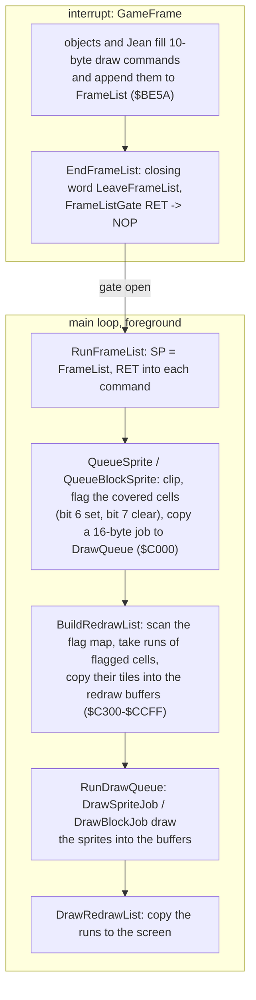
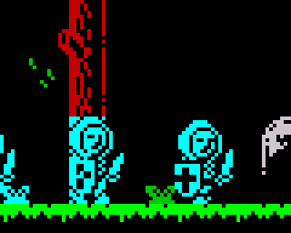
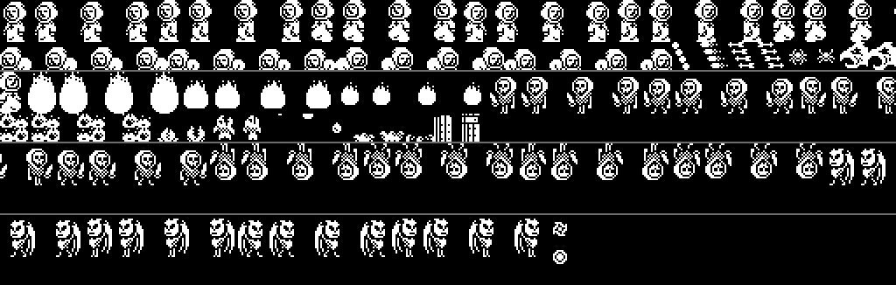
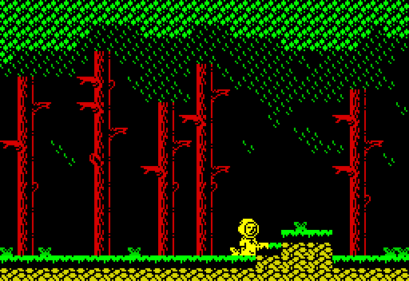
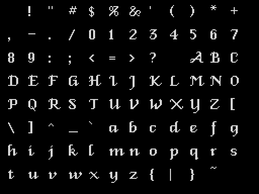
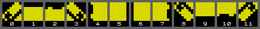

# 5.5 Screen drawing

No routine of the game draws a sprite straight onto the screen. The game
frame, which runs in the interrupt, only queues draw commands. The main loop
then finds every character cell that changed or that a sprite covers,
rebuilds those cells from the tile map in buffers, draws the sprites into the
buffers with a one-pixel black outline, and copies the cells to the screen.
The sprites come from a 10 KB sprite sheet that every room fills by
unpacking its sprite sets, with pre-shifted and mirrored copies made at
that moment.

## One frame of drawing



The game frame ([GameFrame](../src/gameframe.asm#L22)) runs once per 50 Hz interrupt (F103). Each
object handler and the player routine fill a draw command and append it to
the frame call list [FrameList](../src/buffers.asm#L50): Jean through [QueueDrawCmd](../src/player.asm#L446), the
creatures through their own copy loops ([QueueOneCommand](../src/entities.asm#L1322),
[QueueTwoCommands](../src/entities.asm#L1305)), the items through [AnimateItem](../src/gameframe.asm#L696). [EndFrameList](../src/gameframe.asm#L61)
closes the list and writes a NOP over the RET at [FrameListGate](../src/templates.asm#L143). The main
loop ([StartGame](../src/mainloop.asm#L70), the part at [MainLoop_Play](../src/mainloop.asm#L137)) spins on
that byte, then calls it: the NOP falls into [RunFrameList](../src/templates.asm#L163), which turns
the gate back into a RET, points SP at the list and RETs into the first
command (the mechanism is in [Tricks](06-tricks.md)). After
[BuildRedrawList](../src/redraw.asm#L556) and [DrawRedrawList](../src/redraw.asm#L32) the loop runs the three tile
animations of [DrawWaterReflection](../src/effects.asm#L31), [AnimateBloodTiles](../src/effects.asm#L191) and
[ShowCrossRing](../src/effects.asm#L245) (see [Rooms](05-rooms.md)) and starts again.

The commands are queued in the order the frame code runs: items and
creatures in slot order, then Jean, because [UpdatePlayer](../src/player.asm#L557) comes after
[RunObjectSlots](../src/gameframe.asm#L94). Sprites are drawn in that order, so Jean is drawn over
everything else.

A frame whose drawing is not finished when the next interrupt comes loses
its drawing, not its logic: the game frame still runs, but while the list
is being drawn [QueueDrawCmd](../src/player.asm#L446) is a RET and [GameFrame](../src/gameframe.asm#L22) skips
[EndFrameList](../src/gameframe.asm#L61). In 800 frames of `tests/inputs/play.txt` the screen was
drawn 586 times (F103).

## Buffers

| Address | Size | What | Written by | Read by |
| --- | --- | --- | --- | --- |
| $5B00 tile map | 704 | 22 rows x 32 tile numbers | room scripts ([PlaceTile](../src/script.asm#L514)), hanged men's ropes, blood tiles | [CopyRunCells](../src/redraw.asm#L460), [RedrawCell](../src/sprites.asm#L1246) |
| $5E00 flag map | 704 | one byte per cell, 3 pages above the tile map: bits 0-2 tile class, bit 6 "a sprite is here", bit 7 "redraw" | [PlaceTile](../src/script.asm#L514), [QueueSprite](../src/sprites.asm#L50), [CollectRedrawRun](../src/redraw.asm#L363), [RedrawCell](../src/sprites.asm#L1246) | the same, collision code |
| $BE5A [FrameList](../src/buffers.asm#L50) | 162 | up to 16 draw commands of 10 bytes and the closing word | game frame | [RunFrameList](../src/templates.asm#L163) |
| $C000 [DrawQueue](../src/buffers.asm#L75) | 256 | 16 jobs of 16 bytes | [AddQueueJob](../src/sprites.asm#L162) | [RunDrawQueue](../src/redraw.asm#L588) |
| $C200 [RedrawRuns](../src/buffers.asm#L150) | 256 | the run list of the frame | [CollectRedrawRun](../src/redraw.asm#L363) | [DrawRedrawList](../src/redraw.asm#L32), the job handlers |
| $C300 [RedrawLengths](../src/buffers.asm#L159) | 256 | run length at the index of a run's first cell | [CopyRunCells](../src/redraw.asm#L460) | [DrawRedrawList](../src/redraw.asm#L32) |
| $C400 [RedrawAttrs](../src/buffers.asm#L168) | 256 | attribute of each queued cell | [CopyRunCells](../src/redraw.asm#L460), the drawers | [DrawRedrawList](../src/redraw.asm#L32) |
| $C500 [RedrawPixels](../src/buffers.asm#L182) | 2048 | pixel row r of each queued cell at $C500 + 256 r + index | [CopyRunCells](../src/redraw.asm#L460), the drawers | [DrawRedrawList](../src/redraw.asm#L32) |
| $CD00 [TileFlags](../src/tiles.asm#L36), $CE00 [TileAttrs](../src/tiles.asm#L63), $CF00 [TileGfx](../src/tiles.asm#L92) | 256 + 256 + 2048 | class, attribute and 8 bitmap bytes of each of the 256 tiles | (data) | the drawing and collision code |
| $D700 [SpriteSheet](../src/spritesheet.asm#L25) | 10240 | 40 pages, one per pixel row | the image, [UnpackSpriteSet](../src/unpack.asm#L92) | the drawers |
| $FF00 OutlineMasks | 256 | outline mask of every byte | [StartUp](../src/startup.asm#L39) | the drawers |

All tables that are indexed by a byte start on a page boundary, so a lookup
is `LD H,page / LD L,index`: the attribute of tile t is at $CE00 + t, the
mask of byte g at $FF00 + g, cell i of pixel row r at (&#36;C5 + r) * 256 + i.
The flag of a cell is 3 pages above its tile ([FlagMapAddress](../src/helpers.asm#L166),
[TileMapAddress](../src/helpers.asm#L141)).

## Draw commands

A draw command is a routine address and the 8 bytes that routine pops
([SpriteCmd](../src/player.asm#L974), [SpriteCmd2](../src/player.asm#L985), [ItemCmd](../src/player.asm#L996) are the templates):

| Offset | Size | Masked sprite ([QueueSprite](../src/sprites.asm#L50)) | Item ([QueueBlockSprite](../src/redraw.asm#L639)) |
| --- | --- | --- | --- |
| +0 | 2 | routine | routine |
| +2 | 1 | y in 2-pixel units (0-$57; $58 or more is above the room) | character row |
| +3 | 1 | byte column (0-31; $20 or more is left of the room) | column |
| +4 | 2 | graphics in the sprite sheet: low byte column, high byte pixel-row page | graphics, 2 bytes per pixel row |
| +6 | 1 | width in bytes (1-5) | not used (always 2) |
| +7 | 1 | height in 2-pixel units | height in 2-pixel units (8 for items, 12 for the arch) |
| +8 | 1 | popped as F, not used | not used |
| +9 | 1 | attribute of the covered cells | attribute |

The standing monk is y = $44, column $12, graphics $D726, width 3, height
$0C, attribute $46 (F38). Positions are kept as 8.8 words in 2-pixel units
(x 0-$7F, y 0-$57); x / 4 is the byte column of the command and x AND 3
selects one of the four pre-shifted copies of the frame (see "The sprite
sheet"). The vertical resolution is two pixel rows.

[QueueSprite](../src/sprites.asm#L50) clips a sprite to the room: for a part left of column 0 or
above the room the graphics address is moved on past the hidden columns (E)
or pixel rows (D) and the size cut, a part past column 31 or y $57 is cut
from the size, and a sprite wholly outside is dropped by an early RET (each
RET enters the next command of the list).

## Cells marked for redraw

The flag map is the only record of what is on the screen. [QueueSprite](../src/sprites.asm#L50)
and [QueueBlockSprite](../src/redraw.asm#L639) set bit 6 and clear bit 7 of every cell the sprite
covers. When [BuildRedrawList](../src/redraw.asm#L556) meets a cell with either bit set,
[CollectRedrawRun](../src/redraw.asm#L363) does this (observed on the monk's cell, F40):

| Before | Meaning | After |
| --- | --- | --- |
| bit 7 only | the cell must be redrawn from the tile map | 0 |
| bit 6 (bit 7 clear) | a sprite is drawn on it this frame | bit 7 only |

So a cell under a sprite is redrawn from the tiles in the frame the sprite
is drawn and once more in the next frame. If the sprite has moved away, the
second redraw erases it; if it is still there, [QueueSprite](../src/sprites.asm#L50) turns the
mark back into bit 6. Nothing saves or restores the background, and no
sprite is drawn by XOR. The tile class in bits 0-2 is kept.

## The redraw list and the cell buffers

[BuildRedrawList](../src/redraw.asm#L556) scans the 22 x 32 flag map row by row. Each run of
consecutive flagged cells goes to the run list [RedrawRuns](../src/buffers.asm#L150), and
[CopyRunCells](../src/redraw.asm#L460) copies the tile of every cell of the run into the cell
buffers: the attribute to $C400 + index, the 8 bitmap bytes to $C500 +
index ... $CC00 + index, and the run length to $C300 + index of the first
cell. The index counts the cells queued this frame and is one byte, so a
frame can hold 256 cells (not checked).

| Run list item | Size | Meaning |
| --- | --- | --- |
| row | 1 | character row 0-21; $FF ends the list |
| n | 1 | number of runs in the row |
| per run | 2 | first column, index of the first cell in the buffers |

After a frame of room 5 the list was `11 02 00 00 12 02 / 12 02 00 05 12 07
/ 13 02 00 0A 12 0C / FF`: rows 17-19, each with a run of 2 cells at column
0 (the crusaders entering) and a run of 3 cells at column $12 (the monk),
F99.

[CopyRunCells](../src/redraw.asm#L460) reads the tile bitmap with POP: it points SP at the tile's
bytes and pops them in pairs. The interrupt can arrive in the middle of that
(32 times in the 3000 frames of `play.txt`); why that does not damage the
tiles is in [Tricks](06-tricks.md).

[RunDrawQueue](../src/redraw.asm#L588) then calls the handler of every job of [DrawQueue](../src/buffers.asm#L75) with
DE = job + 1 and clears the job. The two handlers look up the job's rows in
the run list ([FindRedrawRow](../src/sprites.asm#L231), then the following records, F45) and draw
into the cell buffers, on top of the tiles and of the sprites drawn before:

| Job (template) | Handler | Fields after the handler word |
| --- | --- | --- |
| [SpriteJob](../src/sprites.asm#L197) | [DrawSpriteJob](../src/sprites.asm#L430) | +2 graphics, +4 character rows, +5 row, +6 column, +7 first-row offset (y AND 3), +8 height, +9 width, +10 attribute (F39) |
| [BlockJob](../src/redraw.asm#L691) | [DrawBlockJob](../src/sprites.asm#L274) | +2 graphics, +4 character rows, +5 row, +6 column, +7 attribute |

[AddQueueJob](../src/sprites.asm#L162) copies 16 bytes from the template whatever its length (the
block template is 8 bytes; the code after it comes along) and does not check
for a full queue. A 17th job in one frame would land on the object slots at
$C100; the most seen in fuzzed runs of all 25 rooms was 14 (F44, inferred).

## Sprites with an outline instead of a mask

The sprites have no mask data. [StartUp](../src/startup.asm#L39) builds a table at $FF00 that
gives, for every byte g, the pixels that are neither in g nor next to a
pixel of g (F37):

    OutlineMasks[g] = NOT (g OR g << 1 OR g >> 1)

and every byte of a sprite is combined with the background as
`(OutlineMasks[g] AND background) OR g`. The background is cleared under
the sprite's pixels and one pixel to the left and right of each of them,
which leaves a black outline. The code of one pair of pixel rows of a
1-byte-wide sprite ([DrawStripW1](../src/sprites.asm#L621)):

```asm
  LD A,(DE)               ; graphics byte from the sprite sheet
  LD C,A                  ; C = g; B = $FF, so BC = OutlineMasks + g
  LD A,(BC)               ; A = outline mask of the byte
  AND (HL)                ; clear the pixels around the sprite's pixels
  OR C                    ; set the sprite's pixels
  LD (HL),A
  INC H                   ; next pixel row of the cell buffer
  INC D                   ; next pixel row of the sprite sheet
```

The attribute of every covered cell is replaced by the sprite's, so the
scenery in those cells takes the sprite's colour. In this enlarged part of
room 6 the crusader on the left is drawn over the tree: the trunk's pixels
next to him are cleared and the trunk's cells turn cyan.



The masked drawing is done per character row. [DrawSpriteJob](../src/sprites.asm#L430) finds the
row's run and the cell index, works out how many pairs of pixel rows fall
in this character row (4 minus the first-row offset, at most the height
left) and calls [DispatchDrawer](../src/sprites.asm#L550). There is one drawer per width
([SpriteDrawerTable](../src/sprites.asm#L591): [DrawSpriteW1](../src/sprites.asm#L655) to [DrawSpriteW5](../src/sprites.asm#L1111)); each is four
`CALL strip / INC H` of 4 bytes, and [DispatchDrawer](../src/sprites.asm#L550) enters it 4 x (4 -
pairs) bytes in, so a partial character row runs only the last calls. The
strip routines ([DrawStripW1](../src/sprites.asm#L621) to [DrawStripW5](../src/sprites.asm#L1013)) draw two pixel rows;
from width 2 on, the first row goes left to right and the second right to
left, so the pointers end in the column where they started. The drawers work in the alternate register set with B'
= $FF fixed, so BC' addresses the mask table by the graphics byte in C'.

Items are drawn by [DrawBlockJob](../src/sprites.asm#L274) without a mask: 16 pixels wide, on the
character grid, replacing the cells' pixels. It reads the graphics with
POP, 16 bytes per character row.

Checked while writing this article: a Python model of the whole pass (tiles
of the flagged cells, then every command of the frame list in order, masked
sprites as above with the row offsets and the clipping of [QueueSprite](../src/sprites.asm#L50),
blocks replacing the pixels, the last sprite's attribute) was compared with
the screen after [DrawRedrawList](../src/redraw.asm#L32) in four consecutive frames of each of
rooms 1-24 entered directly and in two frames of `play.txt`: 336 masked
sprites (all four values of y AND 3, three of them clipped) and 160 items,
28,683 screen bytes, no difference. This confirms the drawing rule of F37
and the row offsets of F47; F47 is still marked inferred in the register.

## Copying the cells to the screen

[DrawRedrawList](../src/redraw.asm#L32) goes through the run list and copies each run from the
buffers to the screen: the attributes, then the 8 pixel rows. A run of n
cells is copied by a chain of 31 LDI instructions entered at the right
place: the JR before the chain has its offset byte patched to 2 x (32 - n),
which skips the LDIs that are not needed, and the last cell is copied by a
plain `LD A,(HL) / LD (DE),A` after the chain:

```asm
  LD A,SCREEN_COLS        ; 2 x (32 - length): the entry offset
  SUB (HL)
  ADD A,A
  LD (SmcBitmapForwardJump+$0001),A
  LD (SmcBitmapBackJump+$0001),A
  LD (SmcAttrJump+$0001),A
  LD H,PAGE_REDRAW_ATTRS
SmcAttrJump:
  JR SmcAttrJump          ; offset patched: jump into the LDI chain
```

There are three such chains: attributes ([CopyAttrChain](../src/redraw.asm#L106)), pixel rows
copied backwards with LDD ([CopyBitmapBack](../src/redraw.asm#L196)) and forwards with LDI
([CopyBitmapForward](../src/redraw.asm#L269)). The pixel rows alternate: row 0 from the last cell
to the first, row 1 from the first to the last, and so on, so after each row
the pointers only need `INC H / INC D` to reach the next pixel row of the
buffer and of the screen. Each chain is split in two entries of 21 and 10
LDIs; no run of more than 21 cells was seen (F131).

## The sprite sheet



[SpriteSheet](../src/spritesheet.asm#L25) is 40 pages of 256 bytes at $D700-&#36;FEFF. The byte of pixel
row r and column c is at $D700 + 256 r + c: a sprite is a rectangle of
columns read down the pages, `INC D` moves one pixel row down and `INC E`
one byte right, and the graphics address of a command holds the first row
in its high byte and the first column in its low byte. The listing splits
the table at row 24 ([SpriteSheetLower](../src/spritesheet.asm#L281)).

| Columns | Rows | Contents |
| --- | --- | --- |
| $00-$62 | 0-23 | the monk: 9 frames of 11 columns. Left: walking 0, walking 1, in the air ([MonkFramesLeft](../src/player.asm#L933)); the same facing right ([MonkFramesRight](../src/player.asm#L935)); three flames of the dying animation ([MonkDyingFrames](../src/player.asm#L937), drawn bright red) |
| $00-$2F | 24-39 | the crouching monk: 4 frames of 12 columns ([CrouchFramesLeft](../src/player.asm#L944), [CrouchFramesRight](../src/player.asm#L946)) |
| $30-$62 | 24-39 | small sprites: arrows, seeds, fireballs, the splash, the red flames ([BehaviourDrop](../src/behaviours.asm#L337) and the sprite blocks after it) |
| $63-&#36;FF | 0-39 | zero in the image; filled on room entry from the room's packed sprite sets |

A frame of a 16-pixel sprite is stored four times, each copy shifted two
pixels further right: 2 + 3 + 3 + 3 = 11 columns. [ShiftPairs](../src/player.asm#L928) gives the
(column offset, width) of the copy for x AND 3: (0, 2), (2, 3), (5, 3), (8,
3). The drawer never shifts anything; it only picks the copy. The crouching
frames use [ShiftPairsCrouch](../src/player.asm#L939) (3 columns in every phase), the creatures
the pair table their behaviour block points to ([Creatures](05-creatures.md)).

## Unpacking the sprite sets

Script opcode $97 ([OpUnpackSprites](../src/script.asm#L1503)) unpacks one of 20 packed sets
([PackedSetArcher](../src/graphics.asm#L333) to [PackedSetWorm](../src/graphics.asm#L686), $68CC-$717E) into the sheet with
[UnpackSpriteSet](../src/unpack.asm#L92). Record n of [UnpackRecords](../src/unpack.asm#L24) gives the destination,
the packed set, flags and the frame width N in columns:

| Flag | Meaning |
| --- | --- |
| bit 7 | after each frame, three copies shifted right by 2, 4 and 6 pixels, N + 1 columns each ([ShiftFrameCopies](../src/unpack.asm#L226)): a frame takes N + 3 (N + 1) columns |
| bit 6 | after all frames, a mirrored copy of every frame (and of its shifted copies with bit 7): columns in reverse order, each byte bit-reversed ([MirrorFrame](../src/unpack.asm#L304)) |

A packed set starts with the number of columns and of character rows. Then
each column is coded top to bottom: one flag byte per character row, most
significant bit first; a set bit takes the next byte of the stream as the
pixel byte, a clear bit repeats the previous pixel byte of the column (0 at
the top of a column). Runs of equal bytes cost one bit each ([UnpackColumns](../src/unpack.asm#L168),
F113, observed with a model of the format on set 0).

The mirror needs a table of the 256 bit-reversed bytes, which
[BuildMirrorTable](../src/templates.asm#L286) writes at $C500 on every room entry ([EnterRoom](../src/mainloop.asm#L192)):
the first page of the redraw pixel buffer, free at that moment and
overwritten by the first frame drawn. A model of the format, of the shifted
and of the mirrored copies reproduced every byte the Z80 code writes for all
20 records (F114).

| Set | Contents (comments of [UnpackRecords](../src/unpack.asm#L24)) | Flags | Width | Destination |
| --- | --- | --- | --- | --- |
| 0 | skeleton archers (rooms 17, 21) | mirror | 2 | $D7F8 |
| 1 | crusaders (rooms 0, 4, 5, 6, 24, 25) | shift, mirror | 2 | $D763 |
| 2 | Death (room 18) | shift, mirror | 4 | $D763 |
| 3 | red winged devils (rooms 21, 22) | shift, mirror | 2 | $D7BB |
| 4 | magenta winged flyers (rooms 20, 23) | shift, mirror | 3 | $EF63 |
| 5 | unidentified, room 10 | none | 2 | $D768 |
| 6 | head of the Pestilent Beast (room 10) | none | 5 | $D763 |
| 7 | red whirling fireballs (rooms 22, 23) | none | 2 | $D7E7 |
| 8 | green flies (room 12) | mirror | 2 | $D763 |
| 9 | green flies, second kind (room 12) | mirror | 2 | $D76B |
| 10 | hanged men (room 9) | mirror | 2 | $D763 |
| 11 | green zombies (rooms 15, 20) | shift, mirror | 2 | $D763 |
| 12 | grinning cyan ghost (room 11) | shift, mirror | 2 | $D763 |
| 13 | rats (room 2) | shift, mirror | 2 | $D763 |
| 14 | Satan's pieces (room 24) | none | 30 | $D78F |
| 15 | red bats (room 8) | shift | 2 | $D763 |
| 16 | scythe pieces (room 18) | shift | 2 | $D7EA |
| 17 | skeletons (rooms 13, 22) | shift, mirror | 2 | $D763 |
| 18 | white ghosts (rooms 22, 23) | shift, mirror | 2 | $D78F |
| 19 | cyan worms (rooms 9, 14) | shift | 2 | $D7F5 |

The sets of one room have different destinations; sets of different rooms
reuse them. Unpacking takes time: measured in the simulator, entering room 8
(one set) spends 0.8 frames in [UnpackSpriteSet](../src/unpack.asm#L92) and room 22 (four sets)
6.5 frames, out of 7 and 15 frames for the whole room script.

## Room sweeps



A new room is not drawn through the redraw list. The room script marks every
cell, and [RedrawRoom](../src/sprites.asm#L1162) visits all 704 cells in an order taken from
[SweepSetups](../src/sprites.asm#L1313) by the direction of the last exit ([ExitDirection](../src/variables.asm#L104),
F41):

| Exit | Direction | Sweep |
| --- | --- | --- |
| right edge | 0 | columns, left to right |
| left edge | 1 | columns, right to left |
| bottom edge | 2 | rows, top to bottom |
| top edge | 3 | rows, bottom to top |

A setup is 8 bytes: number of lines, cells per line, first row, first
column, and the column and row steps inside a line and from line to line.
[RedrawRoom](../src/sprites.asm#L1162) copies the four steps into the operands of four `LD A,n`
instructions of its loop ([SmcSweepInnerCol](../src/sprites.asm#L1205), [SmcSweepInnerRow](../src/sprites.asm#L1210),
[SmcSweepOuterCol](../src/sprites.asm#L1218), [SmcSweepOuterRow](../src/sprites.asm#L1223)). [RedrawCell](../src/sprites.asm#L1246) draws a flagged
cell straight to the screen (attribute and 8 bitmap bytes) and clears the
flag. There is no delay, but the sweep takes 8-9 frames (F42, and 8.3-8.5
frames measured in rooms 8 and 22), so the room is seen to wipe in from the
side Jean came from. With the 7-15 frames of the room script before it, a
room change takes about a third to half a second; during that time the
interrupt still runs, with the room state 0, so no game logic runs.

The text windows ([ShowTextWindow](../src/hud.asm#L125)) also end with [RedrawRoom](../src/sprites.asm#L1162), with
the direction set to 0.

## The status bar

Rows 22 and 23 hold the hearts and the crosses, columns 0-11; the room name
is printed to the right of them by the room script ([ScriptRoomPanel](../src/roomscripts.asm#L1517)).

| Row | Routine | Tile | Coloured |
| --- | --- | --- | --- |
| 22 | [DrawLivesBar](../src/sprites.asm#L1337) | heart (tile $7B) x 9, then 3 blank cells | the first [Lives](../src/variables.asm#L466) cells bright red, the rest blue |
| 23 | [DrawCrossesHud](../src/hud.asm#L17) | cross (tile $7C) x 12 | the first [Crosses](../src/variables.asm#L475) cells bright white, the rest blue |

Both are one-shot routines: the first byte is a NOP when a redraw is wanted,
and the routine writes a RET over it at once. The main loop calls both on
every pass; whoever changes the counters writes 0 over the first byte
([StartGame](../src/mainloop.asm#L70), [ActionHeart](../src/gameframe.asm#L428), [TakeCross](../src/gameframe.asm#L608), [UpdateDying_End](../src/player.asm#L530),
[ShowTextWindow](../src/hud.asm#L125)). The bitmaps are copied by [DrawTileCells](../src/hud.asm#L44), the
colours by [FillHudAttrs](../src/hud.asm#L68), which counts the coloured cells with DJNZ: B is
lives + 1, the DJNZ falls through once when B reaches 0 and switches the
colour to blue, and B wraps to $FF, so it never falls through again. With
more than 9 lives (only by poking) the blank cells turn red (F122). Room 4
draws no status bar, so it stays blank after the debug warp passes through
it (F67).

## Text

The text of the game (room names, the intro, the parchments, the menus,
the ending) is printed in a proportional font of 16-pixel glyphs by
[DrawGlyph](../src/script.asm#L555), called by [PrintString](../src/script.asm#L795) for the script opcodes $84 and $85
([OpPrintStringVar](../src/script.asm#L242), [OpPrintString](../src/script.asm#L224)).



[FontIndex](../src/font.asm#L11) ($6130) has a word per character $20-$7F: bits 0-11 are the
distance from the word's high byte to the glyph in [FontGlyphs](../src/font.asm#L50), bits
12-15 the width minus 2. The width (2-17 pixels) is also the advance of the
cursor. A glyph is a 16-bit mask, bit 15 for pixel row 0, then one pattern
for each set bit; a clear bit repeats the pattern of the row above (a blank
row before the first pattern). A pattern is one byte for a glyph up to 8
pixels wide and two bytes, right byte first, for a wider one. "@" and $7F
are empty glyphs.

[DrawGlyph](../src/script.asm#L555) computes the screen address of the cursor ([TextCursorY](../src/script.asm#L758),
[TextCursorX](../src/script.asm#L760)) and XORs each row of the glyph into three screen bytes.
The row is shifted into position by a chain of eight `ADD HL,HL / ADC A,A`
pairs at [ShiftGlyphRow](../src/script.asm#L673), entered through a JR whose offset byte
([SmcGlyphShift](../src/script.asm#L647)) is set to 2 x (x AND 7) for each character, so 8 - (x
AND 7) shifts are done. [NextPixelRow](../src/script.asm#L737) steps down the screen layout. The
attributes are not touched: text takes the colours the cells already have.
The format (F22, inferred in the register) was checked while writing this
article: a Python decoder of the index and glyphs gives the same pixels as
[DrawGlyph](../src/script.asm#L555) for all 96 characters at 9 positions (every value of x AND
7), and the same cursor advance.

Before a string is printed, [MeasureString](../src/script.asm#L840) adds up its advances and
[AlignText](../src/script.asm#L879) sets the cursor x from [TextAlignMode](../src/script.asm#L904) (script opcode $82,
[OpSetTextAlign](../src/script.asm#L188)): 1 left (x = 0), 2 centred (x = 128 - ceil(width / 2)),
any other value right-aligned (x = 256 - width), F11. The room names use the
right alignment.

## Text windows and the parchment frame

[ShowTextWindow](../src/hud.asm#L125) shows a script's text on its own screen: it runs the
script (which clears the screen and prints), draws a 24 x 11 cell frame with
[DrawParchmentFrame](../src/hud.asm#L175), waits for a key and redraws the room. The frame is
coded in [ParchmentLayout](../src/graphics.asm#L730): the top-left cell (row 5, column 4), then 11
rows of codes, where code 1 n is a run of n blank cells (only the attribute
is set) and code k is frame tile k - 2 of the 12 at [ParchmentFrameTiles](../src/graphics.asm#L702)
([DrawFrameRow](../src/hud.asm#L202), [DrawFrameCell](../src/hud.asm#L234), F19). The parchments use black on
yellow inside and yellow tiles ([ShowParchment](../src/hud.asm#L103)); the ending uses red and
cyan.

 
