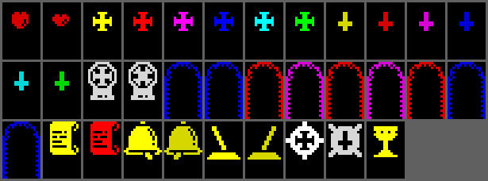
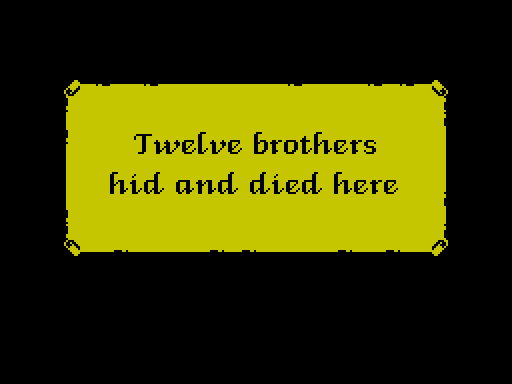
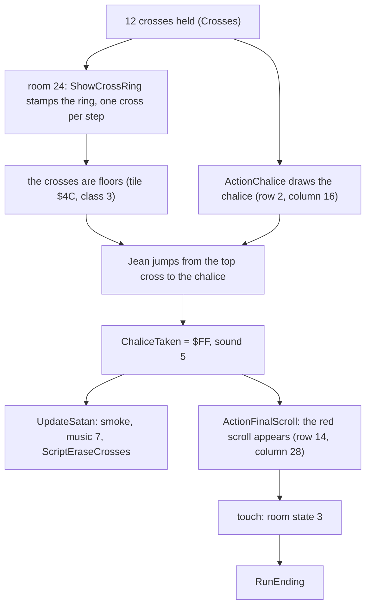
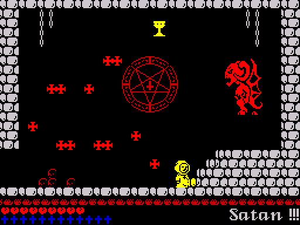
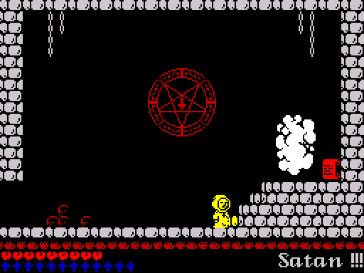
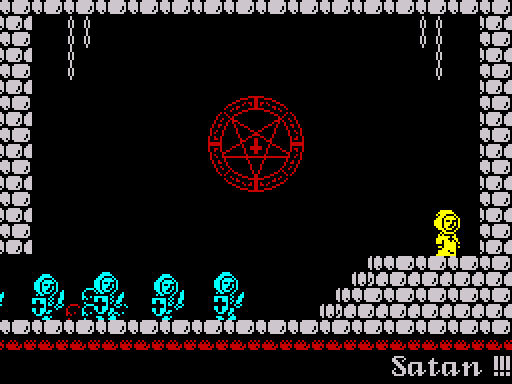
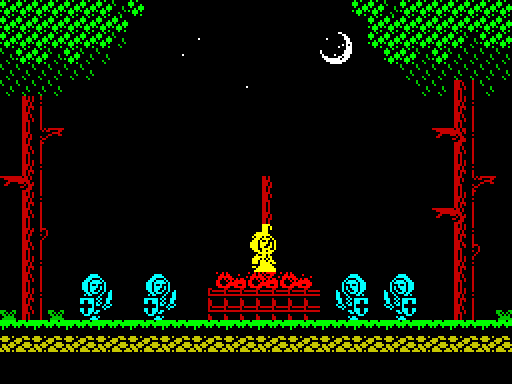
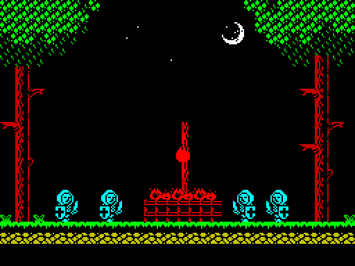

# 5.4 Items, the quest and the ending

The 45 items of the abbey (hearts, crosses, checkpoints, a bell, levers,
parchments, two arches, the wheel of faith, the chalice, the red scroll and
the hidden trigger of the church door) are object slots like the creatures.
Their handler tests Jean's box and RETs into the item's action routine. Each
item owns one flag byte in $851B-$854B that survives leaving the room; the
flags open the doors of the room scripts, choose the checkpoint, decide which
crosses can be taken and drive the chain that ends the game: twelve crosses,
the ring, the chalice, Satan's smoke, the red scroll and two cutscenes.



## Item records and slots

[RoomItems](../src/objects.asm#L580) ($8EDF) has 45 records of 8 bytes: room, the address of the
item's flag, type, row, column and a word that is the action routine (for a
parchment, the numbers of its two text lines) (F98; the layout is in
[Data structures](02-data.md)). The type indexes [ObjectTypeTable](../src/objects.asm#L14), whose
8-byte records ([ObjectTypeRecords](../src/objects.asm#L51)) give the frame delay and count, the
slot handler, the frame list and the sprite size. The records are ordered by
flag address, not by room; [SpawnRoomItems](../src/sequences.asm#L291) reads the whole table at every
room entry and [SpawnItem](../src/sequences.asm#L314) skips an item whose flag is $FF, so a heart, a
cross or a parchment that was taken never comes back.

Every item but the parchments has the handler [RoomItemHandler](../src/gameframe.asm#L129):

```asm
RoomItemHandler:
  POP HL                  ; L = row, H = column
  LD (ItemCmdPos),HL      ; sprite command position (y, x/4)
  ADD HL,HL               ; x2
  ADD HL,HL               ; x4: D = column * 4, E = row * 4
  EX DE,HL
  LD HL,ITEM_BOX*$0100+ITEM_BOX ; box size 8 x 8 (2-pixel units)
  ADD HL,DE
  LD B,H                  ; BC = far corner
  LD C,L
  LD IX,ItemActionEntry   ; continue at the RET: the action routine
  JP OverlapTest
```

The item's box is its 16 x 16 pixel cell square. [OverlapTest](../src/gameframe.asm#L844) compares it
with Jean's box and jumps to IX with the carry flag set on a touch.
[ItemActionEntry](../src/gameframe.asm#L148) is a single RET: it pops the next word of the slot, the
action routine, and enters it with the carry flag and with SP at the flag
pointer. Most actions end in [AnimateItem](../src/gameframe.asm#L667) or [DrawItemFrame](../src/gameframe.asm#L703), which
queue the sprite through the draw command [ItemCmd](../src/player.asm#L974), or in
[FreeSlotWithSound](../src/gameframe.asm#L433), which plays sound effect 5 and frees the slot. Jean's
box is rebuilt while he is dying, so items can still be touched then (F121).
All 45 records were touched in the simulator with the results below (F69,
F58).

| Type | Item | Rooms | Action | Flag | Touched |
| --- | --- | --- | --- | --- | --- |
| 0 | heart | 2, 10, 11, 12, 15, 17, 18, 19, 23 | [ActionHeart](../src/gameframe.asm#L415) | $8525-$852D | +1 life up to 9, sound 5, gone |
| 1 | cross | 3, 10, 13, 14, 16, 17, 18, 19 | [ActionCrossWheelRest](../src/gameframe.asm#L569) | in $8535-$8540 | taken if the wheel is at rest |
| 2 | cross | 9, 15, 17, 22 | [ActionCrossWheelTurned](../src/gameframe.asm#L553) | in $8535-$8540 | taken if the wheel is turned |
| 3 | checkpoint (a gravestone cross) | 8, 11, 12, 14, 15, 19, 21, 23 | [ActionCheckpoint](../src/gameframe.asm#L273) | $8544-$854B | becomes the active checkpoint, sound 9 |
| 4 | bell | 2 | [ActionBellOrLever](../src/gameframe.asm#L496) | [BellRung](../src/variables.asm#L242) $851B | 0 to 1 once, sound 3 |
| 5 | parchment | 3, 8, 12, 14, 16, 21 | [ActionParchment](../src/gameframe.asm#L785) | $852E-$8533 | shows two lines of text, gone |
| 6 | red scroll | 24 | [ActionFinalScroll](../src/gameframe.asm#L236) | [RedScrollTaken](../src/variables.asm#L351) $8534 | starts the ending |
| 7 | church door trigger (no sprite) | 7 | [ActionChurchDoor](../src/gameframe.asm#L173) | [CheckpointFlag0](../src/variables.asm#L408) $8543 | shuts the door behind Jean |
| 8 | arch | 10, 19 | [ActionArchToRiver](../src/gameframe.asm#L365), [ActionArchToBeast](../src/gameframe.asm#L339) | $8523, $8524 | moves Jean to the other arch, sound 4 |
| 9 | lever | 9, 10, 20 | [ActionBellOrLever](../src/gameframe.asm#L496), [ActionGateLever](../src/gameframe.asm#L524) | $851C, $851D, $851F | 0 to 1 once, sound 3 (room 20: 5) |
| 10 | wheel of faith | 17 | [ActionWheel](../src/gameframe.asm#L304) | [WheelState](../src/variables.asm#L248) $851E | 0 and 6 in turn, sound 5 |
| 11 | chalice | 24 | [ActionChalice](../src/gameframe.asm#L469) | [ChaliceTaken](../src/variables.asm#L266) $8521 | Satan turns to smoke |

[StartGame](../src/mainloop.asm#L65) clears all the flags ($8512-$854D) at the start of a game.

## Hearts

[ActionHeart](../src/gameframe.asm#L415) sets the flag to $FF, arms the redraw of the hearts bar
([DrawLivesBar](../src/sprites.asm#L1321)) and adds one to [Lives](../src/variables.asm#L435) with `CP 9` / `ADC A,0`, so at 9
lives the heart is used up and adds nothing (F122). Without a touch the heart
beats: two frames, 20 frames each.

## Crosses and the wheel of faith

The twelve crosses are the goal of the game: the first parchment, in room 3,
says "Twelve crosses / against the devil". A taken cross ([TakeCross](../src/gameframe.asm#L581)) sets
its flag to $FF, adds one to [Crosses](../src/variables.asm#L444) and arms [DrawCrossesHud](../src/hud.asm#L17), which
redraws the twelve cross cells of row 23 with as many in bright white as are
held, the rest blue.

The wheel of faith of room 17 ([ActionWheel](../src/gameframe.asm#L304)) toggles its flag with
`XOR $86` on each new touch: bits 1-2 go from 0 (at rest) to 6 (turned) and
back, and bit 7 is a latch, set while Jean stays on the wheel and cleared
when he leaves it, so standing on it turns it only once. The eight crosses of
type 1 can be taken only with the wheel at rest, the four of type 2 only with
it turned (F31). Both sets are drawn: a cross that cannot be taken now
is shown thin, frames 6-11 of [FramesCross](../src/objects.asm#L125) instead of the bright 0-5. The
action adds (wheel AND 7) to the frame for type 1 ([DrawCrossWheelRest](../src/gameframe.asm#L597)) and
((wheel AND 7) XOR 6) for type 2 ([DrawCrossWheelTurned](../src/gameframe.asm#L628)), and both step
through the six colours every 5 frames. The parchment of room 12 reads "Four
brothers / changed their faith", which fits the four crosses of type 2
(inference from the text).

## Checkpoints

A checkpoint whose flag is 0 ([ActionCheckpoint](../src/gameframe.asm#L273)) clears all nine
checkpoint flags [CheckpointFlag0](../src/variables.asm#L408)-[CheckpointFlag8](../src/variables.asm#L424), sets its own to 2
and requests sound effect 9; the picture drawn is bit 1 of the flag, so the
active one is lit. After a death [SelectCheckpoint](../src/templates.asm#L315) restarts Jean at the
first flag that is not 0, or in room 5 when there is none (F33; the table of
positions is in [Jean](05-player.md)). The church trigger sets flag 0 to 1
without clearing the others; as [SelectCheckpoint](../src/templates.asm#L315) scans from flag 0, the
church would win over a checkpoint touched before it, but whether any route
reaches another checkpoint before room 7 was not checked.

## The church door (room 7)

The Abandoned church has an item with no sprite at row 15, column 2, just
inside its left door. While the door is open ([ChurchDoorShut](../src/variables.asm#L216) is 0) a
touch sets checkpoint flag 0 to 1 and [ChurchDoorShut](../src/variables.asm#L216) to $FF, and starts
[DoorLeftShut](../src/roomscripts.asm#L474) through the one-shot runner [RunEventScript](../src/hud.asm#L279), which draws
the door at once. From then on the item makes the door rattle: a countdown of
32 to 63 frames (R AND $1F plus $20, the R register as a random number) ends
in sound effect 8 and three frames of the other door picture
[DoorLeftRattle](../src/roomscripts.asm#L485), then the normal one again (F28). The scripts of rooms 6
and 7 draw a door on their common edge whenever [ChurchDoorShut](../src/variables.asm#L216) is set, so
Jean cannot go back to the forest ([Rooms](05-rooms.md)).

## Bell and levers

[ActionBellOrLever](../src/gameframe.asm#L496) sets the flag from 0 to 1 at the first touch with sound
effect 3; the picture is the flag (rest or rung, up or pulled). Nothing
happens at once: the scripts of other rooms test the flags when they are
entered ([Rooms](05-rooms.md)):

| Item | Room | Opens |
| --- | --- | --- |
| bell | 2 Tower of the Bell | a 2 x 2 wall block of room 8 (row 20, column 26) |
| lever | 9 Hangman tree | the left door of room 19 (to room 18) |
| lever | 10 Pestilent Beast | the right door of room 8 (to room 9) |
| lever | 20 Unexpected gate | the gate at the right edge of room 20 (to room 21) |

The lever of room 20 has its own action, [ActionGateLever](../src/gameframe.asm#L524): with sound
effect 5 it also starts [EraseDoorRight](../src/roomscripts.asm#L1211) through [RunEventScript](../src/hud.asm#L279), so the
gate in front of Jean disappears at once.

## Arches (rooms 10 and 19)

The arch of room 10 (row 17, column 23) and the one of room 19 (row 15,
column 21) lead to each other ([ActionArchToRiver](../src/gameframe.asm#L365), [ActionArchToBeast](../src/gameframe.asm#L339)).
A touch sets bit 7 of the other arch's flag, puts the other arch's position
into [RespawnX](../src/variables.asm#L177) and [RespawnY](../src/variables.asm#L181) (room 10: X $5C, Y $44; room 19: X $54,
Y $3C), sets the room number, Jean's state to 4 and the room state to 2
(respawn), and requests sound effect 4 ([EnterRoomAtArch](../src/gameframe.asm#L385)). Bit 7 of the
arrival arch's flag is a latch: that arch ignores Jean until he has walked
off it, so he is not sent straight back (F32). The arch cycles its ink through
9 frames, one every 3 frames. The respawn position written by an arch is not
a checkpoint: a death after it returns Jean to the active checkpoint
([Jean](05-player.md)).

## Parchments

The parchments have their own handler, [ParchmentHandler](../src/gameframe.asm#L757), because the
action word of their records holds the two string numbers; it runs the same
box test and enters [ActionParchment](../src/gameframe.asm#L785). A touch copies the numbers to
[ParchmentLine1](../src/variables.asm#L137) and [ParchmentLine2](../src/variables.asm#L139), sets the flag to $FF, writes a NOP
over [ParchmentGate](../src/hud.asm#L88), requests sound effect 5 and frees the slot. On its
next pass the main loop falls through the gate into [ShowParchment](../src/hud.asm#L103):
[ShowTextWindow](../src/hud.asm#L116) sets the room state to 0, so the game frame stops running
the game logic, runs [ScriptParchment](../src/roomscripts.asm#L1539) (black screen, the two lines
centred at pixel rows 65 and 85), draws the 24 x 11 cell frame in black on
yellow ([DrawParchmentFrame](../src/hud.asm#L166)), waits for a key, redraws the room and the
status bar and restores the room state (F19).

| Room | Text |
| --- | --- |
| 3 | Twelve crosses / against the devil |
| 8 | Twelve brothers / hid and died here |
| 12 | Four brothers / changed their faith |
| 14 | An invisible path / over a wood bridge |
| 16 | Jump to death / and prove your faith |
| 21 | Glide through / the beast cage |

Three of them read like hints to the hidden cells described in
[Rooms](05-rooms.md) (an inference from the texts).



## The way to the end



[ActionChalice](../src/gameframe.asm#L469) tests the cross count only to decide whether to show the
chalice: with fewer than 12 crosses it frees its slot in its first frame. A
touch in that very frame would take it anyway (F30), but Jean only reaches
the chalice's row from the ring, which needs the twelve crosses, so this
cannot happen in play (F125). With twelve crosses the ring of
[ShowCrossRing](../src/effects.asm#L240) gives room 24 the platforms it otherwise lacks, and a jump
to the right from the top cross reaches the chalice (observed from X $2C-$30
on the cross at row 6, F125; [Rooms](05-rooms.md)).



Taking the chalice sets [ChaliceTaken](../src/variables.asm#L266). In the same game frame (the items are
spawned before the creatures, so their slots come first; observed: both flags
change in frame 25 of a run with Jean placed on the chalice) Satan turns into
a cloud of smoke for 150 frames, his fireballs vanish, the ring is erased and
stops being stamped, and the red scroll is drawn on the steps on the right
([Creatures](05-creatures.md), F53). [ActionFinalScroll](../src/gameframe.asm#L236) skips its slot
while the chalice is in place; afterwards a touch sets its flag to $FF and the
room state to 3, the ending (F29).



## The ending

Room state 3 makes the main loop call [RunEnding](../src/sequences.asm#L113) ($887B), which runs two
cutscenes between text windows and returns to [StartGame](../src/mainloop.asm#L65) (F109). Jean's
state is 0 throughout, so the player code does nothing and the keys only
close the windows.

1. Room 25 is entered: its script is room 24's ([RoomScript25](../src/roomscripts.asm#L1463)), and its
   object record is the crusader spawner with the path of
   [PathScriptRoom25](../src/entities.asm#L601). The window [ScriptEnding1](../src/roomscripts.asm#L1560), black on bright red:
   "your doom will come / not by my hand / but by human hands". A key closes
   it.
2. Music track 5 (128K). [LoadCutsceneList](../src/sequences.asm#L74) queues [CutsceneList1](../src/cutscenelists.asm#L14), one
   actor: Jean standing on the steps ([ActorMonkTemplate](../src/templates.asm#L189), moved by
   [UpdateMovingSprite](../src/entities.asm#L2942) with speed 0). [RunCutscene](../src/sequences.asm#L167) sets the room state
   to $80 and runs the foreground of the game frame until [CutsceneDone](../src/variables.asm#L7) is
   set. The crusaders climb the stairs; the path command 5 at x $64 sets the
   flag (about 365 frames).
3. Room 4 is entered, the window [ScriptEnding2](../src/roomscripts.asm#L1582) in cyan: "Heresy!!! The
   Cathar / is hidden on the throne / of Satan, burn him". Jean's X and Y are
   set to $3E and $3A, the top of the pyre.
4. [CutsceneList2](../src/cutscenelists.asm#L17) queues eight actors: the monk on the pyre
   ([ActorPyreMonkTemplate](../src/templates.asm#L201), [UpdatePyreMonk](../src/entities.asm#L2872)), three flames and four
   crusaders, which only animate. After 280 frames [UpdatePyreMonk](../src/entities.asm#L2872) stops
   drawing itself and sets [PlayerHit](../src/player.asm#L51) and [PlayerState](../src/player.asm#L30) to 2, so the
   game's own player code takes over at the same position: in the same game
   frame [UpdatePlayer](../src/player.asm#L554) finds the hit flag, [KillPlayer](../src/player.asm#L475) runs, and Jean
   burns with the dying animation of [Jean](05-player.md). 175 frames later the pyre monk sets [CutsceneDone](../src/variables.asm#L7)
   (F85; the scene lasts about 457 frames, F109).
5. Music track 2, the text [ScriptEnding3](../src/roomscripts.asm#L1604) on a black screen: "Your body has
   burned / in the flames, / but your soul has found / a place in Heaven.". A
   key returns to [StartGame](../src/mainloop.asm#L65), which on a 48K machine draws the title screen
   (F36, F111).







Using the death of the player for the burning has side effects that do not
show. [KillPlayer](../src/player.asm#L475) takes a life (observed: [Lives](../src/variables.asm#L435) 9 to 8 at the moment
he catches fire), and at the end of the animation [UpdateDying_End](../src/player.asm#L525) writes
room state $84 (or $85 with no life left) on every frame; the cutscene loop
does not look at the room state and sets it to 0 when it ends, and
[StartGame](../src/mainloop.asm#L65) resets the lives. Room 4 has no name panel and its script
clears the status bar rows, which nothing redraws during the ending (F67).

## Game over

Room state 5 comes from the end of the dying animation with no life left
([UpdateDying_End](../src/player.asm#L525), F73) or from R and Y held together during play (F26).
The main loop ([MainLoop_GameOver](../src/mainloop.asm#L152)) runs [ScriptGameOver](../src/controls.asm#L761), `G a m e  O v e r`
in the middle of a black screen, sets music track 7, waits for a key and
its release, and jumps to [StartGame](../src/mainloop.asm#L65). There is no high score table.


A new game clears the item, checkpoint and door flags, the respawn position,
the ring count and the crosses, and sets 9 lives. It keeps what lies outside
$8512-$854D: the RAGE cheat byte, the redefined keys, the Kempston switch, the
two effect timers and the colour step of the ring and the attribute of tile
$4C; none of these shows in play (F123).
