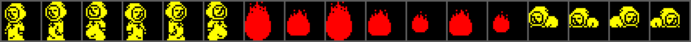
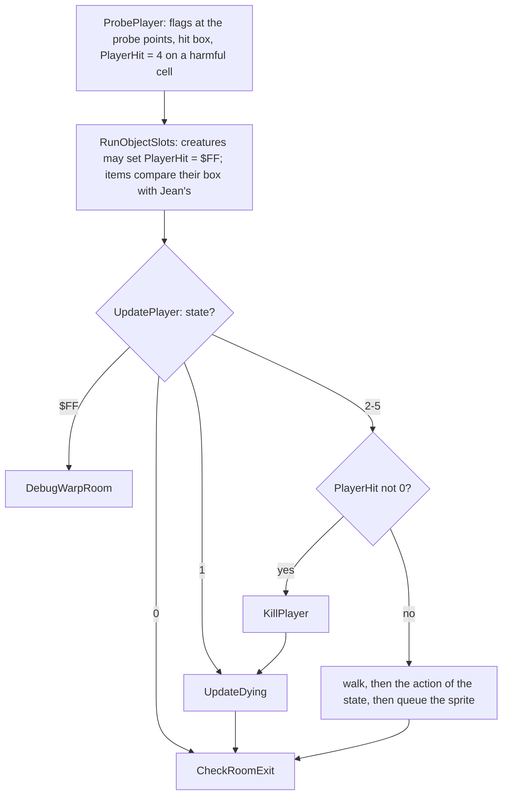
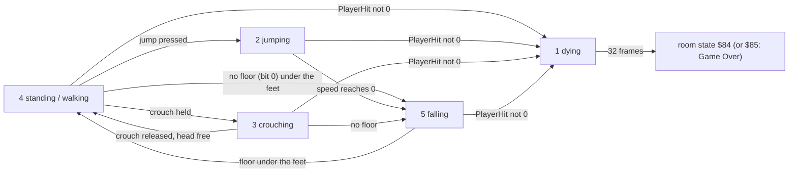
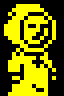

# 5.2 Jean

Jean Raymond is a 16 x 24 pixel sprite whose position is kept in 8.8 fixed
point. Every game frame, inside the 50 Hz interrupt, [ProbePlayer](../src/player.asm#L78) samples
the flag map around him, the creatures and items run, [UpdatePlayer](../src/player.asm#L554) moves
him through a small state machine, and [CheckRoomExit](../src/player.asm#L1015) changes the
room when he crosses an edge. A harmful cell or a creature's hit box kills him
at once; falls never do.

## State

| Variable | Contents |
| --- | --- |
| [PlayerState](../src/player.asm#L30) (&#36;A894) | 0 none (intro, ending), 1 dying, 2 jumping (rising), 3 crouching, 4 standing or walking, 5 falling, $FF the debug room warp |
| [PlayerAnimTimer](../src/player.asm#L33), [PlayerFrame](../src/player.asm#L35) | frames to the next picture; picture 0-1 walking or crouching, 2 in the air, 0-7 dying |
| [PlayerFacing](../src/player.asm#L37) | 0 right, 1 left |
| [PlayerSpeedY](../src/player.asm#L39) | vertical speed, 8.8, up while jumping and down while falling |
| [PlayerTileHead](../src/player.asm#L43), [PlayerTileRight](../src/player.asm#L45), [PlayerTileFeet](../src/player.asm#L47), [PlayerTileLeft](../src/player.asm#L49) | the probe results of this frame: the OR of the flag bytes at the probe points |
| [PlayerHit](../src/player.asm#L51) | 0, 4 (a harmful cell), $FF (a creature), 2 (the pyre of the ending); not 0 kills |
| [PlayerX](../src/player.asm#L53), [PlayerY](../src/player.asm#L55) | position, 8.8; the high byte counts units of 2 pixels |
| [PlayerBoxXMax](../src/variables.asm#L196) .. [PlayerBoxYMin](../src/variables.asm#L202) | the hit box of this frame, which creatures and items compare with theirs |
| [Lives](../src/variables.asm#L433), [RespawnX](../src/variables.asm#L175), [RespawnY](../src/variables.asm#L179) | lives left; where the next respawn puts him |

The high byte of X runs 0-$7F across the 256-pixel room and the high byte of
Y 0-$57 down its 176 pixel rows. (X, Y) is the top left corner of the sprite,
which is 8 units wide and 12 high. X / 4 is the byte column of the sprite and
X mod 4 selects one of four copies of each frame, shifted by 0, 2, 4 or 6
pixels, that the sprite sheet holds ([ShiftPairs](../src/player.asm#L907),
[Drawing](05-drawing.md)).

## Controls

[ReadKeyControls](../src/controls.asm#L21) turns the eight redefinable (row, mask) pairs of
[ControlKeys](../src/controls.asm#L131) into one byte, [ControlsRead](../src/controls.asm#L155); with the Kempston interface
switched on, [ReadKempston](../src/controls.asm#L61) ORs the joystick into it (F27):

| Bit | Key (default) | Kempston | Used by |
| --- | --- | --- | --- |
| 0 | right (P) | right | walking |
| 1 | left (O) | left | walking |
| 2 | crouch (A) | down | crouching |
| 3 | jump (Q) | - | jumping |
| 4 | jump (Q again) | fire | jumping |
| 5 | T | - | the debug warp, only with the RAGE cheat (F23) |
| 6, 7 | R, Y | - | both together: Game Over (F26) |

The keyboard jump sets bits 3 and 4, the fire button only bit 4; joystick up
is ignored. [GameFrame](../src/gameframe.asm#L20) keeps two copies: [ControlsHeld](../src/controls.asm#L164), the bits now,
and [ControlsPressed](../src/controls.asm#L172), the bits that were not set in the previous frame.
Walking and crouching use the held bits, the jump uses the newly pressed
ones: holding the jump key gives one jump and no second one on landing
(observed: Q held for 180 frames in room 5, one jump from frame 20 to 56).
The menus and the key redefinition are in [Title and menu](03-title-and-menu.md).

## A frame of Jean

The order matters in two places. The creatures test their boxes against the
box [ProbePlayer](../src/player.asm#L78) built in this frame, and [UpdatePlayerActive](../src/player.asm#L629) reads the
hit flag after all of them, so a touch kills in the frame it happens. And
[ProbePlayer](../src/player.asm#L78) runs for every state but 0, including the dying one, so the
dying monk still has a box that items can touch (F121).

## Probes and hit box

[ProbePlayer](../src/player.asm#L78) reads the flag map at fixed points around the body, each
result the OR of the flag bytes of the cells under the points. The points are
offsets in units of 2 pixels from (X, Y) (F79):

| Result | Standing, walking, in the air | Crouching |
| --- | --- | --- |
| head | (X+2, Y+1), (X+5, Y+1) | (X+2, Y+6), (X+5, Y+6) |
| left | X+1 at Y+3, Y+7, Y+11 | (X, Y+11) |
| right | X+6 at Y+3, Y+7, Y+11 | (X+8, Y+11) |
| feet | (X+2, Y+12), (X+5, Y+12) | X+1, X+4, X+7 at Y+12 |
| harmful (bit 2 to [PlayerHit](../src/player.asm#L51)) | X+2 and X+5 at Y+2, Y+5, Y+8, Y+11 ([ProbeRing](../src/player.asm#L365)) | X+1, X+4, X+7 at Y+7 and Y+11 ([ProbeBlock3x2](../src/player.asm#L274)) |
| hit box | X+2..X+6, Y+2..Y+12 | X+1..X+8, Y+7..Y+13 |

The feet points are the row just below the sprite. Each point goes through
[ProbeCell](../src/player.asm#L400), which drops a point outside the room (X of $80 or more, Y of
$58 or more; a negative coordinate counts as large): at an edge nothing
blocks him, which is how he walks out of a room. The harmful ring was mapped
cell by cell in room 5: standing at X $24 Jean is killed by a class 4 cell in
columns 9-10, rows 17-19, at X $26 only in column 10 (F56, F79).

## Walking

[UpdatePlayerActive](../src/player.asm#L629) moves Jean sideways before it does anything else, in
every state from 2 to 5, so he can be steered in the air:

- right (held bit 0) adds $0080 to X, one pixel per frame; left (bit 1)
  subtracts it; crouching the step is $0020, a quarter of a pixel (F70);
- a side whose probe result has bit 1 (classes 2 and 3) stops the move (F7),
  and that frame resets the walking picture as if he stood still;
- right is tested first and left second, so with both keys down X does not
  change and Jean faces left;
- while he moves, [PlayerFrame](../src/player.asm#L35) toggles between 0 and 1 every 8 frames;
  standing still it is 0. In the air the state code sets picture 2.

## Jumping

Only the standing state reads the jump ([PlayerStanding](../src/player.asm#L757)), including the
frame in which a fall ends ([PlayerLanded](../src/player.asm#L750) falls into it). A newly pressed
jump requests sound effect 2, sets [PlayerSpeedY](../src/player.asm#L39) to $01FE and sets state
2, jumping. Then every frame ([PlayerJumping](../src/player.asm#L728)):

1. unless the head result has bit 1, Y -= speed;
2. speed -= $1E ([GRAVITY](../src/constants.asm#L99));
3. when the speed is 0 the state becomes 5, falling, with speed 0.

$01FE is exactly 17 x $1E, so the rise lasts 17 frames and covers $11EE, 17.9
units or 35.9 pixels: four and a half character rows. On flat ground the
whole jump takes 36 frames (F71). Hitting a ceiling stops the rise but not
the countdown, so Jean hangs under the ceiling until the 17 frames are over
and then falls (F75). The crouching state ignores the jump key.

## Falling and landing

Standing or crouching with no bit 0 under the feet starts a fall at speed 0.
Every frame of [PlayerFalling](../src/player.asm#L689) adds the speed to Y, then adds $1E to the
speed while its high byte is below 2, so the speed ends at $021C, 4.2 pixels
per frame (F72). There is no fall damage and no height limit: in room 5 a
fall from Y $08 to the floor at Y $44 just lands (F72).

Landing takes two steps. After moving Y, [LandPlayer](../src/player.asm#L173) probes the two feet
points again and, if a cell there has bit 0 or 1, rounds Y down to a multiple
of 4 with a zero fraction, which puts the feet exactly on top of that cell
row. In the next frame the feet result shows the floor and Jean stands again
(state 4). Class 1 cells set only bit 0, so they block neither the sides nor the
head: Jean jumps up through them and walks through them, and lands on one
when his feet come down onto its top edge from the free row above (observed:
he jumped up through two class 1 cells, fell back and stood on them, F74). If
his feet are already inside such a cell, [PlayerFalling](../src/player.asm#L689) calls
[LandPlayer](../src/player.asm#L173) only in a frame that carries Y into the next cell row (read
from the code).

## Crouching

A held crouch key in the standing state switches to state 3
([PlayerCrouching](../src/player.asm#L847)). Crouched, Jean walks at a quarter of a pixel per frame,
his hit box is lower (Y+7..Y+13) and he is drawn 4 units lower from the
crouching frames, 16 pixels high ([DrawPlayerCrouch](../src/player.asm#L871)). He stands up when
the key is released and the crouched head points (Y+6) are free; with no
floor he falls.

When the crouch ends in a fall in the same frame, the fall sets picture 2 and
the crouching drawer reads entry 2 of [CrouchFramesRight](../src/player.asm#L925), which has only
two: the word after it is the routine address in [SpriteCmd](../src/player.asm#L952), so for one
frame Jean is drawn from the code bytes at $983C (F120,
[Tricks](06-tricks.md)). Facing left the read lands on a real frame.

## Dying

[PlayerHit](../src/player.asm#L51) is set in two places: [ProbePlayer](../src/player.asm#L78) stores bit 2 of the
harmful probe (4 on a class 4 cell), and [HitTestDone](../src/gameframe.asm#L874) stores $FF when a
creature's box overlaps Jean's ([Creatures](05-creatures.md)). In the ending
the pyre monk stores 2 ([Ending](05-items-ending.md)).

[UpdatePlayerActive](../src/player.asm#L629) tests the flag first; if it is not 0, [KillPlayer](../src/player.asm#L475)
takes a life from [Lives](../src/variables.asm#L433) at once, requests sound effect 6, clears the flag
and sets state 1. [UpdateDying](../src/player.asm#L490) then runs every frame:

- Y goes up by $0080, one pixel per frame;
- every 4 frames the picture advances; the 7 pictures of
  [MonkDyingFrames](../src/player.asm#L916) are three flames (large, medium, small) in the order
  0 1 0 1 2 1 2, drawn in bright red instead of bright yellow;
- picture 7 is not drawn, and at picture 8 [UpdateDying_End](../src/player.asm#L525) sets the room
  state to $84, restart after a death, or $85, Game Over, when [Lives](../src/variables.asm#L433) is 0,
  and asks for the hearts to be redrawn.

The animation lasts 32 frames (F73). Jean cannot leave the room while dying
([CheckRoomExit](../src/player.asm#L1015) ignores states 0 and 1), but the items still see his box:
a heart touched in the frame of the death or during the animation gives the
life back, even the last one, and then no Game Over follows (F121).

## Checkpoints and respawn

Room state 4 makes the main loop call [SelectCheckpoint](../src/templates.asm#L315)
([MainLoop_AfterDeath](../src/mainloop.asm#L105)). It clears the room state and the hit flag, turns a
dying monk into a standing one, and scans the nine checkpoint flags
[CheckpointFlag0](../src/variables.asm#L406)-[CheckpointFlag8](../src/variables.asm#L422) for the first one that is not 0. Its
index selects a 3-byte record of [Checkpoints](../src/templates.asm#L364) (room, row, column); with all
nine at 0 the tenth record, the start in room 5, is used (F33). The room goes
to [RoomNumber](../src/variables.asm#L77) and row x 4 and column x 4 to the high bytes of
[RespawnY](../src/variables.asm#L179) and [RespawnX](../src/variables.asm#L175); the main loop copies them to Jean and enters
the room, which rebuilds it with all its creatures at their start.

| Flag | Set by | Room | Respawn (row, column) |
| --- | --- | --- | --- |
| $8543 | the church door trigger (1) | 7 Abandoned church | 16, 2 |
| $8544 | checkpoint (2) | 8 The Altar | 17, 7 |
| $8545 | checkpoint | 11 Cave of illusions | 17, 14 |
| $8546 | checkpoint | 12 Plagued ruins | 7, 8 |
| $8547 | checkpoint | 14 Hidden garden | 17, 8 |
| $8548 | checkpoint | 15 Gloomy tunels (the game's spelling) | 7, 21 |
| $8549 | checkpoint | 19 Underground river | 11, 8 |
| $854A | checkpoint | 21 Evil church | 5, 19 |
| $854B | checkpoint | 23 Ashes to ashes | 17, 17 |
| none | - | 5 Escape !!! | 17, 9 |

Touching a checkpoint clears all nine flags and sets its own to 2, so at most
one is active ([Items](05-items-ending.md)). A death always returns Jean to
that checkpoint, whatever room he died in. The arches of rooms 10 and 19 also
write [RespawnX](../src/variables.asm#L175) and [RespawnY](../src/variables.asm#L179), but only for their own move (room state
2); a death after an arch goes through [SelectCheckpoint](../src/templates.asm#L315) and overwrites
them (observed: Jean placed on the arch of room 19 arrived in room 10 at
X $5C, Y $44; room state $84 poked there restarted him in room 5 at X $24,
Y $44, the start, as no checkpoint was active).

## Lives

A game starts with 9 lives ([StartGame](../src/mainloop.asm#L65) clears $8512-$854D and stores
[MAX_LIVES](../src/constants.asm#L21)). A heart adds one up to 9: at 9 the heart is taken and nothing
is added (F122). A death subtracts one at once; the Game Over test comes only
at the end of the animation. A poked 0 would wrap to 255 at the next death,
which cannot happen in play (F122). [DrawLivesBar](../src/sprites.asm#L1321), a one-shot routine
re-armed after a heart, a death or a text window, draws nine hearts and three
blank cells in row 22 and colours as many cells bright red as there are lives,
the rest blue (F43). There is no score and no extra life for anything else.

## Drawing Jean

At the end of each state [DrawPlayerStand](../src/player.asm#L791) (or [DrawPlayerCrouch](../src/player.asm#L871)) fills
the 10-byte draw command [SpriteCmd](../src/player.asm#L952): position (Y, X / 4), the address of
the frame in the sprite sheet plus the offset of the shifted copy for X mod 4,
width and height, and the attribute $46 (bright yellow; bright red $42 while
dying). [QueueDrawCmd](../src/player.asm#L445) appends it to the frame call list, unless the list is
being drawn at that moment (its first byte is then a RET). The list is drawn
by the main loop ([Game loop](04-game-loop.md), [Drawing](05-drawing.md)).

## The debug warp

With the RAGE cheat on, T sets [PlayerState](../src/player.asm#L30) to $FF ([EnterRoomWarp](../src/player.asm#L581)),
and [UpdatePlayer](../src/player.asm#L554) then runs [DebugWarpRoom](../src/cutscenelists.asm#L39) instead of Jean: each
direction key moves one room through the exit code ([DebugMoveRoom](../src/player.asm#L1117)), and T
returns to state 4 (F23, F119; [Tricks](06-tricks.md)).
