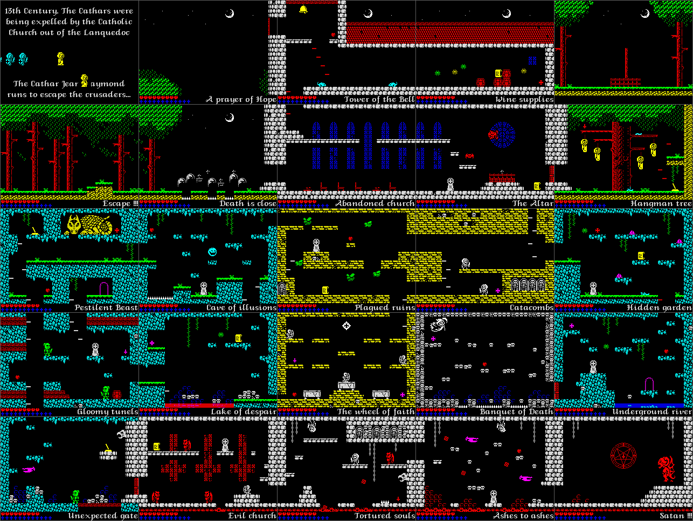
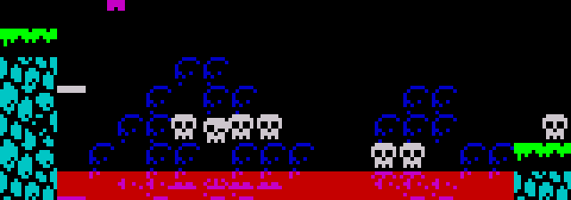

# 5.1 Rooms: scripts, maps, effects and exits

The abbey is 25 rooms on a 5 x 5 grid, plus room 25, which only the ending
enters. No room is stored as a map: each one is a bytecode script that paints
tile numbers into a 32 x 22 tile map and the flags of those tiles into a
parallel flag map. The creatures and items of a room come from two separate
tables, and three per-room effects (the water reflection, the bubbling blood,
the ring of crosses) are routines that a script switches on.



Room n is at row n / 5, column n mod 5 of this picture. Room 0 is the intro
text, not a place in the abbey.

## Entering a room

[EnterRoom](../src/mainloop.asm#L188) ($86B9) builds the room whose number is in [RoomNumber](../src/variables.asm#L77)
($8509) from nothing. It draws nothing itself:

1. [BuildMirrorTable](../src/templates.asm#L388) fills $C500 with the 256 bit-reversed bytes, which the
   sprite unpacker needs for mirrored frames (F114).
2. A RET (&#36;C9) goes over the first byte of five routines that the main loop
   calls on every pass: the three effects [DrawWaterReflection](../src/effects.asm#L29),
   [AnimateBloodTiles](../src/effects.asm#L187) and [ShowCrossRing](../src/effects.asm#L240), and the one-shot gates
   [ParchmentGate](../src/hud.asm#L88) and [RunEventScript](../src/hud.asm#L279). A script opcode, an item or Satan
   writes a NOP back to switch one of them on.
3. The draw queue $C000-&#36;C0FF is cleared and the 11 object slots at $C100 are
   freed; the end mark [EndOfSlots](../src/gameframe.asm#L112) goes after the last one.
4. The room state [RoomState](../src/variables.asm#L116) becomes 0, so the game frame in the interrupt
   reads the keys but runs no game logic while the room is built.
5. [RunScript](../src/script.asm#L84) runs the room's script, word n of [RoomScriptTable](../src/roomscripts.asm#L8)
   ($7236).
6. [SpawnRoomItems](../src/sequences.asm#L291) and [SpawnRoomObjects](../src/sequences.asm#L419) fill the slots from the item
   and object tables ([Items](05-items-ending.md), [Creatures](05-creatures.md)).
7. The 128K music track comes from [RoomMusicTable](../src/cutscenelists.asm#L63).
8. The frame list gate [FrameListGate](../src/templates.asm#L252) is closed, so the main loop waits for
   a complete game frame before it draws.

The main loop then calls [RedrawRoom](../src/sprites.asm#L1147), which draws the whole room in a
sweep from the side Jean came in by ([ExitDirection](../src/variables.asm#L98), F41); for a full room
this takes 8-9 frames (F42, [Drawing](05-drawing.md)). Jean's position is not
touched: the exit code has already moved him to the opposite edge, or the
respawn code has set it ([Jean](05-player.md)).

## The tile map and the flag map

| Address | Size | Contents |
| --- | --- | --- |
| $5B00 | 22 rows x 32 | tile numbers, 0-255; [TileMapAddress](../src/helpers.asm#L141) gives $5B00 + 32 row + column |
| $5E00 | 22 rows x 32 | one flag byte per cell; [FlagMapAddress](../src/helpers.asm#L166) gives $5E00 + 32 row + column |
| $6100 | 24 words | [FlagRowTable](../src/startup.asm#L171): the address of each row of the flag map, built at start-up |
| $CD00 | 256 bytes | [TileFlags](../src/tiles.asm#L36): the flag byte of each tile |
| $CE00 | 256 bytes | [TileAttrs](../src/tiles.asm#L61): the attribute of each tile |
| $CF00 | 256 x 8 bytes | [TileGfx](../src/tiles.asm#L90): the 8 x 8 bitmap of each tile |

Every tile command of a script ends in [PlaceTile](../src/script.asm#L489), which stores the tile
number in the tile map and copies its byte of [TileFlags](../src/tiles.asm#L36) into the same cell
of the flag map, three pages higher (F68). The flag map overlays the start-up
code at $6000, which has run by then. A flag byte has three parts:

- bit 7: the cell must be redrawn. Every tile starts with it set, so a new
  room is drawn in full;
- bit 6: a sprite covers the cell this frame; the next frame turns it into
  bit 7 so the cell is redrawn and the sprite erased (F40,
  [Drawing](05-drawing.md));
- bits 0-2: the class, which Jean, the projectiles and the face of room 11
  test.

| Class | Flag | Tiles | Meaning |
| --- | --- | --- | --- |
| 0 | $80 | 126 | empty |
| 1 | $81 | 3: $10, $26, $87 | one-way platform: Jean jumps up through it, walks through it and lands on it only when falling across its top edge (F74) |
| 2 | ($82) | none | blocks walking and the head, is not a floor; only made by script op $8A |
| 3 | $83 | 85 | wall and floor (bit 1 blocks, bit 0 can be stood on; F7, F74) |
| 4 | $84 | 42: $05, $3B-$3C, $4E-$74 | harmful: kills Jean (F73), removes a scythe (F56) |

The tile counts are from the 256 bytes of [TileFlags](../src/tiles.asm#L36). Drawing reads only
the tile map, and the collision tests read only the flag map. A script can therefore make
a cell look like one thing and behave like another, which the game uses for
its hidden passages (below).

## The room script

[RunScript](../src/script.asm#L84) ($9D5F) is the interpreter for every script of the game: the
rooms, the parchment and ending windows, the menus and the title. A byte
below $80 is a character, drawn at the text cursor by [DrawGlyph](../src/script.asm#L531); a byte
of $80 or more is a command, whose handler is word (code - $80) of
[ScriptOpTable](../src/hud.asm#L323). The opcodes and their operands are listed in
[Data structures](02-data.md). The interpreter does not call its handlers in
a loop: it pushes its own address as their return address, so every handler
ends with a plain RET and lands back at the top.

```asm
RunScript:
  PUSH HL
  LD HL,RunScript         ; the loop address becomes the return address of
                          ; every handler
  EX (SP),HL
  LD A,(HL)
  ADD A,A                 ; bit 7 to carry: a command
  JR C,RunScript_0
  LD A,(HL)
  INC HL
  CALL DrawGlyph          ; character: draw it at the text cursor
  RET                     ; back into the loop
```

The end code $80 ([OpEnd](../src/script.asm#L116)) pops that loop address, so its RET returns to
whoever called [RunScript](../src/script.asm#L84). A subscript ($83, and the conditional $95 and
$9C) is a recursive call of [RunScript](../src/script.asm#L84) and ends with its own $80. A static
decoder with the operand lengths of the 32 opcodes walks every script from
$726A to $83A8 without a gap and reproduces all 522 command starts that the
interpreter executed in the 25 rooms (F1, F13).

Nearly every room script starts the same way: unpack the sprite sets the
room's creatures need (op $97, [OpUnpackSprites](../src/script.asm#L1472), F114), set the room name
(op $87) and call [ScriptRoomPanel](../src/roomscripts.asm#L1502):

```asm
ScriptRoomPanel:
  DEFB $8F,$16,$0C,$14,$02,$07 ; FILLATTR row 22, col 12, 20x2, attribute $07
  DEFB $81,$B0,$0C,$14,$10,$00 ; FILLPIX pixel row 176, byte col 12, 20 bytes x
                               ; 16 rows, byte $00
  DEFB $86,$00,$00,$20,$16,$80 ; FILLTILE row 0, col 0, 32x22, tile $80
  DEFB $82,$00,$B0        ; ALIGN mode 0, pixel row 176
  DEFB $84                ; PRINTVAR string number in RoomNameString
  DEFW RoomNameString
  DEFB $90,$01            ; REDRAWMARK mark all cells
  DEFB $80                ; END
```

The panel (the room name, right-aligned in rows 22-23) is written to the
screen directly; everything else goes into the tile map. The rest of a script
paints the room from a few kinds of commands: rectangles of one tile ($86,
$98), a block pattern defined once ($88) and repeated over rectangles ($89,
$99: 61 uses, the stone, rock and earth of most rooms), rows and pictures of
consecutive tiles ($8B, $91, $93), single tiles at lists of positions ($8C,
$92), runs along a row ($8D), vertical lines ($9B) and one compressed bit map,
the foliage of room 9 ($94, F3). Small shared subscripts draw the night sky
([ScriptSky](../src/roomscripts.asm#L1518): the moon and seven stars of rooms 1-4 and 6) and the block
patterns. Room 25 is a single call of room 24's script ([RoomScript24](../src/roomscripts.asm#L1428))
([RoomScript25](../src/roomscripts.asm#L1463)); room 0 ([RoomScript00](../src/roomscripts.asm#L97)) prints the intro text straight
to the screen and clears the redraw marks so that nothing is drawn over it.

## Cells that look different from what they are

Three commands change the flags of cells after the tiles are placed. Reading
the flag map of each room right after it is built (the snapshots of
`scripts/docs-images.py`) and comparing every cell with the class of its tile
finds only these cells:

| Room | Cells | Command | Looks like | Is |
| --- | --- | --- | --- | --- |
| 5 | column 0, rows 0-19 | $8A, [OpFlagEdges](../src/script.asm#L1174) | sky and forest | class 2: the left edge is closed (F62); rows 20-21 are ground anyway |
| 10 | row 5, columns 28-31 | $96, [OpSetFlagRect](../src/script.asm#L1418) | rock | class 0: a tunnel one cell high out of the right edge |
| 11 | row 5, columns 0-1 | $96 | rock | class 0: the same tunnel, arriving from room 10 |
| 11 | rows 20-21, columns 2-3 | $96 | spikes over rock | class 0: a hole in the floor |
| 16 | rows 0-3, columns 2-3 | $96 | rock | class 0: the shaft under that hole |
| 16 | row 21, columns 6-21 | $9D, [OpSetupWater](../src/script.asm#L1555) | blank, then the water strip | class 4 |
| 19 | row 21, columns 14-29 | $9D | blank, then the water strip | class 4 |

Room 11 is right of room 10 and room 16 under room 11, so the hidden cells
form a tunnel from the Beast's cave into the Cave of illusions and a drop from
there into the Lake of despair. Both were tried in the simulator. The tunnel
starts in the two-column gap between the Beast and the rock (columns 26-27)
and is one cell high: standing, Jean's side probes hit the rock of rows 3-4,
but crouched his only side probe is at Y+11, in row 5, so he crawls through
at a quarter of a pixel per frame (placed in the gap at X $68, Y $0C and
holding crouch and right, he entered room 11 160 frames later). The hole in
room 11's floor is two cells wide, as wide as Jean: dropped at X $08 he fell
through the spikes into room 16 and landed at Y $14 with no life lost. Two
parchments read like hints to them, "Glide through / the beast cage" (room
21) and "Jump to death / and prove your faith" (room 16); that link is an
inference from the texts.

A fourth trick needs no command: tile $00 has class 3 and the attribute $00,
black ink on black paper. Room 20 has six of them at row 8, columns 15-20, a
bridge that cannot be seen; Jean dropped onto it in the simulator stands in
the air at Y $14. The only other uses are the whole tile map of room 0 and
tile $4D (also class 3, attribute 0) once in room 10. The parchment of room 14
says "An invisible path / over a wood bridge", and the invisible cells of
room 20 lie above its red wooden bridge (inference).

Op $8A has a fault for an operand the game never passes: its bit 3 is meant
for the bottom row but starts at $60E0, row 23, which is the top of the main
stack (F6).

## Doors that depend on items

Two opcodes run a subscript only if a flag byte is 0 ($95, [OpRunIfZero](../src/script.asm#L1128)) or
not 0 ($9C, [OpRunIfNonZero](../src/script.asm#L1146)). The flags belong to items
([Items](05-items-ending.md)), so these parts are decided when the room is
entered:

| Room | Subscript | Drawn while | Effect |
| --- | --- | --- | --- |
| 6 | [DoorRight](../src/roomscripts.asm#L575), column 31, rows 14-17 | [ChurchDoorShut](../src/variables.asm#L216) is not 0 | the way back into the church is shut |
| 7 | [DoorLeftShut](../src/roomscripts.asm#L474), column 0, rows 14-17 | [ChurchDoorShut](../src/variables.asm#L216) is not 0 | the church door, shut behind Jean (F28) |
| 8 | [DoorRight](../src/roomscripts.asm#L575) | the lever of room 10 ([LeverRoom10](../src/variables.asm#L246)) is 0 | the way right to room 9 |
| 8 | [EraseWallBlock](../src/roomscripts.asm#L565), 2 x 2 at row 20, column 26 | the bell of room 2 ([BellRung](../src/variables.asm#L242)) is not 0 | erases a wall block |
| 19 | [DoorLeftLow](../src/roomscripts.asm#L1150), column 0, rows 16-19 | the lever of room 9 ([LeverRoom9](../src/variables.asm#L244)) is 0 | the way left to room 18 |
| 20 | [DoorRight](../src/roomscripts.asm#L575) | the lever of room 20 ([LeverRoom20](../src/variables.asm#L250)) is 0 | the gate right to room 21 |

The door tiles are class 3, so a door is a wall. Two items do not wait for the
next visit: the church trigger and the lever of room 20 store a script
address in [SmcEventScript](../src/hud.asm#L285) and write a NOP over [RunEventScript](../src/hud.asm#L279), and the
main loop runs that script once, so the door appears or vanishes at once.

## Room effects

[DrawWaterReflection](../src/effects.asm#L29), [AnimateBloodTiles](../src/effects.asm#L187) and [ShowCrossRing](../src/effects.asm#L240)
(`src/effects.asm`) are called by the main loop on every pass, after the
redraw, and each starts with the byte that [EnterRoom](../src/mainloop.asm#L188) sets to RET and the
script opcode sets to NOP. They run in the foreground, so their speed depends
on how fast the main loop goes, not on the 50 Hz interrupt.

### The water reflection (rooms 16 and 19)

Op $9D ([OpSetupWater](../src/script.asm#L1555)) takes row, column, attribute and width and writes
them, with the addresses derived from them, into the operands of
[DrawWaterReflection](../src/effects.asm#L29): the attribute address of the first cell, the
attribute, the width, the bitmap address three cell rows above the water
(source), the bottom pixel line of the water row (destination), the byte
count (width x 8) and the offset of a JR. It also gives the strip class 4.

Every pass the routine paints the attribute on the strip and copies eight
pixel lines into it: destination line k (0 = top) is source line 3 x (7 - k),
counted from the top of the cell row three rows above. The 24 pixel lines
above the water arrive squashed to a third and upside down (F115). Each line
is copied by a chain of 32 LDI instructions ([WaterCopyChain](../src/effects.asm#L69)) that the JR
at [SmcWaterJump](../src/effects.asm#L57) enters 2 x (32 - width) bytes in, so exactly `width` LDIs
run; the line step after the chain ([WaterChainTail](../src/effects.asm#L106)) moves the destination one
pixel line up and the source three down, and `RET PO` ends the routine when
the byte count reaches 0. Both strips are 16 cells wide, so the first 16 LDIs
never run (F130).

| Room | Row | Columns | Attribute |
| --- | --- | --- | --- |
| 16, Lake of despair | 21 | 6-21 | $13: magenta on red (blood) |
| 19, Underground river | 21 | 14-29 | $0D: cyan on blue |



### The bubbling blood (rooms 21, 22, 23)

Op $9E switches on [AnimateBloodTiles](../src/effects.asm#L187). Every second pass
([BloodAnimTimer](../src/variables.asm#L150)) it walks row 21 of the tile map, turns each tile $3B into
$3C and each $3C into $3B, and sets the redraw bit of those cells (F116). The
two tiles are class 4: the blood at the foot of these rooms kills. See
[room 22](img/room-22.png).

### The ring of twelve crosses (room 24)

Op $9F, the last command of room 24's script, switches on [ShowCrossRing](../src/effects.asm#L240).
It does nothing until Jean holds twelve crosses ([Crosses](../src/variables.asm#L444)). Then every
fifth pass ([CrossFlashTimer](../src/variables.asm#L159)) it:

1. advances a colour index 0-5 kept in the operand of the instruction at
   [SmcCrossColour](../src/effects.asm#L251) and copies that attribute of [CrossColours](../src/variables.asm#L510) (yellow,
   red, magenta, blue, cyan, green, all bright) into [TileAttrs](../src/tiles.asm#L61) for tile
   $4C, so all the crosses of the ring change colour together;
2. unless the chalice has been taken ([ChaliceTaken](../src/variables.asm#L266)), adds one cross to the
   ring ([CrossRingCount](../src/variables.asm#L391), up to 12, with sound effect 5) and stamps that
   many tiles $4C at the positions of [CrossRingPositions](../src/roomscripts.asm#L1477) through
   [PlaceTile](../src/script.asm#L489), which also marks them for redraw.

In room 24 one step took 8 to 9 interrupt frames, because the main loop is
slower than the interrupt in that room (F117). Tile $4C has the flags $83, so
each cross is a floor: room 24 has no platform until the ring is complete,
and a jump to the right from the top cross reaches the chalice at row 2,
column 16 (F125; [the quest](05-items-ending.md)). The count survives leaving
the room, so on a later visit the whole ring is stamped at the first step.


The position list is shared with the script that removes the ring. When
Satan turns to smoke he starts [ScriptEraseCrosses](../src/roomscripts.asm#L1475) through
[RunEventScript](../src/hud.asm#L279); that script is op $92 ("tile $80 at 12 positions") and its
twelve operand pairs are the bytes labelled [CrossRingPositions](../src/roomscripts.asm#L1477), which
[ShowCrossRing](../src/effects.asm#L240) reads as data.

## Exits and the map

[CheckRoomExit](../src/player.asm#L1015) (&#36;ACEF) is the last step of every game frame. It does
nothing while Jean is absent or dying (state 0 or 1). Positions are in units of
2 pixels and wrap at 256, so a position just left of or above the room is
$FC-&#36;FF or $FA-&#36;FF.

| Exit | Condition (X, Y: high bytes) | Room | New position | [ExitDirection](../src/variables.asm#L98) |
| --- | --- | --- | --- | --- |
| right | facing right, $7C <= X < $FC | + 1 | X - $80 | 0 |
| left | facing left, $80 <= X <= $FC | - 1 | X + $80 | 1 |
| up | $80 <= Y <= $F9 | - 5 | Y + $58 | 3 |
| down | $52 <= Y < $80 | + 5 | Y - $58 | 2 |

The horizontal tests come first and only on the side Jean faces; the edge
values were checked one by one in the simulator (F76). At an exit half of
Jean's sprite is already outside, and he appears half outside the opposite
edge of the new room. The room state becomes 1 and the main loop enters the
room ([MainLoop](../src/mainloop.asm#L118)). Jean keeps his state and speed, so a jump or a fall goes
on in the next room (observed through the top edge of room 3, F124).

[WrapRoomNumber](../src/player.asm#L1093) then subtracts 25 until the number is below 25. It works on
the byte, so a room number below 0 (&#36;FB-&#36;FF) ends 6 too high: left from room
0 enters room 5, up from room 2 enters room 3 (F77). In play these exits are
never taken (F124): room 0 is only the intro, the top edges of rooms 1-4 are
out of reach and room 4 cannot be entered, so the wrap shows only in the
debug warp of the RAGE cheat ([DebugWarpRoom](../src/cutscenelists.asm#L39), F119,
[Tricks](06-tricks.md)), which moves through the same exit code.

The probes ignore points outside the room ([ProbeCell](../src/player.asm#L400)), so an edge is
open unless there is a wall in the room's own cells next to it. Where the
grid and the map differ:

- room 5's left edge is closed by op $8A (F62), so the chase of rooms 5 and 6
  only goes one way;
- rooms 0 and 4 cannot be entered in play, and room 1 has no floor or walls in
  its flag map: it is seen only through the window in the left wall of room 2,
  where Jean stops in a one-cell pocket (F124);
- the arches of rooms 10 and 19 move Jean between those rooms (F32), the
  church door of room 7 is one-way (F28), and the hidden tunnel and hole above
  lead from room 10 to 11 and from 11 down to 16.
