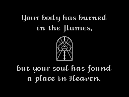

# 5.6 Sound

On a 48K Spectrum the game has no music, only short beeper effects: one
burst of about 2 ms of square wave per frame, played from the interrupt. On
a 128K machine the loader puts a bank of AY music into a RAM bank, and the
start-up code patches a few instructions so that the game calls into that
bank for the music, the AY sound effects and two screens. The music bank
(`data/music128.bin`) is kept as data and was not disassembled; what is
said about it here is read from a few of its bytes or seen by running two
of its routines in the 48K simulator, and is marked so.

## How an effect is requested

A routine asks for an effect by storing its number in [SoundRequest](../src/variables.asm#L506)
($854F). [PlaySoundStep](../src/mainloop.asm#L291) runs once per frame at the start of the
interrupt's frame routine ([GameFrameRoutine](../src/interrupt.asm#L181), and [MenuFrame](../src/controls.asm#L543) in the
menus). It takes a request at once, even while another effect is playing
(F104), clears it, copies the effect's 8-byte record to the current-effect
variables at [SoundPeriod](../src/mainloop.asm#L477) and plays the first step; on the next frames it
plays one step of the effect in [SoundPlaying](../src/variables.asm#L483) until the effect ends.

| Effect | Constant | Requested by | Observed |
| --- | --- | --- | --- |
| 1 | (none) | nothing: no store of 1 in the image (F106) | forced by a poke |
| 2 | SFX_JUMP | a jump starts ([PlayerStanding](../src/player.asm#L771)) | yes |
| 3 | SFX_TRIGGER | the bell or a lever touched ([ActionBellOrLever](../src/gameframe.asm#L516)) | yes |
| 4 | SFX_PORTAL | the arch between rooms 10 and 19 ([EnterRoomAtArch](../src/gameframe.asm#L398)) | yes |
| 5 | SFX_PICKUP | a heart, a cross, the chalice or the final parchment taken ([FreeSlotWithSound](../src/gameframe.asm#L447)), the wheel ([ActionWheel](../src/gameframe.asm#L311)), a gate lever ([ActionGateLever](../src/gameframe.asm#L545)), a parchment ([ActionParchment](../src/gameframe.asm#L816)), a cross of the ring added ([ShowCrossRing](../src/effects.asm#L245)), a key accepted in the controls menu ([RedefineOneKey](../src/controls.asm#L408)) | yes |
| 6 | SFX_DEATH | Jean dies ([KillPlayer](../src/player.asm#L479)) | yes |
| 7 | SFX_ENEMY_SHOT | Death throws a scythe ([ThrowDeathScythe](../src/entities.asm#L3344)), Satan fires ([UpdateSatan](../src/entities.asm#L3632)), an archer or a stone head shoots ([UpdateShooter_Tail](../src/entities.asm#L1987)), a plant spits ([UpdatePlant](../src/entities.asm#L2057)), a fish splashes ([UpdateFishWaiting](../src/entities.asm#L2510), [UpdateFishJumping](../src/entities.asm#L2595)), the Beast breathes fire ([UpdateBeastFire](../src/entities.asm#L2792)) | yes |
| 8 | SFX_DOOR | the church door flickers ([ActionChurchDoor](../src/gameframe.asm#L180)) | yes |
| 9 | SFX_CHECKPOINT | a checkpoint touched ([ActionCheckpoint](../src/gameframe.asm#L280)) | yes |

"Observed" means the request was seen in [SoundRequest](../src/variables.asm#L506) in a simulator
run (F107: rooms entered directly, items touched with Jean held on them);
the list of requesters comes from the stores of each number in the code.

## One step of a tone

An effect is played as one burst per frame. A burst is exactly 255 counts
of a loop that flips the speaker bit (bit 4 of port $FE) every PERIOD
counts:

```asm
PlaySoundStep_2:
  LD E,H                  ; E counts half a period
  OUT (ULA_PORT),A        ; flip the speaker
  XOR SPEAKER_BIT         ; next level
PlaySoundStep_3:
  DEC D                   ; count the burst down
  JR Z,PlaySoundStep_BurstEnd ; burst over
  DEC E
  JR NZ,PlaySoundStep_3
  JR PlaySoundStep_2
```

A count costs 27 T-states, so the speaker flips every 27 x PERIOD + 29
T-states and the burst lasts about 6,900 T-states, 2 ms (observed in the
port log of the simulator, F105). The pitch inside the burst is 3,500,000 /
(2 x (27 x PERIOD + 29)) Hz. PERIOD 0 gives a single flip, a click. After
the burst PERIOD changes by STEP with 8-bit wrap-around, so a sweep that
passes 0 jumps from the highest pitch to the lowest. Between the bursts the
speaker is silent: an effect is a 50 Hz train of 2 ms tones, not a
continuous tone. The bits 0-2 of the value sent to port $FE are 0, so the
border stays black.

The burst runs inside the interrupt handler with interrupts disabled. With an
effect playing, the frame routine takes 7,000-9,000 T-states more, and the
game logic of that frame starts that much later in the frame (F103).

## The effect records

[SoundEffects](../src/mainloop.asm#L520) holds 8 bytes for each of the effects 2-9 (effect n at
$87F2 + 8 (n - 2)); the fields, as described at [SoundPeriod](../src/mainloop.asm#L477):

| Offset | Field | Meaning |
| --- | --- | --- |
| +0 | PERIOD | loop counts between two flips in the first burst |
| +1 | STEP | added to PERIOD after each burst (&#36;FA is -6) |
| +2 | FRAMES | bursts in the first segment |
| +3 | SEGMENTS | number of segments |
| +4 | MODE | the start of the next segment: 0 PERIOD = BASE; 1 BASE - 2, then PERIOD = BASE; 2 BASE + 2, then PERIOD = BASE; 3 or more: PERIOD goes on and STEP changes sign |
| +5 | BASE | the PERIOD of a new segment |
| +6 | RELOAD | bursts in the second and later segments (0 = 256) |
| +7 | NEXT | effect to start when this one ends (0 none) |

| Effect | Record | Bursts | PERIOD per burst | Sound |
| --- | --- | --- | --- | --- |
| 2 jump, 8 door | `00 02 02 01 00 00 00 00` | 2 | 0, 2 | a click, then 127 flips 83 T apart (about 21 kHz) |
| 3 bell, lever | `A0 50 1E 01 00 00 00 00` | 30 | $A0, $F0, $40, $90, $E0, $30, ... | the period jumps by $50 with wrap-around and runs through all 16 multiples of $10: a warble between about 270 Hz and 3.8 kHz, with a click where it passes 0 |
| 4 arch | `E6 E6 0A 01 02 00 00 00` | 10 | 230, 204, ... 22, then 252 | rising from about 280 Hz to 2.8 kHz, the last burst low |
| 5 item, 9 checkpoint | `28 FA 08 01 00 00 00 00` | 8 | 40, 34, 28, 22, 16, 10, 4, 254 | rising from 1.6 kHz to 12.8 kHz, then a low blip (observed, F105) |
| 6 death | `04 F2 28 03 02 50 08 00` | 40 + 8 + 8 | 4, 246, 232, ... (STEP -14, wrapping about every 18 bursts); then 82, 68, ...; then 84, 70, ... | the pitch rises again and again; the longest effect, 56 frames (1.1 s) |
| 7 enemy shot | `14 00 01 01 00 00 00 00` | 1 | 20 | one 2 ms burst at about 3.1 kHz |

Every NEXT byte is 0, and MODE is 0 or 2, so the chained effect and the
modes 1 and 3 are never used (F130). Effects 2 and 8 are the same record,
and so are 5 and 9.

## Effect 1 and its bug

Effect 1 is built into [PlaySoundStep](../src/mainloop.asm#L291) rather than the table: 10 frames of
48 speaker samples, each the bit 4 of a "random" byte from [NoiseByte](../src/mainloop.asm#L425).
That routine was meant to return the refresh register R XORed with a byte of
the ROM, walking a pointer through $0000-$03FF. It stores the pointer with
`LD (NoisePointer),A` where `LD (NoisePointer),HL` was meant:

```asm
NoiseByte:
  PUSH HL
  LD HL,(NoisePointer)    ; $1000, and it stays $1000
  INC HL
  LD A,H
  AND $03
  LD H,A                  ; HL = $0001
  LD (NoisePointer),A     ; stores A over the low byte only
  LD A,R
  XOR (HL)                ; always the ROM byte at $0001
  POP HL
  RET
```

[NoisePointer](../src/mainloop.asm#L445) keeps the value $1000, HL is $0001 every time and the byte
is R XOR $01. R advances with every instruction, so the samples form a
regular pattern: observed with the effect forced by a poke, bit 4 of the 48
samples of a frame was `110100100100100100101101101101101101001001001001`
(F106). No code requests effect 1, so the bug is never heard.

## 128K: the hooks

The loader's second stage ([DetectMachine](../src/stage2.asm#L171), [MeasureBanks](../src/stage2.asm#L201))
finds out whether it runs on a 48K or a 128K machine, and on a 128K which
of the banks 1, 3, 4 and 6 runs code fastest (it counts `INC DE` in one
frame in each). [Start128](../src/stage2.asm#L114) copies the screen depacker
[DepackScreen](../src/stage2.asm#L290) and the two packed screens of tape block 3 (the
title and the info screen) into that bank at $C000, unpacks the music after
them, from $CF6D, and looks for an AY chip by writing its register 8 and
reading it back ([WriteAY](../src/stage2.asm#L161)). It leaves the bank's port value (or 1
on a 48K) and the AY flag on the stack for the game (F66, inferred: the 128K
paths were read, not run).

[StartUp](../src/startup.asm#L39) keeps the machine type in [MachineType](../src/variables.asm#L44) and, when it is not a
48K, runs [Patch128KHooks](../src/startup.asm#L122), which writes opcodes over four instructions of
the 48K code:

| Place | 48K | 128K |
| --- | --- | --- |
| [StartGame_Music](../src/mainloop.asm#L79) | `LD HL,BankShowTitle`: only loads HL | `CALL BankShowTitle` |
| [RunEnding_Music](../src/sequences.asm#L148) | `LD HL,BankEndingDoor` | `CALL BankEndingDoor` |
| [ShowInfoScreen](../src/controls.asm#L242) | `RET` followed by two address bytes | `CALL BankShowInfo` |
| [PlaySoundStep](../src/mainloop.asm#L291) (only with an AY) | `LD HL,PlayEffectOnAY` | `JP PlayEffectOnAY` |

Each stub is an instruction whose operand already is the address of the
128K routine, so one byte turns it into a call. The routines page the bank
in with [PageInBank](../src/interrupt.asm#L142) (port $7FFD) and enter it through
[CallInMusicBank](../src/interrupt.asm#L126), which pushes [PageInBank0](../src/interrupt.asm#L108) as the return address of
the bank routine, so bank 0 is paged back in when it returns.
[PlayEffectOnAY](../src/interrupt.asm#L163) saves the paging state, calls $CF7D in the bank and
restores it.

## 128K: what the bank routines do

The bank is entered at four addresses. Two of them were run in the 48K
simulator, with the bank's bytes placed at $C000 as [Start128](../src/stage2.asm#L114)
puts them (paging itself is not simulated):

- $F9D7, reached through [BankShowTitle](../src/interrupt.asm#L218) (HL = $C09D) and
  [BankShowInfo](../src/interrupt.asm#L215) (HL = $CA8A), clears the attribute file and jumps to the
  copy of [DepackScreen](../src/stage2.asm#L290) at $C000. With HL = $C09D the screen
  afterwards was `data/loading.scr` byte for byte, with HL = $CA8A
  `data/info.scr`. So on a 128K the title picture is unpacked again from the
  bank at the start of every game, which is why the 48K title script is not
  needed there (F111), and holding SPACE on the title shows the info screen
  from the bank, releasing it brings the title back.
- $FC4B, reached through [BankEndingDoor](../src/interrupt.asm#L212) at the end of the ending,
  builds a bit-reversal table at $5B00 with the game's [BuildMirrorTable](../src/templates.asm#L286)
  (read from its bytes: a tile code with bit 7 set is drawn mirrored), sets [MusicTrack](../src/variables.asm#L529) to 2 and draws a
  picture of 8 x 6 cells (columns 12-19, rows 9-14) between the two lines of
  the last text of the ending: a closed double door. It draws it again 70
  frames later (it waits with HALT), then four more pictures 20 frames
  apart, the doors opening on a white arch, and returns 60 frames after the
  last one: 210 frames, about 4 seconds.



The other two were only read (the first instructions of each, from the bytes
of `data/music128.bin`; not run, so all of this is inferred):

- $CF7D, called every frame by [PlayEffectOnAY](../src/interrupt.asm#L163), is the player. It first
  reads the keyboard rows of [KeyRows](../src/controls.asm#L190): when F and H are pressed together
  it flips a flag that silences the music (a mute toggle, not mentioned
  anywhere in the game). It then compares [MusicTrack](../src/variables.asm#L529) with the byte at
  $8550, which holds the track playing (the game's own code never touches
  $8550, BankMusicTrack in the sources); a different track number is
  started from a table of 9 module addresses at $D892 and [MusicTrack](../src/variables.asm#L529) is
  cleared. Then comes an effect player: it takes [SoundRequest](../src/variables.asm#L506) into
  [SoundPlaying](../src/variables.asm#L483) as the beeper code does and plays effect n from a table of
  9 at $F7A3, one byte per frame (low 4 bits the volume, bit 5 a tone word
  follows, bit 6 a noise byte follows, a noise value of 32 or more ends the
  effect) on AY channel B. Last it writes the AY registers 0-13 from a copy
  in memory through ports $FFFD and $BFFD.
- $CF6D, the first routine of the bank, copies [SoundRequest](../src/variables.asm#L506) to
  [SoundPlaying](../src/variables.asm#L483); nothing in the game calls it.

## 128K: the music

The table at $D892 holds 9 module addresses, tracks 1-9. Eight of the
modules start with the header of a Vortex Tracker II 1.0 module; one of
them has a title, track 2, "Prayer Of Hope" by Darkhorace. Track 9 starts
with "ProTracker 3.5 compilation of Evil Fight" by DaRkHoRaCe. The game
chooses the track in [MusicTrack](../src/variables.asm#L529):

| Track | When |
| --- | --- |
| 3 | the title and the controls menu ([StartGame](../src/mainloop.asm#L70)) |
| per room | on entering a room, from [RoomMusicTable](../src/cutscenelists.asm#L63): rooms 0:1, 1:2, 2-3:4, 4:7, 5-6:5, 7-8:4, 9:7, 10-11:8, 12-13:4, 14-16:8, 17:4, 18:9, 19-20:8, 21-23:6, 24:9 |
| 7 | Satan turned into smoke ([UpdateSatan](../src/entities.asm#L3632)), the Game Over screen |
| 5, then 2 | the two parts of the ending ([RunEnding](../src/sequences.asm#L112)); the bank's ending routine sets 2 again |

Room 1, "A prayer of Hope", plays track 2, the module titled "Prayer Of
Hope"; Death (room 18) and Satan (room 24) get track 9, "Evil Fight". As
the player starts a track only when the number changes, walking between two
rooms with the same track should not restart the music (inferred from the
compare above). On a 48K nothing reads [MusicTrack](../src/variables.asm#L529).

What the modules sound like, how the AY effects compare with the beeper
ones and whether the F + H toggle works as read were not checked: the
simulator is a 48K machine without an AY (Q22, partial).
