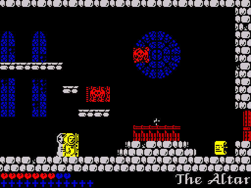

# 6. Tricks, bugs and dead code

This part collects what is not obvious from the routine list: the game
logic running inside the interrupt handler, the stack pointer used as a
data pointer, the self-modifying code, the size and speed tricks, every bug
and quirk found, the code that is never run and what stays open. Each claim
gives the finding of `re/findings.md` it rests on; **observed** means seen in
the simulator (often with a poked value), **inferred** read from the code.

## The game runs inside the interrupt

[StartUp](../src/startup.asm#L39) selects interrupt mode 2 with I = $84. The vector table
[Im2Table](../src/im2table.asm#L11) at $8400-$8500 is 257 bytes of $85, so whatever byte the data
bus holds during the interrupt acknowledge, the vector is $8585 (the byte
$FF reads $84FF and $8500, which is why the table is one byte longer than a
page), and $8585 is [InterruptHandler](../src/interrupt.asm#L35). The handler takes the return
address off the interrupted stack, keeps it and the interrupted SP in the
operands of its last two instructions ([SmcInterruptReturn](../src/interrupt.asm#L79),
[SmcInterruptSP](../src/interrupt.asm#L76)) and runs on its own 38-byte stack ([InterruptStack](../src/variables.asm#L595),
$855F-$8584) with every register saved (the code is in
[The game loop](04-game-loop.md)). It calls the routine in
[InterruptRoutine](../src/variables.asm#L34): [MenuFrame](../src/controls.asm#L543) in the menus, [GameFrameRoutine](../src/interrupt.asm#L181) in
play. So the whole game logic, the sound step, the keyboard, Jean, the
creatures, the exits, runs in the interrupt, once per frame, with
interrupts disabled (F103). The main program only draws: it waits at
[FrameListGate](../src/templates.asm#L143) for the interrupt to complete a list of draw commands
([Screen drawing](05-drawing.md)).

The only EI of the frame comes before the two patched instructions and takes
effect after the `LD SP`. An interrupt accepted between the `LD SP` and the
`JP` would push $85B9 (the JP) as its return address, the second run of the
handler would store it as the operand of that JP, and the program would hang
on `JP $85B9`. It needs a frame routine that ends exactly as the next frame
starts. The frame routine takes at most about 25,000 of the 69,888
T-states of a frame (the logic up to 15,800 T-states in the rooms measured
in [The game loop](04-game-loop.md), a sound step up to 9,000), so this was
not seen (F112, inferred).

## The stack pointer as a data pointer

The interrupt writes only two bytes below the interrupted SP (the return
address, then BC) and keeps everything else on its own stack, so the code
can point SP at data:

- **The frame call list.** [RunFrameList](../src/templates.asm#L163) stores SP in the operand of
  [LeaveFrameList](../src/templates.asm#L182), sets SP to [FrameList](../src/buffers.asm#L50) and executes RET. Each entry
  is a routine address followed by its parameters; the routine POPs the
  parameters and its RET jumps to the next entry. The list ends with the
  address of [LeaveFrameList](../src/templates.asm#L182), which restores SP. A call list without
  CALLs.
- **The object slots.** [RunObjectSlots](../src/gameframe.asm#L94) points SP at each 22-byte slot
  and RETs: the first word of the slot is its handler. The handler POPs its
  own fields, PUSHes back the changed ones and jumps to [RunObjectSlot](../src/gameframe.asm#L99)
  with the next slot; [EndOfSlots](../src/gameframe.asm#L114) restores SP. Item slots go one step
  further: [RoomItemHandler](../src/gameframe.asm#L132) jumps to the overlap test with IX =
  [ItemActionEntry](../src/gameframe.asm#L151), a RET that pops the item's action routine from the
  slot. [HitTest](../src/gameframe.asm#L856) pops the hit box words and continues at an address it
  stored in the operand of a JP ([SmcHitContinue](../src/gameframe.asm#L918)). This runs inside the
  interrupt, with interrupts off.
- **Handlers that rewrite themselves.** A creature changes its behaviour by
  replacing its slot's handler word: the crusader's path commands and the
  water drop move SP back to the slot and PUSH the new handler, then restore
  SP from a patched `LD SP,nn` ([SmcHopRestoreSP](../src/entities.asm#L278), [SmcFallRestoreSP](../src/entities.asm#L322),
  [SmcStepRestoreSP](../src/entities.asm#L367), [SmcDropSP](../src/entities.asm#L1790)). The patrolling creatures swap
  between two handler words at their turning points (F86).
- **POP as a fast read.** In the foreground, with interrupts on,
  [CopyRunCells](../src/redraw.asm#L460) reads tile bitmaps and [DrawBlockJob](../src/sprites.asm#L274) item sprites by
  pointing SP at them and popping pairs of bytes.

### Why the interrupt does not damage the graphics

The last point is the dangerous one. When the interrupt arrives while SP
points into a tile bitmap, the CPU pushes the return address into the two
bytes below SP, which are bytes of the tile. It happens: a watch on
$CF00-&#36;D6FF over the 3000 frames of `tests/inputs/play.txt` caught 32
interrupts with SP inside the tile bitmaps, and a watch on $66DC-$68CB 5
with SP inside the item sprites. In every case the bytes were back to their
old values before the handler went on, and the tile bitmaps, item sprites
and font were identical to the image after the run (and after the 8000
frames of `tests/inputs/fuzz.txt`, 134 such interrupts).

The repair is the `PUSH BC` near the start of the handler (F139; the
annotation first called it an instruction with no effect). After `EX (SP),HL / POP HL`
SP is back where it was interrupted, and `PUSH BC` writes BC over the same
two bytes the CPU overwrote. Both copy loops keep in BC exactly those two
bytes: each `POP BC` loads the pair just below the new SP, and before the
first POP the loops load the first pair with `LD C,(HL) / LD B,(HL)` and
only then set SP past it ([CopyRunCells](../src/redraw.asm#L460), [DrawBlockJob](../src/sprites.asm#L274)). Taking the
`PUSH BC` out shows what it prevents. With $858E poked to 0 (NOP), the same
run of `play.txt` ends with 31 bytes of the tile bitmaps and 20 bytes of the
item sprites changed, and blank tile $80 is no longer blank:

Compare `play-church.png` in the [gallery](07-graphics.md). These runs were
made while writing this article; the comments of [InterruptHandler](../src/interrupt.asm#L35) and
[CopyRunCells](../src/redraw.asm#L460) and the evidence of F112 still describe the `PUSH BC` as
unused.

## Self-modifying code

The program changes its own instructions in about fifty places. They fall
into five kinds.

**One-byte gates.** A routine whose first byte is RET or NOP. The main loop
calls it on every pass; something else arms it by writing 0 (NOP), and the
routine disarms itself by writing RET back. A flag and a branch in one byte:

| Gate | Armed by | Disarmed by |
| --- | --- | --- |
| [DrawLivesBar](../src/sprites.asm#L1337), [DrawCrossesHud](../src/hud.asm#L17) | a new game, a heart, a cross, the end of a death, a closed text window | itself |
| [ParchmentGate](../src/hud.asm#L87) | a parchment touched ([ActionParchment](../src/gameframe.asm#L816)) | [ShowTextWindow](../src/hud.asm#L125), [EnterRoom](../src/mainloop.asm#L192) |
| [RunEventScript](../src/hud.asm#L287) | the church door, a gate lever, Satan's smoke (the script address goes into [SmcEventScript](../src/hud.asm#L293)) | itself, [EnterRoom](../src/mainloop.asm#L192) |
| [FrameListGate](../src/templates.asm#L143) | [EndFrameList](../src/gameframe.asm#L61) (a frame list complete) | [RunFrameList](../src/templates.asm#L163), [EnterRoom](../src/mainloop.asm#L192) |
| [QueueDrawCmd](../src/player.asm#L446) | [LeaveFrameList](../src/templates.asm#L182) | [RunFrameList](../src/templates.asm#L163); read as a flag by [GameFrame](../src/gameframe.asm#L22) |
| [DrawWaterReflection](../src/effects.asm#L31), [AnimateBloodTiles](../src/effects.asm#L191), [ShowCrossRing](../src/effects.asm#L245) | room script opcodes $9D, $9E, $9F | [EnterRoom](../src/mainloop.asm#L192) |
| [KempstonSwitch](../src/controls.asm#L45) | [StartUp](../src/startup.asm#L39) (joystick found), [ToggleKempston](../src/controls.asm#L260) | the same |

**Opcode changes.** [CheckCheatKeys](../src/controls.asm#L511) flips the `JR` at [SmcWarpCheat](../src/player.asm#L571)
($18) into `JR Z` ($28) and back, which lets the T key reach the debug room
warp (F23). [Patch128KHooks](../src/startup.asm#L122) turns two `LD HL,nn`, one `RET` and the first
instruction of [PlaySoundStep](../src/mainloop.asm#L291) into `CALL nn` and `JP nn` on a 128K
([Sound](05-sound.md)). [CopyMenuArea](../src/controls.asm#L587) writes NOP or `EX DE,HL` in front of two
LDIRs ([SmcCopyBitmap](../src/controls.asm#L594), [SmcCopyAttrs](../src/controls.asm#L602)) to copy the screen to a buffer
or back.

**Patched jumps into unrolled code.** A JR whose offset byte is computed
skips the start of a chain of identical instructions: the redraw copy
([SmcAttrJump](../src/redraw.asm#L87), [SmcBitmapBackJump](../src/redraw.asm#L179), [SmcBitmapForwardJump](../src/redraw.asm#L252): an
offset of 2 x (32 minus the run length) into chains of LDI or LDD), the
water reflection ([SmcWaterJump](../src/effects.asm#L59), into 32 LDIs) and the font
([SmcGlyphShift](../src/script.asm#L647), 2 x (x AND 7) into eight `ADD HL,HL / ADC A,A` pairs).
[DispatchDrawer](../src/sprites.asm#L550) does the same with a computed address and RET instead of
a patched JR.

**Saved values in operands.** Instead of a variable, an instruction keeps
the value as its own operand: the interrupted SP and PC ([SmcInterruptSP](../src/interrupt.asm#L76),
[SmcInterruptReturn](../src/interrupt.asm#L79)), the SP of the list and slot runners
([LeaveFrameList](../src/templates.asm#L182), [EndOfSlots](../src/gameframe.asm#L114)) and of the POP copies
([SmcBlockSP](../src/sprites.asm#L382), [SmcRestoreSP](../src/redraw.asm#L514)), a continuation address
([SmcHitContinue](../src/gameframe.asm#L918)), the draw queue tail (the operand of [AddQueueJob](../src/sprites.asm#L162)),
the graphics pointer of a block ([SmcBlockGfx](../src/sprites.asm#L332)), the next free redraw cell
and the run count of a row ([SmcRedrawIndex](../src/redraw.asm#L401), [SmcRunCount](../src/redraw.asm#L420)), the four
steps of a room sweep ([SmcSweepInnerCol](../src/sprites.asm#L1205) and the three after it), the
event script address ([SmcEventScript](../src/hud.asm#L293)), the colour step of the cross ring
([SmcCrossColour](../src/effects.asm#L256)) and the six operands of the water reflection
([SmcWaterAttrAddr](../src/effects.asm#L34) to [SmcWaterCount](../src/effects.asm#L51), written by [OpSetupWater](../src/script.asm#L1589)).

**Handler words.** The object slots hold the address of the code that runs
them, and creatures change it as their state changes (see above).

A new game restores the gates of the status bar but not the cheat byte, the
colour step of the cross ring or the tile animation timers (F123); none of
these shows in play.

## Size and speed

- **Outlines instead of masks.** One 256-byte table built at start-up
  replaces a mask for every sprite byte ([Screen drawing](05-drawing.md), F37).
- **Pre-shifted and mirrored sprites made on room entry.** The tape holds
  each frame once, packed; the room's sprites are unpacked with three
  shifted copies and a mirrored set as needed, so drawing never shifts or
  flips (F113, F114).
- **Draw only what changed.** The flag map marks cells to redraw; the run
  list copies only those, each run with one entry into an unrolled LDI
  chain, the pixel rows alternating LDD and LDI so no pointer is reloaded.
- **Page-aligned tables.** Tile flags, attributes and bitmaps at $CD00,
  $CE00, $CF00, the outline masks at $FF00, the sprite sheet a page per
  pixel row, the redraw buffers a page per field: every lookup is a register
  pair with a fixed high byte. The flag map is three pages above the tile
  map, so adding 3 to the high byte turns one address into the other.
- **Coordinates in 2-pixel units.** Positions fit a byte (x 0-$7F, y
  0-$57) with an 8.8 fraction; x / 4 is the byte column and x AND 3 the
  shifted copy.
- **Packed data.** The sprite sets are packed column by column ([Screen drawing](05-drawing.md)),
  the font repeats unchanged pixel rows with a mask bit (F22), the rooms are
  bytecode scripts ([Rooms](05-rooms.md)), and the whole game is a MegaLZ stream on
  the tape, unpacked by the loader over itself ([Overview](01-overview.md)).
- **Small things.** [ScanKeyboard](../src/helpers.asm#L221) reads the eight half-rows with eight
  `INI`; [FillHudAttrs](../src/hud.asm#L68) switches colour when its DJNZ counter runs out and
  never again because B wraps to $FF; [FindRedrawRow](../src/sprites.asm#L231) and the run list
  use one-byte indexes so `INC L` never needs a carry.

## Memory used twice

| Address | First use | Second use |
| --- | --- | --- |
| $6000-$6072 | the start-up code ([StartUp](../src/startup.asm#L39)) | rows 16-19 of the flag map, from the first room on |
| $5B00-$5DBF | the loader's depacker (printer buffer) | the tile map; under the controls menu, the saved attribute file ([SaveMenuArea](../src/controls.asm#L561)) |
| $C500-&#36;C5FF | the bit-reverse table for mirroring sprites ([BuildMirrorTable](../src/templates.asm#L286), room entry) | pixel row 0 of the redraw buffers |
| $C500-&#36;CCFF | the redraw buffers | under the controls menu, the saved middle third of the screen |
| $625E-... | the loader's second stage | tape block 3 is loaded over it |

## Bugs and quirks

| Finding | Status | What |
| --- | --- | --- |
| F51 | observed (forced) | The sliding scythe of Death ([UpdateScytheSliding](../src/entities.asm#L3521)) loads both coordinates from x on one path, so the scythe is drawn at y = x. The path needs a solid cell at the scythe's own row, which its fall-and-slide movement in room 18 never meets (F50); seen with poked flags. |
| F94 | observed (forced) | The horizontal patrols and the intro runners test the turning point with equality: a creature that starts outside its limits walks until x wraps round 256. No room record does this; seen with a poked start. |
| F106 | observed (forced) | The noise effect's random bytes are R XOR $01 ([Sound](05-sound.md)). Effect 1 is never requested. |
| F120 | observed | When Jean stops crouching and starts to fall in one frame, frame 2 of a two-frame table is read: the word after the table is a routine address, and for one frame he is drawn from the code bytes of [QueueSprite](../src/sprites.asm#L50). |
| F121 | observed | The dying monk still touches items: a heart taken during the 32 frames of the death gives the life back, and with the last life lost the game goes on with one life. |
| F122 | observed | A heart adds a life only below 9; lives are decremented with no floor (only a poke gives 0, which wraps to 255); more than 9 lives turn the blank cells of the bar red. |
| F24 | observed | The cheat test XORs the eight bytes of the redefined keys into one value: 59392 of the 2560000 key choices toggle it, Z X C 5 among them, not only R A G E. |
| F127 | observed | Two keys of one half-row held while redefining: the binding takes one key and the name shown the other. |
| F126 | observed | With all 11 object slots busy the spawn queue is dropped: in room 14 the plants lose seeds at every volley. |
| F35 | observed | A Kempston joystick moved during the start-up probe is taken as "no interface". |
| F75 | observed | A jump into a ceiling stops the rise but not the jump timer: Jean hangs under the ceiling until the rise would have ended. |
| F128 | observed | R + Y during the intro do not give Game Over; held on, they end the game on its first frame. |
| F123 | observed | A new game keeps the RAGE cheat and the redefined keys (see Self-modifying code above). |
| F95 | observed, harmless | The chasing ghost of room 11 reads the flag map as a flat array, so at the edges it reads the neighbouring row; the walls there keep it on screen. |
| F30 | observed (forced) | The chalice can be taken without 12 crosses, but only on the room's first frame; without the ring of crosses it is out of reach (F125). |
| F77 | observed (warp only) | Room numbers are reduced modulo 25 as a byte, so going left from room 0 enters room 5 and up from rooms 2 and 3 enters 3 and 4. None of these exits can be reached in play (F124). |
| F67 | observed (warp only) | Room 4 clears the status bar and redraws nothing, so the hearts and crosses stay blank afterwards. Room 4 is only reached by the debug warp and in the ending. |
| F129 | observed | Spelling: "Lanquedoc" in the intro, "Gloomy tunels" (room 15); the room names of rooms 0 and 4 are ":)" and ":&#36;", never shown. |
| F6 | observed (forced) | Script opcode $8A with bit 3 (bottom edge) writes into the main stack and crashes; no room uses it. |
| F5 | observed | Script opcode $90 never changes the cell at $6000 (row 16, column 0); no room depends on it. |
| F12 | observed | [BitmapAddress](../src/helpers.asm#L66) is right only for pixel rows that are multiples of 8; every script uses such rows. |
| F55 | observed, harmless | A 16-byte template brings two bytes of the next template into the slot. |
| F85 | observed, harmless | The countdown of the pyre monk in the ending wraps to $FFFF after use. |
| F111 | observed (poke) | On a 128K the title script is not drawn after Game Over or the ending; the 128K bank unpacks the title picture instead ([Sound](05-sound.md)). |
| F44 | inferred | Nothing checks for a 17th draw job in a frame (14 is the most seen). |
| F110 | inferred | The room spawners do not check for a free slot; at most 10 records per room, 11 slots. |
| F112 | inferred | The interrupt race described above. |

## Dead code and unused data

| Address | What | Evidence |
| --- | --- | --- |
| $85BD [UnusedRet](../src/interrupt.asm#L97) | a RET nothing refers to | F130 |
| $A097 [UnusedFillFlags](../src/script.asm#L1254), $A22F [UnusedFlagMapAddress](../src/helpers.asm#L189) | a flag fill and its address helper; nothing calls the first | F130 |
| $A15A [OpTileVLine](../src/script.asm#L1539) | script opcode $9A: no script uses it | F1, F130 |
| effect 1, [NoiseByte](../src/mainloop.asm#L425) | the noise effect, never requested | F106 |
| $879E, $87B2, $87C4 in [PlaySoundStep](../src/mainloop.asm#L291) | the chained effect and sound modes 1 and 3+: no record uses them | F130 |
| $ADA1 [WaterCopyChain](../src/effects.asm#L72) | the first 16 LDIs of the water copy: both water strips are 16 cells wide | F130 |
| $A1A2, $AE13 | the water source in another screen third and the row step: both strips are in row 21 | F130 |
| $AFF1 in [MirrorFrame](../src/unpack.asm#L304) | a branch no sprite set needs | F130 |
| $8508 [UnusedByte](../src/variables.asm#L63), $8520 | variable bytes no code uses; [BankMusicTrack](../src/variables.asm#L515) ($8550) is used by the 128K music bank ([Sound](05-sound.md)) | Q2 |
| [SpareFill1](../src/buffers.asm#L58) $BEFC-&#36;BFFF, [SpareFill2](../src/buffers.asm#L132) $C1F4-&#36;C1FF | fill after the frame list and the object slots | Q2 |

Code that the game can reach but no input of this project ran is listed in
F131: the 128K paths, the no-Kempston store of the probe, the intro ending
on a joystick move, the long runs of the redraw copy (more than 21 cells),
the top exit from room 7 to room 2, the debug warp keys, and a few branches
of the chasing ghost and the archers for negative x.

## Open questions

- Still **inferred** in the finding register: F44 (draw queue overflow),
  F45 (consecutive run list records for one job), F65 (which set is the
  crusaders), F66 (what the loader leaves on the stack on a 128K), F93 and
  F101 (frame tables of the walkers), F110 (spawner without a free slot),
  F112 (interrupt race), F131 (code not run). F22 (font format) and F47
  (sprite rows inside a character row) were checked by models while writing
  this article ([Screen drawing](05-drawing.md)) and can be marked observed;
  the drawing model found no frame where F45's assumption fails.
- The 128K machine (Q22, partial): nothing of the bank was run on a 128K
  model. The AY output, the F + H mute toggle and the AY effects are read
  from a few instructions of the bank ([Sound](05-sound.md)).
- The loader's patch of LD-BYTES for a ROM whose LD-EDGE-1 starts with a
  JP stores a different byte (src/stage2.asm, [InstallLoader](../src/stage2.asm#L679)):
  Unknown.
- Why rooms 0 and 4 have the names ":)" and ":&#36;" (src/text.asm): Unknown.
