# 7. Graphics gallery

Every image of the article, made from the game's bytes or from runs of the
game in the project's simulator (`tools/zxrun.py`), never redrawn by hand.
Screens and rooms come from runs (sometimes with a poked variable), sprites
and tiles from their bytes in the colours the game gives them, the font and
the 128K ending from the game's own routines run in the simulator. The
commands for most of them are in
[`scripts/docs-images.py`](../scripts/docs-images.py).

## Loading

| | |
| --- | --- |
| 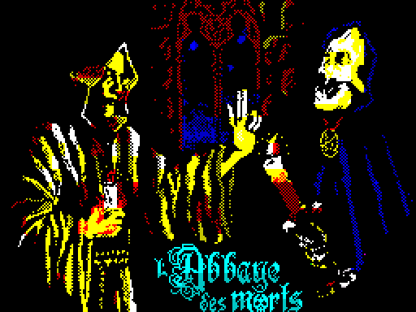 | The picture that the second loader stage reveals cell by cell before it loads the rest of the tape (`data/picture.scr`; [Overview](01-overview.md)) |
|  | The reveal in progress |
|  | The loading screen, unpacked when the game is loaded; it stays on the screen as the title of the first game (`data/loading.scr`, F36) |
|  | The info screen (`data/info.scr`). On a 128K, holding SPACE on the title unpacks it from the music bank ([Sound](05-sound.md)) |

The hourglass of the tape loader: the outline of 3 x 3 cells
([HourglassOutline](../src/stage2.asm#L751)) with its middle column replaced by one of ten
frames. The frame follows the number of pages still to load; two sets of
frames ([HourglassTop](../src/stage2.asm#L764) and [HourglassBottom](../src/stage2.asm#L795), top and
bottom row of the strip below) differ in the falling grains and alternate with
bit 0 of the byte counter, so the stream flickers while a frame is shown.
The loader's edge routine draws one quarter of the current frame (8 bytes)
per call instead of the ROM's delay loop ([EdgeRoutines](../src/stage2.asm#L563)).

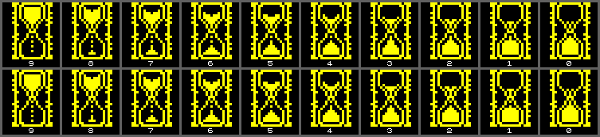
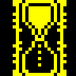

## Screens

| | |
| --- | --- |
|  | The title drawn by [ScriptTitle](../src/controls.asm#L741) after a Game Over or the ending (48K) |
|  | The controls screen ([Title and menus](03-title-and-menu.md)) |
|  | Redefining the keys: JUMP, CROUCH and LEFT done, RIGHT asked for |
|  | The intro, room 0: Jean ahead of three crusaders under the story text |
|  | In play, room 6 (frame 700 of `tests/inputs/play.txt`): crusaders come in from the left |
|  | In play, room 8 (frame 1500): bats, a checkpoint, a parchment |
|  | The parchment of room 8 in its frame |
|  | The Game Over screen |
|  | Room 24 after the chalice: Satan's smoke and the red scroll |
|  | The ending, first scene: the crusaders climb to the pentagram room |
|  | The second scene: Jean on the pyre |
|  | The pyre after 280 frames: the player's own dying animation |
|  | The 128K ending: the music bank's routine at $FC4B, run in the simulator with the bank's bytes at $C000 ([Sound](05-sound.md)) |

How the screen is built, in pictures:

| | |
| --- | --- |
|  | A room sweeping in after an exit to the right, one image per frame, slowed down five times ([Screen drawing](05-drawing.md)) |
|  | Sprites over scenery, enlarged: the black outline from the mask table and the sprites' colour taken by the cells they cover |
|  | The reflection in the lake of room 16 ([Rooms](05-rooms.md)) |
|  | Room 24 with twelve crosses: the ring and the chalice |
|  | Room 8 with the `PUSH BC` of the interrupt handler removed: the tile and item graphics damaged by the interrupt ([Tricks](06-tricks.md)) |

## The rooms

Each room entered directly (room number $8509 poked, room state $81), the
picture taken 12 frames after its sweep has ended, with Jean taken out of
play. Room 0 is the intro; room 1 is seen in play only through the window of
room 2; room 4 is the setting of the second scene of the ending and has no
name panel (F124, F67).

| | | | | |
| --- | --- | --- | --- | --- |
| 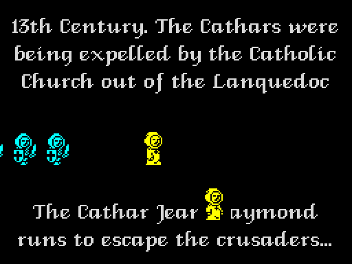 0 (intro) | 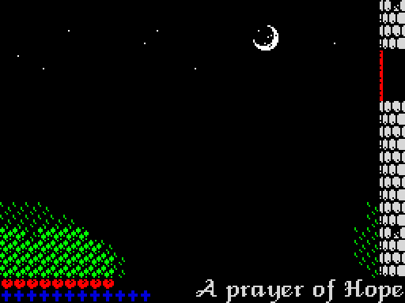 1 A prayer of Hope | 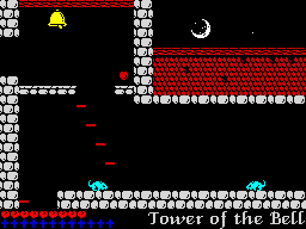 2 Tower of the Bell | 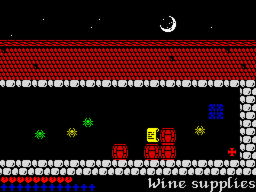 3 Wine supplies | 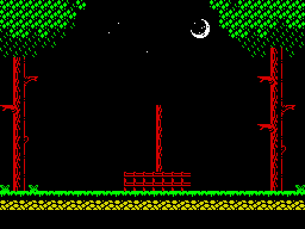 4 (no name) |
| 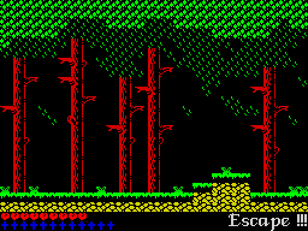 5 Escape !!! | 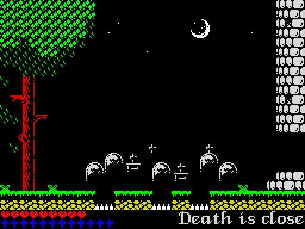 6 Death is close | 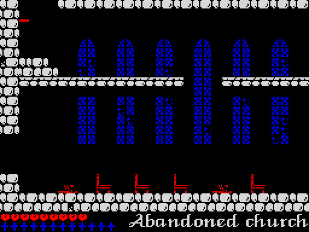 7 Abandoned church | 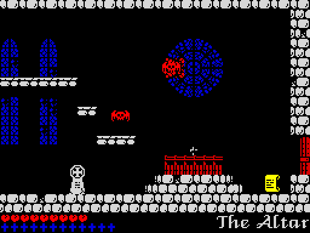 8 The Altar | 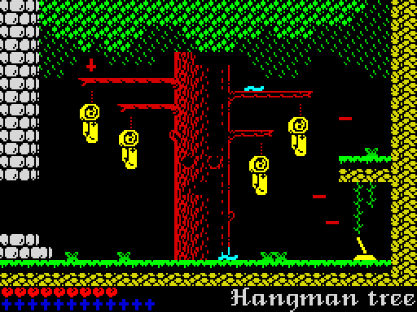 9 Hangman tree |
| 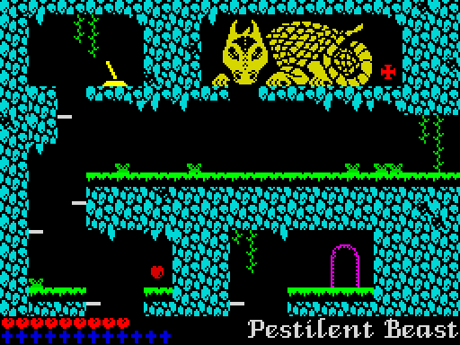 10 Pestilent Beast | 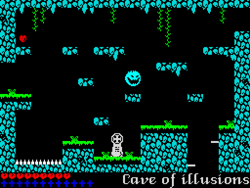 11 Cave of illusions | 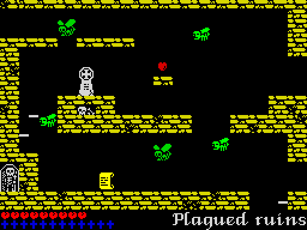 12 Plagued ruins | 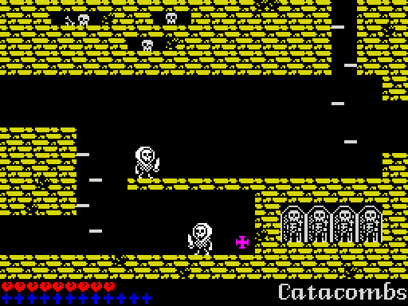 13 Catacombs | 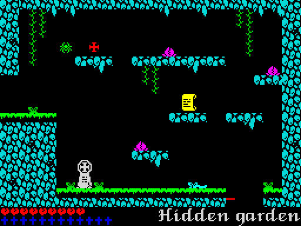 14 Hidden garden |
| 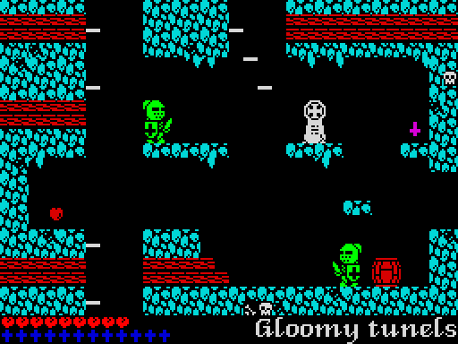 15 Gloomy tunels | 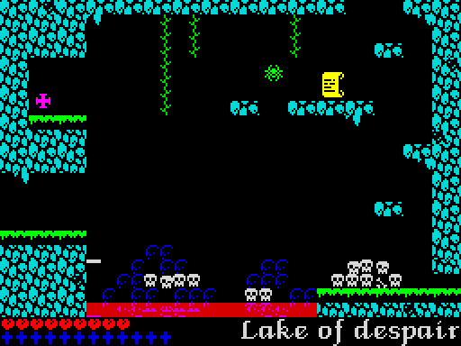 16 Lake of despair | 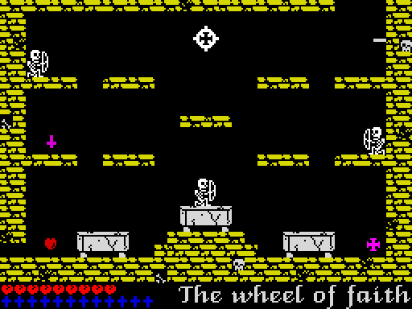 17 The wheel of faith | 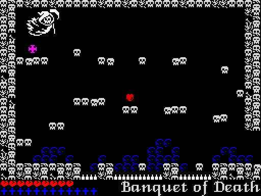 18 Banquet of Death | 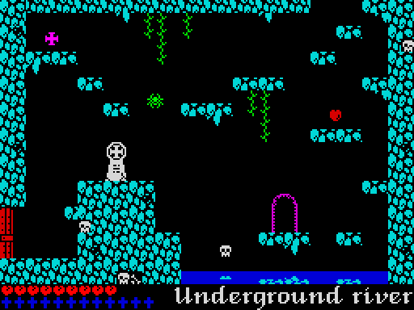 19 Underground river |
| 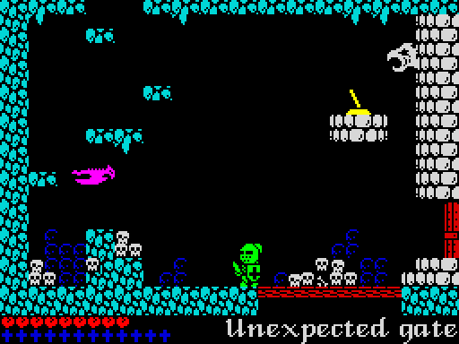 20 Unexpected gate | 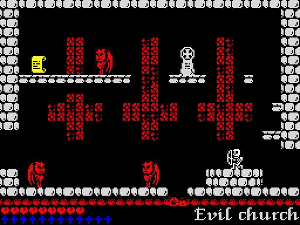 21 Evil church | 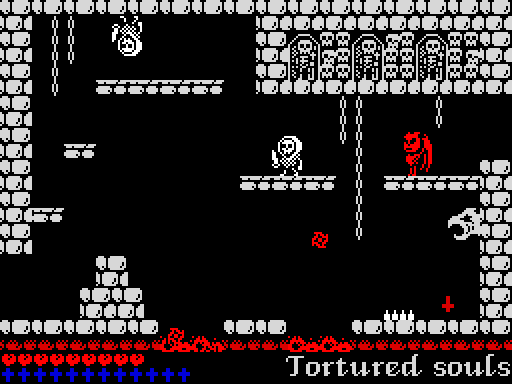 22 Tortured souls | 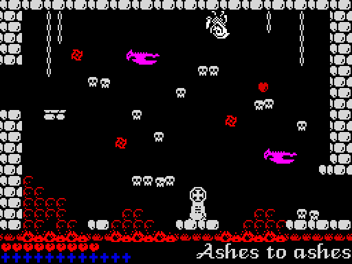 23 Ashes to ashes | 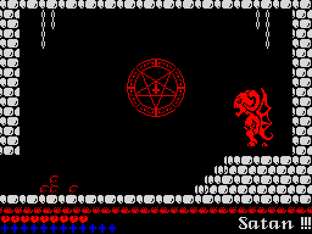 24 Satan !!! |

## Tiles

The 256 tiles at [TileGfx](../src/tiles.asm#L90) (&#36;CF00), three times enlarged, tile n at row n /
32, column n mod 32, each drawn in its attribute from [TileAttrs](../src/tiles.asm#L61). Tile
$00 is the black solid cell of room 20's invisible bridge (F135), $3B and
$3C the bubbling blood (F116), $4C the cross of the ring (F125), $7B and
$7C the heart and the cross of the status bar, $80 the blank cell, $B7 the
rope of the hanged men (F88).

## Items

The 34 frames of the lists at [FramesHeart](../src/objects.asm#L120) and after it, each a 16 x 16
sprite (the arch 16 x 24) in its attribute: the heart (2 frames,
[FramesHeart](../src/objects.asm#L120)); the cross in six bright colours, then the thin plus sign
in the same six, shown for the crosses that cannot be taken with the wheel
of faith as it is ([FramesCross](../src/objects.asm#L125), F31); the checkpoint, not active and
active; the arch in its nine colour steps ([FramesArch](../src/objects.asm#L155)); the parchment;
the red scroll (the same sprite, red); the bell at rest and ringing; the
lever up and pulled; the wheel of faith in its two positions; the chalice
([Items and the ending](05-items-ending.md)).

## Jean

 

From the sprite sheet: walking and in the air facing left ([MonkFramesLeft](../src/player.asm#L912))
and right ([MonkFramesRight](../src/player.asm#L914)), the seven pictures of the dying animation
([MonkDyingFrames](../src/player.asm#L916), three flames drawn bright red), crouching facing left
and right ([CrouchFramesLeft](../src/player.asm#L923), [CrouchFramesRight](../src/player.asm#L925)). Only the unshifted
copy of each frame is shown. The walk: pictures 0 and 1, each held for 8 frames, as
[UpdatePlayerActive](../src/player.asm#L629) toggles them ([Jean](05-player.md), F70).

## Creatures

Each creature of the room object table drawn from the frames its behaviour
block points to, in a snapshot of a room that unpacks its sprites; the label
is the block address and that room. The names are the titles of the blocks
in [`src/behaviours.asm`](../src/behaviours.asm):

| Label | Block | Creature |
| --- | --- | --- |
| $93D3 r0 | [BehaviourJean](../src/behaviours.asm#L41) | Jean walking across the intro screen (kind 0, room 0) |
| $93E0 r0 | [BehaviourCrusader](../src/behaviours.asm#L60) | a crusader (kinds 0 and 1, rooms 0, 5, 6 and 25) |
| $93F5 r13 | [BehaviourSkeleton](../src/behaviours.asm#L79) | a white walker (kind 2, rooms 13 and 22) |
| $940A r22 | [BehaviourWhiteFlyer](../src/behaviours.asm#L98) | a white walker near the ceiling (kind 2, rooms 22 and 23) |
| $941F r8 | [BehaviourBat](../src/behaviours.asm#L117) | a bat (kinds 2 and 3, room 8) |
| $9430 r2 | [BehaviourRat](../src/behaviours.asm#L134) | a rat (kinds 2 and 3, room 2) |
| $9445 r3 | [BehaviourSpider](../src/behaviours.asm#L154) | a spider on its thread (kind 4, rooms 3, 14, 16 and 19) |
| $9452 r3 | [BehaviourSpiderYellow](../src/behaviours.asm#L170) | a yellow spider (kind 5, room 3) |
| $9465 r9 | [BehaviourHangedMan](../src/behaviours.asm#L190) | a hanged man (kind 6, room 9) |
| $9476 r9 | [BehaviourWorm](../src/behaviours.asm#L207) | a worm (kind 2, rooms 9 and 14) |
| $9487 r12 | [BehaviourFlyA](../src/behaviours.asm#L224) | a fly (kind 5, room 12) |
| $949C r12 | [BehaviourFlyB](../src/behaviours.asm#L242) | a fly, darker colour (kind 5, room 12) |
| $94B1 r11 | [BehaviourChaser](../src/behaviours.asm#L261) | the grinning ghost that chases Jean (kind 8, room 11) |
| $94C6 r20 | [BehaviourBird](../src/behaviours.asm#L281) | a flying creature (kind 2, rooms 20 and 23) |
| $9506 r15 | [BehaviourSoldier](../src/behaviours.asm#L349) | a soldier (kind 2, rooms 15 and 20) |
| $9555 r21 | [BehaviourDemon](../src/behaviours.asm#L428) | a demon (kinds 2 and 3, rooms 21 and 22) |
| $956A r22 | [BehaviourFireWheel](../src/behaviours.asm#L449) | a falling red flame (kind 4, rooms 22 and 23) |

[BehaviourDeath](../src/behaviours.asm#L538): Death (kind 16, room 18), drawn on its own because it is
28 pixel rows high.

The other kinds have blocks of another layout and are shown in play, rooms
entered directly with enemy hits switched off (&#36;A87A := $18):

| | |
| --- | --- |
|  | Room 5: the crusaders arrive from the left ([Creatures](05-creatures.md)) |
| 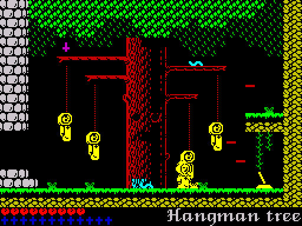 | Room 9, 60 frames after the warp: the hanged men ([BehaviourHangedMan](../src/behaviours.asm#L190)) on ropes they draw into the tile map (F88), a worm on the branch |
|  | Room 10: the Pestilent Beast ([BehaviourBeastHead](../src/behaviours.asm#L467)) breathes fire ([BehaviourBeastFire](../src/behaviours.asm#L490)) |
| 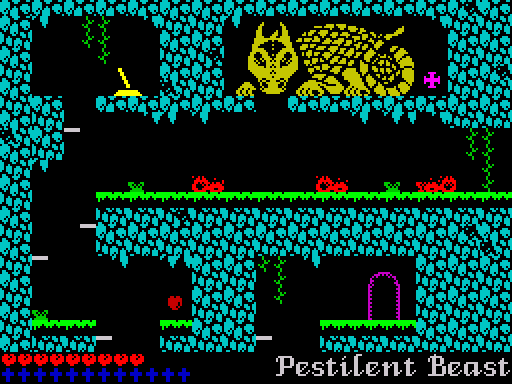 | Room 10, 300 frames after the warp: flames running along the ledge below the Beast (F84) |
|  | Room 14: a plant ([BehaviourSeedPlant](../src/behaviours.asm#L401)) has just spat two seeds |
| 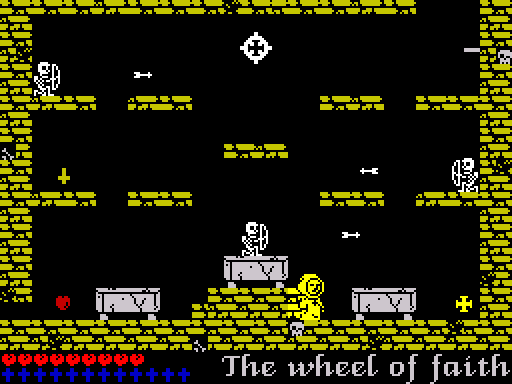 | Room 17, 110 frames after the warp: three skeleton archers ([BehaviourArcher](../src/behaviours.asm#L369)) and their arrows (F81) |
|  | Room 18: Death and two scythes |
| 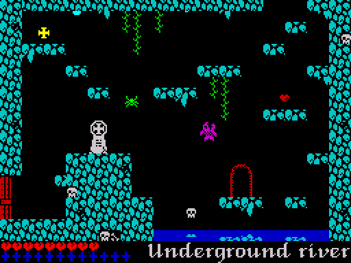 | Room 19, 80 frames after the warp: a fish ([BehaviourFish](../src/behaviours.asm#L415)) out of the river, a spider on its thread (F83) |
|  | Room 24: Satan ([BehaviourSatan](../src/behaviours.asm#L572)) has fired a volley; the ring of crosses is complete |

The water drops ([BehaviourDrop](../src/behaviours.asm#L315)) hang from the roofs of rooms 15 and 19
and the stone heads ([BehaviourStoneHead](../src/behaviours.asm#L388)) sit in the walls of rooms 20
and 22; see the room pictures above.

## The sprite sheet

[SpriteSheet](../src/spritesheet.asm#L25) in room 22, white on black, in four bands of 64 columns
($00-$3F, $40-$7F, $80-&#36;BF, $C0-&#36;FF), each band the 40 pixel rows $D7-&#36;FE.
The first band holds the fixed sprites (Jean in his four shifted copies per
frame, crouching, the small projectiles), the second starts with the flames
of the dying animation; from column $63 come the four sets room 22 unpacks:
devils, fireballs, skeletons and white ghosts, with their shifted and
mirrored copies ([Screen drawing](05-drawing.md)).

## The font

The 96 characters $20-$7F of [FontIndex](../src/font.asm#L11), each drawn by the game's
[DrawGlyph](../src/script.asm#L531) in the simulator, 12 to a line. "@" and $7F are empty.

## The parchment frame

The 12 frame tiles at [ParchmentFrameTiles](../src/graphics.asm#L651), yellow on black as
[ShowParchment](../src/hud.asm#L103) draws them: 0 top-left corner, 1 and 2 top edge, 3
top-right corner, 4 and 6 left edge, 5 and 7 right edge, 8 bottom-left
corner, 9 and 10 bottom edge, 11 bottom-right corner. [ParchmentLayout](../src/graphics.asm#L679)
places them around a 22 x 9 interior.
