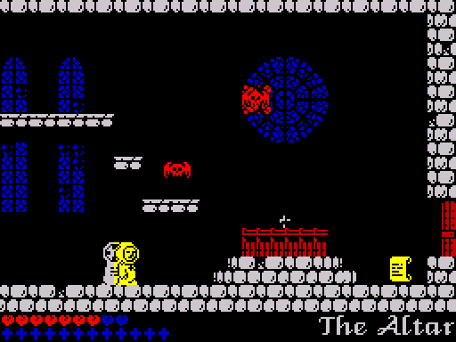

# l'Abbaye des Morts (ZX Spectrum, 2014): how it works

l'Abbaye des Morts for the 48K ZX Spectrum was written by DaRkHoRaCe and
Jerri and released as freeware in 2014, after Locomalito's PC game of 2010.
The Cathar monk Jean Raymond flees the crusaders through the 25 rooms of an
abbey and its grounds: he collects twelve crosses, turns the wheel of faith,
climbs a ring of crosses to the chalice and faces Satan. This article
explains the program top-down from a full disassembly whose sources in
[`src/`](../src) rebuild the original tape byte for byte, the loader and its
packer included.

The tape holds a BASIC line, a string variable with the first loader stage
and the packed second stage, and a block of four MegaLZ streams: the second
stage reveals a picture cell by cell and loads that block with a patched
copy of the ROM loader that animates an hourglass. The game logic runs inside the 50 Hz IM 2 interrupt: every
frame it reads the keys, moves Jean and the eleven object slots of the room
and leaves the sprites as a chain of draw commands, which the foreground loop
runs by `RET` and draws when it can, skipping pictures but never logic
frames. Rooms are bytecode scripts for a 32-command interpreter that fill a
tile map and a flag map; the flag map also carries the redraw marks, so only
changed cells reach the screen. Creatures are handlers entered by `RET`
with SP pointing into their slot. Sprites get a black outline from a table
instead of stored masks, and are pre-shifted and mirrored when a room is
entered. On a 128K the same program pages in a music bank. The article covers
the loader, every data format, the frame logic and its timing, each
subsystem, the bugs and dead code, a gallery of every room and sprite, and
notes for porting.

## Contents

1. [Overview](01-overview.md): the game, the hardware it uses, the memory
   map, how it loads (BASIC, MegaLZ stages, the picture, the hourglass
   loader), the start-up, 48K and 128K
2. [Data structures](02-data.md): variables, room scripts and their
   commands, room objects and items, behaviour blocks, object slots,
   templates, checkpoints, tiles and tile flags, font, texts, the sprite
   sheet and the packed sprite sets
3. [Title, menus and the start of a game](03-title-and-menu.md): the
   title, the controls menu, key redefinition, Kempston, the RAGE cheat, the
   intro in room 0, a new game, Game Over
4. [The game loop](04-game-loop.md): the interrupt handler, one game frame,
   the frame call list, the room state machine, timing and speed
5. Subsystems
   - [Rooms](05-rooms.md): how a room is built from its script, the room
     effects, exits and the room map
   - [Jean](05-player.md): controls, tile probes, walking, jumping,
     falling, crouching, dying, checkpoints, lives
   - [Creatures](05-creatures.md): the object slots, spawning, every kind of
     creature, projectiles, hit tests
   - [Items and the ending](05-items-ending.md): items and their actions,
     the ending sequence
   - [Screen drawing](05-drawing.md): outline masks, the draw queue, the
     redraw buffers, room sweeps, sprite unpacking, the status bar, the
     proportional font
   - [Sound](05-sound.md): beeper effects, the 128K hooks and the music bank
6. [Tricks, bugs and dead code](06-tricks.md)
7. [Graphics gallery](07-graphics.md)
8. [Porting notes](08-porting.md)

## Sources

| File | Contents |
| --- | --- |
| [`src/loader.bas`](../src/loader.bas) | BASIC line 10: `PRINT USR (VARS+3)` |
| [`src/stage1.asm`](../src/stage1.asm) | the string variable l&#36;: the first loader stage and the packed second stage |
| [`src/stage2.asm`](../src/stage2.asm) | the second stage: machine check, picture reveal, hourglass tape loader, unpacking |
| [`src/megalz.asm`](../src/megalz.asm), [`scripts/megalz.py`](../scripts/megalz.py) | the MegaLZ depacker; the decoder and packer that rebuild the streams |
| [`src/game.asm`](../src/game.asm) | includes the game's modules below in address order |
| [`src/constants.asm`](../src/constants.asm) | named numbers: colours, tiles, keys, states, sizes, speeds, sounds |
| [`src/startup.asm`](../src/startup.asm) | $6000: start-up, main stack, flag row table |
| [`src/font.asm`](../src/font.asm) | $6130: the proportional font |
| [`src/graphics.asm`](../src/graphics.asm) | $66DC: item sprites, the 20 packed sprite sets, the parchment frame |
| [`src/roomscripts.asm`](../src/roomscripts.asm) | $7236: the scripts of the 26 rooms and their subscripts |
| [`src/cutscenelists.asm`](../src/cutscenelists.asm) | $83A8: ending actors, debug room warp, music per room |
| [`src/im2table.asm`](../src/im2table.asm) | $8400: IM 2 vector table |
| [`src/variables.asm`](../src/variables.asm) | $8501: game variables, interrupt stack |
| [`src/interrupt.asm`](../src/interrupt.asm) | $8585: interrupt handler, 128K paging and music hooks |
| [`src/mainloop.asm`](../src/mainloop.asm) | $85FC: new game, main loop, room entry, beeper effects |
| [`src/sequences.asm`](../src/sequences.asm) | $8832: intro, ending, cutscenes, spawning |
| [`src/objects.asm`](../src/objects.asm) | $8A8F: item types and frames, room objects, room items |
| [`src/text.asm`](../src/text.asm) | $9048: the 53 strings |
| [`src/behaviours.asm`](../src/behaviours.asm) | $93D3: behaviour blocks of the creatures |
| [`src/redraw.asm`](../src/redraw.asm) | $95FF: the redraw list and buffers |
| [`src/sprites.asm`](../src/sprites.asm) | $9836: sprite drawing, lives bar, room sweeps |
| [`src/hud.asm`](../src/hud.asm) | $9C1B: crosses counter, parchments and text windows |
| [`src/script.asm`](../src/script.asm) | $9D5F: the script interpreter and its 32 commands, text |
| [`src/helpers.asm`](../src/helpers.asm) | $A1C3: key waits, address arithmetic, keyboard scan |
| [`src/controls.asm`](../src/controls.asm) | $A271: keys, Kempston, title and controls menus, cheat |
| [`src/gameframe.asm`](../src/gameframe.asm) | $A596: game frame, object slots, item actions, hit tests |
| [`src/player.asm`](../src/player.asm) | $A894: Jean |
| [`src/effects.asm`](../src/effects.asm) | $AD88: water reflection, bubbling blood, ring of crosses |
| [`src/unpack.asm`](../src/unpack.asm) | $AE9D: unpacking sprite sets into the sprite sheet |
| [`src/entities.asm`](../src/entities.asm) | $B028: the creatures |
| [`src/templates.asm`](../src/templates.asm) | $BC92: templates of spawned objects, frame list runner, checkpoints |
| [`src/buffers.asm`](../src/buffers.asm) | $BE56: frame call list, draw queue, object slots, redraw buffers |
| [`src/tiles.asm`](../src/tiles.asm) | $CD00: tile flags, attributes and bitmaps |
| [`src/spritesheet.asm`](../src/spritesheet.asm) | $D700: the sprite sheet |
| [`re/findings.md`](../re/findings.md) | 132 claims with status and evidence (F1-F132, cited in this article) |
| [`re/notes.md`](../re/notes.md), [`re/questions.md`](../re/questions.md) | memory map and loader notes; the questions the work answered |

Links in this article point at labels in these files
(`../src/file.asm#Lnn`). Statements come from the annotated sources, from the
finding register or from runs of the game in the project's simulator
(`tools/zxrun.py`). **Observed** means seen in such a run or a byte check;
**inferred** means read from the code and not run. Finding numbers (F1-F132)
and question numbers (Q1-Q23) point into [`re/findings.md`](../re/findings.md)
and [`re/questions.md`](../re/questions.md). Names are those of the sources;
texts the game prints are quoted as printed, with its spelling. The 128K music
bank is kept as data and its code paths were read, not run: the simulator is
a 48K.

Images in [`img/`](img) are made from the game's bytes and runs by
[`scripts/docs-images.py`](../scripts/docs-images.py).
