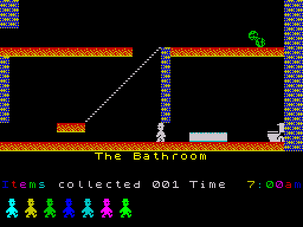
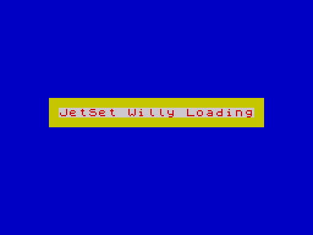
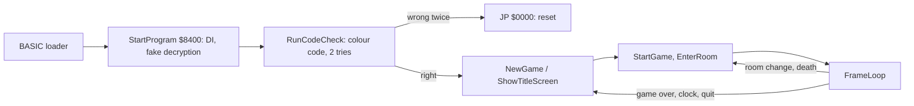

# 1. Overview

Jet Set Willy is a flip-screen platform game: each room fills the top two
thirds of the screen, and walking off an edge replaces it with the
neighbouring room. This section describes what the player sees, which parts
of the Spectrum the program uses, where everything lies in memory and how
the tape gets the program running.

## The game



- **Goal.** The title message says: "Guide Willy to collect all the items
  around the house before Midnight so Maria will let you get to your bed."
  There are 83 items in 38 rooms ([FirstItemIndex](../src/itemtable.asm#L10), F15, F49). Each room
  has one item picture, drawn in every item cell of the room in flashing
  colours.
- **Rooms.** 61 rooms (0-60) joined by left, right, up and down exits. The
  start room is 33, "The Bathroom" ([START_ROOM](../src/constants.asm#L49)). The bottom third of the
  screen shows the room name, "Items collected 000 Time 7:00am" and the lives
  in reserve as small walking Willys.
- **Lives.** 7 in reserve, no extra lives: the 8th death ends the game
  (F101).
- **Clock.** Starts at 7:00am; one game minute is 256 passes of the frame
  loop. When it would reach 1:00 after "12:59pm" the game goes back to the
  title screen without a message (F95, F96).
- **Hazards.** Guardians (16x16 sprites moving horizontally or vertically
  between limits), arrows that cross the room, nasty tiles, and falls of
  five or more character rows. Ropes swing and can be climbed.
- **Ending.** With every item collected the figure in the Master Bedroom
  disappears; walking to the bed end of that room makes Willy run right by
  himself to the toilet in the Bathroom, where he stops and is no longer
  drawn. The game then goes on until the clock ends it or the player quits
  ([Items and the ending](05-items-ending.md), F61-F66).
- **Controls** (F107): left Q E T U O 5 6, right W R Y I P 7 8, jump on the
  whole bottom row (CAPS SHIFT to SPACE) and 0; a Kempston joystick if one is
  detected. A to G pause, H to ENTER toggle the tune, CAPS SHIFT + SPACE quit
  to the title. There is no key redefinition.
- **No score, no levels, no demo, no high score table.** The status line
  counts items collected.

## Hardware used

| Part | Use |
| --- | --- |
| Z80 at 3.5 MHz | interrupts disabled at the first instruction ([StartProgram](../src/start.asm#L16)) and never enabled; no `HALT`, no `IM`. The speed of the game is the run time of one pass of the loop (F93) |
| Screen bitmap $4000-$57FF, attributes $5800-$5AFF | written by block copies from work buffers (top two thirds), directly for the status area (bottom third), the title, code and game-over screens |
| RAM $5C00-$7FFF | four work buffers over the BASIC system variables and program area (the game never returns to BASIC) |
| Port $FE out | border colour (bits 0-2) and beeper (bit 4 speaker, bit 3 MIC, toggled together: [BEEPER_BITS](../src/constants.asm#L10) = $18) |
| Port $FE in | keyboard half rows, read with `IN A,(C)` and the row in B |
| Port $1F in | Kempston joystick, read only when [JoystickFlag](../src/variables.asm#L219) is set |
| ROM | the character set at $3D00 (through [PrintChar](../src/output.asm#L114)); `JP $0000` resets the machine after a wrong colour code. No ROM routine is called |
| FRAMES ($5C78) | read once, as a seed for the colour-code grid cell; nothing else updates it because interrupts are off (F4) |

Only one system variable is read. The stack lives at $5BFE, at the top of
the printer buffer.

## Memory map

| Range | Size | Contents | Source |
| --- | --- | --- | --- |
| $5B00-$5BFF | 256 | stack (SP=$5BFE after the start) | [StartProgram](../src/start.asm#L16) |
| $5C00-$5DFF | 512 | work attributes: the room with sprites, copied to $5800 every pass | [FrameLoop](../src/mainloop.asm#L98) |
| $5E00-$5FFF | 512 | empty-room attributes (master copy) | [ExpandRoomLayout](../src/roombuild.asm#L85) |
| $6000-$6FFF | 4096 | work bitmap: the room with sprites, screen layout, copied to $4000 | [RowAddressTable](../src/buffers.asm#L138) |
| $7000-$7FFF | 4096 | empty-room bitmap (master copy) | [BuildRoomBuffers](../src/roombuild.asm#L31) |
| $8000-$80FF | 256 | room buffer: the current room's record | [RoomBuffer](../src/buffers.asm#L37) |
| $8100-$8140 | 65 | entity buffer: 8 entries of 8 bytes and an $FF end byte | [EntityBuffer](../src/buffers.asm#L116) |
| $8141-$81FF | 191 | unused (zeros) | [L8141](../src/buffers.asm#L124) |
| $8200-$82FF | 256 | address of each of the 128 pixel rows of the work bitmap | [RowAddressTable](../src/buffers.asm#L138) |
| $8300-$83FF | 256 | rope shape table | [RopeStepTable](../src/buffers.asm#L184) |
| $8400-$841F | 32 | program entry | [StartProgram](../src/start.asm#L16) |
| $8420-$869E | 639 | room number, move table, title pieces, texts, variables, cheat keys, tunes | [CurrentRoom](../src/variables.asm#L10) |
| $869F-$9717 | 4217 | code (two unreachable fragments, F10, F11) | [RunCodeCheck](../src/protection.asm#L15) to [ShowAttrMap](../src/output.asm#L264) |
| $9718-$97FF | 232 | unused (zeros) | [L9718](../src/screens.asm#L5) |
| $9800-$99FF | 512 | title screen attributes (rows 0-15) | [TitleAttributes](../src/screens.asm#L24) |
| $9A00-$9AFF | 256 | status bar attributes (rows 16-23) | [StatusBarAttributes](../src/screens.asm#L73) |
| $9B00-$9BFF | 256 | code screen: key graphics and attributes | [CodeKeyGraphics](../src/screens.asm#L95), [CodeScreenAttrs](../src/screens.asm#L172) |
| $9C00-$9C3F | 64 | leftover assembler source text | [LeftoverSource](../src/charsprites.asm#L11) |
| $9C40-$9DFF | 448 | sprites: foot, barrel, figure (4), Willy (8) | [SpriteFoot](../src/charsprites.asm#L25) |
| $9E00-$9EFF | 256 | colour-code table | [CodeTable](../src/codetable.asm#L21) |
| $9F00-$9FFF | 256 | unused (zeros) | [L9F00](../src/codetable.asm#L44) |
| $A000-$A3FF | 1024 | 128 entity definitions of 8 bytes; the last byte is the first item index | [EntityDefs](../src/entitydefs.asm#L88), [FirstItemIndex](../src/itemtable.asm#L10) |
| $A400-$A5FF | 512 | item table, two halves of 256 bytes | [ItemRoomTable](../src/itemtable.asm#L46), [ItemPositionTable](../src/itemtable.asm#L63) |
| $A600-$BFFF | 6656 | 26 sprite pages of eight 16x16 sprites | [SpritesToilet](../src/sprites.asm#L16) |
| $C000-$FFFF | 16384 | 64 room records of 256 bytes (rooms 0-60 and three stray pages) | [RoomOffLicence](../src/rooms.asm#L98) |

The code and data from $8000 to $FFFF are one 32 KB block. The block from
$8000 to $9EFF can be moved by $100 and still play the same (`make
shift-test`); $A000-$FFFF must stay where it is because definitions, items,
sprites and rooms are found by page arithmetic (`$C0 OR room`, `$1400 +
index` times 8, `H = $A4/$A5`), see [`re/notes.md`](../re/notes.md).

## How it loads

The tape has two standard ROM blocks: a BASIC program "Jetset1" that starts
itself at line 10, and a 32768-byte code block "Jetset2" loaded at $8000
([`src/loader.bas`](../src/loader.bas), [`tape/tape.txt`](../tape/tape.txt)).

```basic
10 CLEAR 25000: PAPER 1: BORDER 1: CLS : FOR a=0 TO 12 STEP 2: BEEP .1,a: NEXT a
   ... PRINT AT 11,5;"JetSet Willy Loading" (in colour)
11 INK 1: PAPER 1: POKE 23613,0
30 LOAD "Jetset2" CODE
40 RANDOMIZE USR 33792
```

Line 10 plays seven rising notes and prints the loading message; line 11
sets ink and paper to blue, so text printed after it (such as the
"Bytes: Jetset2" header message) is blue on blue (inferred), and pokes 0 into 23613, the low byte of the system variable ERR_SP.
What that poke is for was not tested in this project (inferred: a BREAK or
error during the load would then return through a wrong address instead of
to BASIC). `RANDOMIZE USR 33792` calls $8400.



At $8400 [StartProgram](../src/start.asm#L16) disables interrupts, writes the address of
[RunCodeCheck](../src/protection.asm#L15) at $5BFE by hand and points SP at it, then runs a loop over
$8500-$FFFF that looks like a decryptor but writes back every byte as it
read it (observed: no byte differs afterwards, F1). The loop costs about 22
frames. Its `RET` takes the planted word and enters [RunCodeCheck](../src/protection.asm#L15), the
colour-code screen ([Protection](05-protection-cheat.md)). After a correct
code the program never leaves its own code again: the title screen, the
game and the game over form one cycle.


