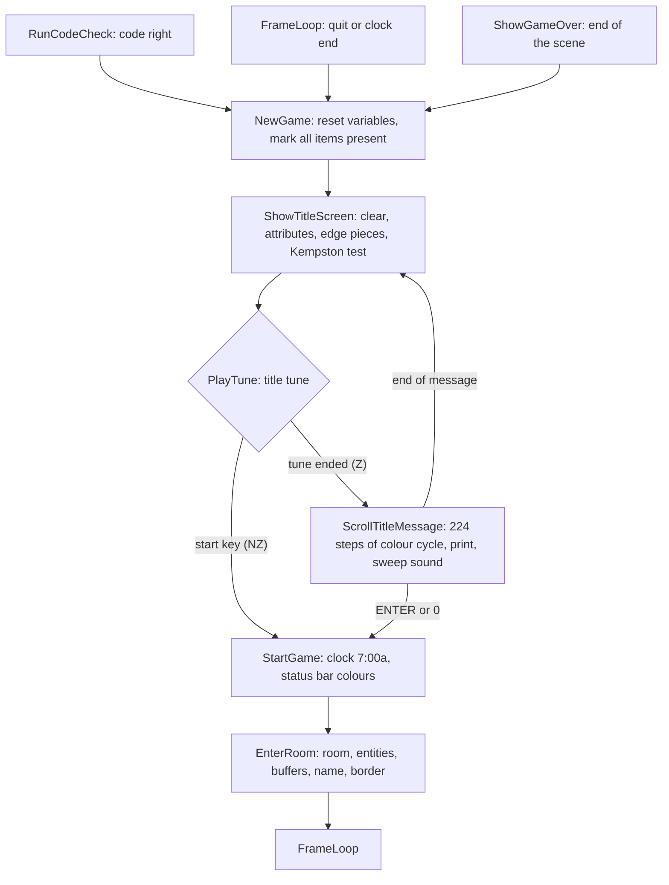

# 3. Title screen and start of a game

After the colour code is accepted the program enters a cycle that it never
leaves: new game, title screen with tune and scrolling message, game, and
back to the new game when the game ends. There is no menu and no demo; ENTER
or 0 (or Kempston fire during the tune) starts. Three routines share one
long fall-through chain in [`src/title.asm`](../src/title.asm):
[NewGame](../src/title.asm#L30) → [ShowTitleScreen](../src/title.asm#L86) → [ScrollTitleMessage](../src/title.asm#L217) → [StartGame](../src/title.asm#L259) →
[EnterRoom](../src/title.asm#L285).

## New game

[NewGame](../src/title.asm#L30) ($87CA) resets the game variables (F69):

| Variable | Value |
| --- | --- |
| [JoystickFlag](../src/variables.asm#L219), [TuneStep](../src/variables.asm#L458), [FlashTimer](../src/variables.asm#L205), [WillyAirState](../src/variables.asm#L293), [PassCounter](../src/variables.asm#L177), [IdleCounter](../src/variables.asm#L447), [EndingStage](../src/variables.asm#L432) | 0 |
| [LivesLeft](../src/variables.asm#L190) | 7 ([START_LIVES](../src/constants.asm#L50)) |
| [WillyY](../src/variables.asm#L243) | $D0 ([WILLY_START_Y](../src/constants.asm#L51)) |
| [CurrentRoom](../src/variables.asm#L10) | $21, The Bathroom ([START_ROOM](../src/constants.asm#L49)) |
| [WillyAttrAddr](../src/variables.asm#L328) | $5DB4: row 13, column 20 ([WILLY_START_ATTR](../src/constants.asm#L52)) |
| [ItemsCollectedText](../src/variables.asm#L125) | "000" |
| [ItemCounter](../src/variables.asm#L401) | [FirstItemIndex](../src/itemtable.asm#L10) (&#36;AD) |
| item bytes $A4AD-&#36;A4FF | bit 6 set (present) |
| [TuneFlags](../src/variables.asm#L474) | bit 0 set; bit 1 (tune off) kept |

Not reset: [CheatProgress](../src/variables.asm#L489) (the cheat stays on across games, F106), the
tune on/off bit, and the entity definition table, which the game modifies
(F25; see the Attic bug in [Tricks](06-tricks.md#the-attic-arrow)). Bit 0
of [TuneFlags](../src/variables.asm#L474) means "a tune key was held in the last pass"; setting it
keeps the ENTER that started the game (ENTER is on the tune half row) from
switching the tune off in the first pass.

## The title picture

[ShowTitleScreen](../src/title.asm#L86) ($8813) clears the bitmap and copies 768 attribute bytes
from [TitleAttributes](../src/screens.asm#L24) to $5800. The bottom third of that copy comes from
[StatusBarAttributes](../src/screens.asm#L73), which follows it in memory, so row 19 is then
re-coloured bright yellow for the first 32 characters of [TitleMessage](../src/variables.asm#L80),
"+++++ Press ENTER to Start +++++".

The picture is almost all attributes: the letters "JET SET WILLY" are cells
with attribute $D3 (flashing, bright red paper) and an empty bitmap; the
blue, green and cyan faces of the triangle are solid cells ($09, $24, $2D).
Only the slanted edges have pixels. The routine walks the attribute cells of
the top two thirds and draws one of the four 8x8 pieces of
[TitleEdgePieces](../src/variables.asm#L54) into each cell that is not one of five solid codes ($00,
$D3, $09, $2D, $24): the attribute selects piece +0 or +$10 (an edge going
down to the right or down to the left) and an odd column adds 8 (the right
cell of a 16-pixel edge). Attribute $2C is changed to $25 on the way (F79,
inferred piece by piece; the result matches the screenshot).

Then the Kempston test: port $1F is read 256 times and the results ORed;
when bit 5 never came up, [JoystickFlag](../src/variables.asm#L219) is set (F46, F71). The simulator
returns 0 on that port, so it always detects a joystick.

## Title tune and scroll

[PlayTune](../src/output.asm#L154) plays [TitleTune](../src/variables.asm#L557): 99 notes of about 0.29 s, 29 s in all
(F73). After each note [ReadStartInput](../src/output.asm#L196) tests Kempston fire (if detected)
and key 0 / ENTER (port $AFFE reads half rows 6-0 and H-ENTER together; bit
0 is either key). A press stops the tune and the game starts at once.

If the tune ends, [ScrollTitleMessage](../src/title.asm#L217) scrolls the message. [ScratchByte](../src/variables.asm#L501)
is the offset (0 to $DF); each step:

1. [CycleColours](../src/mainloop.asm#L250) adds 3 to the ink and the paper of all 768 attribute
   cells (bright cleared) and sets the border to the old ink of the first
   cell (F78);
2. row 19 is set to bright white on blue and the 32 characters from the
   offset are printed;
3. [PlaySweepSound](../src/output.asm#L230) makes a short sweep whose length depends on the offset
   (A = (offset AND $1F) + $32);
4. key 0 or ENTER starts the game (Kempston fire is not tested here).

The message is 256 characters, eight lines of 32; the last line repeats the
first, so after $E0 steps the window shows the opening text again and the
title is redrawn with the tune (F70). The scroll takes 843 frames.

The message reads: "+++++ Press ENTER to Start +++++ JET-SET WILLY by
Matthew Smith © 1984 SOFTWARE PROJECTS Ltd . . . . .Guide Willy to collect
all the items around the house before Midnight so Maria will let you get to
your bed. . . . . . . +++++ Press ENTER to Start +++++" (character $7F of the
ROM font is the © sign).

## Start of a game

[StartGame](../src/title.asm#L259) ($88FC) copies " 7:00a" from [ClockStartText](../src/variables.asm#L146) to
[ClockText](../src/variables.asm#L138) and the status bar colours from [StatusBarAttributes](../src/screens.asm#L73) to
$5A00, then falls into [EnterRoom](../src/title.asm#L285). The clock is reset only here, not
after a death.

## Entering a room

[EnterRoom](../src/title.asm#L285) ($8912) is the target of every room change, the teleport cheat,
the restart after a death and the start of a game. It runs with an empty
stack and ends with `JP FrameLoop`.

1. Copy the 256 bytes at `($C0 OR room) * 256` to [RoomBuffer](../src/buffers.asm#L37).
2. For each of the eight slots of [RoomEntitySlots](../src/buffers.asm#L79): definition address =
   `$1400 + index` (bit 7 cleared) times 8 = $A000 + 8 * index; copy bytes
   +0 and +1, write the slot's start byte over definition byte +2, copy
   bytes +2 to +7. The definition table keeps the start byte (F25).
3. Copy Willy's seven state bytes [WillyY](../src/variables.asm#L243)-[WillyJumpStep](../src/variables.asm#L344) to
   [WillySavedState](../src/variables.asm#L386) (the position a death returns to, F76, F117).
4. [BuildRoomBuffers](../src/roombuild.asm#L31): the empty-room attributes at $5E00 and bitmap at
   $7000 ([Rooms](05-rooms.md#building-the-buffers)).
5. Clear the bottom third of the bitmap, print [RoomName](../src/buffers.asm#L39) on row 16 and
   [StatusLineText](../src/variables.asm#L99) on row 19, write [RoomBorder](../src/buffers.asm#L65) to port $FE.
6. Clear [WillyRope](../src/variables.asm#L360) and jump to [FrameLoop](../src/mainloop.asm#L98).

Willy's position is not set here: the exit routines set it before they jump
to [EnterRoom](../src/title.asm#L285), a death restores it from the saved copy, and a teleport
keeps it.

