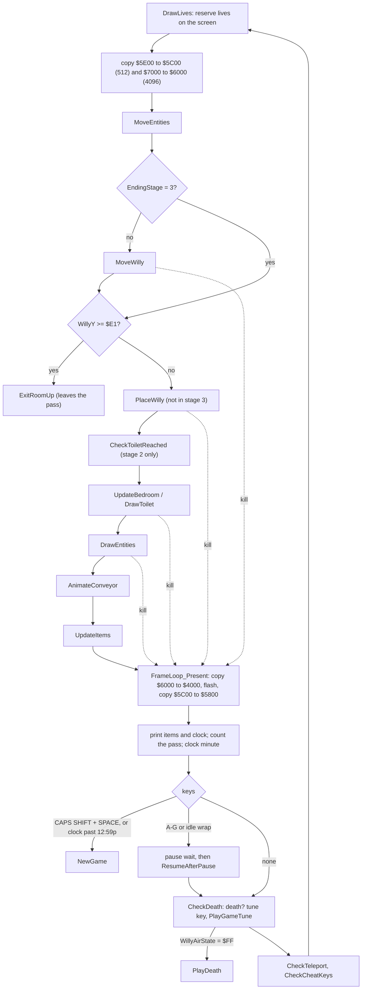

# 4. The frame loop

All of the game runs in [FrameLoop](../src/mainloop.asm#L98) ($89AD), entered by `JP` with an empty
stack and never returned from. A pass rebuilds the picture of the room from
scratch: it copies the empty room into the work buffers, moves and draws
everything into them, copies them to the screen, then handles the clock,
the keys, the death check, the tune and the cheat, and jumps back. There is
no synchronisation with the display; the speed of the game is the time a
pass takes, about 3.9 TV frames (F82, F93).

## One pass

| # | Code | Does | Details |
| --- | --- | --- | --- |
| 1 | [DrawLives](../src/mainloop.asm#L18) | one Willy sprite per reserve life at row 21, straight on the screen | [Clock and lives](05-clock-lives.md#lives) |
| 2 | `LDIR` x2 | empty-room attributes $5E00 → $5C00, bitmap $7000 → $6000 | [Drawing](05-drawing.md) |
| 3 | [MoveEntities](../src/entities.asm#L42) | guardians and ropes one step (arrows move when drawn) | [Entities](05-entities.md#movement) |
| 4 | [MoveWilly](../src/willy.asm#L78) | rope, jump, ground test, fall, keys, walking; skipped in ending stage 3 | [Willy](05-willy.md) |
| 5 | [ExitRoomUp](../src/exits.asm#L50) | when Y wrapped past the top ($E1 or more) | [Rooms](05-rooms.md#exits) |
| 6 | [PlaceWilly](../src/specialrooms.asm#L161) | ramp offset, marks his cells ink 7 ([MarkWillyCell](../src/specialrooms.asm#L224)), nasty test, draws him ([DrawWilly](../src/output.asm#L23)); skipped in stage 3 | [Willy](05-willy.md#drawing-willy) |
| 7 | [CheckToiletReached](../src/specialrooms.asm#L82) | stage 2 only: stage 3 at the toilet | [Ending](05-items-ending.md) |
| 8 | [UpdateBedroom](../src/specialrooms.asm#L22) | figure in the Master Bedroom; otherwise [DrawToilet](../src/specialrooms.asm#L107) in the Bathroom | [Ending](05-items-ending.md) |
| 9 | [DrawEntities](../src/entities.asm#L245) | guardians, arrows, ropes into the buffers, with collision tests | [Entities](05-entities.md#drawing-and-collisions) |
| 10 | [AnimateConveyor](../src/exits.asm#L119) | rotates two pixel rows of the belt in the master bitmap | [Rooms](05-rooms.md#conveyor-animation) |
| 11 | [UpdateItems](../src/items.asm#L33) | draws the room's items, collects the one under ink 7 | [Items](05-items-ending.md) |
| 12 | [FrameLoop_Present](../src/mainloop.asm#L126) | work bitmap → $4000; stages 2-3 set bit 0 of [WillyFrame](../src/variables.asm#L308); flash timer; work attributes → $5800 | [Drawing](05-drawing.md) |
| 13 | [PrintText](../src/output.asm#L89) x2 | clock at $5079, item digits at $5070 | |
| 14 | [PassCounter](../src/variables.asm#L177) | +1; on wrap the clock gains a minute; 12:59p + 1 minute → [NewGame](../src/title.asm#L30) | [Clock](05-clock-lives.md#the-clock) |
| 15 | [FrameLoop_Keys](../src/mainloop.asm#L200) | CAPS SHIFT + SPACE → [NewGame](../src/title.asm#L30); [IdleCounter](../src/variables.asm#L447) + 1; A-G or idle wrap → pause | [Pause](05-clock-lives.md#pause-and-idle-pause) |
| 16 | [ResumeAfterPause](../src/mainloop.asm#L326) | after a pause: status bar colours and border back | |
| 17 | [CheckDeath](../src/mainloop.asm#L334) | [WillyAirState](../src/variables.asm#L293) = $FF → [PlayDeath](../src/mainloop.asm#L456); tune key toggle | [Death](05-death.md) |
| 18 | [PlayGameTune](../src/mainloop.asm#L352) | one 9 ms blip of the in-game tune (if on) | [Sound](05-sound.md) |
| 19 | [CheckTeleport](../src/mainloop.asm#L388), [CheckCheatKeys](../src/mainloop.asm#L407) | WRITETYPER cheat; both end with `JP FrameLoop` | [Cheat](05-protection-cheat.md#the-writetyper-cheat) |

The order is read from the code; simulator stops with T-state counts
confirm the lives, the block copies and the screen copy (F94, inferred as a
whole). Three consequences of it:

- Willy is drawn before the entities, so a guardian's collision test sees
  Willy's pixels in the work bitmap. It also sees the room's own pixels: a
  guardian that touches a lit tile pixel kills Willy as well (F83).
- [PlaceWilly](../src/specialrooms.asm#L161) marks Willy's cells with ink 7 before [UpdateItems](../src/items.asm#L33) runs,
  which is how an item knows it is touched. Guardians and arrows are drawn
  in between and can paint ink 7 too (F19, F119).
- [DrawLives](../src/mainloop.asm#L18) draws on the screen, not in a buffer, and the bottom third
  is never cleared during play; the figures simply overwrite themselves.

## Leaving the pass early

The pass is cut short in three ways, all by jumps that discard return
addresses. The loop runs with SP=$5BFE and an empty stack, so a jump target
inside the loop can be reached from any depth.

- **Room change.** [ExitRoomLeft](../src/exits.asm#L11), [ExitRoomRight](../src/exits.asm#L30), [ExitRoomUp](../src/exits.asm#L50) and
  [ExitRoomDown](../src/exits.asm#L79) pop the return address of their caller and jump to
  [EnterRoom](../src/title.asm#L285).
- **Death.** [KillWilly](../src/willy.asm#L577) pops one return address (for a routine called
  from the loop), [KillWillyNested](../src/willy.asm#L573) pops one more (for [MarkWillyCell](../src/specialrooms.asm#L224),
  called from [PlaceWilly](../src/specialrooms.asm#L161)). Both store $FF in [WillyAirState](../src/variables.asm#L293) and jump
  to [FrameLoop_Present](../src/mainloop.asm#L126), so the rest of the drawing is skipped but the
  screen is still updated; [CheckDeath](../src/mainloop.asm#L334) then starts the death scene (F42).
- **Game end.** The clock, CAPS SHIFT + SPACE and the end of the game-over
  scene jump to [NewGame](../src/title.asm#L30).

## Timing and speed

Nothing waits for the 50 Hz interrupt: interrupts are off from $8400 on and
there is no `HALT` (F93). One pass was measured in the simulator in the
Bathroom:

| Part | T states |
| --- | --- |
| whole pass, tune on | about 261,800 |
| whole pass, tune off | about 230,800 |
| the four `LDIR` block copies (512 + 4096 + 4096 + 512 bytes at 21 T) | about 193,000 |
| tune blip ([PlayGameTune](../src/mainloop.asm#L352)) | about 31,000 |

At 3.5 MHz that is 13.4 passes per second with the tune on and 15.2 with it
off: switching the music off makes the game about 13% faster. A room with
more entities or a beeping arrow takes longer; the arrow chirp alone is
about 111,500 T (F85). Walking takes one cell per 4 passes (3.3 cells a
second), a jump 18 passes.

Because the block copies dominate, the picture is copied to the screen while
the TV is drawing it; there is no attempt to avoid tearing.

## The clock

[PassCounter](../src/variables.asm#L177) counts passes; each wrap (256 passes, about 19 seconds with
the tune on) adds a minute to [ClockText](../src/variables.asm#L138), which is ASCII and is changed
digit by digit in [FrameLoop](../src/mainloop.asm#L98) ($8A49-$8AA9): minutes units, minutes tens,
then the hour. The hour runs 7, 8 ... 12 with "a", then 1 ... 12 with "p";
the letter changes at 1 o'clock, not at 12. The pass that would make it
"13:00p" jumps to [NewGame](../src/title.asm#L30) (F75, F96). One game hour is 15,360 passes
and a whole game 18 hours = 276,480 passes, about 5.7 hours of real time
with the tune on (F95).
