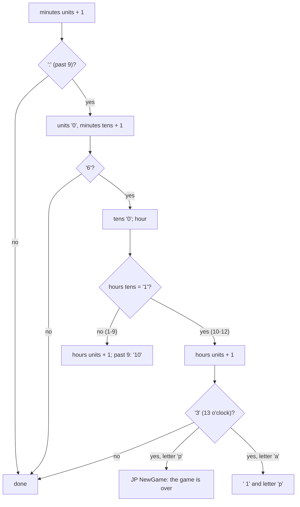

# 5.5 Clock, lives, pause and tune toggle

The status area at the bottom of the screen shows the room name, the items
count, the clock and the lives in reserve. The clock is the game's only time
limit; the lives are a counter with a picture. The same part of the frame
loop also reads the quit, pause and tune keys.

## The clock

[ClockText](../src/variables.asm#L138) is six ASCII characters: hours tens (blank or "1"), hours
units, ":", minutes tens, minutes units, "a" or "p" ("m" follows from the
status line text). [FrameLoop](../src/mainloop.asm#L98) advances it one minute when [PassCounter](../src/variables.asm#L177)
wraps, every 256 passes:

So the clock shows 7:00am to 11:59am, 12:00am to 12:59am (the hour after
noon), 1:00pm to 11:59pm, 12:00pm to 12:59pm (the hour after midnight), and
the next minute ends the game (F75, F96). 18 game hours of 15,360 passes
each (F95). The clock is reset only by [StartGame](../src/title.asm#L259), so it runs on through
deaths.

## Lives

[LivesLeft](../src/variables.asm#L190) starts at 7. [DrawLives](../src/mainloop.asm#L18) draws one Willy per reserve life
at row 21, two columns apart, every pass, directly on the screen with
[DrawSprite](../src/sprite.asm#L33) in replace mode. The frame is bits 2-3 of [TuneStep](../src/variables.asm#L458), the
same for all figures, so they walk on the spot; [TuneStep](../src/variables.asm#L458) only advances
while the tune is on, so with the tune off they stand still (F102). Their
colours (cyan, yellow, green, blue, cyan, magenta, green) are fixed in
[StatusBarAttributes](../src/screens.asm#L73).

A death with lives left decrements the counter after the death scene
([RestartAfterDeath](../src/mainloop.asm#L493)); a death with 0 left is the game over. The game
allows 8 deaths and no code adds a life (F101). The lives display does not
erase old figures: the bottom third is cleared only at room entry, so a lost
life disappears from the row when the room is entered again after the
death.

The lives also set the pitch of the in-game tune: note + 28 - 4 * lives, so
the music drops as lives are lost (F74).

## Pause and idle pause

After the clock, [FrameLoop_Keys](../src/mainloop.asm#L200) reads:

- **CAPS SHIFT + SPACE** together: `JP NewGame`, back to the title (F99).
  Either key alone does nothing.
- **[IdleCounter](../src/variables.asm#L447)** + 1. It is cleared by a left, right or jump key and
  by every pass that plays the tune, so it can only wrap with the tune off.
  When it wraps (256 passes, about 17 s) the game pauses by itself (F98).
- **A, S, D, F or G**: pause.

The pause ([FrameLoop_Wait](../src/mainloop.asm#L220)) polls the other half rows (port high byte
$02) until a key is down. Every 65,536 polls (about 1.05 s) it calls
[CycleColours](../src/mainloop.asm#L250), which changes the ink and paper of the whole screen and
the border, unless the cheat is on (F97). Releasing A does not resume; any
key outside A-G does. [ResumeAfterPause](../src/mainloop.asm#L326) then copies the status bar
colours back from [StatusBarAttributes](../src/screens.asm#L73) and restores the border. The room
area needs no repair; the next pass redraws it.

## Tune toggle

Any key of H, J, K, L, ENTER toggles the in-game tune once per press
([CheckDeath](../src/mainloop.asm#L334)): bit 0 of [TuneFlags](../src/variables.asm#L474) remembers that the key was down in
the last pass, bit 1 is "tune off" (F100). The setting survives a new game.

## The flash timer

[FlashTimer](../src/variables.asm#L205) is decremented by every pass while it is not 0, and the
work attributes are then flooded with a paper colour from it. No code ever
sets it to a non-zero value; with the byte poked to 3 the room flashes
paper 2, 1, 0 for three passes (F105). It is a feature that the game does
not use.
