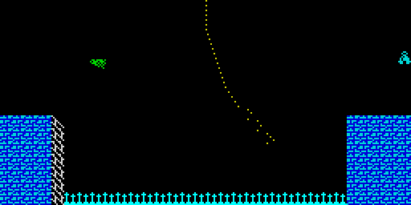

# 5.2 Entities: guardians, arrows and ropes

Everything that moves in a room except Willy is an entity: an 8-byte entry in
[EntityBuffer](../src/buffers.asm#L116), copied from [EntityDefs](../src/entitydefs.asm#L88) when the room is entered. Two
routines walk the buffer every pass: [MoveEntities](../src/entities.asm#L42) ($90C0) moves
guardians and ropes before Willy moves, and [DrawEntities](../src/entities.asm#L245) ($91BE) draws
all entities after Willy has been drawn, moves the arrows, tests every
entity against what is already in the work bitmap and handles Willy on a
rope. There is no AI and no random number anywhere: every entity follows a
fixed path (F51-F53, F80-F86).

Field layouts are in [Data structures](02-data.md#entity-definitions-and-the-entity-buffer).

## Movement

[MoveEntities](../src/entities.asm#L42) tests only bits 0-1 of the type, so the arrow (type 4) is
skipped here like an empty entry. The rules below were checked with a
Python model against the Z80 routine on 3000 random entity buffers, all
identical (F81).

### Horizontal guardian (type 1)

Byte +0 holds the direction in bit 7 and an animation phase 0-3 in bits 5-6.
Each pass the phase counts down (going left) or up (going right); when it
wraps the guardian steps one column. At the end of its beat (column = byte +6
going left, byte +7 going right) it turns instead of stepping: byte +0
becomes $81 (right, phase 0) or $61 (left, phase 3). So it moves one column
every 4 passes, the same speed as Willy, and shows its four frames once per
column (F51). The frame of the sprite includes the direction bit when the
mask in byte +1 lets it through, which is how pages with "left and right"
frames work.

### Vertical guardian (type 2)

Bit 3 of byte +0 flips every pass; the phase (bits 5-7) advances every pass
when bit 4 is set and every second pass otherwise. The Y index (+3) changes
by the signed step (+4) every pass. When Y reaches or passes the bottom
limit (+7) the step is negated; when it reaches or passes the top limit
(+6) Y is set to the limit and the step negated (F52, F81). The bottom limit
is not clamped, so a guardian whose path is not a multiple of its step goes
a few units past it (computed for definitions $05, $06, $07: up to step - 1
units; all stay inside the room).

### Rope (type 3)

Byte +1 is the swing position: bits 0-6 the distance from hanging straight,
bit 7 the side. Byte +0 bit 7 is the swing direction. The distance changes
by 2 per pass, or by 4 near the middle (below $14 going in, below $12 going
out); when it equals the limit in byte +7 ($36) the direction flips (F81).
The position sequence in room 16 runs $22, $20 ... $14, $10, $0C, $08, $04,
$80, $84 ... $90, $92 ... $B6 and back.

## Drawing and collisions

[DrawEntities](../src/entities.asm#L245) draws in buffer order and stops at the first $FF. A
collision jumps to [KillWilly](../src/willy.asm#L577), so the entities after the one that hit
Willy are not drawn in that pass.

### Guardians (types 1, 2)

1. **Attributes.** The 2 x 2 cells under the sprite (2 x 3 when Y is not a
   multiple of 16) get the ink and bright bits of byte +1; the paper of the
   cell is kept and flash cleared.
2. **Sprite.** Frame F = ((+0 AND +1) OR +2) >> 5, address page(+5) * 256 +
   32 * F (F54). [DrawSprite](../src/sprite.asm#L33) draws it into the work bitmap with C = 1:
   each sprite byte is first ANDed with the bitmap byte under it, and any
   overlap returns NZ, which kills Willy (F37).

The test does not know what it overlaps. Willy is the normal case, but the
room's tile pixels count too: a guardian placed over a brick block kills
Willy wherever he is (observed in room 16 with a poked Y, F83). Room data
keeps guardians away from lit tiles; the Attic bug breaks that
([Tricks](06-tricks.md#the-attic-arrow)).

A white-ink guardian also paints ink 7, the colour that tells
[UpdateItems](../src/items.asm#L33) that Willy touches an item; such a guardian collects an item
it passes over (observed with a moved item, F19). No room has an item on the
path of a white guardian.

### Arrows (type 4)

The arrow moves here: X (+4) goes down by 1 per pass (bit 7 of +0 clear) or
up by 1 (set). It is drawn only while X is 0-31. When X reaches $2C (going
left) or $F4 (going right), 13 or 12 passes before it enters the screen,
the pass makes a rising chirp instead of drawing ([Sound](05-sound.md)): the
warning. X is a byte, so the arrow returns every 256 passes, about 19 s
(F84, F85).

Drawing, at the row of the Y index in +2 and column X:

1. The collision mask (+5) is $FF if the cell's attribute has ink 7 (Willy),
   else 0.
2. The cell gets ink 7 (OR 7).
3. The fin pattern (+6) is written to the pixel row above and below the
   centre row, $FF to the centre row.
4. Before the centre row is written, its old byte AND the mask non-zero
   kills Willy (F86).

So an arrow kills only in a white-ink cell with lit pixels on its row. A
white-ink tile with pixels (the brick blocks of room 16) is deadly to an
arrow's path as well. Because step 2 sets ink 7, an arrow that crosses an
item cell collects the item (observed with a moved item, F119; no room has
an item in an arrow's row).

The arrow takes the address of its centre row from [RowAddressTable](../src/buffers.asm#L138) with
the Y index as an offset into a table of words; an odd Y index reads half a
word off. "The Attic" has one ([Tricks](06-tricks.md#the-attic-arrow)).

### Ropes

A rope is a chain of 33 one-pixel points from pixel row 0 of the room down
([DrawEntities_Rope](../src/entities.asm#L377)). It starts at the top column (+2) with pixel mask
$80; for each segment S the index I = S + swing distance selects two bytes
of [RopeStepTable](../src/buffers.asm#L184): $8300 + I pixels sideways (left if bit 7 of +1 is
set) and $8380 + I rows down in row-table units. For small I the rope hangs
straight (3 rows per segment); the larger I, the more the lower segments
lean, up to 3 pixels sideways per 2 rows (F23). Points are ORed into the
bitmap and change no attribute.

While each point is plotted, the grab test and the placing of Willy run as
described in [Willy: ropes](05-willy.md#ropes). After the last point, the
release countdown in [WillyRope](../src/variables.asm#L360) is advanced, or, if the rope is held and
Willy walks, the climb is applied and the limits are checked.

The rope keeps its segment counter in byte +1 and its held flag in bit 0 of
byte +3 of the next entry (it addresses them as IX+9 and IX+11). An arrow
does not use those bytes, and the $FF end marker only uses byte +0, so
every rope in the rooms is followed by one or the other (F55, F90).

Quirk: a lit pixel under point 0 counts as a grab of "segment 0": the held
flag is set while [WillyRope](../src/variables.asm#L360) stays 0, and Willy is moved to the top of
the rope (F91).

## Speed

A horizontal guardian moves a column per 4 passes, an arrow a column per
pass (about every 4 TV frames, F82), a vertical guardian its step per pass:
the definitions used by rooms have steps of -12 to +12 Y units (up to 6
pixel rows), and some have step 0 and only animate in place.

## Sprites

The 26 pages and the guardians that use them are in the
[gallery](07-graphics.md#sprite-pages); every guardian's animation is in
[Guardian animations](07-graphics.md#guardian-animations).

 The figure in the Master Bedroom and
the toilet are not entities; they are drawn by
[UpdateBedroom](../src/specialrooms.asm#L22) and [DrawToilet](../src/specialrooms.asm#L107) ([Items and the ending](05-items-ending.md)).
