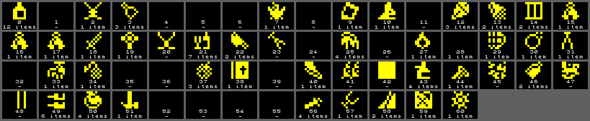
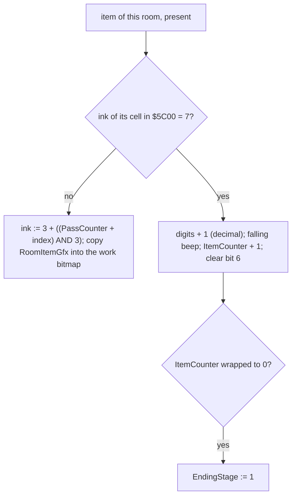
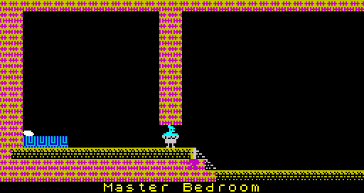
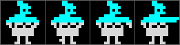
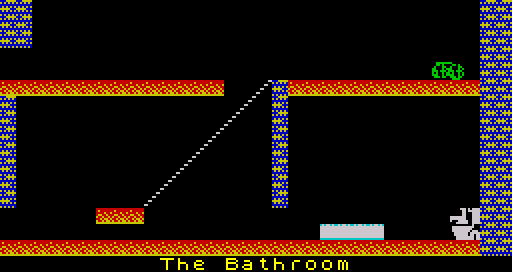

# 5.4 Items and the ending

The 83 items are entries in a two-page table, each with a room, a cell and a
"present" flag; their picture belongs to the room. Collecting them is a
colour test: an item is taken when its cell has ink 7, the colour that
[MarkWillyCell](../src/specialrooms.asm#L224) gives Willy's cells. When the last item is taken, a state
byte [EndingStage](../src/variables.asm#L432) starts a short scripted ending: the figure in the
Master Bedroom goes, Willy runs from the bed to the toilet, and stays there.

## The item table

| Byte | Bits | Meaning |
| --- | --- | --- |
| [ItemRoomTable](../src/itemtable.asm#L46) + i | 0-5 | room |
| | 6 | present (set for all at a new game, cleared when collected) |
| | 7 | bottom half of the room (rows 8-15) |
| [ItemPositionTable](../src/itemtable.asm#L63) + i | 0-4 | column |
| | 5-7 | row inside the half |

Indexes run from [FirstItemIndex](../src/itemtable.asm#L10) ($AD) to $FF. The second byte is the
low byte of the cell's address in the work attribute buffer ($5C or $5D) and
in the work bitmap ($60 or $68), so no arithmetic is needed (F15).

The picture is room bytes $E1-$E8 ([RoomItemGfx](../src/buffers.asm#L68)), the count under it is
from the item table. 17 rooms have no item and a blank picture. Six rooms
(20, 23, 41, 45, 47, 48) have a picture but no item, room 42's picture is a
solid block ($FF in all 8 bytes) with no item, and room 28 has an item with a
blank picture, so that item is invisible (F49, F122).

## Drawing and collecting

[UpdateItems](../src/items.asm#L33) ($93D1) runs once per pass, after Willy and the entities are
drawn, and walks all 83 entries. For each item whose room is the current
room and whose present bit is set:

### Colours

The ink of an item cell is 3 + ((pass counter + item index) AND 3): magenta,
green, cyan, yellow, changing every pass and offset by the index, so
neighbouring items flash out of step. Paper, bright and flash of the cell
are kept (F20).

### Collecting

The test is only "ink 7 in the work attribute buffer" (F16):

- Willy's cells get ink 7 when they hold the background attribute
  ([MarkWillyCell](../src/specialrooms.asm#L224)). An item stands on a background cell, so touching it
  with any of his four (or six) cells collects it.
- Any other ink 7 collects as well. A white-ink guardian walking over an
  item, or an arrow crossing it, collects it without Willy (observed with
  items moved onto their paths, F19, F119). The original room data has no
  such case.
- Two items on the same cell are both collected in the same pass: "The
  Beach" has such a pair (F18).

Collecting increments the three ASCII digits of [ItemsCollectedText](../src/variables.asm#L125) with
a decimal carry, plays a falling beep (64 half-periods, the delay growing
from $10 to $8E loop passes), increments [ItemCounter](../src/variables.asm#L401) and clears the
present bit. [ItemCounter](../src/variables.asm#L401) starts at $AD, so it wraps to 0 exactly at the
83rd item, which sets [EndingStage](../src/variables.asm#L432) to 1 (F17).

## The figure in the Master Bedroom

While [EndingStage](../src/variables.asm#L432) is 0, [UpdateBedroom](../src/specialrooms.asm#L22) draws a figure in "Master
Bedroom" (room 35) at column 14, pixel row 88, on the platform beside the
bed, with the collision test of [DrawSprite](../src/sprite.asm#L33): touching it kills Willy
(observed, F62). The two upper cells get bright cyan, the two lower white.
The frame depends on Willy's height (F63):

| [WillyY](../src/variables.asm#L243) | Frame |
| --- | --- |
| $D0 (on the low floor) | 0 and 1, alternating with bit 1 of [PassCounter](../src/variables.asm#L177) |
| $C0-$CF and above $D0 | 2 |
| below $C0 (the upper platform) | 3, an arm stretched out |

 

The figure stands with its top at a character row boundary (pixel row 88,
row 11), and [UpdateBedroom](../src/specialrooms.asm#L22) colours its two rows differently: the
top cells $45 (bright cyan), the bottom cells $07 (white, not bright). So it
is cyan above its waist and white below it in play, as in the room picture.

The title message names Maria as the one who must let Willy get to his bed;
the sources call this sprite "the figure", and nothing in the code names it.

## Ending stages

| Stage | Set by | Effect |
| --- | --- | --- |
| 0 | [NewGame](../src/title.asm#L30) | normal play; the figure guards the bed |
| 1 | [UpdateItems](../src/items.asm#L33): last item | the figure is not drawn |
| 2 | [UpdateBedroom](../src/specialrooms.asm#L22): Willy in the Master Bedroom at a column below 6 (the bed end) | the right key is pressed by itself ([ReadWillyInput](../src/willy.asm#L255) inverts the P bit), a real right key stops him, jumps are ignored, the walk frame gets bit 0 every pass so he runs at twice the walking speed (F64) |
| 3 | [CheckToiletReached](../src/specialrooms.asm#L82): in the Bathroom with the low byte of [WillyAttrAddr](../src/variables.asm#L328) = $BC (row 13, column 28) | [MoveWilly](../src/willy.asm#L78) and [PlaceWilly](../src/specialrooms.asm#L161) are no longer called: Willy does not move, is not drawn and does not collide; the toilet is drawn with frames 2-3; [PassCounter](../src/variables.asm#L177) is cleared (F65) |

The stages only go up; nothing but a new game clears them (F61). In stage 2
Willy runs right out of the Master Bedroom, through "Top Landing" (34) and
into "The Bathroom" (33); the rooms on the way are played normally, and in
the simulator run he fell into room 28 on the way and came back (F65).

 

[DrawToilet](../src/specialrooms.asm#L107) runs in every room except the Master Bedroom (it is the
other branch of [UpdateBedroom](../src/specialrooms.asm#L22)) and does nothing outside the Bathroom.
There it ORs the toilet sprite from page $A6 ([SpritesToilet](../src/sprites.asm#L16)) into the
work bitmap at column 28, pixel row 104, without a collision test, frame 0
or 1 by bit 0 of [PassCounter](../src/variables.asm#L177), plus 2 in stage 3, and sets its four cells
to white.

## After the ending

There is no ending screen (F66). In stage 3 the guardians keep moving, the
clock keeps running and the tune keeps playing. The game leaves stage 3 only
the way any game ends: the clock passing 12:59pm or CAPS SHIFT + SPACE, both
of which go to [NewGame](../src/title.asm#L30) and the title screen.
