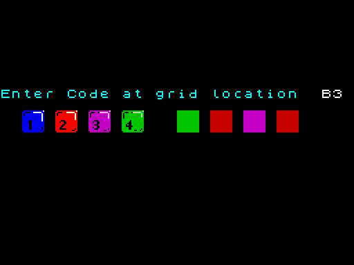

# 5.9 Colour-code protection and the WRITETYPER cheat

Before the title screen the game names a cell of a grid of 180 cells and
asks for the four-colour code of that cell. The answers are not shown
anywhere in the program; it only compares them with a table. Two wrong
answers reset the machine. During play, typing
WRITETYPER in one particular spot switches on a cheat that teleports Willy
to any room. Both are small parts of the code with their own tables.

## The colour-code screen



[RunCodeCheck](../src/protection.asm#L15) ($869F) clears the whole screen to black and calls
[AskColourCode](../src/protection.asm#L63) with [EnterCodeText](../src/variables.asm#L154). A right code goes to [NewGame](../src/title.asm#L30);
a wrong one calls it again with [TryAgainText](../src/variables.asm#L160) ("Sorry, try code at
location"); a second wrong code jumps to $0000, which resets the Spectrum
(observed, F7).

[AskColourCode](../src/protection.asm#L63) ($86C3):

1. Prints the message on row 8, draws the four key pictures 1-4
   ([CodeKeyGraphics](../src/screens.asm#L95)) at columns 2, 5, 8, 11 of rows 10-11 and copies
   [CodeScreenAttrs](../src/screens.asm#L172) to rows 8-11, which colour the keys blue, red,
   magenta and green and leave four empty 2x2 slots at columns 16, 19, 22,
   25.
2. Picks the grid cell: FRAMES + $25 is stored back into FRAMES; if the
   result is below $B3 it is the cell index L, otherwise L = result - $B4.
3. Expected code = [CodeTable](../src/codetable.asm#L21)[L] + L, kept in [ScratchByte](../src/variables.asm#L501).
4. Prints the cell as a letter A + (L mod 18) at column 29 and a digit 0 +
   (L div 18) at column 30: the grid has 18 columns (A-R) and 10 rows (0-9).
5. Loops over the four slots with [ReadCodeSlot](../src/protection.asm#L153), forever.

The rule was checked for all 256 start values of FRAMES (F2). Interrupts are
off, so FRAMES does not count; its value is the one left by the loader, and
each call of [AskColourCode](../src/protection.asm#L63) adds $25, so the second try asks for another
cell (F4). In the simulator FRAMES is $12 at the start, giving L = $37, cell
B3, code 4-2-3-2 (F5).


### Reading the answer

[ReadCodeSlot](../src/protection.asm#L153) waits until keys 1-4 are released, then polls:

- a single key 1, 2, 3 or 4 paints the slot with paper blue, red, magenta
  or green, waits about 23 ms and returns; the next slot follows;
- anything else (no key, several keys) sets the flash bit of the slot as a
  cursor and polls again;
- ENTER, once slot 4 is no longer empty (attribute $07), builds the code:
  paper colour of each slot minus blue gives 0-3, slot 1 in bits 7-6, slot 2
  in bits 5-4, slot 3 in bits 3-2, slot 4 in bits 1-0.

[AskColourCode](../src/protection.asm#L63) cycles the slots 1, 2, 3, 4, 1, ... so a slot can be
re-entered by going round again (F6). The check uses a stack trick:
[ReadCodeSlot](../src/protection.asm#L153) pops its own return address and its `RET` returns straight
to [RunCodeCheck](../src/protection.asm#L15) with the Z flag of the comparison, which is the only way
out of the endless slot loop.

```asm
  POP HL                  ; discard the return address into AskColourCode
  OR C                    ; A = the entered code
  LD HL,ScratchByte
  CP (HL)                 ; Z if equal
  RET                     ; returns to the caller of AskColourCode
```

### The code table

[CodeTable](../src/codetable.asm#L21) ($9E00) has 256 bytes; cells 0-$B2 are used. The stored value
is the code minus the cell index, so the table itself does not show the
codes. Its bytes look like a piece of some other Z80 program (83 distinct
values in the 180 used entries; they disassemble as code with variables at
$40xx and calls below $2C00) and are not from the Spectrum ROM; where they
came from is Unknown (F8, F9).

Two edge cases come from the comparison `CP $B3` followed by `SUB $B4`
(F3): a result of exactly $B3 (FRAMES $8E at entry) gives L = $FF, so the
code is read from $9EFF and the cell is shown as ">D" (digit '0' + 14); and
cell $B3 (R9) is never asked.

## The WRITETYPER cheat

The cheat is in the second half of the pass, in [CheckTeleport](../src/mainloop.asm#L388) and
[CheckCheatKeys](../src/mainloop.asm#L407) ([`src/mainloop.asm`](../src/mainloop.asm)).

### Typing it

[CheatProgress](../src/variables.asm#L489) counts the letters typed (0-10). While it is not 10,
[CheckCheatKeys](../src/mainloop.asm#L407) runs only when Willy is in "First Landing" (room 28,
$1C) with [WillyY](../src/variables.asm#L243) = $D0 (standing on the floor of the room). It reads the
half rows Q-T and P-Y and compares them with the pair of [CheatKeyTable](../src/variables.asm#L525)
for the current step (bits active low, $1F = no key):

| Step | Key | Q-T byte | P-Y byte |
| --- | --- | --- | --- |
| (before 0) | none | $1F | $1F |
| 0 | W | $1D | $1F |
| 1 | R | $17 | $1F |
| 2 | I | $1F | $1B |
| 3 | T | $0F | $1F |
| 4 | E | $1B | $1F |
| 5 | T | $0F | $1F |
| 6 | Y | $1F | $0F |
| 7 | P | $1F | $1E |
| 8 | E | $1B | $1F |
| 9 | R | $17 | $1F |

A match of both rows advances the step. No key, or the previous step's keys
still held, keeps it. Anything else, such as two keys at once or a wrong
letter, sets it back to 0. The first pair is the "previous keys" of step 0
(F72, observed by typing the ten keys in the simulator).

At 10 the cheat is on. It is not reset by [NewGame](../src/title.asm#L30), so it stays on for
every later game until the machine is reset (F106). The only other effect
is that the pause no longer cycles the colours.

### Teleport

With the cheat on, [CheckTeleport](../src/mainloop.asm#L388) reads key 9 every pass. Holding 9
together with any of 1-5 and 6 sets [CurrentRoom](../src/variables.asm#L10) to the binary number
1 = 1, 2 = 2, 3 = 4, 4 = 8, 5 = 16, 6 = 32 and jumps to [EnterRoom](../src/title.asm#L285) at
once; Willy keeps his position and state (F106). 9 alone gives room 0. The
number is not checked, so rooms 47 and 61-63, which no exit leads to, can
be entered; in the
simulator the stray pages 61-63 killed Willy repeatedly.
