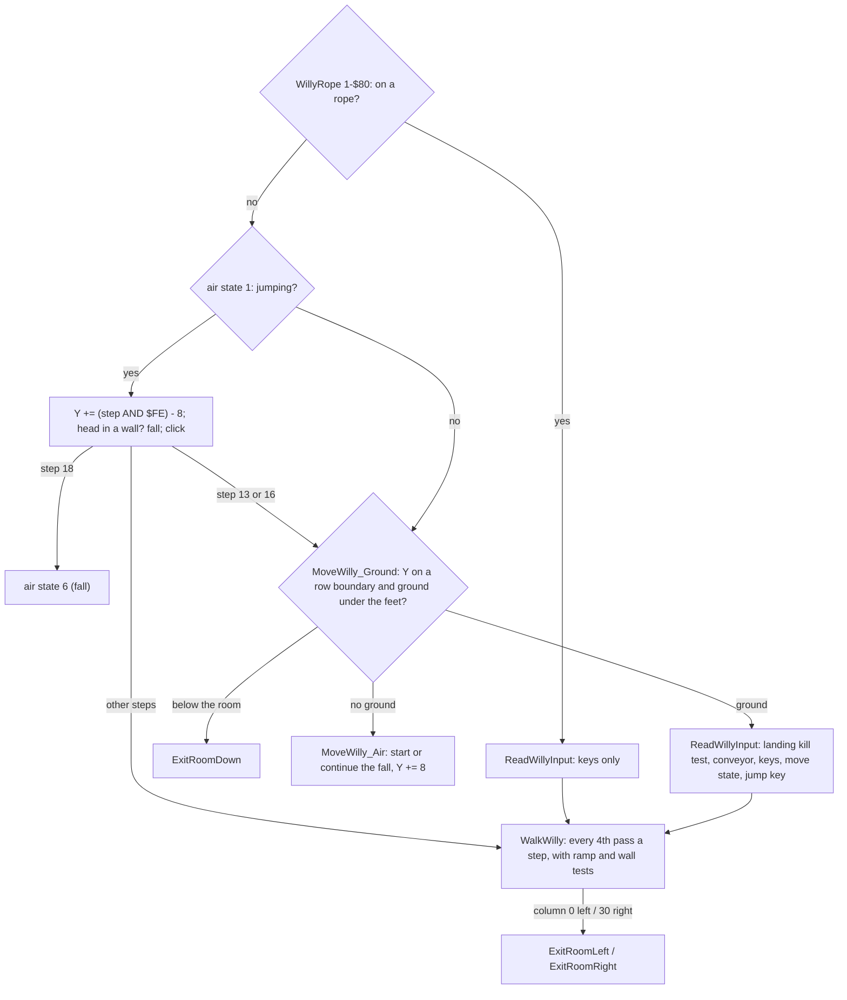
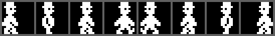
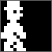
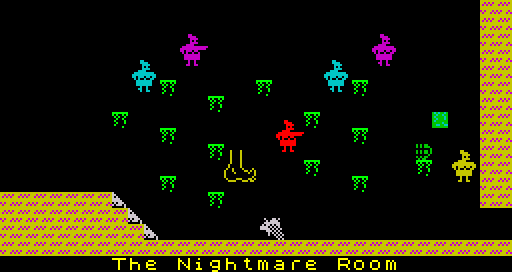

# 5.1 Willy

Willy is a 16x16 sprite, two cells wide and two or three cells high. His
movement is one routine, [MoveWilly](../src/willy.asm#L78) ($8DD3, about 740 bytes), called once
per pass; it reads only attribute cells to find walls, floors, nasties,
ramps and conveyors. Drawing him, marking his cells and the nasty test are
done afterwards by [PlaceWilly](../src/specialrooms.asm#L161). Nearly every rule here was measured with
a harness that logs his variables pass by pass (F109-F118).

## State

| Variable | Values |
| --- | --- |
| [WillyY](../src/variables.asm#L243) | Y index of the top of the sprite (2 per pixel row); $D0 = feet on the floor of row 15 |
| [WillyAttrAddr](../src/variables.asm#L328) | top-left cell; always row Y / 16 (kept by [SetWillyCell](../src/willy.asm#L204), F118) |
| [WillyMoveState](../src/variables.asm#L265) | bit 0 = facing left, bit 1 = walking |
| [WillyFrame](../src/variables.asm#L308) | 0-3: sprite frame and step timer |
| [WillyAirState](../src/variables.asm#L293) | 0 on the ground or a rope, 1 jumping, 2-$0F falling, $FF killed |
| [WillyJumpStep](../src/variables.asm#L344) | 0-18 during a jump |
| [WillyRope](../src/variables.asm#L360) | 0 no rope, 1-$20 rope segment held, $F0-&#36;FF just let go |

## Order of work in a pass

## Input

[ReadWillyInput](../src/willy.asm#L255) collects all direction inputs into one byte E, active
low: bits 0, 2, 4 mean right, bits 1, 3, 5 mean left (F108). It starts as
$FF, then:

1. a conveyor under his feet enters as a pressed key: $FD (left, direction
   0) or $FE (right, direction 1);
2. half row P-Y (&#36;DFFE): P, I, Y right; O, U left;
3. half row Q-T (&#36;FBFE) shifted left by one: W, R right; Q, E, T left;
4. half rows 1-5 and 6-0 together (&#36;E7FE): bit 4 (keys 5 and 6) → left;
5. half row 6-0 (&#36;EFFE): keys 8 and 7 → right;
6. Kempston bits 0 (right) and 1 (left) if [JoystickFlag](../src/variables.asm#L219) is set;
7. in ending stages 2 and 3 the P bit is inverted, so "right" is pressed
   by itself and a real right key cancels it (F64).

Any left or right key, and a jump, clears [IdleCounter](../src/variables.asm#L447). The new move
state is [MoveStateTable](../src/variables.asm#L36)[old state + 4 * left + 8 * right] (F24, table in
[Data](02-data.md#tables)).

Jump keys are the two bottom half rows ($7EFE: CAPS SHIFT Z X C V and B N M
SYMBOL SHIFT SPACE), key 0 and Kempston fire. A jump is ignored in ending
stages 2 and 3. All keys were tested one at a time in the simulator (F107);
keys 1-4, 9, H-ENTER and Kempston up/down do nothing in movement.

## Walking

Walking happens only with bit 1 of the move state set and no rope held.
[WalkWilly](../src/willy.asm#L397) counts [WillyFrame](../src/variables.asm#L308) 0, 1, 2, 3 when facing right or 3, 2, 1,
0 when facing left, one count per pass; in the pass that finds the end value
(3 right, 0 left) it tries a one-cell step and reloads the frame (0 or 3).
A step therefore takes 4 passes, about 15 frames, 3.3 cells per second
(F113). Releasing the key stops at once and keeps the frame.

A step tests the cells he would occupy for the wall tile ([TileWall](../src/buffers.asm#L45)):

| Step | Cells tested |
| --- | --- |
| left | the cell left of his second row; the cell left of his third row if Y is not on a row boundary |
| right | the cell right of his second row; of the third row if not on a boundary; the cell right of his head row |

The left step does not test the head row: a wall cell only at head height
stops him walking right but not walking left (observed, F116).

A step left from column 0 jumps to [ExitRoomLeft](../src/exits.asm#L11); a step right from
column 30 (the cell beyond him is column 0 of the next row) jumps to
[ExitRoomRight](../src/exits.asm#L30).

## Ramps

A ramp is a diagonal line of ramp-tile cells (one per row) drawn into the
attribute buffer from the room's ramp fields. On the ground (air state 0),
each step looks at one cell relative to his top-left cell; if it is a ramp
cell, the step also moves him one row (16 Y units) up or down (F114):

| Ramp direction ([RoomRampDir](../src/buffers.asm#L59)) | Step left | Step right |
| --- | --- | --- |
| 0, rises to the left | cell +$1F (one row down, one column left): up | cell +$40 (two rows down, left column): down |
| 1, rises to the right | cell +$41 (two rows down, right column): down | cell +$22 (one row down, two columns right): up |

Between the cell steps, [PlaceWilly](../src/specialrooms.asm#L161) draws him 0 to 6 pixel rows lower,
following the walk frame, when the cell under his feet is a ramp cell, so
he appears to walk along the slope (F67).

## Jumping

A jump key sets air state 1 and step 0. In each pass of the jump
([MoveWilly](../src/willy.asm#L78)):

- Y changes by (step AND $FE) - 8, so the 18 steps give
  -8 -8 -6 -6 -4 -4 -2 -2 0 0 +2 +2 +4 +4 +6 +6 +8 +8: a rise of 40 Y units
  (20 pixel rows, 2.5 character rows) and back (F109);
- if Y wrapped to $F0 or more he leaves through the top ([ExitRoomUp](../src/exits.asm#L50));
- if either cell of his top row is wall, he bumps his head: Y becomes the
  row boundary at or below Y + 16, air state 2 (a fall), walking stops;
- a click: 32 speaker toggles with a delay of (distance from the apex + 1)
  * 8, so the pitch is highest at the apex;
- the ground test runs only after steps 13 and 16; at step 18 the jump ends
  as a fall with state 6.

Walking continues during the jump in the direction held at take-off (the
keys are not read again until he lands). Because the ground test is made
only at two steps, he can land on a platform whose top is 1 or 2 character
rows above his take-off floor; a platform 3 rows up is passed through
(F110). A held jump key starts the next jump as soon as he lands, every
19-20 passes.

## Falling

| State | Set by |
| --- | --- |
| 2 | walking off an edge (the first pass without ground only sets the state), a head bump, [ExitRoomDown](../src/exits.asm#L79) when the state was below $0B |
| 6 | the end of a jump |
| +1 per pass | [MoveWilly_Air](../src/willy.asm#L158): Y += 8 (4 pixel rows), a click whose pitch falls with the state |
| $10 → $0C | a long fall cycles through $0C-$0F |

The ground test is made only when Y is on a row boundary, every second pass
of a fall. Landing with a state of $0C or more kills ([ReadWillyInput](../src/willy.asm#L255),
$8EE3). In character rows: from standing, a drop of 4 rows is survived and
5 kill; after a jump that ended over a gap, 2 rows are survived and 3 kill
(observed, F111). There is no sideways movement in a fall.

Ground means: at least one of the two cells under his feet is not the
background attribute, and neither is the nasty attribute (F112). Walls,
floors, ramps and conveyors all hold him. A nasty under his feet kills him
anyway in [MarkWillyCell](../src/specialrooms.asm#L224).

## Conveyors

If either cell under his feet has the conveyor attribute, the conveyor
direction enters the input as a held key. He walks with the belt even with
no key pressed, a key in the belt direction changes nothing, and a key
against it gives "both directions", which keeps the move state: he stands
still (F115). A jump keeps the direction he had at take-off, belt included.

## Ropes

Ropes are entities ([Entities](05-entities.md#ropes)); the part that moves
Willy is in [DrawEntities](../src/entities.asm#L245), which runs after he is drawn.

- **Grab.** While [WillyRope](../src/variables.asm#L360) is 0, any lit pixel of the work bitmap under
  a rope point grabs the rope there: [WillyRope](../src/variables.asm#L360) = segment number (1-32)
  and the held flag is set (F87). Normally that pixel is Willy's.
- **Hanging.** Every pass, Willy is placed on the held point: Y = Y index
  of the point - $10, column and frame from the pixel mask of the point
  (mask $80/$40 frame 2, $20/$10 frame 3, both one column to the left;
  $08/$04 frame 0, $02/$01 frame 1). [MoveWilly](../src/willy.asm#L78) skips the jump, ground
  and walking code while he holds a rope.
- **Climbing.** Holding a direction key moves him one segment per pass: down
  (+1) when his facing differs from the swing direction, up (-1) otherwise
  (F88). Above segment 1-2 he leaves through the top; in a room whose up
  exit is the room itself he cannot climb above segment $0C (F89).
- **Letting go.** Past the last segment he drops (Y rounded down to a
  multiple of 8, air state 0, [WillyRope](../src/variables.asm#L360) = $F0). A jump on the rope sets
  $F0 too and starts a jump from the row boundary above, walking in the
  facing direction. [WillyRope](../src/variables.asm#L360) then counts $F0 → $FF → 0 once per rope
  pass, so he cannot grab again for 16 passes (F89).

[WillyRope](../src/variables.asm#L360) is cleared at every room entry and is not part of the saved
state.

## Drawing Willy

[PlaceWilly](../src/specialrooms.asm#L161) ($95C8) runs after the movement (not in ending stage 3):

1. Ramp offset B (above).
2. [MarkWillyCell](../src/specialrooms.asm#L224) for his six cells (the third row only counts when Y +
   B is between rows). A cell holding the background attribute gets ink 7,
   other cells keep their colours; every cell is compared with the nasty
   attribute, and a match kills him through [KillWillyNested](../src/willy.asm#L573) (F68).
3. [DrawWilly](../src/output.asm#L23) ORs the sprite into the work bitmap (no collision test):
   sprite = $9D00 + $80 * facing + $20 * frame. In "The Nightmare Room"
   (room 29) the page is $B6 ([SpritesFlapper](../src/sprites.asm#L2273)) with the facing half
   swapped, so Willy appears as the flapping creature (F58).

 

Ink 7 in his cells is all the item code needs to know that Willy is there
([Items](05-items-ending.md#collecting)). Willy's own pixels are what the
guardians, the arrows and the ropes test against.
