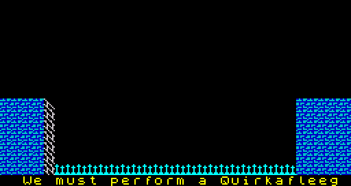
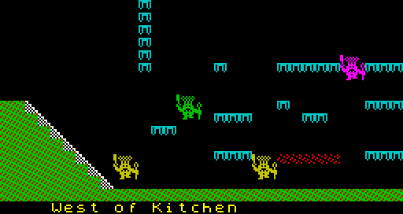

# 6. Tricks, dead code and bugs

This section collects what is not obvious from the routine list: how the
program uses the stack and page arithmetic, the one piece of self-modifying
code, the code and data that are never used, and every bug found. Each bug
is marked **observed** (seen in the simulator, sometimes with poked state)
or **inferred** (read from the code), with its finding number. The last
part lists what stays open.

## Stack tricks

The program uses the stack for control flow in three places.

- **The start.** [StartProgram](../src/start.asm#L16) writes the address of [RunCodeCheck](../src/protection.asm#L15) into
  $5BFE/$5BFF by hand and sets SP to $5BFE; its final `RET` "returns" to
  the code check. Nothing called it.
- **The code check.** [ReadCodeSlot](../src/protection.asm#L153) pops the return address into
  [AskColourCode](../src/protection.asm#L63), so its `RET` leaves the endless slot loop and lands in
  [RunCodeCheck](../src/protection.asm#L15) with the flags of the comparison.
- **An empty stack in the loop.** [FrameLoop](../src/mainloop.asm#L98) is always entered by `JP`
  with SP=$5BFE and nothing on the stack. Any routine can therefore abandon
  the pass with a jump: the exits pop one return address and jump to
  [EnterRoom](../src/title.asm#L285); [KillWilly](../src/willy.asm#L577) pops one and [KillWillyNested](../src/willy.asm#L573) two, then
  jump into the middle of the loop. The death and game over end with jumps
  to [EnterRoom](../src/title.asm#L285) or [NewGame](../src/title.asm#L30), never returns.

## Page arithmetic

Tables are page aligned and indexed by a single register:

| Lookup | Code |
| --- | --- |
| room N | `LD A,(CurrentRoom) / OR $C0 / LD H,A / LD L,0` |
| entity definition I | `LD L,I / LD H,$14 / ADD HL,HL` three times = $A000 + 8 * I |
| item i | `LD H,$A4 / LD L,i`, second byte at `INC H` |
| item cell | the item's second byte is the low byte of its attribute address and of its bitmap address |
| pixel row r | `LD L,2r / LD H,$82`: [RowAddressTable](../src/buffers.asm#L138) |
| sprite frame | page in a register, frame * 32 in the low byte |
| colour code | `LD H,$9E / LD L,cell` |

This is why only $8000-$9EFF can be relocated, and only by whole pages
(see [`re/notes.md`](../re/notes.md), Relocation).

## Small arithmetic

The ramp test in [WalkWilly](../src/willy.asm#L397) computes the cell offset to test from the
ramp direction without a branch:

```asm
  LD A,(RoomRampDir)      ; ramp direction: 0 rises left, 1 rises right
  DEC A                   ; $FF or 0
  OR $A1                  ; $FF or $A1
  XOR $E0                 ; $1F or $41: the cell to test
```

The right step does the same with `OR $9D / XOR $BF` ($40 or $22), and
[PlaceWilly](../src/specialrooms.asm#L161) uses `DEC A / XOR $0C / XOR B / AND $0C` to turn the walk
frame into a ramp offset of 4 * frame or 12 - 4 * frame.

[ExpandRoomLayout](../src/roombuild.asm#L85) gets the ramp step -33 or -31 as `AND 1 / RLCA / ADD A,$DF`
with D = $FF. [ReadWillyInput](../src/willy.asm#L255) turns the conveyor direction 0 or 1 into a
pressed-key byte with `SUB 3` (&#36;FD left, $FE right).

Counters that are shown are kept as ASCII and incremented digit by digit
with a carry ([ItemsCollectedText](../src/variables.asm#L125), [ClockText](../src/variables.asm#L138)), so nothing converts
numbers to text.

## Self-modifying code

One instance: [BuildRoomBuffers](../src/roombuild.asm#L31) stores $70 or $78 into the operand of
`LD D,n` at [SmcPixelBufPage](../src/roombuild.asm#L50) before each half of the room, choosing the
bitmap third it writes to.

## The entity table is written at run time

[EnterRoom](../src/title.asm#L285) copies the slot's start byte into byte +2 of the definition
in [EntityDefs](../src/entitydefs.asm#L88) before copying the definition to the buffer (F25). Byte +2
in the table is therefore only scratch; the value on the tape is 0. It is
harmless by itself, but it means the program does not treat the table as
read-only, and the Attic bug below damages it for good.

## The rope borrows the next entry

The rope routine keeps its segment counter and held flag in bytes +1 and +3
of the next entity entry (as IX+9 and IX+11). The room designs make sure the
next entry is an arrow or the end marker, neither of which uses those bytes
(F55, F90).

## Dead code and unused data

| Address | What | Status |
| --- | --- | --- |
| $8415 [StartProgram](../src/start.asm#L16) | a "decryption" loop over $8500-&#36;FFFF that writes every byte back unchanged | observed: memory identical after it (F1); why it is there is Unknown |
| $8451 [UnusedAirText](../src/variables.asm#L67) | "AIR" | observed unused: overwriting it changes no frame (F12) |
| $85CD [FlashTimer](../src/variables.asm#L205) | room flash effect | only cleared and decremented, never set (F105) |
| $93BB [FillAttrBlock](../src/entities.asm#L532) | tail of a routine that fills 2x3 attribute cells, after an unconditional jump | unreachable (F10, inferred) |
| $96F4 [ShowAttrMap](../src/output.asm#L264) | test code: shows the room's attribute map with a bar pattern, X resets | unreachable, runs when started by hand (F11) |
| $9718-$97FF, $8141-$81FF, $9F00-$9FFF | zeros | unused |
| $9C00 [LeftoverSource](../src/charsprites.asm#L11) | assembler source text: "NZ,ENDPAUSE", "INC E", "JR NZ,PAUSE", "INC D" | unreferenced (F14) |
| $9EB4-$9EFE | end of the code table | never read (F8) |
| sprite pages $A7, $A8, $A9, $AA, $B3 | zeros | unused (F59) |
| sprite page $B1 | poles | no definition uses it (F59) |
| $A600 frames 4-7 | filler next to the toilet | never drawn (F60) |
| entity definitions $00, $2B, $3F, $70-$7E | $2B is a complete vertical guardian | no room uses them (F56) |
| room bytes $DF-&#36;E0, $ED-&#36;EF | rooms 0-4 hold $A000, $A040, $A080, $A0C0, $A0C0 at $DF | never read (F32) |
| room 47 and pages 61-63 | an empty room named "[" and three pages of code bytes | 47 reachable only through a walled edge; 61-63 only by the cheat (F35, F41) |

## Bugs

### The Attic arrow

**Observed** (F92, F121). The arrow of "The Attic" (room 41, definition
$45) has the start byte $D5, an odd Y index. [DrawEntities](../src/entities.asm#L245) reads its row
address from [RowAddressTable](../src/buffers.asm#L138) at that index, half a word off: the low
byte of one entry and the high byte of the next. The attribute cell comes
out as $5D6A + X, the upper fin row as $9F6A + X (unused zeros) and the
solid centre row as $A06A + X, which is inside [EntityDefs](../src/entitydefs.asm#L88). As the arrow
crosses the room (X $1B down to 0) it writes $FF into $A06A-&#36;A085: bytes +2
to +7 of definition $0D, all of $0E and $0F, and bytes +0 to +5 of $10.

The definitions are only read when a room is entered, and nothing restores
them (not even a new game), so the damage shows up later, in other rooms:

- Definition $0D now has Y index $FF and sprite page $FF. In "Rescue
  Esmerelda" (14), "I'm sure I've seen this before.." (15) and "We must
  perform a Quirkafleeg" (16), which use it, [DrawEntities](../src/entities.asm#L245) looks up row
  $FF, gets HL = $006F (a ROM address), and its collision test ANDs the
  sprite with ROM bytes. The result is not zero, so Willy is killed in the
  first pass of every entry, the restart enters the room again, and all
  lives are lost there. Observed: stop at [KillWilly](../src/willy.asm#L577) with IX on that
  entry and HL = $006F in all three rooms; lives 7 → 0 within 101 frames in
  room 16 with Willy standing on safe ground.
- Definitions $0E, $0F and $10 start with $FF, the end-of-list marker. In
  rooms 1, 6, 14, 27 and 38 the entity list ends at that slot, so the
  entities from there on are gone. In room 16 the bad $0D entry comes first,
  and its kill also stops the drawing of the rope and the arrow.



Compare with the [undamaged room](img/rooms/room-16.png). A visit of a few
seconds is enough: the arrow crosses the room once every 256 passes.

### A deadly fall repeats

**Observed** (F120). [ExitRoomDown](../src/exits.asm#L79) keeps Willy's air state when it is
$0B or more, and [EnterRoom](../src/title.asm#L285) saves it with his position. If he leaves a
room through the bottom in a fall that is already deadly (state $0C or
more), the landing in the room below kills him, and the restart puts him
back at the top of that room in the same fall. In the simulator (Bathroom,
column 16, dropped into "The Chapel" with state $0C) he died eight times in
a row and the game-over scene followed 709 frames later.

### Tiles found by colour

**Observed** (F30, F40). [BuildRoomBuffers](../src/roombuild.asm#L31) finds a cell's pixels by
searching the tile area for the cell's attribute byte. If that byte also
occurs earlier in the tile area, as an attribute or as a pixel row of an
earlier tile, the 8 bytes after the earlier match are drawn. This affects
the conveyor of rooms 24, 29, 49 and 51 and the nasty tile of room 36. In
"West of Kitchen" (24) the conveyor attribute $42 equals the 6th pixel row
of the floor tile, so the belt is drawn from the floor's last bytes and the
start of the wall tile:




The colours and the collision behaviour are right; only the picture is
wrong. The same for room 29:


### Walking through walls to the left

**Observed** (F116). A step to the right tests the cell beside Willy's head;
a step to the left does not. A wall cell only at head height blocks him
going right and not going left.

### Anything white collects items

**Observed with modified data, latent in the original** (F19, F119). An
item is taken when its cell has ink 7. Willy's cells get ink 7, but so do
the cells of a white guardian and of every arrow. With an item moved onto
their paths, a white guardian in room 22 and the arrow of room 16 collected
it without Willy. No room in the game has such an overlap.

### Guardians collide with the room

**Observed with modified data** (F83). A guardian's collision test is
against all lit pixels in the work bitmap. With a guardian's Y moved over a
brick block in room 16, Willy died at once, far from it. The room data keeps
guardians clear of lit tiles, except when the Attic bug changes them.

### The rope's segment 0

**Observed** (F91). A lit pixel under the first point of a rope sets the
held flag while [WillyRope](../src/variables.asm#L360) stays 0, and Willy is moved to the top of the
rope; with such a pixel poked into room 16 he left the room (to room 0) a
few frames later.

### Two items in one cell

**Observed** (F18). Items $C0 and $C6 of "The Beach" share a cell, so 82
cells hold 83 items and both are counted at once.

### The colour code cell $B3

**Observed** (F3). The grid cell is chosen with `CP $B3` and then `SUB $B4`:
cell $B3 (R9) is never asked, and a FRAMES value of $8E gives index $FF,
shown as ">D", with the code taken from beyond the used table.

### Noon is am, midnight is pm

**Observed** (F96). The letter of the clock changes when the hour goes from
12 to 1, so the clock reads "12:00am" at noon and "12:00pm" at midnight,
and the game ends at what it would call 1:00pm, an hour after the midnight
of the title message.

### Vertical guardians pass their bottom limit

**Computed** with the movement rules of F81. The step is reversed only
after it took the guardian to or past the bottom limit, and the limit is
not enforced, so definitions $05, $06 and $07 go up to 4, 8 and 4 Y units
(2-4 pixel rows) below their limits. All stay inside the room.

### Kempston detection

**Inferred** (F46). The title screen sets [JoystickFlag](../src/variables.asm#L219) when 256 reads of
port $1F never have bit 5 set. A Kempston interface returns 0 in bit 5; a
machine without one returns whatever the bus holds. Whether a bare 48K
passes the test was not tried here; in the simulator, which returns 0, the
joystick is always "detected".

### No ending

**Observed** (F66). After the run to the toilet the game goes on without
Willy until the clock or CAPS SHIFT + SPACE ends it; nothing is shown.

## Open questions

- Where the bytes of the colour-code table come from (F9, unknown).
- Why [StartProgram](../src/start.asm#L16) runs a loop that changes nothing (a decryptor with
  the key removed is a guess).
- What the bytes between the lines of [LeftoverSource](../src/charsprites.asm#L11) mean (a 2-byte
  prefix and a byte that grows by $21 per line).
- What room bytes $DF-&#36;E0 and $ED-&#36;EF were for (F32).
- What the loader's `POKE 23613,0` is for; not tested.
- Which tunes the title and in-game music are (Unknown in the sources).
- Still **inferred** in the finding register, not run: the unreachable
  fragment at $93BB (F10), the uses of the scratch byte (F13), the leftover
  text (F14), ramp direction 0 in the layout expansion (F29, only direction
  1 rooms checked), tile roles (F31), unread room bytes (F32), slot format
  (F33), rooms 47 and 61-63 (F35, F36, F41), the killed flag (F42), the tune
  format by ear (F44), the start-key and joystick tests (F45, F46), Willy's
  sprite choice (F47), the item room list (F49), the frame formula (F54),
  rope scratch bytes (F55), unused sprite pages (F59, F60), title pieces
  (F79), the order of the pass as a whole (F94), the ground rule (F112).
  Most are confirmed indirectly by observed findings that depend on them.
