# 7. Graphics gallery

Every image here was produced from the game's bytes: screens by running the
game in the simulator (sometimes with a poked variable), sprites and tiles by
rendering their bytes with `tools/zxgfx.py`, rooms by letting the game enter
each room and draw one pass. The commands are in
[`img/Makefile`](img/Makefile). There is no loading screen on the tape.

## Screens

| | |
| --- | --- |
|  | The BASIC loader's message, still on the screen when the code takes over ([Overview](01-overview.md#how-it-loads)) |
|  | The colour-code screen with an answer in the four slots ([Protection](05-protection-cheat.md)) |
| 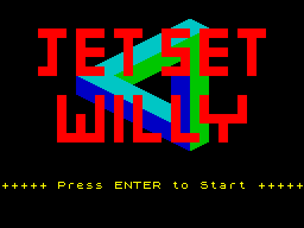 | The title screen during the tune ([Title](03-title-and-menu.md)) |
| 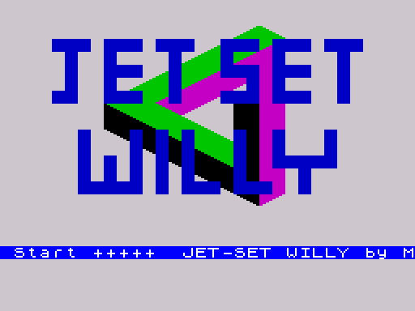 | The message scroll, colours cycled by [CycleColours](../src/mainloop.asm#L250) |
|  | In play: the Bathroom after the first item |
| 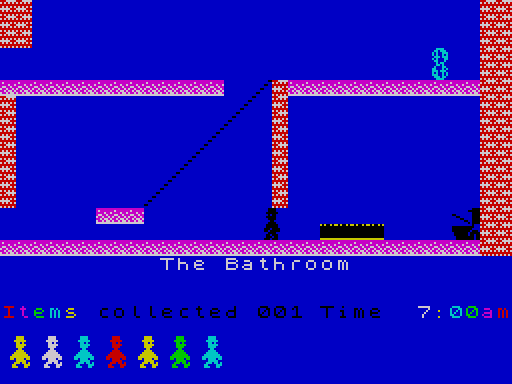 | Pause: the whole screen and the border cycled |
| 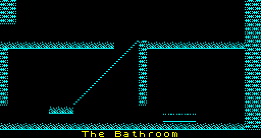 | The death flash, one of its eight colours |
|  | Game over: the foot coming down on Willy |
| 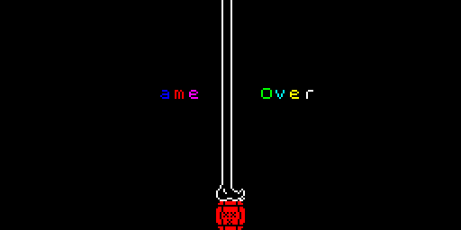 | Game over: "Game Over" with the letters cycling ("G" is black at this instant) |
|  | Ending stage 3: Willy gone, the toilet with frames 2-3 |
|  | Willy drawn as the flapping creature in "The Nightmare Room" |
|  | Room 16 after the Attic arrow has damaged the entity table ([Tricks](06-tricks.md#the-attic-arrow)) |

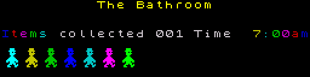

## Willy, the figure, the foot and the barrel

Rendered in white (the game draws Willy with whatever ink his cells have:
white where he marks background cells).

 

 

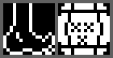

## Sprite pages

All 26 pages $A6-$BF, one page (8 frames) per row, in white on black. The
colours in play come from the entity definitions. Which definitions and
rooms use each page is in the comment of each page in
[`src/sprites.asm`](../src/sprites.asm).

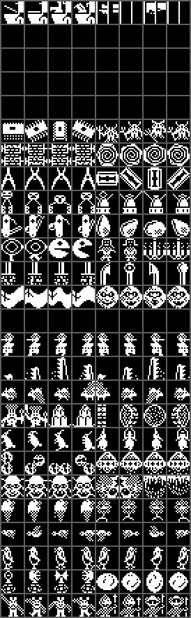

| Row | Page | Label | Contents (as described in the sources) |
| --- | --- | --- | --- |
| 1 | $A6 | [SpritesToilet](../src/sprites.asm#L16) | toilet (4 frames) and unused filler |
| 2 | $A7 | [UnusedSpritesA7](../src/sprites.asm#L155) | zeros |
| 3 | $A8 | [UnusedSpritesA8](../src/sprites.asm#L294) | zeros |
| 4 | $A9 | [UnusedSpritesA9](../src/sprites.asm#L433) | zeros |
| 5 | $AA | [UnusedSpritesAA](../src/sprites.asm#L572) | zeros |
| 6 | $AB | [SpritesSlabCrawler](../src/sprites.asm#L713) | spinning slab, crawler |
| 7 | $AC | [SpritesBarbedSpiral](../src/sprites.asm#L855) | barbed bars, spiral disc |
| 8 | $AD | [SpritesPincersRazor](../src/sprites.asm#L996) | pincers, razor blade |
| 9 | $AE | [SpritesWalkerDrum](../src/sprites.asm#L1137) | two-legged walker, arms-up figure on a drum |
| 10 | $AF | [SpritesKnifeTeardrop](../src/sprites.asm#L1278) | penknife, teardrop with spot |
| 11 | $B0 | [SpritesRingChomper](../src/sprites.asm#L1421) | ring on a stalk, chomping head, dressed figure, barred ornament |
| 12 | $B1 | [SpritesPolesUnused](../src/sprites.asm#L1564) | poles (not used by any definition) |
| 13 | $B2 | [SpritesBannerFace](../src/sprites.asm#L1705) | banner, round face |
| 14 | $B3 | [UnusedSpritesB3](../src/sprites.asm#L1844) | zeros |
| 15 | $B4 | [SpritesHatWalkers](../src/sprites.asm#L1986) | hatted walker, left and right |
| 16 | $B5 | [SpritesSpikyPosts](../src/sprites.asm#L2128) | spiky post, left and right |
| 17 | $B6 | [SpritesFlapper](../src/sprites.asm#L2273) | flapper, left and right; also Willy in "The Nightmare Room" |
| 18 | $B7 | [SpritesCrownDomeBall](../src/sprites.asm#L2416) | crowned creature, dome, bars, spotted ball |
| 19 | $B8 | [SpritesCritterHooded](../src/sprites.asm#L2558) | profile critter, hooded figure |
| 20 | $B9 | [SpritesCoilDome](../src/sprites.asm#L2698) | coil, fringed dome |
| 21 | $BA | [SpritesSkullBlobDrip](../src/sprites.asm#L2842) | skull face, checkered blobs, dripping fringe |
| 22 | $BB | [SpritesConeBalloon](../src/sprites.asm#L2983) | cone, balloon on legs |
| 23 | $BC | [SpritesSmallFlyers](../src/sprites.asm#L3126) | small flyer, left and right |
| 24 | $BD | [SpritesHatBirds](../src/sprites.asm#L3267) | hatted bird, left and right |
| 25 | $BE | [SpritesStalkHeadBall](../src/sprites.asm#L3408) | head on a stalk, dark ball |
| 26 | $BF | [SpritesImpsGuards](../src/sprites.asm#L3552) | stick figure, spear guard and plumed guard |

## Guardian animations

Every guardian of rooms 0-60, in its ink on black, cycling through the
frames the game shows: a horizontal guardian (type 1) through phases 0-3
walking right, then 3-0 walking left; a vertical guardian (type 2) through
phases 0-7. The frame is ((byte 0 AND byte 1) OR slot byte) >> 5 (F54), so
one definition placed with two different slot bytes appears twice. Caption:
definition index and the rooms that use it ("+" = more rooms). The real
speed is one phase per pass for vertical guardians with bit 4 set, half that
otherwise, and one phase per pass for horizontal guardians (they move one
column per four phases); here every frame lasts 0.16 s. Made by
[`scripts/docs-anim.py`](../scripts/docs-anim.py) from the definitions and the room slots.

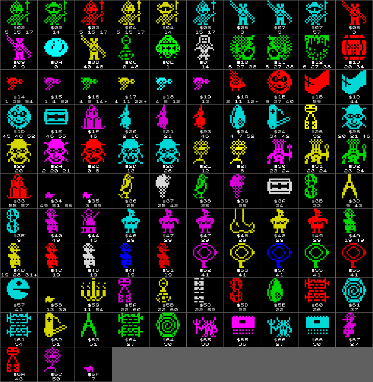

## Rooms in motion

Room 16 recorded in the simulator, one GIF frame every 4 frames (about one
pass of the frame loop), with Willy hidden (ending stage 3): the rope swings
between its limits, the arrow crosses the room, the guardians move.

## Code screen and title graphics

## Item pictures

One per room (room bytes $E1-$E8), rooms 0-60 in rows of 16, in yellow,
with the room number and the number of items the item table puts in that
room ("-" for none). In play they flash in magenta, green, cyan and yellow.
A picture with "-" is never shown; room 28's item has a blank picture
(F49, F122).

## Tiles

Every room's six tiles are in its record; the rooms below show them as the
game draws them. Two tile sets as defined, for the tile bug in
[Tricks](06-tricks.md#tiles-found-by-colour) (background, floor, wall,
nasty, ramp, conveyor, each in its own attribute):

 

## The room map

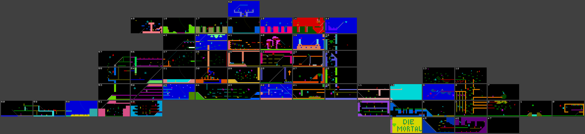

Built by [`scripts/docs-roommap.py`](../scripts/docs-roommap.py) from the
room snapshots; the layout and the links that cannot be drawn on a flat grid
are explained in [Rooms and exits](05-rooms.md#the-room-map).

## Rooms

Each room was rendered by poking [CurrentRoom](../src/variables.asm#L10), jumping to [EnterRoom](../src/title.asm#L285)
and stopping after the attribute copy of the first pass of [FrameLoop](../src/mainloop.asm#L98).
Willy is hidden by ending stage 3 (which skips [MoveWilly](../src/willy.asm#L78) and
[PlaceWilly](../src/specialrooms.asm#L161)), except in the Bathroom (33, Willy at his position after
the start script) and the Master Bedroom (35, to show the figure). Entities
have made one move from their start positions; arrows are drawn only when
on screen, so most rooms do not show theirs. Item colours depend on the
pass counter. Room names are as the game prints them.

### 0. The Off Licence

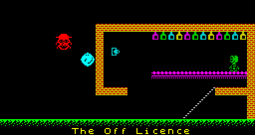

Exits: left 1, right 0, up 0, down 0. Source: [RoomOffLicence](../src/rooms.asm#L98).

### 1. The Bridge

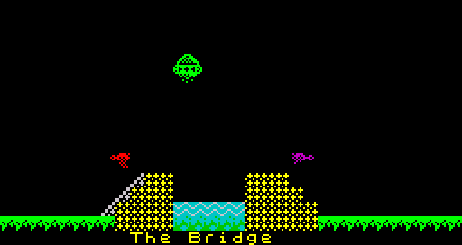

Exits: left 2, right 0, up 0, down 0. Source: [RoomBridge](../src/rooms.asm#L190).

### 2. Under the MegaTree

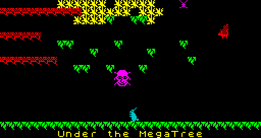

Exits: left 3, right 1, up 0, down 0. Source: [RoomUnderMegaTree](../src/rooms.asm#L280).

### 3. At the Foot of the MegaTree

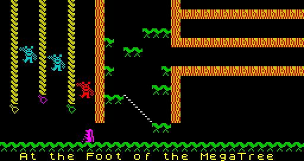

Exits: left 4, right 2, up 8, down 0. Source: [RoomFootOfMegaTree](../src/rooms.asm#L374).

### 4. The Drive

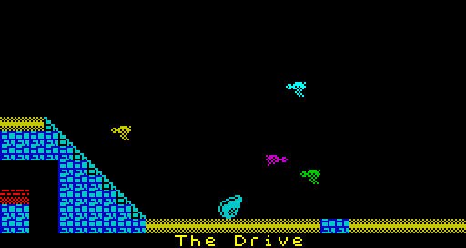

Exits: left 5, right 3, up 6, down 45. Source: [RoomDrive](../src/rooms.asm#L467).

### 5. The Security Guard

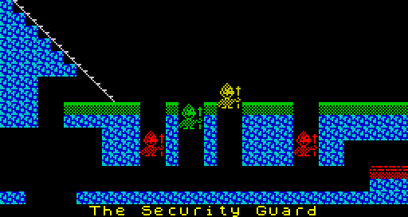

Exits: left 19, right 4, up 10, down 6. Source: [RoomSecurityGuard](../src/rooms.asm#L557).

### 6. Entrance to Hades

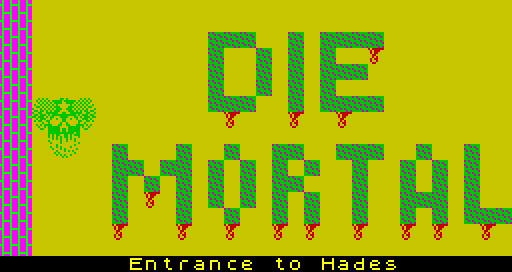

Exits: left 14, right 5, up 0, down 0. Source: [RoomEntranceToHades](../src/rooms.asm#L650).

### 7. Cuckoo's Nest

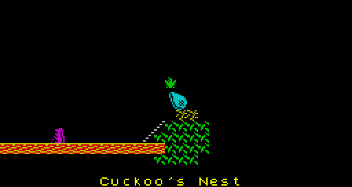

Exits: left 8, right 0, up 0, down 2. Source: [RoomCuckoosNest](../src/rooms.asm#L742).

### 8. Inside the MegaTrunk

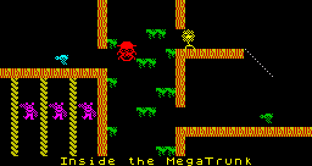

Exits: left 9, right 7, up 12, down 3. Source: [RoomInsideMegaTrunk](../src/rooms.asm#L832).

### 9. On a Branch Over the Drive

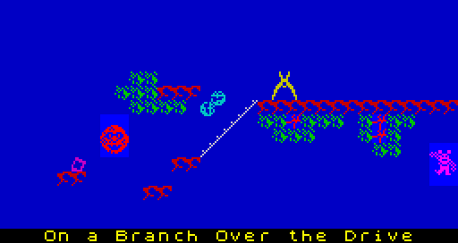

Exits: left 10, right 8, up 13, down 4. Source: [RoomBranchOverDrive](../src/rooms.asm#L922).

### 10. The Front Door

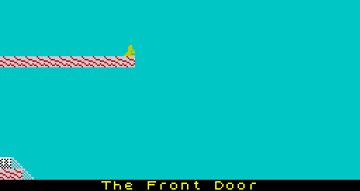

Exits: left 11, right 9, up 0, down 5. Source: [RoomFrontDoor](../src/rooms.asm#L1007).

### 11. The Hall

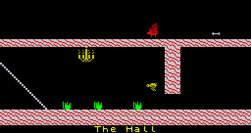

Exits: left 20, right 10, up 0, down 0. Source: [RoomHall](../src/rooms.asm#L1099).

### 12. Tree Top

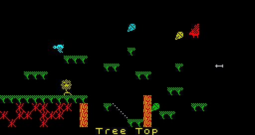

Exits: left 13, right 0, up 0, down 8. Source: [RoomTreeTop](../src/rooms.asm#L1190).

### 13. Out on a limb

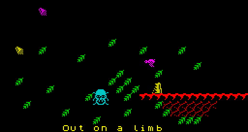

Exits: left 10, right 12, up 0, down 9. Source: [RoomOutOnALimb](../src/rooms.asm#L1280).

### 14. Rescue Esmerelda

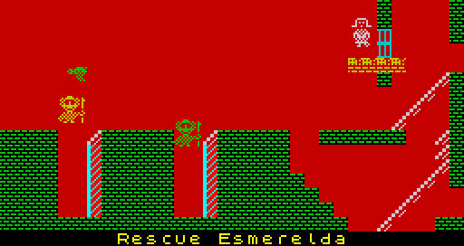

Exits: left 15, right 44, up 20, down 39. Source: [RoomRescueEsmerelda](../src/rooms.asm#L1372).

### 15. I'm sure I've seen this before..

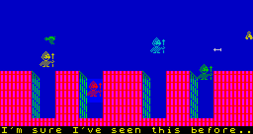

Exits: left 16, right 14, up 0, down 0. Source: [RoomSeenThisBefore](../src/rooms.asm#L1460).

### 16. We must perform a Quirkafleeg

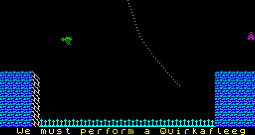

Exits: left 17, right 15, up 50, down 0. Source: [RoomQuirkafleeg](../src/rooms.asm#L1549).

### 17. Up on the Battlements

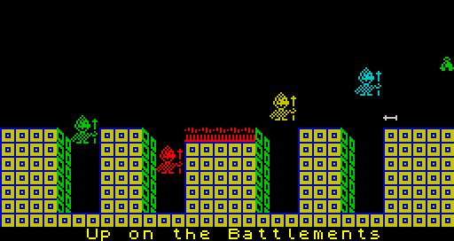

Exits: left 18, right 16, up 0, down 0. Source: [RoomBattlements](../src/rooms.asm#L1639).

### 18. On the Roof

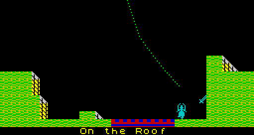

Exits: left 48, right 17, up 18, down 0. Source: [RoomOnTheRoof](../src/rooms.asm#L1727).

### 19. The Forgotten Abbey

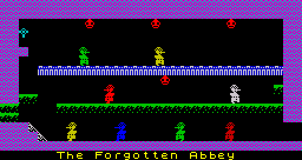

Exits: left 49, right 5, up 0, down 0. Source: [RoomForgottenAbbey](../src/rooms.asm#L1818).

### 20. Ballroom East

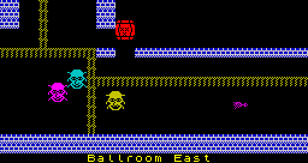

Exits: left 21, right 11, up 26, down 0. Source: [RoomBallroomEast](../src/rooms.asm#L1907).

### 21. Ballroom West

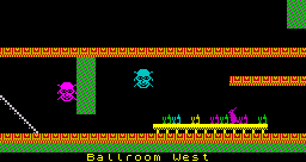

Exits: left 22, right 20, up 27, down 0. Source: [RoomBallroomWest](../src/rooms.asm#L2000).

### 22. To the Kitchens Main Stairway

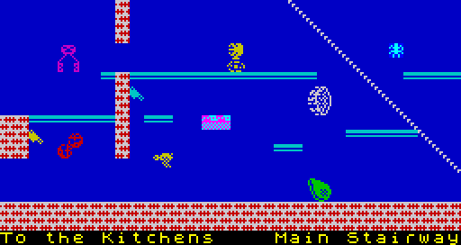

Exits: left 23, right 21, up 28, down 0. Source: [RoomMainStairway](../src/rooms.asm#L2092).

### 23. The Kitchen

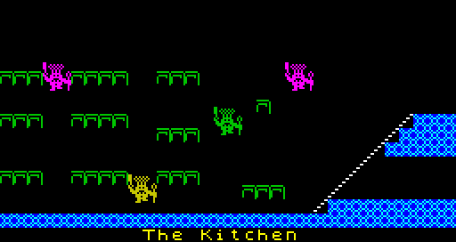

Exits: left 24, right 22, up 0, down 0. Source: [RoomKitchen](../src/rooms.asm#L2181).

### 24. West of Kitchen

Exits: left 25, right 23, up 30, down 0. Source: [RoomWestOfKitchen](../src/rooms.asm#L2276).

### 25. Cold Store

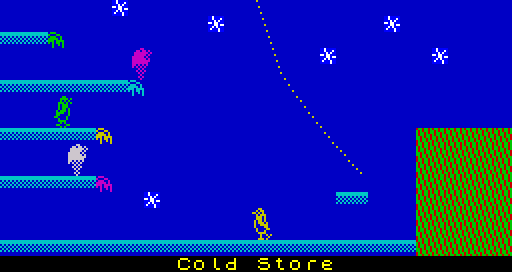

Exits: left 52, right 24, up 31, down 0. Source: [RoomColdStore](../src/rooms.asm#L2369).

### 26. East Wall Base

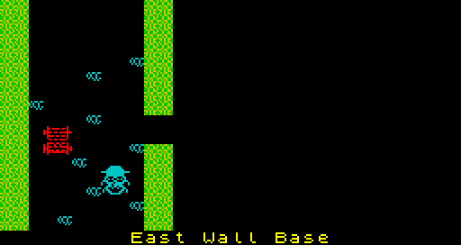

Exits: left 27, right 0, up 32, down 20. Source: [RoomEastWallBase](../src/rooms.asm#L2459).

### 27. The Chapel

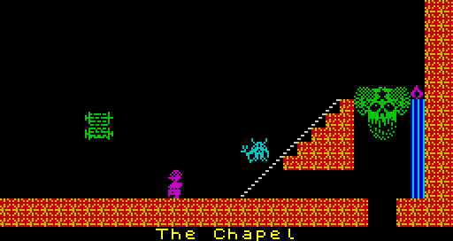

Exits: left 28, right 26, up 33, down 21. Source: [RoomChapel](../src/rooms.asm#L2553).

### 28. First Landing

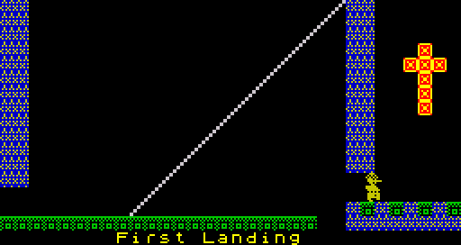

Exits: left 29, right 27, up 34, down 22. Source: [RoomFirstLanding](../src/rooms.asm#L2642).

### 29. The Nightmare Room

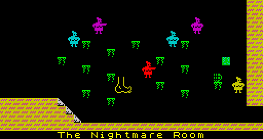

Exits: left 30, right 28, up 0, down 0. Source: [RoomNightmareRoom](../src/rooms.asm#L2737).

### 30. The Banyan Tree

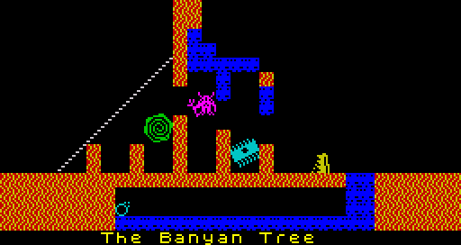

Exits: left 31, right 29, up 36, down 24. Source: [RoomBanyanTree](../src/rooms.asm#L2827).

### 31. Swimming Pool

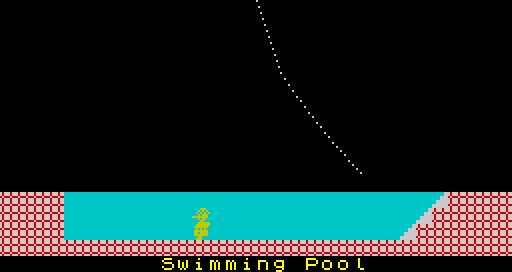

Exits: left 54, right 30, up 37, down 0. Source: [RoomSwimmingPool](../src/rooms.asm#L2916).

### 32. Halfway up the East Wall

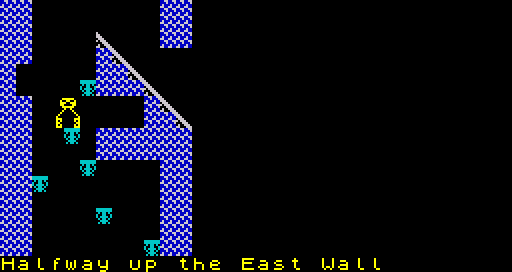

Exits: left 33, right 0, up 38, down 26. Source: [RoomHalfwayEastWall](../src/rooms.asm#L3007).

### 33. The Bathroom

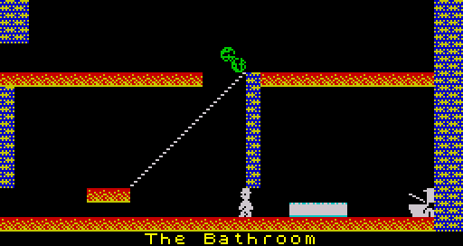

Exits: left 34, right 32, up 39, down 27. Source: [RoomBathroom](../src/rooms.asm#L3100).

### 34. Top Landing

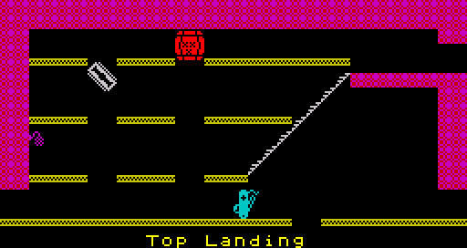

Exits: left 35, right 33, up 40, down 28. Source: [RoomTopLanding](../src/rooms.asm#L3190).

### 35. Master Bedroom

Exits: left 36, right 34, up 41, down 29. Source: [RoomMasterBedroom](../src/rooms.asm#L3282).

### 36. A bit of tree

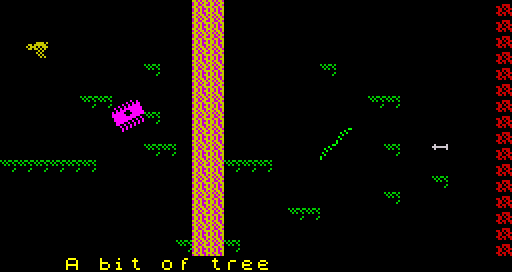

Exits: left 37, right 35, up 42, down 30. Source: [RoomBitOfTree](../src/rooms.asm#L3374).

### 37. Orangery

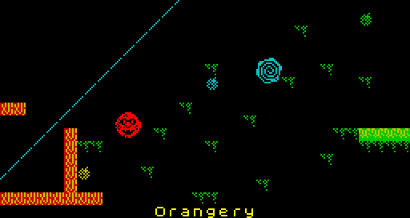

Exits: left 56, right 36, up 43, down 31. Source: [RoomOrangery](../src/rooms.asm#L3465).

### 38. Priests' Hole

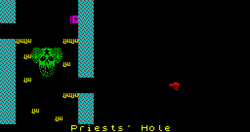

Exits: left 39, right 0, up 60, down 32. Source: [RoomPriestsHole](../src/rooms.asm#L3553).

### 39. Emergency Generator

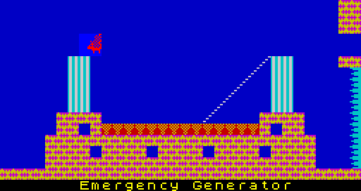

Exits: left 40, right 38, up 14, down 0. Source: [RoomEmergencyGenerator](../src/rooms.asm#L3644).

### 40. Dr Jones will never believe this

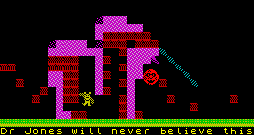

Exits: left 41, right 39, up 16, down 0. Source: [RoomNeverBelieveThis](../src/rooms.asm#L3731).

### 41. The Attic

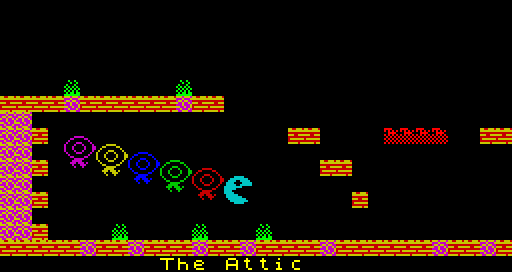

Exits: left 42, right 40, up 0, down 34. Source: [RoomAttic](../src/rooms.asm#L3824).

### 42. Under the Roof

Exits: left 43, right 41, up 48, down 36. Source: [RoomUnderTheRoof](../src/rooms.asm#L3915).

### 43. Conservatory Roof

Exits: left 0, right 42, up 0, down 37. Source: [RoomConservatoryRoof](../src/rooms.asm#L4003).

### 44. On top of the house

Exits: left 14, right 0, up 0, down 38. Source: [RoomTopOfTheHouse](../src/rooms.asm#L4092).

### 45. Under the Drive

Exits: left 6, right 46, up 4, down 0. Source: [RoomUnderTheDrive](../src/rooms.asm#L4187).

### 46. Tree Root

Exits: left 45, right 47, up 3, down 0. Source: [RoomTreeRoot](../src/rooms.asm#L4279).

### 47. \[

Exits: left 29, right 205 (room 13 after masking), up 28, down 43. Source: [RoomBracket](../src/rooms.asm#L4369).

### 48. Nomen Luni

Exits: left 0, right 18, up 0, down 42. Source: [RoomNomenLuni](../src/rooms.asm#L4444).

### 49. The Wine Cellar

Exits: left 51, right 19, up 52, down 0. Source: [RoomWineCellar](../src/rooms.asm#L4540).

### 50. Watch Tower

Exits: left 0, right 0, up 0, down 16. Source: [RoomWatchTower](../src/rooms.asm#L4629).

### 51. Tool Shed

Exits: left 58, right 49, up 53, down 0. Source: [RoomToolShed](../src/rooms.asm#L4719).

### 52. Back Stairway

Exits: left 53, right 25, up 54, down 49. Source: [RoomBackStairway](../src/rooms.asm#L4807).

### 53. Back Door

Exits: left 0, right 52, up 55, down 51. Source: [RoomBackDoor](../src/rooms.asm#L4898).

### 54. West Wing

Exits: left 55, right 31, up 56, down 52. Source: [RoomWestWing](../src/rooms.asm#L4987).

### 55. West Bedroom

Exits: left 0, right 54, up 57, down 53. Source: [RoomWestBedroom](../src/rooms.asm#L5077).

### 56. West Wing Roof

Exits: left 57, right 37, up 0, down 54. Source: [RoomWestWingRoof](../src/rooms.asm#L5169).

### 57. Above the West Bedroom

Exits: left 0, right 56, up 0, down 55. Source: [RoomAboveWestBedroom](../src/rooms.asm#L5257).

### 58. The Beach

Exits: left 59, right 51, up 58, down 0. Source: [RoomBeach](../src/rooms.asm#L5345).

### 59. The Yacht

Exits: left 60, right 58, up 0, down 0. Source: [RoomYacht](../src/rooms.asm#L5431).

### 60. The Bow

Exits: left 0, right 59, up 0, down 0. Source: [RoomBow](../src/rooms.asm#L5519).

