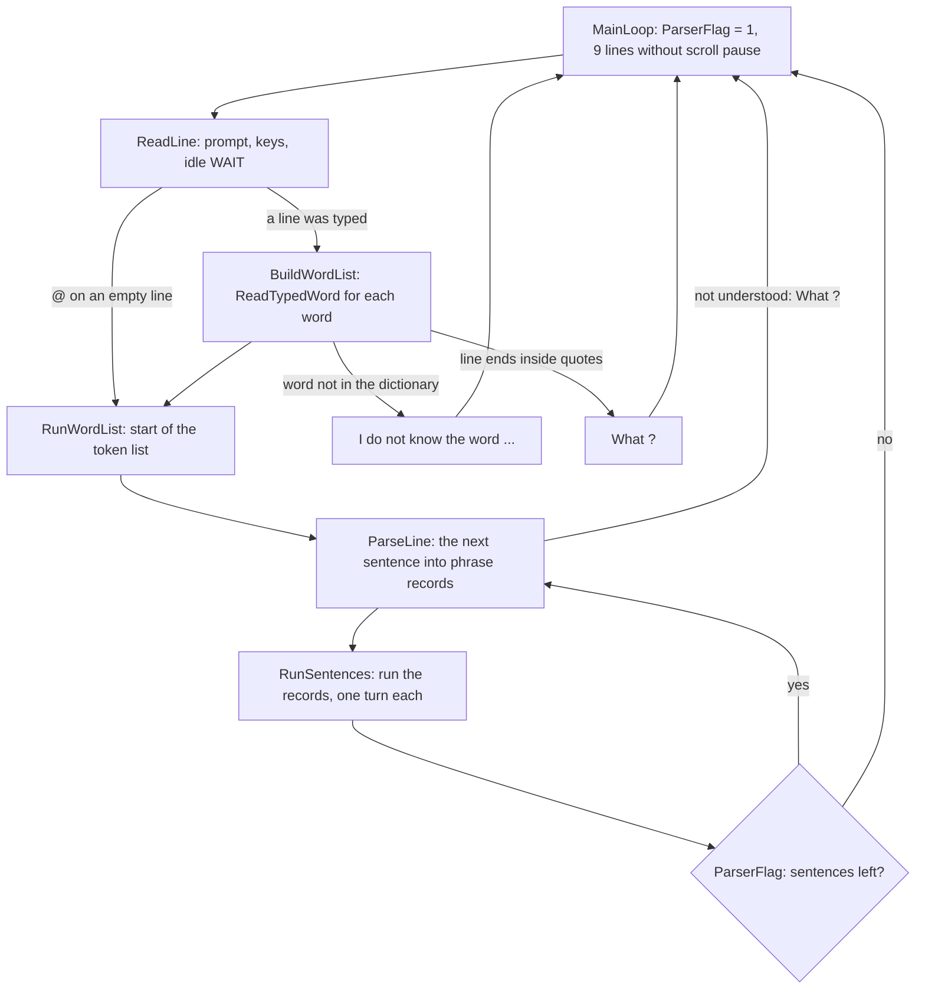
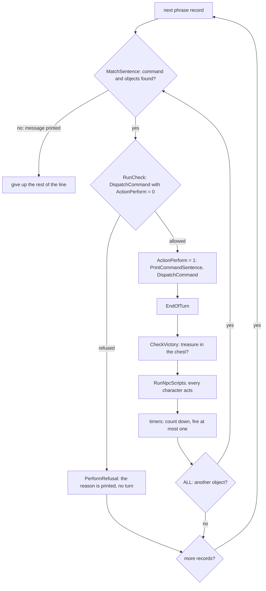

# 4. The main loop and a turn

The game has no frame loop. [MainLoop](../src/main.asm#L197) runs once per typed line: read the
line, turn its words into tokens, parse it a sentence at a time and run each
sentence. A "turn" is one command the game carried out: after each of them the
timers tick and every other character acts. This file follows one line from
the keyboard to the end of its turns.

## The main loop

| Step | Routine | What it does |
| --- | --- | --- |
| 1 | [MainLoop](../src/main.asm#L197) | sets [ParserFlag](../src/world.asm#L53) and lets 9 lines of reply scroll without a pause |
| 2 | [ReadLine](../src/main.asm#L331) | prints `> ` in the input window and edits a line of up to 128 characters in [InputLine](../src/keys.asm#L414) (below) |
| 3 | [BuildWordList](../src/main.asm#L206) | clears [ParsedWords](../src/keys.asm#L437) and calls [ReadTypedWord](../src/keys.asm#L127) for each word: a token per word, `.` = THEN, `,` = AND, `"` = quote, end of line. A word not in the dictionary prints `I do not know the word "xyzzy"` ([UnknownWord](../src/main.asm#L273)) and drops the line. Text between double quotes is an order for a character; a THEN is put before the closing quote (F49) |
| 4 | [ParseLine](../src/parser.asm#L30) | parses the tokens up to the next THEN (or the end) into phrase records; "What ?" drops the rest of the line |
| 5 | [RunSentences](../src/parser.asm#L1035) | runs those records: each performed command is a turn |
| 6 | | while [ParserFlag](../src/world.asm#L53) is set (THEN left more sentences, or AND started a new verb, F62) the loop goes back to step 4 with the same token list |

The `@` key as the first key of an empty line repeats the previous line: the
token list from last time is still in [ParsedWords](../src/keys.asm#L437), so the loop skips
straight to step 4 ([L6E7A](../src/keys.asm#L65), F37).

## The line editor ([ReadLine](../src/main.asm#L331), [WaitKey](../src/keys.asm#L802), [ReadKey](../src/devices.asm#L132))

- Keys come from the game's own scanner [ReadKey](../src/devices.asm#L132): it reads all eight
  half-rows, compares them with the previous scan and returns the ASCII code of
  a key that has just gone down (edge-triggered: a held key is returned once;
  F12). CAPS SHIFT or SYMBOL SHIFT select the second table ([ShiftKeyTable](../src/devices.asm#L217)).
- Accepted characters: letters and anything from `@` up, space, `"`, `.`,
  `,` and ENTER; digits and other punctuation are ignored. Letters are shown in
  capitals in the input window.
- DELETE (CAPS SHIFT + 0) erases the whole line ([EraseInputLine](../src/keys.asm#L87)); 5 (with
  or without CAPS SHIFT) and 0 alone delete one character.
- A cursor key (5, 6, 7, 8, with or without CAPS SHIFT) as the first key of a
  line types `W`, `S`, `N` or `E` and ENTER at once ([CursorKeyToWord](../src/keys.asm#L18)): one
  key moves Bilbo. Later in the line, 6 and 8 are ignored, 5 deletes, and 7
  (code `$5B`) is taken as the character `[` (inferred from the tables).
- SYMBOL SHIFT gives `"` (P), `.` (M), `,` (N) and `@` (2); the digits 1-4 and
  9 are masked out of the scan ([KeyMasks](../src/devices.asm#L107)).
- When the buffer holds 128 characters further keys are ignored until ENTER.

### The automatic WAIT

[WaitKey](../src/keys.asm#L802) counts its keyboard scans in [IdleCounter](../src/world.asm#L86). Each line starts
with 3000 (`IDLE_SCANS_MAX`); each key pressed gives 500 back, up to 3000.
When the count runs out the game erases what was typed, types `WAIT` itself
and returns ENTER. So an idle player still loses turns: the characters keep
acting. Measured from Bag End: the first automatic WAIT comes after 938 frames
(about 19 seconds) without a key (verified, F36).

## A turn ([RunSentences](../src/parser.asm#L1035))

1. [MatchSentence](../src/parser.asm#L1117) finds the command table record that fits the verb and
   prepositions and the objects the noun phrases mean ([05-parser](05-parser.md)).
   If none fits it has printed why, and the rest of the line is dropped.
2. Every command runs **twice** through [DispatchCommand](../src/engine.asm#L87). The test pass
   ([RunCheck](../src/parser.asm#L1372), [ActionPerform](../src/world.asm#L33) = 0) lets the handlers check and refuse;
   any message printed during the test pass clears [ActionAllowed](../src/world.asm#L35) and is
   not shown (output needs ActionPerform = 1, [OutputEnabled](../src/screen.asm#L11)), so a handler
   refuses simply by saying why ([PrintMessage](../src/printer.asm#L112), F16). A handler that gets
   as far as its commit point ([CommitOrAbort](../src/objects.asm#L569)) sets ActionAllowed and
   returns without doing anything. A refused command takes no time:
   [PerformRefusal](../src/parser.asm#L2103) runs the handler once more in perform mode, so that its
   reason is now printed.
3. The real pass: the command is echoed as a sentence in the story window
   ("You take the rope.", [PrintCommandSentence](../src/keys.asm#L570), F59) and the handlers do
   the work.
4. [EndOfTurn](../src/parser.asm#L1057) calls [L96B3](../src/engine.asm#L433), the world's turn:
   - [CheckVictory](../src/handlers.asm#L1180): the treasure in the wooden chest ends the game;
   - [RunNpcScripts](../src/engine.asm#L765): each of the 17 character records runs its script
     until one command succeeds ([05-characters](05-characters.md));
   - the 10 timers are counted down; at most one fires per turn
     ([05-time](05-time.md)).
5. With ALL the same record is matched again for the next object, so
   `TAKE ALL` takes several turns, one per object.

A verb that is in the dictionary but has no command record ("sing", "sleep",
"hello") prints `You sing. Time passes...` and takes a turn ([MatchCommand](../src/parser.asm#L1560),
F38). WAIT is such a verb.

## Timing and speed

Nothing waits for the 50 Hz frame and no interrupt runs: the speed of the
game is the speed of its code. The waits it has:

| Wait | Where | Length |
| --- | --- | --- |
| key scan delay | [ReadKey](../src/devices.asm#L132) starts with [DelayShort](../src/devices.asm#L92) | sets the time per scan, and so the length of the idle WAIT |
| idle WAIT | [WaitKey](../src/keys.asm#L802) | 3000 scans, about 19 s |
| scroll pause | [OutputStoryChar](../src/screen.asm#L349) | after each story line `SCROLL_DELAY` (`$8000`) key polls, about half a second; a held key stops the scrolling until it is released; the first 9 lines after a typed line (17 after a start) have no pause ([NoPauseLines](../src/world.asm#L88), F35) |
| picture | [WaitKeyAfterPicture](../src/engine.asm#L380) | after a location picture is drawn, until any key is down; then the border turns white |
| PAUSE | [WordPause](../src/system.asm#L439) | green border until a key is pressed and released |

Drawing a picture takes from a fraction of a second to a few seconds (lines
and flood fills by single pixels, [05-pictures](05-pictures.md)).
