# Graphics

Every image on this page was made from the game's own bytes: the screens and
the location pictures by running the game's code in the simulator, the font
and the loading screen from the data. The commands are in
[scripts/docs-images.sh](../scripts/docs-images.sh) (run from the project
root, with `re/orig.z80` restored by `make restore`).

## Loading screen and title

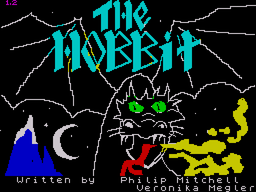

`data/screen05.scr`, 6912 bytes loaded to $4000 by the BASIC loader
(`LOAD "p" CODE 16384`). The game has no title screen of its own:
[RestartGame](../src/main.asm#L81) waits for a key with this picture still on the display.
The screen it waits on differs from the file only in 53 bytes of row 23,
where the ROM printed the header `Bytes: h` of the next block in black on
black (observed: the screen after 40 frames from `re/orig.z80` compared with
the file). After a death or QUIT the game waits on whatever is on the screen
(the last text) instead.

## Screen layout

The top 16 character rows (256x128 pixels) are the picture area; the story
window is rows 0-17, so the picture shares rows 0-15 with the story text and
is scrolled away by it (see `play-start.png` below); row 18 is a rule drawn
from [BorderTile](../src/main.asm#L299) (5 pixel lines of a 2-byte tile repeated 16 times);
rows 19-23 are the input window, in the ROM font. The colours are black ink
on white paper outside the picture.

## The font

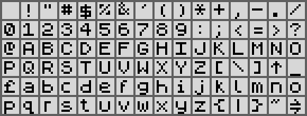

[Font](../src/screen.asm#L660) ($8822): 96 characters, $20-$7F, 8 bytes each, in the order of
the Spectrum character set ($60 is the pound sign, $7F the copyright sign).
Every glyph uses only bits 6-2 (the OR of all 768 bytes is $7C, observed),
so [PrintStoryChar](../src/screen.asm#L580) draws a character 6 pixels wide (`GLYPH_WIDTH`),
shifting it into place across two screen bytes: 42 characters in a line of
252 pixels. The sheet above shows the glyphs on 8x8 cells. The input window
prints with the ROM's own font at $3D00 (32 columns).

## Location pictures

[PictureTable](../src/pictures.asm#L16) (&#36;CC00) has 22 records of 3 bytes (location id, address
of the picture), ending with $FF; the 22 pictures fill $CC43-&#36;F35A back to
back. [ShowLocation](../src/engine.asm#L327) calls [DrawLocationPicture](../src/drawing.asm#L21) with the location
id after printing the description; when a picture was drawn it waits for a
key ([WaitKeyAfterPicture](../src/engine.asm#L380), the border turns white). The pictures are
off for the whole game when N is held as the title key goes down
(`PicturesEnabled`, $B707).

A picture is a header (border colour, attribute of the picture area) and a
stream of commands for [RunPictureCommands](../src/drawing.asm#L77): $08 x y moves the pen; $80-&#36;FF
is a line of two bytes ([DrawPictureLine](../src/drawing.asm#L510)); $40-$7F is a flood fill
of three bytes, ink = the low 3 bits ([FloodFill](../src/drawing.asm#L237)); $20-$27 paints
paper colours into runs of attribute cells
([RunPictureCommands_Paint](../src/drawing.asm#L139)); $00 ends. The pen's y grows upward from
the bottom of the 256x128 area ([PenToScreen](../src/drawing.asm#L641)). The full format is in
the description of [RunPictureCommands](../src/drawing.asm#L77).

Colours: [PlotPixel](../src/drawing.asm#L592) sets the pixel and gives its cell the ink
[PicVar1](../src/drawing.asm#L741). A fill sets that ink to its colour and puts 0 back at its
end, so lines are black, except where the ink equals the paper, where it is
inverted: on black paper the lines are white (picture $05 at night).

How they were rendered: `zxrun.py bagend.z80 --cls 0x38 --poke 0xB707,8
--call 0x7F78 --reg A=ID --png picture-ID.png --crop 0,0,32,16`, where
`bagend.z80` is the game after the opening LOOK. [StartPicture](../src/drawing.asm#L697) first
asks [CheckDark](../src/engine.asm#L219) whether the player can see; the player is in Bag End,
which is lit, so every picture draws, including those of the six dark
locations ($07, $0D, $10, $1F, $20, $2B; flags bit 7 clear). In the game a
player in the dark without light gets a black picture area (border and
attribute 0, the drawing abandoned; read from the code). In practice the dark
paths stop earlier: moving into a dark place prints "It is dark." with no
description (`play-dark.png`), and LOOK there is refused with "I SEE
NOTHING HERE. IT IS DARK." (observed). The short strong sword ($0E) gives
light (F45), which is how the endgame run sees pictures $1F and $20.

22 of the 79 locations have a picture. Those without one: $02, $03, $09,
$0A, $0C, $0E, $0F, $11-$17, $1B, $1D, $1E, $21, $22, $24, $28, $2A, $2C-$30,
$32-$4F.

Table order = address order. "Lit"/"dark" is bit 7 of the location's flags.

| Id, location | Picture | Data and notes |
| --- | --- | --- |
| [Picture01](../src/pictures.asm#L78) tunnel like hall lit |  | $CC43, 564 bytes; border 7, attribute $38; 162 lines, 6 fills, 1 paint. Bag End: the hall, the round green door, the wooden chest on a magenta floor. |
| [Picture31](../src/pictures.asm#L321) great river lit |  | $CE77, 315 bytes; border 4, attribute $20; 104 lines, 6 fills, 1 paint. a river through green land, a boat, a red church and a house. |
| [Picture06](../src/pictures.asm#L463) trolls path lit |  | $CFB2, 668 bytes; border 0, attribute $20; 244 lines, 13 fills, no paint. green shapes with red spots on black (what it shows is not clear). |
| [Picture0B](../src/pictures.asm#L771) narrow place lit |  | $D24E, 281 bytes; border 7, attribute $38; 85 lines, 5 fills, 1 paint. pale cliffs, a red path, a moon in a blue sky. |
| [Picture25](../src/pictures.asm#L895) dragons desolation lit |  | $D367, 590 bytes; border 7, attribute $38; 187 lines, 15 fills, no paint. bare hills, dead trees, a skull, a red stream, a yellow sun. |
| [Picture2B](../src/pictures.asm#L1158) smooth straight passage dark |  | $D5B5, 350 bytes; border 1, attribute $20; 142 lines, 1 fill, no paint. a tunnel drawn as a spiral, green. |
| [Picture26](../src/pictures.asm#L1326) dale valley lit |  | $D713, 535 bytes; border 5, attribute $28; 150 lines, 6 fills, 2 paints. the silhouette of a ruined town at night, a yellow moon, birds. |
| [Picture07](../src/pictures.asm#L1554) trolls cave dark |  | $D92A, 638 bytes; border 7, attribute $38; 192 lines, 26 fills, 3 paints. blue cave wall, an axe, a pot over a fire, a skull and bones. |
| [Picture18](../src/pictures.asm#L1831) forest gate lit |  | $DBA8, 465 bytes; border 7, attribute $38; 141 lines, 8 fills, no paint. a gatehouse with a red gable in a palisade, cyan sky. |
| [Picture23](../src/pictures.asm#L2037) lake town lit |  | $DD79, 691 bytes; border 7, attribute $38; 185 lines, 6 fills, no paint. a town of red-roofed houses on the shore of a blue lake. |
| [Picture0D](../src/pictures.asm#L2338) goblins dungeon dark |  | $E02C, 29 bytes; border 0, attribute $30; 70 lines, 2 fills, no paint. a yellow domed stone wall with a small door and a dark window. Runs on into $1F (prefix, see below). |
| [Picture1F](../src/pictures.asm#L2357) dark dungeon dark |  | $E049, 249 bytes; border 0, attribute $10; 60 lines, 1 fill, no paint. the wall of picture $0D in red, without the window. |
| [Picture05](../src/pictures.asm#L2469) trolls clearing lit |  | $E142, 93 bytes; border 0, attribute $00; 248 lines, 7 fills, 1 paint. a forest drawn in white on black, red ground, a white pot (night, as on tape); see the dawn version below. Runs on into $1C (prefix, see below). |
| [Picture1C](../src/pictures.asm#L2516) levelled elvish clearing lit |  | $E19F, 607 bytes; border 4, attribute $20; 218 lines, 2 fills, 1 paint. the forest of picture $05 in green, without the pot. |
| [Picture04](../src/pictures.asm#L2794) lonelands lit |  | $E3FE, 124 bytes; border 7, attribute $30; 35 lines, 2 fills, no paint. yellow hills under a blue sky, green ground, a dead tree. |
| [Picture20](../src/pictures.asm#L2851) elvenkings cellar dark |  | $E47A, 618 bytes; border 1, attribute $08; 216 lines, 9 fills, no paint. barrels and an open trap door over cyan water, blue. |
| [Picture10](../src/pictures.asm#L3133) big goblins cavern dark |  | $E6E4, 778 bytes; border 6, attribute $30; 284 lines, 17 fills, no paint. a tunnel drawn as a spiral, five torches, yellow. |
| [Picture19](../src/pictures.asm#L3491) bewitched gloomy place lit |  | $E9EE, 592 bytes; border 1, attribute $08; 215 lines, 11 fills, 1 paint. black gnarled trees on blue, a red moon. |
| [Picture08](../src/pictures.asm#L3763) running river lit |  | $EC3E, 517 bytes; border 4, attribute $20; 190 lines, 5 fills, 2 paints. a river under a waterfall, yellow rocks, green banks. |
| [Picture29](../src/pictures.asm#L4000) lower halls lit |  | $EE43, 446 bytes; border 7, attribute $38; 132 lines, 16 fills, 1 paint. arches on the left, the treasure hoard (gems, a chest) on yellow. |
| [Picture1A](../src/pictures.asm#L4192) spider threads place lit |  | $F001, 485 bytes; border 2, attribute $10; 175 lines, 4 fills, 2 paints. a giant black spider on a red web, a yellow moon. |
| [Picture27](../src/pictures.asm#L4414) front gate lit |  | $F1E6, 373 bytes; border 7, attribute $38; 114 lines, 13 fills, 4 paints. the Lonely Mountain in blue and black under a cyan sky. |

### Two pictures that are prefixes of others

[Picture0D](../src/pictures.asm#L2338) (29 bytes) and [Picture05](../src/pictures.asm#L2469) (93 bytes) are not complete
pictures. Each draws a few extra details and ends with a bare $08 (move)
command byte, whose x and y operands are the two header bytes of the next
picture in memory ([Picture1F](../src/pictures.asm#L2357), [Picture1C](../src/pictures.asm#L2516)); the interpreter then
runs on through that picture's commands to its $00. Both following pictures
begin with their own move, so the borrowed coordinates do no harm. So the
goblins' dungeon ($0D, yellow, with a window) is the dark dungeon ($1F, red)
plus 10 lines and a black fill, and the trolls' clearing ($05) is the elvish
clearing ($1C) plus the pot (30 lines and 5 fills) (counted by parsing the
streams as the interpreter does; observed in the renders).

### Picture $05 at night and after dawn

| Night (on tape) | After dawn |
| --- | --- |
|  |  |

Picture $05 has border 0 and attribute 0 on tape, so the forest is drawn in
inverted (white) lines on black. When day dawns and the trolls turn to stone,
[LA94E_0](../src/handlers.asm#L1115) writes border 5 and attribute $28 (black on cyan) into the
first two bytes of the picture's data, and the clearing is drawn by day.
[RestartGame](../src/main.asm#L81) writes the two zeroes back at every restart, which is why
it touches picture data at all. The picture data is not part of the saved
state ([SaveGame](../src/system.asm#L574) and [LoadGame](../src/system.asm#L463) move only the four state blocks and three script bytes),
so a game saved after dawn and loaded after a restart shows the night picture
over a description of the stone trolls, and the other way round (inferred
from the code, not run). The right image was rendered with the two bytes
poked to $05, $28 before the call.

## Screens in play

From the input scripts in `tests/inputs/` (frame numbers in
[scripts/docs-images.sh](../scripts/docs-images.sh)).

| | |
| --- | --- |
| 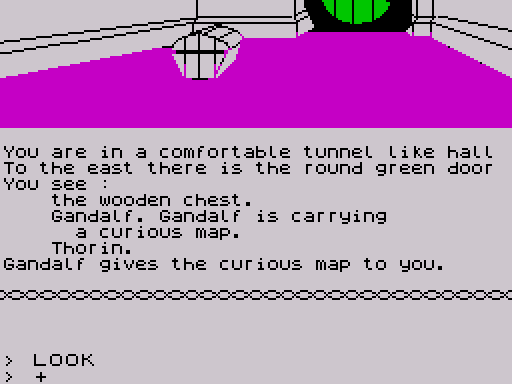 The opening LOOK after the key: the description scrolls the picture up; the input window shows the `> LOOK` the game typed itself. | 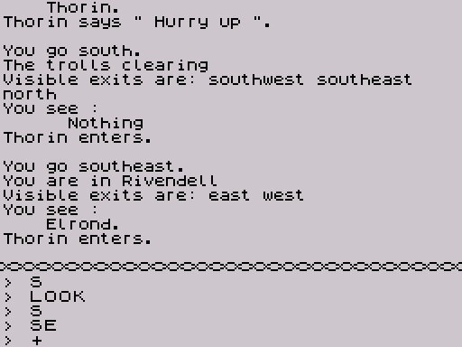 A location without a picture (Rivendell): text only. Thorin follows the player. |
| 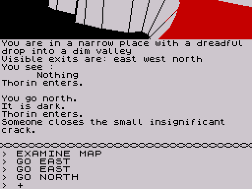 Moving into a dark place (the large dry cave, $0E): "It is dark." and "Someone" for an actor the player cannot see. | 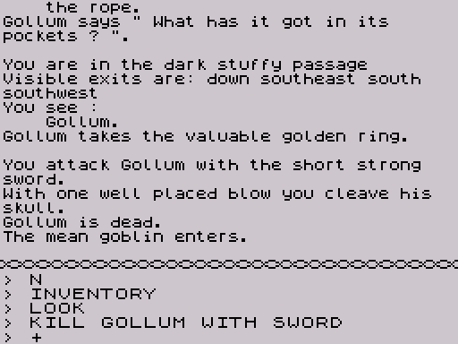 A fight: the player kills Gollum with the sword; a goblin enters. |
| 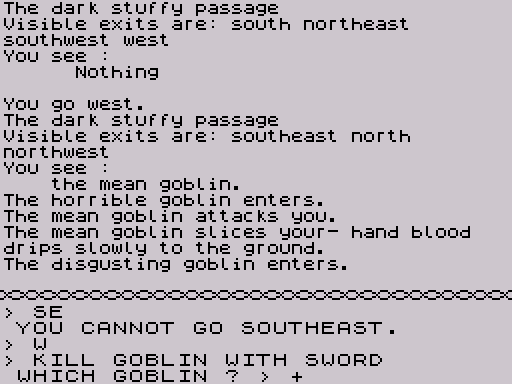 "WHICH GOBLIN ?": the parser asks in the input window and waits for the answer after the prompt. | 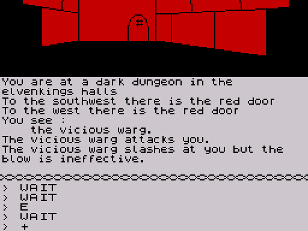 The dark dungeon ($1F) with the sword's light; the warg attacks. |
| 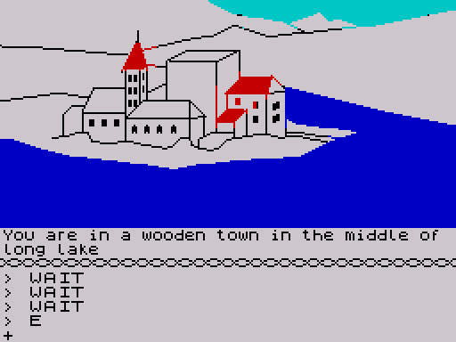 Lake Town: the picture stays until a key is pressed. | 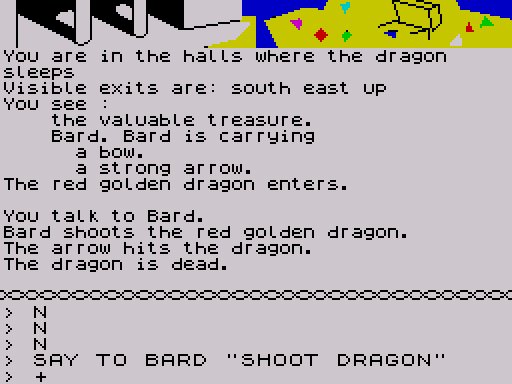 The dragon's halls: Bard, ordered with SAY TO, shoots the dragon. |
| 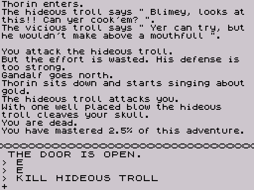 Killed by the hideous troll: "You are dead." and the score. | 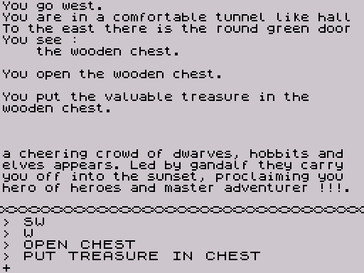 The end of `endgame.txt`: the treasure in the chest wins the game. |

### Edge case: a location with no exits

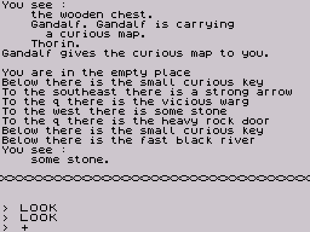

Location $2F (an "empty place", the place of the stone) has no exits: its
record is the 10-byte header and the $FF. The player cannot get there in
play ("THE PLACE IS TOO FULL FOR YOU TO ENTER." from $30, observed), but put
there by a poke, LOOK lists doors and objects that are not there:
[ListExitObstacles](../src/objects.asm#L1388) handles the first exit before it tests for the $FF,
so with no exits it reads the bytes of the next records as exits. RUN there
never returns ([VerbRun](../src/verbs.asm#L639) loops at $8FC1, observed), like F55.

## Map of the locations

Generated from the location records ([LocationTable](../src/world.asm#L179),
[Loc00None](../src/world.asm#L286)) by [scripts/locmap.py](../scripts/locmap.py); names are
the location's name phrase. An edge `a / b` joins two locations with exit a
one way and exit b back; a single arrow is a one-way exit. Dashed edges have
an obstacle object on the exit (door, river, web, crack, window, portcullis),
named after the directions, or are one of the five exits in
[BlockedExits](../src/world.asm#L2299) ("blockable"): [InitNewGame](../src/engine.asm#L608) closes one of them at
the start of every game; Elrond reading the curious map opens it again and
says where it is (F40). The grouping into regions is editorial, by name. Exits to $00 lead
to the empty location record; at the start of the game they are refused by
their obstacle ("YOU CANNOT GO SOUTH" at $19, "YOU CANNOT GO UP" at $21,
observed). Some exits are not reversible: the steep paths $4B-$4D only go
down, every exit of $13 but two leads to $10, and $29 and $2B both reach each
other going east.

```mermaid
flowchart LR
  subgraph "Bag End to Rivendell"
    L01["01 tunnel like hall"]
    L04["04 lonelands"]
    L05["05 trolls clearing"]
    L06["06 trolls path"]
    L07["07 trolls cave"]
    L09["09 rivendell"]
  end
  subgraph "Misty Mountains"
    L0A["0A misty mountain"]
    L0B["0B narrow place"]
    L0C["0C dangerous narrow path"]
    L0E["0E large dry cave"]
    L44["44 narrow path"]
    L45["45 narrow path"]
    L46["46 narrow path"]
    L47["47 narrow path"]
    L48["48 narrow path"]
    L49["49 narrow path"]
    L4A["4A narrow path"]
    L4B["4B steep path"]
    L4C["4C steep path"]
    L4D["4D steep path"]
    L4E["4E deep misty valley"]
    L4F["4F deep misty valley"]
  end
  subgraph "Goblin caves"
    L0D["0D goblins dungeon"]
    L0F["0F dark stuffy passage"]
    L10["10 big goblins cavern"]
    L11["11 deep dark lake"]
    L12["12 dark winding passage"]
    L13["13 inside goblins gate"]
    L14["14 outside goblins gate"]
    L34["34 dark stuffy passage"]
    L35["35 dark stuffy passage"]
    L36["36 dark stuffy passage"]
    L37["37 dark stuffy passage"]
    L38["38 dark stuffy passage"]
    L39["39 dark stuffy passage"]
    L3A["3A dark stuffy passage"]
    L3B["3B dark stuffy passage"]
    L3C["3C dark stuffy passage"]
    L3D["3D dark stuffy passage"]
    L3E["3E dark stuffy passage"]
    L3F["3F dark stuffy passage"]
    L40["40 dark stuffy passage"]
    L41["41 dark stuffy passage"]
  end
  subgraph "Beorn and Mirkwood"
    L15["15 treeless opening"]
    L16["16 beorns house"]
    L17["17 forestriver"]
    L18["18 forest gate"]
    L19["19 bewitched gloomy place"]
    L1A["1A spider threads place"]
    L1B["1B smothering forest"]
    L1C["1C levelled elvish clearing"]
    L1D["1D deep bog"]
    L2E["2E forest road"]
    L02["02 forest road"]
    L03["03 forest"]
    L08["08 running river"]
    L2D["2D waterfall"]
    L30["30 mountains"]
    L31["31 great river"]
    L32["32 green forest"]
    L42["42 west bank"]
    L43["43 east bank"]
  end
  subgraph "Elvenking's halls"
    L1E["1E elvenkings great halls"]
    L1F["1F dark dungeon"]
    L20["20 elvenkings cellar"]
  end
  subgraph "Long Lake"
    L21["21 forestriver"]
    L22["22 long lake"]
    L23["23 lake town"]
    L24["24 running river"]
  end
  subgraph "Lonely Mountain"
    L25["25 dragons desolation"]
    L26["26 dale valley"]
    L27["27 front gate"]
    L28["28 ravenhill"]
    L29["29 lower halls"]
    L2A["2A sidedoor"]
    L2B["2B smooth straight passage"]
    L2C["2C lonely mountain"]
    L2F["2F empty place"]
    L33["33 empty place"]
  end
  L00["00 empty record"]
  L01 <-.->|"e / w: round green door"| L04
  L02 <-->|"e / w"| L03
  L02 <-->|"w / e"| L2E
  L03 <-->|"e / w"| L2D
  L04 <-->|"e,n / sw"| L05
  L04 -->|"ne"| L06
  L05 <-->|"n / s"| L06
  L05 <-->|"se / w"| L09
  L06 <-.->|"n / s: heavy rock door"| L07
  L08 -->|"w"| L03
  L08 <-->|"n / s"| L2D
  L09 <-->|"e / w"| L0A
  L0A <-.->|"e / w (blockable)"| L0B
  L0A <-->|"n / s"| L44
  L0A <-->|"s / n"| L49
  L0B <-->|"e / w"| L0C
  L0B <-->|"n / s"| L0E
  L0C <-->|"e / sw"| L16
  L0D <-.->|"n / se: goblins door"| L10
  L0D <-.->|"w / n: window"| L12
  L0E <-.->|"d / u: small insignificant crack"| L0F
  L0F <-->|"s / n"| L34
  L0F <-->|"ne / e"| L3A
  L10 <-->|"ne / sw"| L12
  L10 <-->|"d / u"| L39
  L11 <-->|"n / s"| L37
  L12 <-->|"se / n"| L3F
  L13 -->|"w,n,s,e,se,sw,d,nw"| L10
  L13 <-.->|"u / d: goblins back door"| L14
  L13 <-->|"ne / e"| L41
  L14 <-.->|"e / w (blockable)"| L15
  L15 -->|"e"| L16
  L16 -->|"nw"| L14
  L16 <-->|"ne / w"| L18
  L16 -->|"s"| L2E
  L16 <-.->|"n / s (blockable)"| L31
  L17 -.->|"se: fast river"| L21
  L17 <-->|"n / se"| L30
  L18 <-.->|"e / w (blockable)"| L19
  L18 <-->|"s / n"| L2E
  L19 -.->|"s: fast black river"| L00
  L19 <-->|"e / w"| L42
  L1A <-.->|"s / n: spider web"| L1B
  L1A <-.->|"n / e: spider web"| L1C
  L1A <-.->|"e / w: spider web"| L1D
  L1A <-.->|"w / ne: spider web"| L32
  L1B -.->|"w: spider web"| L32
  L1C -->|"w"| L19
  L1C <-.->|"ne / w: magic door"| L1E
  L1E <-.->|"e / w: red door"| L1F
  L1E <-->|"s / n"| L20
  L1F <-.->|"sw / ne: red door"| L20
  L20 -.->|"d: large trap door"| L21
  L21 -.->|"u,s: fast river, large trap door"| L00
  L21 <-.->|"e / nw: strong portcullis"| L22
  L22 <-.->|"e / n,s,e,w (blockable)"| L23
  L22 <-->|"n / s"| L24
  L22 -->|"s"| L2D
  L24 <-->|"u / d"| L25
  L25 <-->|"n / s"| L26
  L26 <-->|"n / s"| L27
  L26 -->|"nw"| L28
  L27 <-->|"w / e"| L28
  L27 <-->|"n / s"| L29
  L28 -->|"se"| L25
  L28 <-->|"n / s"| L2A
  L29 <-->|"e / e"| L2B
  L29 <-->|"u / d"| L2C
  L2A <-.->|"e / w: mountains side door"| L2B
  L2A <-->|"n / s"| L33
  L2C -->|"s"| L27
  L2C -->|"sw"| L28
  L2C -->|"w"| L2A
  L30 -->|"e"| L2F
  L30 <-->|"sw / ne"| L31
  L31 -->|"sw"| L0A
  L31 -->|"e"| L18
  L32 <-->|"w / e"| L43
  L33 -->|"u"| L2C
  L33 -->|"n"| L2F
  L34 <-->|"d / u"| L35
  L34 <-->|"u / d"| L36
  L36 -->|"sw"| L11
  L36 <-->|"se / ne"| L37
  L36 <-->|"s / w"| L40
  L37 -->|"w"| L3C
  L37 -->|"sw"| L3D
  L38 <-->|"sw / nw"| L3C
  L39 <-->|"n / s"| L3A
  L39 <-->|"w / se"| L41
  L3A <-->|"u / d"| L3B
  L3A -->|"se"| L3E
  L3B <-->|"s / n"| L3C
  L3C <-->|"se / nw"| L3D
  L3D -->|"n"| L36
  L3E -->|"e"| L3D
  L3F -->|"e"| L3A
  L3F <-->|"u / sw"| L40
  L40 <-->|"nw / n"| L41
  L42 <-.->|"e / w: fast black river"| L43
  L44 <-->|"ne / sw"| L45
  L44 <-->|"e / w"| L47
  L45 -->|"s"| L0A
  L45 <-->|"n / s"| L46
  L46 <-->|"se / nw"| L48
  L47 -->|"nw"| L45
  L47 <-->|"s / n"| L4A
  L48 -->|"sw"| L47
  L48 -->|"d"| L4B
  L49 <-->|"e / w"| L4A
  L4B -->|"d"| L4C
  L4C -->|"d"| L4D
  L4D <-->|"d / u"| L4E
  L4E <-->|"e / w"| L4F
  L4F -->|"u"| L4A
```
