# 9. The pictures as vectors

The 22 location pictures of [07-graphics](07-graphics.md) again, as SVG
drawn from the same commands by [scripts/vector.py](../scripts/vector.py):
lines as paths, fills as polygons, the paper as rectangles. They scale
without pixels and without attribute clash.

## From commands to shapes

The script runs the commands through stage 4's interpreter
([game/hobbit/pictures.py](../game/hobbit/pictures.py)), which draws them
as the game does ([5f](05-pictures.md)), and takes a shape from each command
as it goes:

- **Lines.** The lines drawn on from one pen (no move between them) are one
  path through the centres of their pixels. Curves are chains of short lines
  that meet with a 1-pixel step; the path is simplified (Douglas-Peucker,
  1 pixel), which makes them smooth. The path follows the pixels, not the
  slope stored in the command: a line of 57 steps with one step up every 57
  plots a row of 57 pixels and only then steps up, and the fills next to it
  are bounded by that row.
- **Fills.** A fill command is a colour and a seed point; its shape is
  wherever the scan-line fill spreads. The script runs the fill and takes
  the pixels it lit, the pixels of the outlines drawn for it (which show in
  its colour, below) and half a pixel into the other lit pixels around them
  and past the edge of the area, so that the region reaches under the lines
  that stay black. It traces the boundary of the region into closed loops
  (each pixel a unit square; holes come out the other way round, so the
  nonzero fill rule keeps them holes) and simplifies them one-sidedly: an
  edge may move up to 1.5 pixels out of the region, which turns a staircase
  into its outer edge, but only half a pixel into it, so no paper shows
  between a fill and its lines.
- **Paper.** The paper of every attribute cell at the end, one rectangle per
  run of cells of one paper in a row.

The SVG draws the paper, then the fills in order, then the lines.

## Colours

The Spectrum shows each pixel in the ink of the last pixel plotted in its
8x8 cell. The vectors give each shape its own colour instead:

- a fill: its ink; 7 - ink where that is the paper of its seed's cell
  ([PlotPixel](../src/drawing.asm#L592)'s rule: the pot of $05 at night is a
  black fill on black paper, white);
- a line: black, white on black paper (the same rule);
- but a line that bounds a fill drawn after it takes that fill's colour
  where it touches the fill, and in the cells the fill inked where another
  of the fill's outlines is within two pixels: out to the tips where two
  outlines meet past the fill, as at the horns of the moons of $1A and
  $26, but not along a wall that goes on below a roof ($23);
- and a fill seeded on a pixel already lit, which lights nothing new, only
  plots a few pixels and so gives its cells its ink: everything lit in
  those cells is drawn again in its colour. Seven fills do this: five make
  the black spire in front of the mountain ($27) green, cell by cell, two
  are by the pot of $05.

The third rule came from comparing the vectors with the renders. A picture
draws the outline of a region first and fills it after; the fill gives the
cells along the outline its ink, so the outline shows in the fill's colour
and the edge is only the edge of the colour: the floor of Bag End ($01)
meets the wall without a black line, the red ground of the trolls' clearing
($05) has no box around the pot. The lines drawn after the fills are the
black ones meant to be seen, like the chest on the floor of $01. With every
line black, the vectors showed the hidden outlines (observed: the first
version of the script); with only the pixels next to the fill coloured,
the horns of the moons kept black tips (observed: the second).

Not kept: the clash itself. Where a black line crosses a cell of a fill it
does not bound, the Spectrum turns the fill's pixels in that cell black, or
the line turns the fill's colour (the red curves in the trolls' path, $06);
the vectors keep the fill and the line in their own colours. The border is
left out, as in the renders, and no picture sets BRIGHT.

The simplification costs detail below a pixel: the round tops of the arches
in $29 have fewer corners, and parts of a fill one or two pixels wide come
out as slivers and specks (the left side of the mountain in $27). The 23 SVGs
(with $05 after dawn) take 196K, against 10008 bytes of commands for the 22
pictures.

## The pictures

In id order; the Spectrum renders are the ones of
[07-graphics](07-graphics.md).

| Id, location | Spectrum | Vector |
| --- | --- | --- |
| [Picture01](../src/pictures.asm#L78) tunnel like hall | 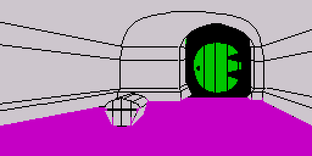 | 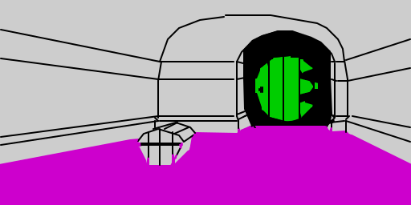 |
| [Picture04](../src/pictures.asm#L2794) lonelands | 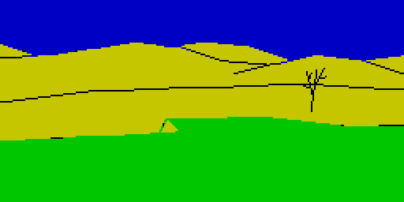 | 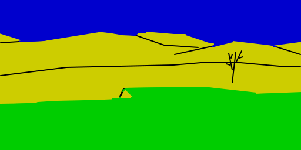 |
| [Picture05](../src/pictures.asm#L2469) trolls clearing | 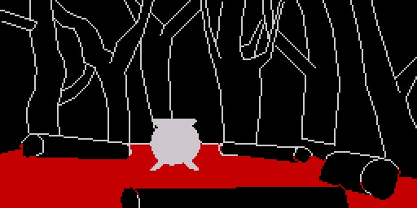 | 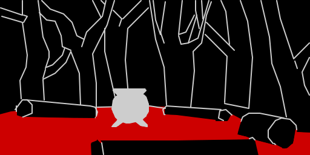 |
| [Picture05](../src/pictures.asm#L2469) after dawn |  | 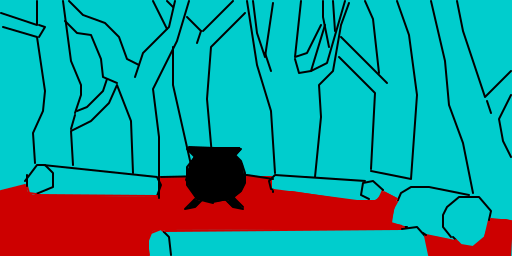 |
| [Picture06](../src/pictures.asm#L463) trolls path | 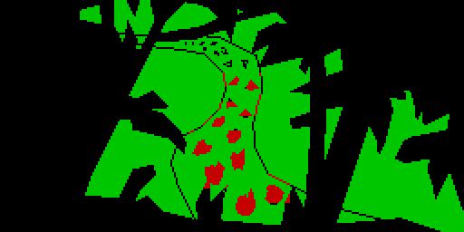 |  |
| [Picture07](../src/pictures.asm#L1554) trolls cave | 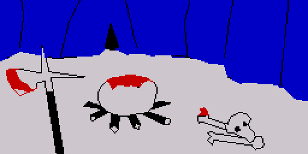 | 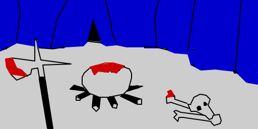 |
| [Picture08](../src/pictures.asm#L3763) running river | 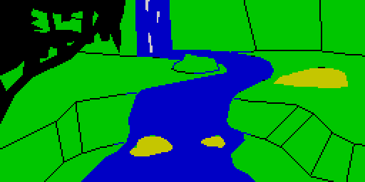 | 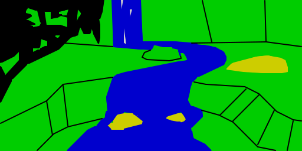 |
| [Picture0B](../src/pictures.asm#L771) narrow place | 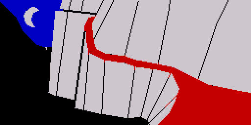 | 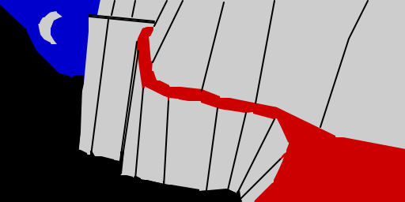 |
| [Picture0D](../src/pictures.asm#L2338) goblins dungeon | 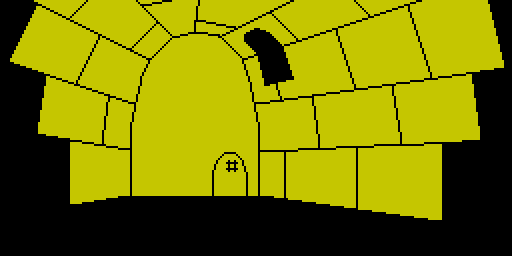 | 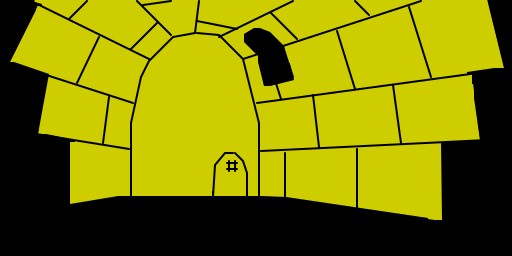 |
| [Picture10](../src/pictures.asm#L3133) big goblins cavern | 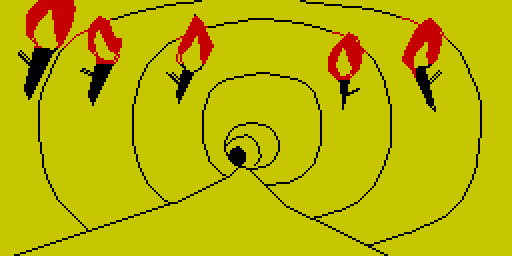 | 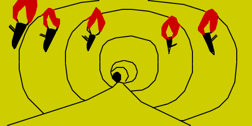 |
| [Picture18](../src/pictures.asm#L1831) forest gate | 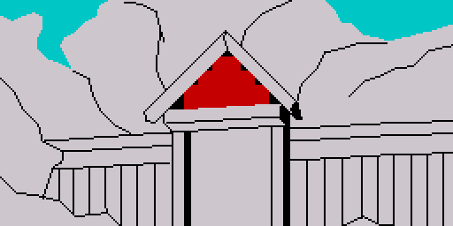 | 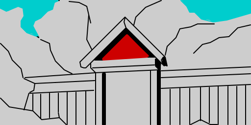 |
| [Picture19](../src/pictures.asm#L3491) bewitched gloomy place | 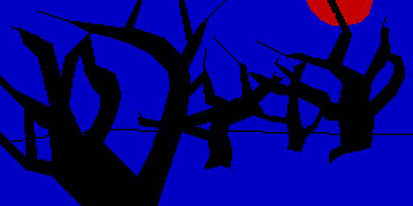 | 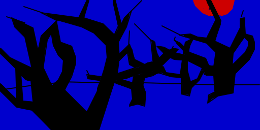 |
| [Picture1A](../src/pictures.asm#L4192) spider threads place | 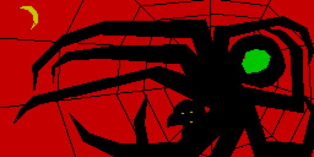 | 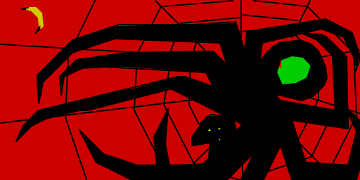 |
| [Picture1C](../src/pictures.asm#L2516) levelled elvish clearing | 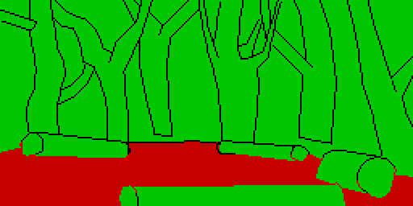 | 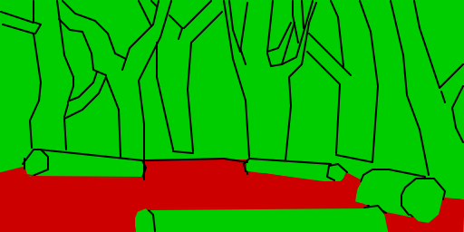 |
| [Picture1F](../src/pictures.asm#L2357) dark dungeon | 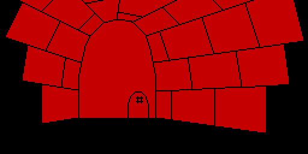 | 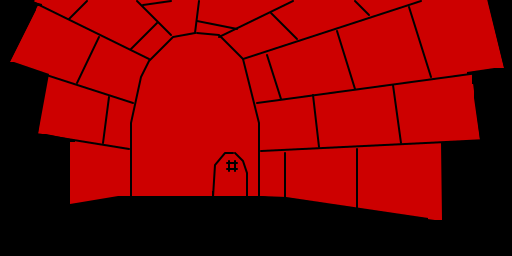 |
| [Picture20](../src/pictures.asm#L2851) elvenkings cellar |  | 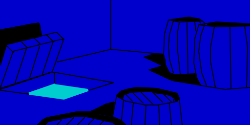 |
| [Picture23](../src/pictures.asm#L2037) lake town | 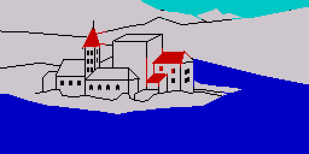 |  |
| [Picture25](../src/pictures.asm#L895) dragons desolation | 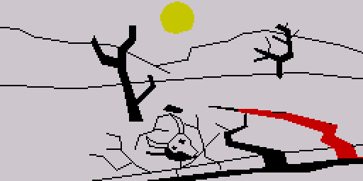 | 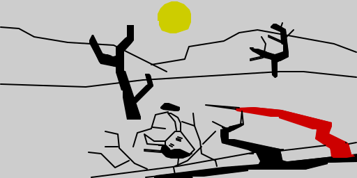 |
| [Picture26](../src/pictures.asm#L1326) dale valley | 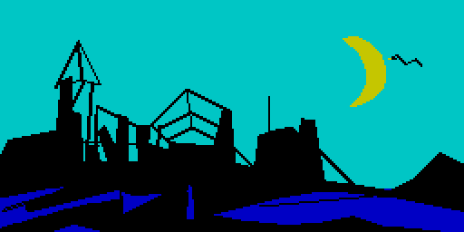 | 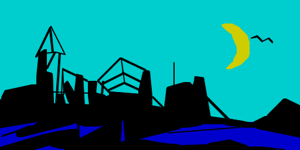 |
| [Picture27](../src/pictures.asm#L4414) front gate | 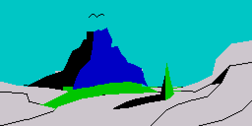 | 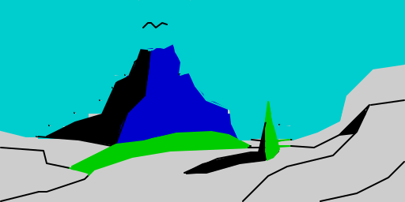 |
| [Picture29](../src/pictures.asm#L4000) lower halls | 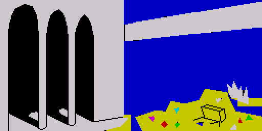 | 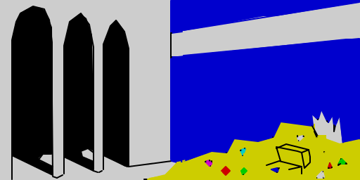 |
| [Picture2B](../src/pictures.asm#L1158) smooth straight passage | 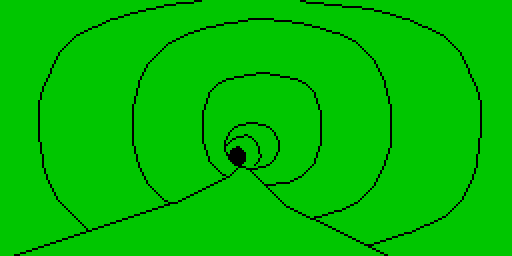 | 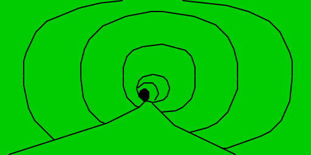 |
| [Picture31](../src/pictures.asm#L321) great river |  | 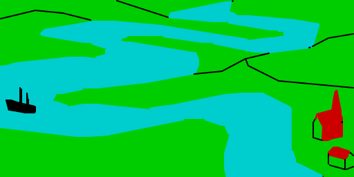 |

Made by `python3 scripts/vector.py` from the project root, which needs
`game/assets/pictures/` (`make game/assets/state.json`).
