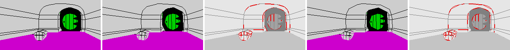
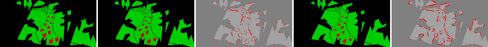
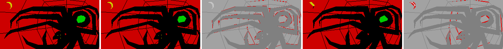
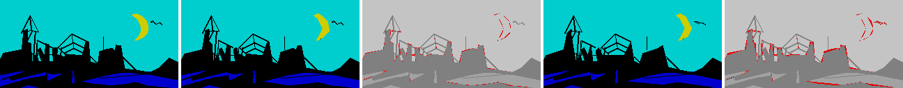

# 10. Smaller pictures

The 22 pictures take 10008 bytes of commands ([5f](05-pictures.md)). This
chapter measures how small they get with a different drawing language and
encoding, when drawing time does not count and some loss is allowed: 36%
smaller with every picture drawn exactly as before, 41% smaller when lines
may move by one pixel.

Every number here comes from [scripts/picdsl/run.py](../scripts/picdsl/run.py).
It reads the pictures from [src/pictures.asm](../src/pictures.asm), encodes
them, decodes them back into the commands of stage 4's interpreter
([game/hobbit/pictures.py](../game/hobbit/pictures.py)), draws them and
compares every pixel with the original drawing: 23 drawings, `$05` also
after dawn. The interpreter's drawings of the original commands are the
Z80's, pixel for pixel (compared with the renders of
[07-graphics](07-graphics.md)). Nothing in `src/`, `port/` or `game/` is
changed. The SVGs of [09-vector](09-vector.md) are drawn from the commands
and are not part of this.

## Where the bytes go

| Command | Count | Bytes | Share |
| --- | ---: | ---: | ---: |
| line | 3271 | 6542 | 65% |
| move | 887 | 2661 | 27% |
| fill | 178 | 534 | 5% |
| paint | 19 | 211 | 2% |
| headers and ends | | 60 | 1% |

- A line spends 15 bits on its direction, length and slope, but the values
  are far from even: 484 of the 4096 pairs of length and slope occur, and
  lines of 3 to 5 steps are a third of all. Counting how often each value
  occurs gives about 10 bits per line.
- A move is 3 bytes with absolute coordinates, though 332 of the 887 land
  within 15 pixels of the pen.
- A fill names its seed absolutely, but any pixel of the region it fills
  does the same: the scan-line fill fills the same runs from any of them.
- Shapes repeat: the big goblins' cavern (`$10`) draws 163 commands the same
  way as the smooth straight passage (`$2B`), at the same place; Lake-town
  (`$23`) draws its rows of windows with the same strokes.
- The bytes themselves repeat little: ZX0, the usual Spectrum compressor,
  saves 18% over the whole block and 11% picture by picture.

## The steps

Each step builds on the one before; the table under
[Results](#results) has their sizes.

**ZX0** ([lz.py](../scripts/picdsl/lz.py)): the original bytes in the ZX0
format. The sizes come from an optimal parse of our own, an upper bound of
what zx0 itself would get. One block of all the pictures needs a 10K buffer
to unpack into, which a 48K game does not have; picture by picture, the
buffer is the size of the largest one (778 bytes).

**Clean-up** ([clean.py](../scripts/picdsl/clean.py)): rewrites that leave
every drawing the same, each one checked by drawing. 185 pairs of lines in a
row become one line (a single line that plots the same pixels and leaves the
pen in the same place), 3 moves that no line uses and 4 commands that plot
nothing new are dropped: 9622 bytes in the original format.

**A new language** ([model.py](../scripts/picdsl/model.py),
[gamma.py](../scripts/picdsl/gamma.py)): the commands depend on the pen,
so a shape drawn again elsewhere is written the same way.

- `move +dx +dy` relative to the pen when that is shorter, else
  `move to x y` (401 of 883 moves are relative);
- `fill ink +dx +dy`: the seed relative to the pen, moved to the pixel of its
  region nearest the pen (81 of 176 fills come within 3 pixels);
- `line`: the same three values, a straight or diagonal line always written
  the same way (each has two spellings in the original);
- a move always starts a path: the token after it is a line and needs no
  type;
- `then`: go on with the next picture, as the original does ([5f](05-pictures.md),
  Sharing).

The tokens are bits: the type in a prefix code chosen by the type before (14
bytes of tables), one bit when a line keeps the octant of the line before,
lengths, slopes and offsets in exp-Golomb codes: 7274 bytes. A decoder needs
a bit reader and no model.

**Reuse** ([reuse.py](../scripts/picdsl/reuse.py)): `copy D back, N` repeats
N tokens from D tokens back, a loop when D < N; `call P from S, N` takes N
tokens of an earlier picture P. The parse is optimal for estimated bit
costs (a type's code depends on the tokens around it): 62
copies (13 of them loops) and 62 calls, the largest the 160 tokens `$10`
calls from `$2B`. 6906 bytes. The windows of Lake-town:

```
move 50 60          move to 50 60
line dr 4 4         line dr 4 4
move 51 60          copy 24 back, 2       (move +0 +4, line dr 4 4)
line dr 4 4         copy 2 back, 2
move 52 60          move +4 +4
line dr 4 4         line dr 4 4
move 57 60          copy 6 back, 10       (a loop: six more strokes)
line dr 4 4
...                 
move 66 60
line dr 4 4
```

Left, the 18 commands in the words of `game/assets/pictures/23.txt`, 45
bytes; right, the 7 tokens that replace them.

**Range coder** ([rc.py](../scripts/picdsl/rc.py)): the same tokens through
an adaptive binary range coder (LZMA's), every field bit coded with a
probability that learns from the bits before it in the same context: the
type by the type before, the octant by the octant before, a line's slope by
its length. Each picture coded alone: 6394 bytes. All pictures as one stream,
which means decoding every picture before the one drawn: 6158.

**Refit** ([lossy.py](../scripts/picdsl/lossy.py)): lossy. Each path (the
lines from one move) is drawn again with the lines that take the fewest
bits, every new pixel within 1 (or 2) pixels of the old path and every old
pixel within that of the new one; the ends of the path stay. A refit is kept
only if the drawing changes in a few pixels more (at most 2 per pixel of the
path) and in no square of 3 by 3 (5 by 5) pixels: a moved line changes a
strip, while a fill that gets out through a gap, a small region whose outline
closes up or a cell whose ink changes changes a block. 2524 of the 3084
lines are left at 1 pixel, 2430 at 2.

## Results

| Approach | Bytes | Saved | Pixels changed |
| --- | ---: | ---: | ---: |
| Original format | 10008 | | 0 |
| ZX0, all pictures in one block | 8166 | 18.4% | 0 |
| ZX0, each picture | 8897 | 11.1% | 0 |
| Cleaned, original format | 9622 | 3.9% | 0 |
| Cleaned, ZX0 each picture | 8764 | 12.4% | 0 |
| Tokens, fixed codes | 7274 | 27.3% | 0 |
| Tokens + reuse, fixed codes | 6906 | 31.0% | 0 |
| Tokens + reuse, range coder, each picture | 6394 | 36.1% | 0 |
| Tokens + reuse, range coder, one stream | 6158 | 38.5% | 0 |
| Refit 1 px, fixed codes + reuse | 6205 | 38.0% | 1.72% |
| Refit 1 px, range coder, each picture | 5915 | 40.9% | 1.72% |
| Refit 1 px, range coder, one stream | 5717 | 42.9% | 1.72% |
| Refit 2 px, fixed codes + reuse | 6101 | 39.0% | 2.34% |
| Refit 2 px, range coder, each picture | 5798 | 42.1% | 2.34% |
| Refit 2 px, range coder, one stream | 5613 | 43.9% | 2.34% |

The share of pixels changed is of the 23 drawings of 256x128. Most of the
saving is in the clean-up, the language and its codes (27%); reuse adds 4%,
the range coder 5%, the refit at 1 pixel 5% more and at 2 pixels another 1%.

Per picture, in bytes, with the range coder:

| Picture | Original | Lossless | 1 px | 2 px |
| --- | ---: | ---: | ---: | ---: |
| 01 | 564 | 367 | 344 | 337 |
| 31 | 315 | 247 | 231 | 220 |
| 06 | 668 | 418 | 377 | 350 |
| 0B | 281 | 207 | 196 | 189 |
| 25 | 590 | 399 | 375 | 361 |
| 2B | 350 | 196 | 149 | 140 |
| 26 | 535 | 365 | 346 | 332 |
| 07 | 638 | 417 | 391 | 385 |
| 18 | 465 | 324 | 312 | 310 |
| 23 | 691 | 364 | 338 | 326 |
| 0D | 29 | 24 | 22 | 19 |
| 1F | 249 | 186 | 179 | 179 |
| 05 | 93 | 53 | 44 | 53 |
| 1C | 607 | 400 | 370 | 366 |
| 04 | 124 | 98 | 101 | 99 |
| 20 | 618 | 386 | 330 | 342 |
| 10 | 778 | 245 | 222 | 235 |
| 19 | 592 | 400 | 377 | 368 |
| 08 | 517 | 355 | 324 | 309 |
| 29 | 446 | 313 | 297 | 286 |
| 1A | 485 | 369 | 342 | 347 |
| 27 | 373 | 261 | 248 | 245 |

`$10` drops to a third: 160 of its tokens are one call of `$2B`. `$04` comes
out larger after the refit, and some pictures larger at 2 pixels than at 1
(`$05`, `$10`, `$1A`, `$20`): the copies and calls they had no longer match,
and the range coder learns each picture from nothing.

## The pictures after the refit

Original, 1 pixel, what changed (red), 2 pixels, what changed:









At 1 pixel the pictures read the same: lines move by a pixel, the edges of
the fills with them, and a cell here and there takes another ink. At 2
pixels small things lose their shape: the birds over Dale (`$26`) become a
dash, the moon of `$1A` a sliver, the round stones on the trolls' path
(`$06`) polygons. All 22 are made by `run.py` in
`build/picdsl/compare-NN.png`.

## Tried and dropped

Measured and not kept, as they saved little:

- **Lines as end points.** 71% of the sloped lines have the slope
  `n div m` (m the minor steps: the end point decides it, likely the
  artist's tool's rule) and 19% the smallest slope with the same end. Coding
  the end point and which slope cost more than the slope itself in the
  adaptive model (4457 against 4153 bytes for the lines).
- **Turtle lines.** The slope as a turn from the line before: 4504 against
  4153 bytes.
- **Moves to an earlier point.** 362 moves land within a pixel of a point
  where an earlier line started or ended; naming that point and the pixel
  next to it saves about 130 bytes.
- **Mirrored copies.** About 110 tokens repeat an earlier run mirrored, most
  in the arches of `$2B`, which `$10` already calls: about 50 bytes.
- **Curves.** Quadratic Beziers drawn as short lines, fitted in the refit:
  about 140 bytes more than lines alone, before any drawing check.
- **Adaptation by counts** in the range coder (fast at first, slower
  later): about 80 bytes.
- **Refit by the number of lines** instead of bits: 46 bytes more with the
  range coder and 135 with the fixed codes, for a quarter fewer pixels
  changed. Without the square check, a torch of `$10` lost its yellow core
  at 1 pixel (its outline closed up) and, with 3 pixels allowed per path
  pixel, a block of the door of `$01` turned magenta at 2 pixels; with 1
  allowed, so many paths were rejected that 2 pixels came out larger than 1.

## On the Spectrum

None of this is written in Z80 code. A decoder would turn a picture back
into the original commands in a buffer and call
[RunPictureCommands](../src/drawing.asm#L77), so the drawing routines (730
bytes) stay. The buffer is the size of the largest picture with the one it
goes on into: 724 bytes (`$10` after the clean-up); no refitted line falls
outside the original format. ZX0's standard decompressor takes 68 bytes. The fixed codes need a bit reader, exp-Golomb decoding, the 14 bytes
of type tables, the pen (relative moves and seeds) and the earlier tokens
for the copies and calls. The range coder needs more code and about 1000
probabilities of 2 bytes in RAM, and decodes bit by bit: slow, but drawing
time did not count here.

## Running it

`python3 scripts/picdsl/run.py` from the project root, about 4 minutes:
the sizes, `build/picdsl/results.md` and the comparison images; `--docs`
also writes the four images above. It needs `src/pictures.asm` and `game/`,
not the tape.
