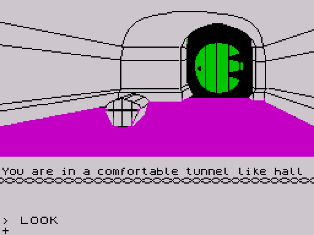

# The Hobbit (ZX Spectrum, 1982): how it works

*The Hobbit* (Beam Software / Melbourne House, 1982; version 1.2 for the 48K
Spectrum) is a text adventure with pictures in which the other characters act
on their own. This article explains, from the sources in [`src/`](../src/)
that rebuild the original tape byte for byte, how it does that in 40K: a
562-word dictionary of 5-bit letters shared by the parser and a message
bytecode; a parser that turns English sentences with AND, THEN, ALL, EXCEPT
and IT into commands; one command dispatcher that runs every command twice,
first to check and then to act, for the player and for 17 scripted
characters alike; 10 turn timers for the events of the story; and 22
location pictures stored as line and flood-fill programs. It also lists what
the reverse engineering found at the edges: a score that cannot pass 75%,
fight messages read from the ROM, a word that overwrites code, orders that
reach the wrong character, an exit that a saved game forgets. The work was
done blind, without any earlier disassembly or description of the game.

## Contents

1. [Overview](01-overview.md): the game, the hardware it uses, how it loads,
   the memory map
2. [Data structures](02-data.md): dictionary, messages, command table, phrase
   records, locations, objects, characters, timers
3. [The start of a game](03-title-and-menu.md): title key, pictures on or
   off, the random seed, the opening LOOK
4. [The main loop and a turn](04-game-loop.md): the line editor, the idle
   WAIT, the two passes of a command, what a turn contains, timing
5. Subsystems
   - [5a. The parser](05-parser.md): words, phrases, AND/THEN/ALL/EXCEPT,
     nouns, questions, SAY TO
   - [5b. Text](05-text-and-screen.md): the message bytecode, the two
     windows, the 42-column font
   - [5c. The world](05-world.md): locations and exits, obstacles, holders
     and containers, weight and size, light and darkness
   - [5d. Characters](05-characters.md): the script language, events,
     orders, fights, death
   - [5e. Time](05-time.md): turns, timers, random numbers
   - [5f. Pictures](05-pictures.md): the drawing commands, lines, flood fill,
     colour
   - [5g. SAVE, LOAD and the printer](05-save-and-printer.md)
   - [5h. The end and the score](05-end-and-score.md)
6. [Tricks, quirks and bugs](06-tricks.md)
7. [Graphics](07-graphics.md): the loading screen, the font, all 22
   pictures, screens in play, a map of the 80 locations
8. [Porting notes](08-porting.md)

## How to read the links

Names in the text link to the sources: `[RunNpcScripts](../src/engine.asm#L765)`
opens the routine with its full description. Claims marked *verified* were
seen in the simulator (SkoolKit's, driven by [`tools/zxrun.py`](../tools/zxrun.py))
or in a byte check; *inferred* ones come from reading the code. The `F`
numbers refer to [`re/findings.md`](../re/findings.md), where each claim has
its evidence. The images are made by
[`scripts/docs-images.sh`](../scripts/docs-images.sh).
